# UCB《数据科学中的计算结构｜CS 88 Computational Structures in Data Science 2022》中英字幕 p21 CS 88 Spring 2022 - Lecture 21 - 4_13_2022.zh_en [BV1516iBfEVY_p21]

Let's get started。 Just alright， cool， looks like everything's on zoom。

Let's do。Transcripts on。All right， cool so。today。com on Powerpoint。All right。

 so today we're going to talk about iterators and generators and Python。

We're going to use a fair number of terms today， just a fair bit of warning。

 we're going to talk about iterators， iterables， generators， sequences。

 all of these things have slightly different meanings in Python and at some point you will feel like it is impossible to keep them straight。

And that's okay， I will fully admit that the terms that Python uses。

 like all terms they have specific meanings， they are useful terms to be aware of memorizing them is not the point if you feel like you need to review what the specific meaning of x Y or Z is。

 that is okay。You know， if you're a professional working in a Python codeb。

 you would probably just get used to them day in and day out。 But given that that's none of us here。

 like， you know， Googling them， looking something up and so on is， is totally fine。

 What I think is really cool， though， about this topic is。😊。

Today is one of the places where when we talk about iterators and generators and what these things are to Python。

 a again， we're not we're talking about them in the context of Python。

 but this idea of streams of data applies in a lot of different programming languages。

 but today is where we actually get to learn about why it is that we have to call list to see the results of a map function when we use map。

 we get to see a little bit about how the for loop in Python works and what it means to say for some item in some list and so on。

 And so today think is really cool because we're going to look at some of the tools that Python has that lets us build objects and build structures in our own programs that operate again。

 more like native Python objects。 So naturally we're going to do that。

By looking at some magic methods， some of these are it and next。

 we're going take another look at the get item method that we saw with the linked list and how that works。

But what we're going to really be talking about is this idea of what it means to sort of lazily evaluate some data or a stream of data that when we say a range from 0 to 100。

 we know that that represents 100 numbers。But what does it mean to sort of generate one number at a time。

 or just always the next value in a sequence。 And so today。

 what we're going to do is look at sort of how we。How we explore some of the tools that Python gives us to。

 to design our own objects。 allll be doing some demoing。

 There is a lot of code in the notebook and Python files that are uploaded。

 We're not going to go through all of it。 There's just a whole bunch of additional examples that are there。

 So don't feel like you need to memorize all of it。

 But if you're looking for more practice more examples and so on。 so。In the past。

 we've been talking a lot about object oriented design， we've talked about abstract data types。

 we've talked on Monday about exceptions and error handling， raising and asserting。

 and we've talked about sort of just designing interfaces that sort of communicate more intention about the problem that we're trying to solve。

And today， iterators and generators are another form。Or those interfaces Today。

 we're really going to be looking at tools for dealing with streams of data of things that have more than one value to them that are all sort of loosely related so far in CS 88。

 we've talked a lot about implicitly things that are sequences of data。

 again sequence here is sort of a specific Python term， it's not just a series of data。

 But when we talk about a sequence Python sort of uses the term ordered set things that are sequences in Python are。

 for the most part， these four things lists， tus ranges and strings。

And what makes them a sequence of data， it means that we can slice them so we can ask for items one to four in some array。

 we can ask for membership in the set so I can say is CS88 in my list of courses。

I can concatenate sequences together。 so I could say add a whole bunch of lists together。

And you can also use the method count on a sequence so you could count how many of one item are in that sequence。

I honestly don't know if like you do three out of four of these things if Python tells you that it's a sequence。

 but roughly speaking， these are the things that you should be able to do with a sequence of data and what this means is that we can also do things like for each item in our sequence we can say iterate over all of those values in a sequence。

 whether it's a for loop or a while loop or something else。

Sequences are then a form of what we're going to call an iterable and an iterable in Python is just any object that you can iterate over。

 it's generally just a term for things that work inside a for loop。

 things that you could potentially implement in a while loop。

 we're not going to do too much of that today， although there are a couple examples in the slide。

And an iterator is just any object that represents this particular stream of data。

 so all of these things have iterator objects in Python Python oddly enough makes the distinction between like a list and a list iterator which is created when you want to iterate over the list we're not really going to get into that distinction so the distinction between iterable and an iterator is pretty fuzzy。

 but you'll see both terms and really what we're just talking about is being able to iterate over all of the items in a sequence。

 so in the past what we've done is we've used things like map filter in the maps project。

 which is not related to the map function you know we showed the zip function。

And and one of those cases in there with the zip function in particular。

 we actually simplified it a little bit by calling list of zip。 And so in the past in CS88。

 we've used all these tools that Python gives us， but we've sort of just been treating them like any other sequence。

 And that's one of the really nice things is that you can actually use map like any other sequence。

 You can just call list to see the results。 You can still say for item in map。

 you can print each item， you can pass a map to another map to a filter， whatever it is。

 So a lot of times the sequences of data。😊，I shouldn't call them sequences。 these。

 these other functions that are iterable types of data。

 We treat them as a sequence that it doesn't really matter that we can't index into a map。

 You might not have even realized that。 but， you know， I could say something like numbers。

 or let's actually call this squares。

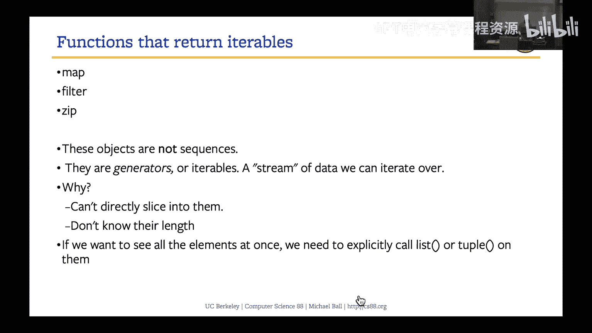

Because this is always our good example is let's say map。Lambda。呃，X。Wops， X。Times x。

What are we mapping in， let's say， range of 10。So if I want to do something like La。Of squares。

I actually get an error saying that our object of Tpemap has no length method。Similarly。I can't。

 I can't do something。Like get the first item of our list of our squares。 Of course。

 what I can do is what we normally do， right， which is call list。Turn this。

 this map object into an actual listed data， which I could then slice an index and get the length of and so on。

 So this is standard map sort of as we know it。 And the question is sort of。

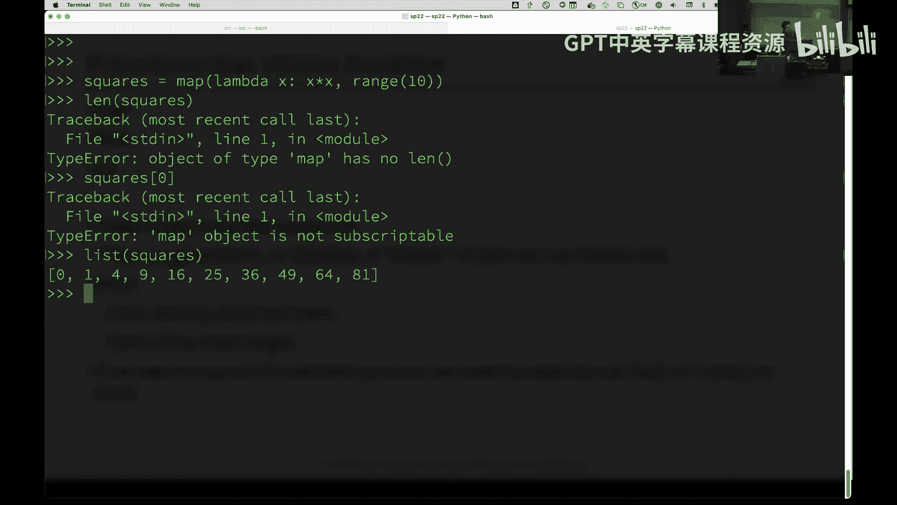

呃。Why is this thing not a sequence or why don't we call this a sequence？

 And it's because it turns out that map， what we said before and range has some of these abilities。

 But because it's implemented a little bit differently， we know the length and so on is。

Map generates each result on demand。 so map is what we call a generator in Python that is because it generates its results or its values each time we try and get the next value in a sequence and generators are a really neat and really useful topic so。

Aside from just calling list， list works perfectly fine， but you won't find it。

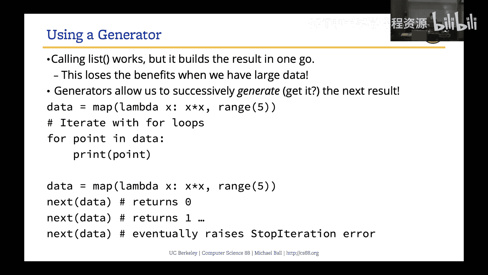

Very commonly used operation。 if you have a generator。 So the question is。

 if we don't want to just turn our data into a list of values。

 But instead we want to take advantage that each time we need a value from a generator。

 we could sort of compute it on demand。 Python gives us tools for that。 So again， one thing to note。

 and this will start to make a little bit more sense。After looking at some of the of the examples。

 But once we've gotten to the end of map， once we've made that list， right。

 if we want to start again， we need a new map object。

 And that's because the map object internally sort of tracks when it gets to the end of its computation。

 So I could say for numb。In squares。Whoops， if I type that correctly。For numb in squares。print。那么。

And we get， we get the values back up。 So that's something we've done before。 But today。

 what we're going to look at。Is this idea of。Using a generator as something that we could sort of have a little bit more control over。

 And once I show you this technique， I'm not going to go through and do it。

 but you could actually start to think about how you could implement your own for loop。

 Now that we've talked about exceptions。 We've talked about higher order functions。

 We're not going to talk about generators and iters after the next few sort of slides here。

 you'll be able to go through and sort of think about how could I implement something like my own for loop and Python。

 actually， what I'm going to do is just for simplicity。 I'm going to make this range 5。

 You'll see why in a second。So。If I look at squares。

I see that this is this thing called a map object。我。What being a generator。

Allows us to do is and we'll look at some of the the magic methods for implementing our own generators is it allows us to do this thing by calling next on our list of of squares so。

Next of squares will return 0。 So the first time I call next。That's our first item in our sequence。嗯。

This is the same。Even though you would probably never write this。

As calling squares dot next in this way。 And this next method is pretty cool， because。

What it allows me to do is whenever I want， I can just keep asking for the next item in our generator and internally while we're stopping here to chat。

 while there's other code working on our Python program。

Python isn't doing anything to make that computation happen。 So this is x squared， right。

 It's pretty trivial for a computer to multiply some numbers together。

 Like computers are great at doing that all day long。

 But perhaps you have something that is a little bit more computational intensive。

 you're working on some research results where you're doing a bunch of regression testing。

 you're doing a bunch of math， you're looking up data from a large data。

 whatever it might be where you want to control how this happens。

 And so generators give you a tool for that。 And so as I keep going through when we now have we should get five values back。

 So0，12，3，4。Squared， so it's 0 through 16。We can just keep calling next。

And the nice thing about next is what next does is。At the very end of our generator。

We get a stop iteration error back and so the last the last result that the next method should return is a stop or it should raise specifically a stop iteration error so we'll come back to that。

 but this idea of using next is our primary interface for how we work with an expression so if I if I now keep asking for。

The， the next item in our map series， we just get back the stop iteration error。

 And so if we have something that we know as a generator。

Now we know that we could write a for loop to access that。 We've seen that before implicitly。

 but now we also have this other method of using the next function to individually get access to each item as as it is generated on demand by that generator function。

 So before we go on and look at some other examples， stop for questions， yeah。Yeah。Yeah。哎。Yep。

 that's absolutely correct。It just does it one at a time， yeah。Yeah。Yep。Yeah。

 so in our for loop yeah in our for loop， what this is doing is it's doing one computation at time。

 so our for loop is just a way of calling next on whatever error in this case squares data。

 whatever we're iterating over is it calls next each time until it gets to that stop iteration error。

嗯。And then when it gets to the stop iteration error， our forlip stops itself。So， that's。Basically。

 it， it's still doing things on demand。 This is why。If I were to type something like R。

Is equal to range。If I type， yeah， range。I can。And actually， if I really want to， write。

 I can just make a really big。If you ever need to test something with big numbers。

 just like start squaring large numbers or raising something to really high power。

 I don't even want to know， but like this is a ridiculous number。

 So actually that might be too ridiculous because even just computing that one expression was apparently。

Was too many zeros。 So perhaps I gave it too ridiculous of a number。But， you know， let's。

Make it a little bit less large。嗯。This range is calculating some millions or billions of data points since I squared that or raised it to have power。

Wait， I can't。 range。 Oh， it doesn't actually。 Okay， yeah， range is actually funny in Python 3。

 It doesn't automatically return an iterator。So I will come back to this later， but。

We can call this it R is equal to iter。Of range。And now I can， I should be able to say next。It are。

Yeah， okay。 so range itself is actually a little bit funny。

 It doesn't implement one of the methods that we need to make it a perfect iterator。

 So I accidentally ski ahead。 But yeah， range does the same thing where really large numbers。

 It will just calculate them on demand。And map filter， the built and zip function。

 There's a few other tools in Python that that will do this。 why。Why I needed to do this。

 We'll actually get to in a few minutes。 So I'll come back to that。 But yeah。

 other questions about Elise thiss idea of using a map object calling next on something。 any。

 any other questions so far。Any questions on zoom。

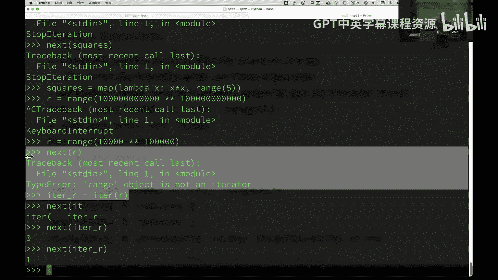

It was pretty quiet today。 Allright， so。That's using a generator。 Now， the question is。

 how are the way， how are some of the ways that you can make a generator object in Python and so。

We're also going to introduce today one new bit。Of， of syntax that that is pretty useful。

And this is called the yield keyword and so。A yield is。Kind of like a special version of return。

 but it doesn't actually return or exit from the function。Yield allows us to say， in Python。Do this。

 this computation。Return my result。 So in this case， return I squared。

 but keep the context of the function around so that someone can later on go and call and call next。

 So what we're going to do is。

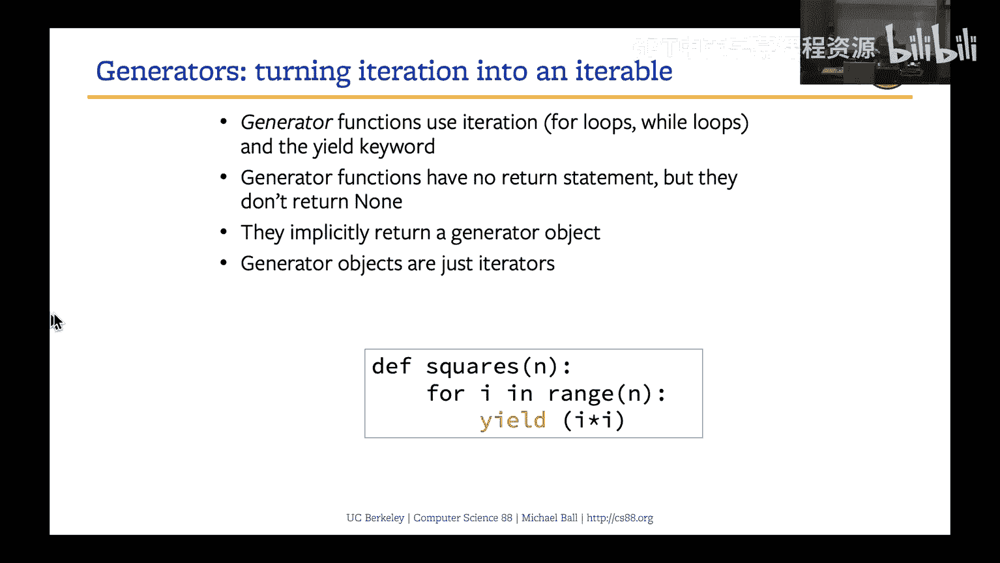

I'll come back to this example later。 we're going to make a generator now that just generates however many squares we need。

 so。So squares。It takes in the value n。We say4 I in range n。

So the nice thing here again is in our for loop， we're actually taking advantage of another you know sort of object in Python。

 but in this case， what we're going to say is instead of saying print or return or something we're going to say yield I times。

呃，I。And。The way that this will work is， I'm going to call this。Squares 5 is equal to。Squares with。

 with the value 5。 And so what squares 5 is going to do。

 because I've told you that this thing is a generator。We should now expect that if we look at this。

That we don't see a list of data results。If I now try and do something like squares 5 of 0。

I'll get some error saying that this is not subscriptable that we don't know how to index or slice this thing。

 But what I will now be able to do is the same thing I was able to do with my map object is next of squares。

five。And I'll get 0。I got one。We get 4， get 9。Get 16。And once again。

 I will get a stop iteration error。 And so every time we use yield。

 this now gives us control in our own code。To instead of returning a result。

 allow the next function to get that value， return it to whoever called next。

 and then hold its position so that we can continue that computation later on。

I sort of exhausted the value of our generator， but just to show that they work so the same way is we can say list。

Of squares 5。And by calling list of a generator in the same way that it worked with map。

 it works with anything else that uses yield and what is our list function doing Well。

 our list function is doing。Pretty much what any other code in Python that uses generator is doing it is internally repeatedly calling that next function。

 shoving that data in some list that it creates。Doing this until we get the stop iteration error。

 And then when it gets stop iteration error， it returns that list back to you or whomever else sort of asked for it。

 And so but。so basically what we have here is the next function allows us to access the values in that iterator and yield is this new piece of syntax up here that allows us to incrementally return each result。

 and this is how you can make your own sets of data that incrementally do things in CS 88 we don't talk about processes on your computer running in parallel。

 but most of the time right， you have multiple things going on at once。

And your computer is context switching between all these applications。

 generators and Python are a really useful tool where if you're doing something that really needs to take advantage of multiple processors on a computer or you're doing a lot of serious computation where you might have to get get one results before going on to the next step。

 generators are a tool that programmers often use to solve some of these problems。

 So some of the things here。You might say， you know。

 we don't need a generator to get the first five squared numbers。 And that's absolutely true。

 We don't need a generator for that。 But as our data grows， generators become become a useful tool。

 So we'll do one more example。 But any question so far on how this idea of， of yielding data works。

Cool， anything on the zoom yet。Allright， so。

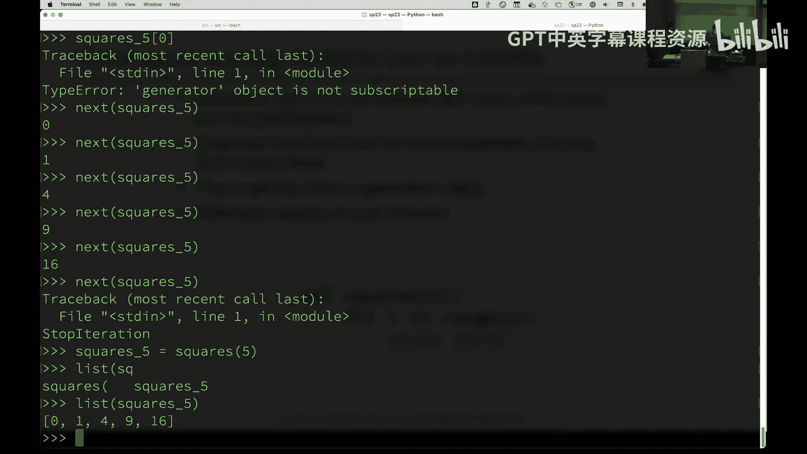

The other neat thing about yielding data because we can stick yields anywhere。PerPoint， let's see。

Hopefully， if I need to。Wops， I will undo that。

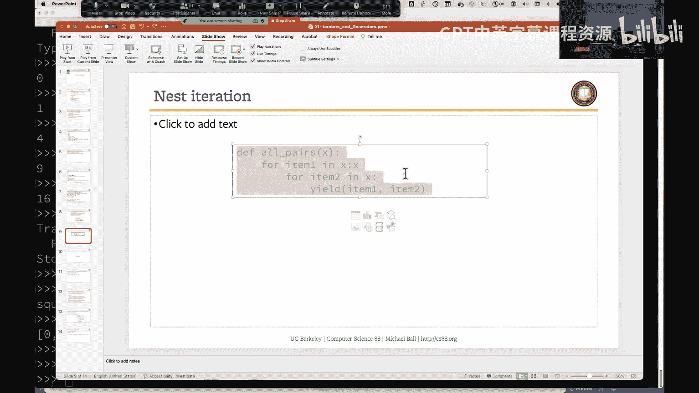

来。I believe this should copy and paste correctly。 Yep， okay。

 so one of the nice things about generators is that。They allow us to do things。

That sort of simplify some of our computations and in particular。

 one thing that you might have seen yourself do is write something like data equals empty array。

 for item in some sequence， do this data do pen something generators can help us simplify some of that。

 So let's just call this pairs。We'll do pairs 5' equal to all pairs from 0，2，5。And。

When we can do this， right， we can say again here next。Pairs of five。

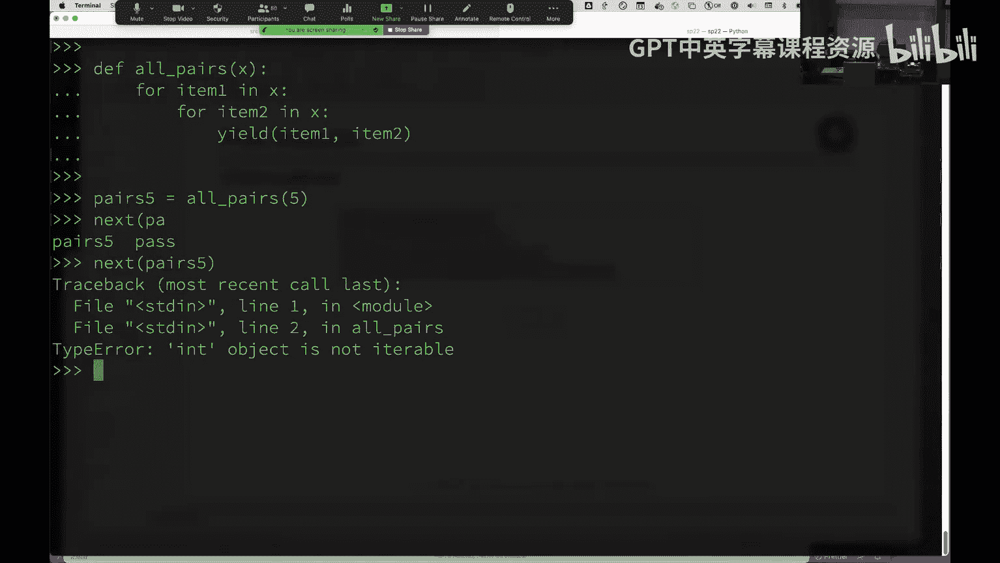

What， oh， shoot， You know what's missing here。 slides are totally wrong。Let me， let me fix that。

 Ca this should say。嗯。Actually， you know what I'll do。

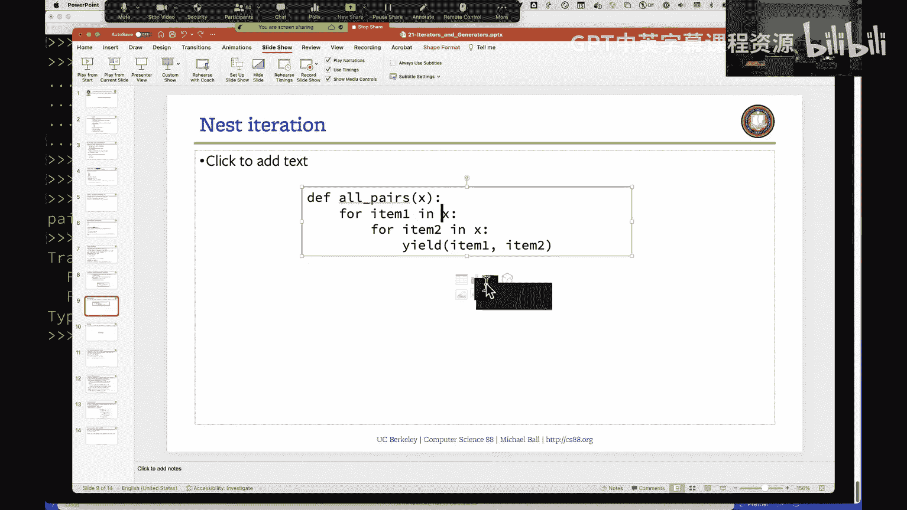

Because this is a more interesting problem。We'll make this， I'll just fix this right here。

 range of five。So the way that this is written， we need to pass in a list or some kind of iterator sequence into our function。

 And now I should be able to say。Next。Of pairs of five。 And that gives me。 and this will。

 this will let me go through and generate all possible pairs of whatever items are in my sequence。

 the way that this was written for， you know， item in X， for item 2 and X。

Now what we're doing here is just generating on demand each combination of， of these items。

 So now this should be 0，1，0，2。 And， of course， this will repeat until we've got everything from 0。

0 through 5 comma 5。 And the nice thing about iterators and generators。

 when we use them together like this is。It didn't matter that I called。

Or I have a sequence here that could be a list that is already known to Python。

 It could be something that is a sequence like range， which still computes its values on demand。

It could be any other generator， but because I pass those into a for loop。

 it's perfectly acceptable in Python's world to have generators generate data from other generators and still return a a new generator。

 Now how often you'll do this maybe depends but this sort of just illustrates the point that once you have the basic building blocks you you can combine them in just about any way anyway way that you see fit。

 So this is just kind of a fun example that as long as you are keeping track of which items should be should be a sequence of data that work in a for loop。

Then you can put a yield just about anywhere that you could put a return value in Python。

 It could turn just about any function into this idea of a generator。 Yeah， go ahead。Yeah， so I。

 I wouldn't call a for loop。 So the question is， is a for loop an implicit generator。

 I wouldn't call a for loop。A generator itself， I would say a for loop is an easy way for us to get at every value in some iterable that could be a generator in this case。

 a for loop will do all the work behind the scenes for us to get the next value to handle a stop iteration to do everything behind the scenes。

To make sure that we've handled all the edge cases。 essentially。

 if you wanted to what you could kind of do。I'm not going to do this。Entirely。

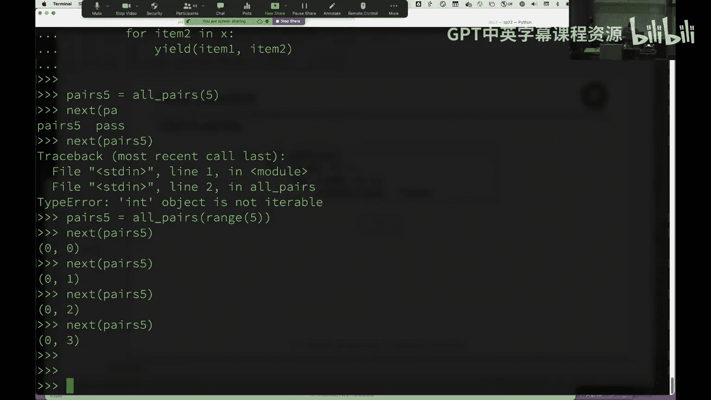

嗯嗯。Or I'm not going to write this in a way that would make it functional。嗯But。If I were to。嗯。

All right， let's make this a little bigger。

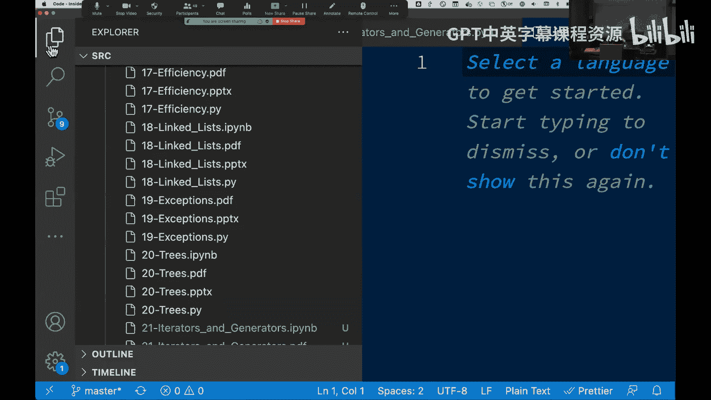

Save this right now。Tempttop pie。

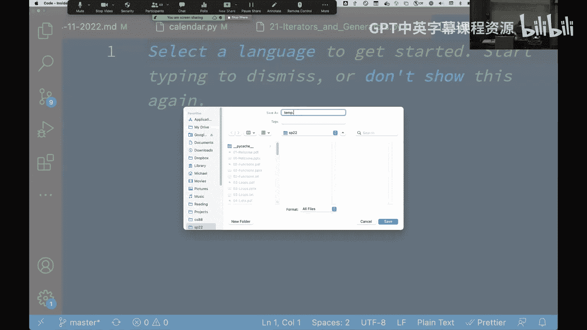

So呃。You， I could say something like data is equal to it。呃。Well， some object， I want to use data。

 and basically could say。While I have data。I could print something。Like， next。Of data。

And this would go through。And this would as long as there's some data in my iterable。

 I can keep calling next， I can keep getting that result the problem is that next raises a stop iteration error so that I might do。

Is， you know， actually say something like try。To get our next of data。

And then what we learned before is now we can say accept。Except。Stop iteration。

I could just say data is equal to none in this case。And then。Maybe we print something。Down here。

So I'm not 100% sure， but I think that this should work if object is something that we can iterate over。

 this is sort of like a manual version， oh， actually this should be。Actually yeah。

 that would work fine this would be one version of a for loop ish that you could implement yourself using a while loop。

There's of course， a whole bunch of different ways that you can do this。

 but this lets you do something like that without you know using range in a different way so this a。

there's a few different ways of working with loops but yeah here's a good question from zoom chat so in this example。

 which of these things is a generator and which of these things is an iterator yeah so this is a good question so this function。

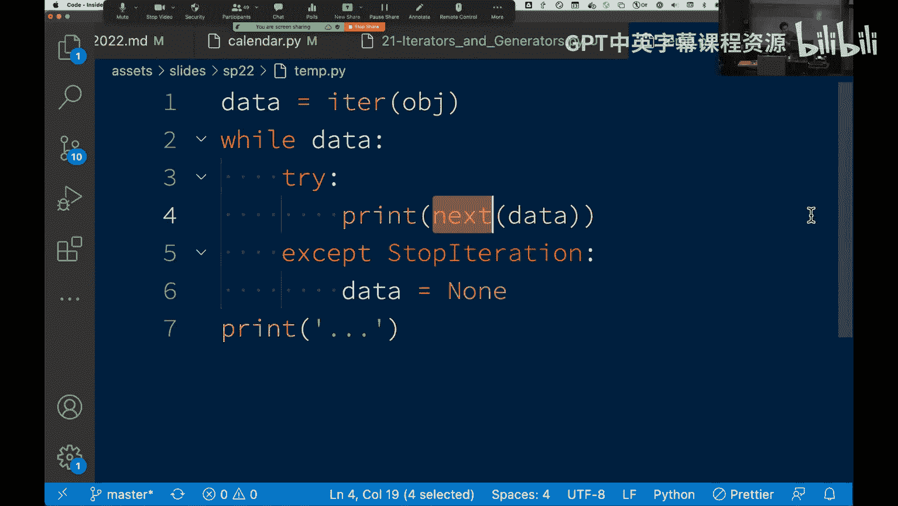

All pairs is a function that returns a generator and a generator in Python is just a is a specific kind of iterator is the way that I put that so this function returns a generator。

X in this function is something， so every time we see x。

 the argument x for item in whatever that x is， and then for item two and whatever that x is。

X in this case is something that also has to be some kind of in this case。

 let'll say an iterable object so that could be an actual iterator object or it could be in Python's term some other object that you can iterate over。

 but yeah this we would typically call all pairs， a generator function and what a generator function returns is a generator object。

 so if I go back to terminal over here we can actually see。

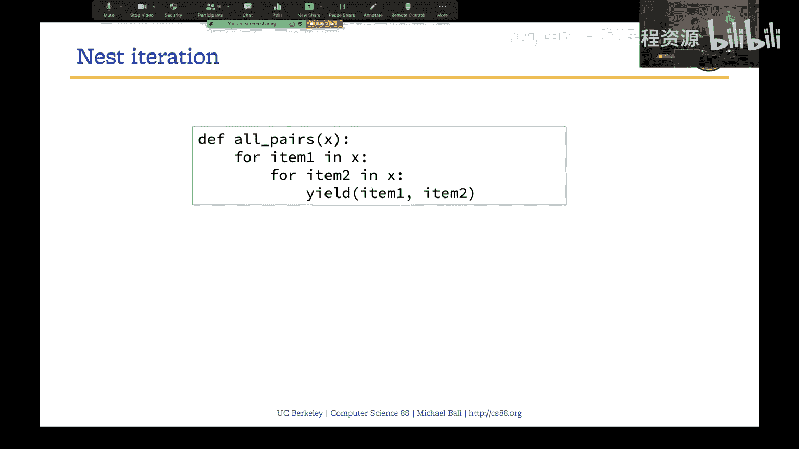

So let's say get a new set， I can ask Python if we have our type function。Not Paris。

 Paris would be fun。Hs5 is a generator。If I say type。see what it says all pairs。

That would be a function。 So Python doesn't necessarily give us an easy way automatically to know whether a function itself will return a generator that's up to you。

 the programmer to know there are。Like Python you can figure this out if you really need to。

 but it's pretty difficult so all pairs is a function， pairs5。

 the result of the function is the generator and a generator is just a type of iterator。

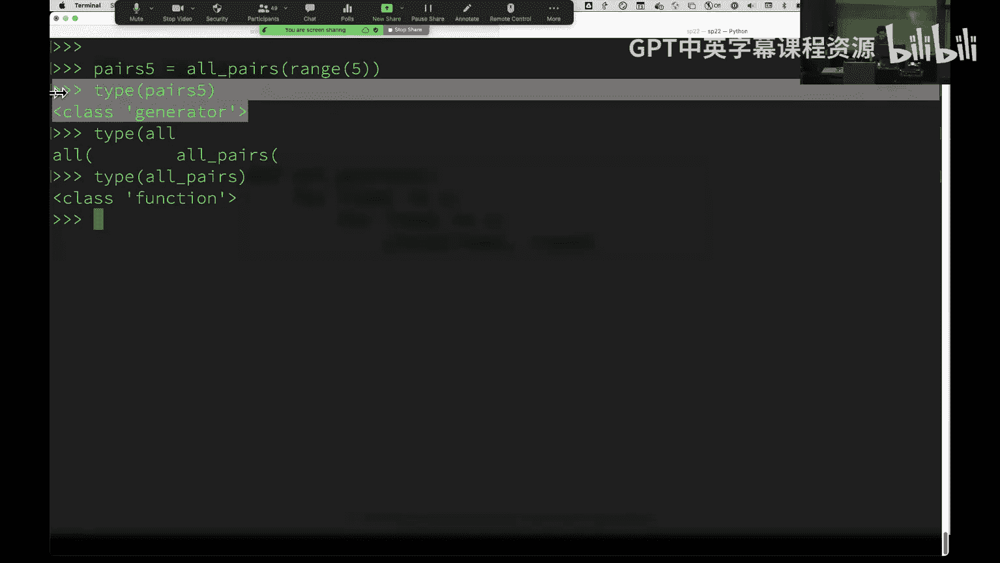

Yeah， good question， the terminology is a little bit dense。Yeah actually， before we move on。

 any questions or any other questions on this example here。不 so。呃。So in this case。

 we've talked about。Using next。 and we've talked about using the results of a generator。

 And so the question becomes。How do I make things in Python that are not just generators。

 but are other types of iterators that are things that could be their own sequences that are functions that we could knowingly have sort of a length。

And all those sorts of things。 And really， what it comes down to when we're working on building our iterators of various kinds。

Is that Python defines a couple patterns that we can apply to our functions and so the primary interface for these are it and our next functions。

The it function， this global function it。Transforms any kind of sequence into something that is an iterator object that Python knows how to deal with。

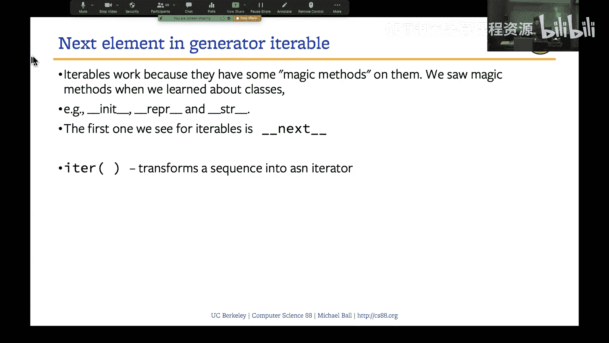

In this case， we're just going to have a range called R。So arrange from zero to 10。嗯。

If we ask for the type。Of R， this tells us it's a range。 Unfortunately。

 this doesn't tell us too much about what we can do with a range。

But we found out earlier that range itself is not is not an iterable object it implements some other methods that make it work。

 but we could call this method called it on R。And what we get back is this thing that is called a range iterator and personally I would say I think this is one of the somewhat confusing implementation decisions that Python has made there's good reason for this of like separating things out but。

The way that Python works is that our it。Our iterator objects can be separate objects from things like our range itself or things like our list is a separate object from the iterator object that actually iterates over the list in practice this doesn't matter too much like I would not get hung up on this distinction but just to be aware that it exists。

 so we have this method it。

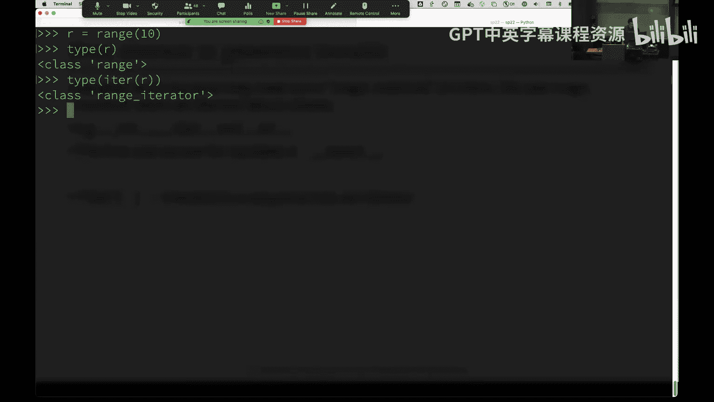

And we have our method next and each of these methods correspond to our magic methods that we can define on our classes and so。

This is where Python has this thing called the iterator protocol。In practice。

 I would say that this is。呃。What it's trying to do is simpler than it seems and the way that it actually works。

Is more complex than you would hope， so kind of keeping those things in mind so。

In order for an object to be iterable， we must implement what's called the iterator protocol。😡。

And in the iterator protocol。Objects have to implement。These two methods。

One of them is the inner method。And the inner method。Just has to return the iterator object。In。

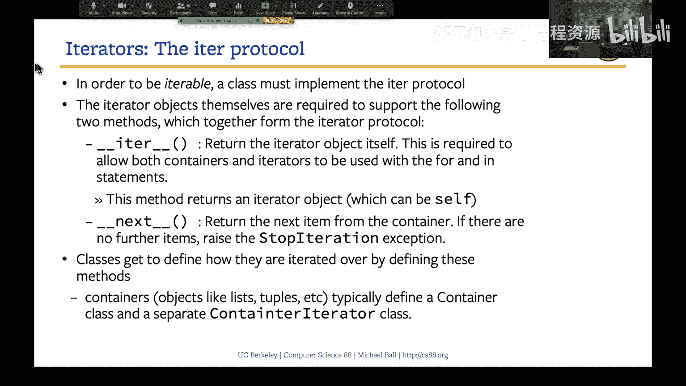

呃。What this means is that。There is some method on a range。Called ittter。

And this range it method returns our range iterable object。

Our range iterable object because it's already an iterator just returns self。😡。

That's just one of those interesting things Python has decided。

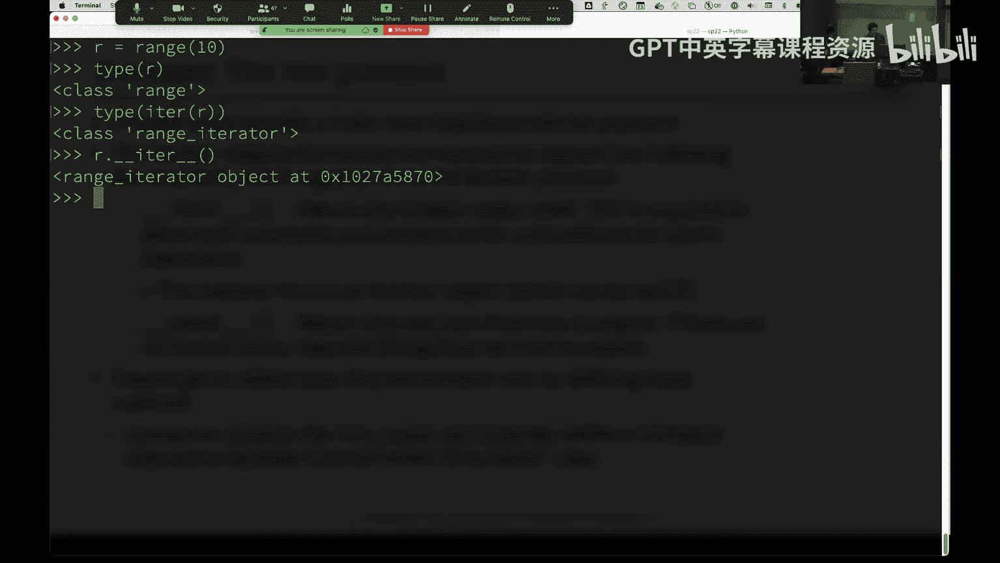

That it separates these two classes for some reason。

 so sometimes we have a class that contains our data and is the iterator and we just our inner method is very simple。

 we just return self。And then what we have to implement is the next method and the next method。😡。

Is the actual method that in this case。Gets called for each iteration。Of。

Of whatever we're iterating over so it does one iteration。

 it returns that value and at the end of our sequence our computation。

 whatever we're at we raise the stop iteration error。And then our sort of iteration is complete。

By know sort of by having these two methods， classes have full control over how over how they're implemented and so。

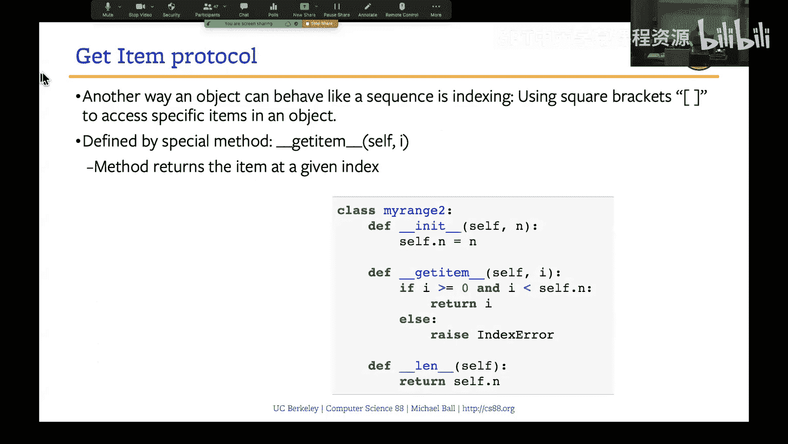

哎。The the best way perhaps to do this is this is where。嗯，in。嗯。同意。Where is。嗯。哎。Very。So in our。

 in our file here， we have a。

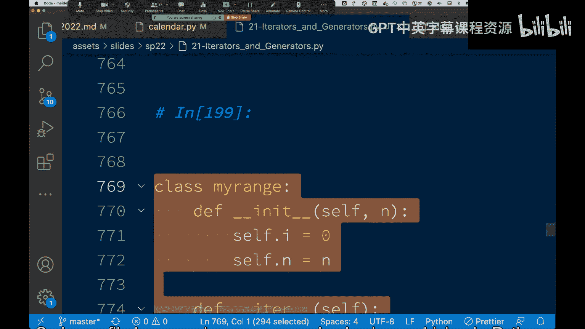

A very simple class， which。

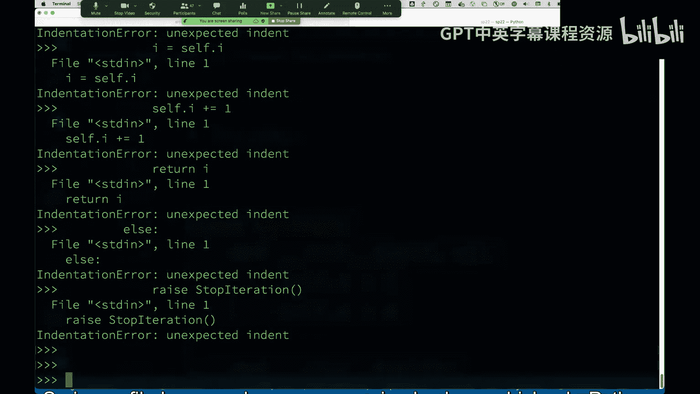

哦。系on。Alright， Python is not gonna。Let me run this code。

 so what we'll do here is we'll exit out of this。

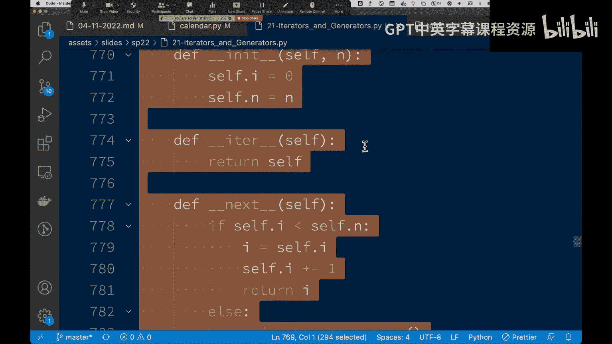

Hython 3 dash， I 21。Oh， crap。O。hy。Okay， I don't know。 one sec。 Let me make sure。

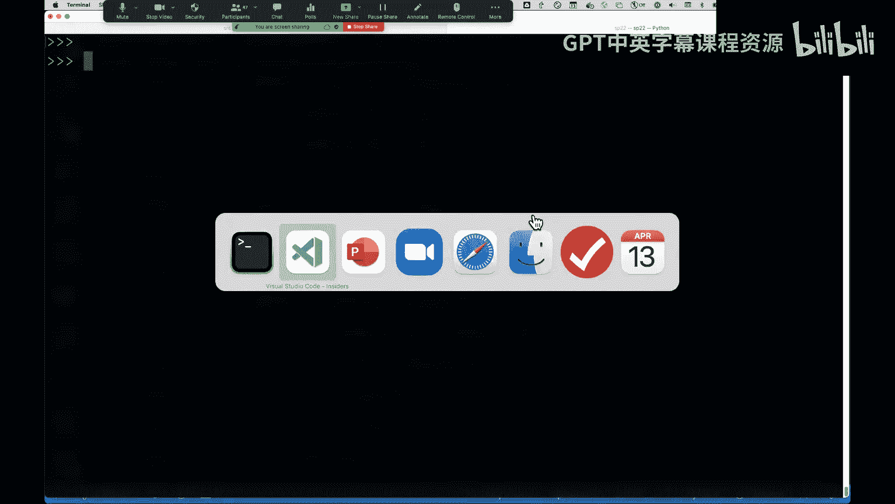

That。There was。A demo here， that。2。We are going to。嗯。Yeah， so this is from the notebook。

 which has a demo， but probably should not be run as a file because it gives you an infinite loop at the end。

 because infinite generators are sort of an interesting but optional topic。

So I'll make sure that this file is runable， but in here what we have is。

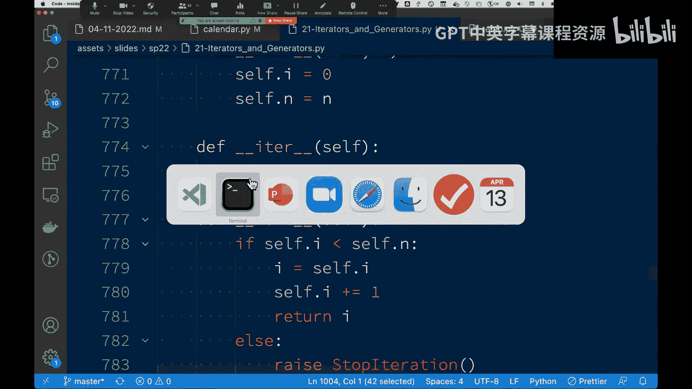

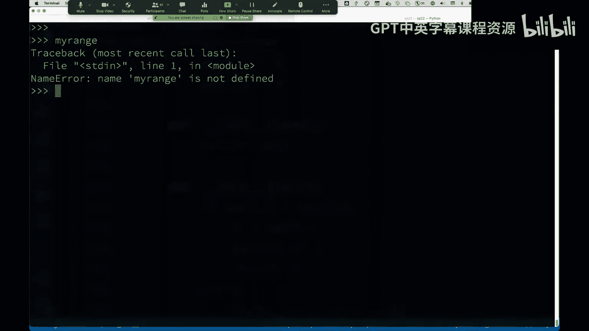

嗯完了。

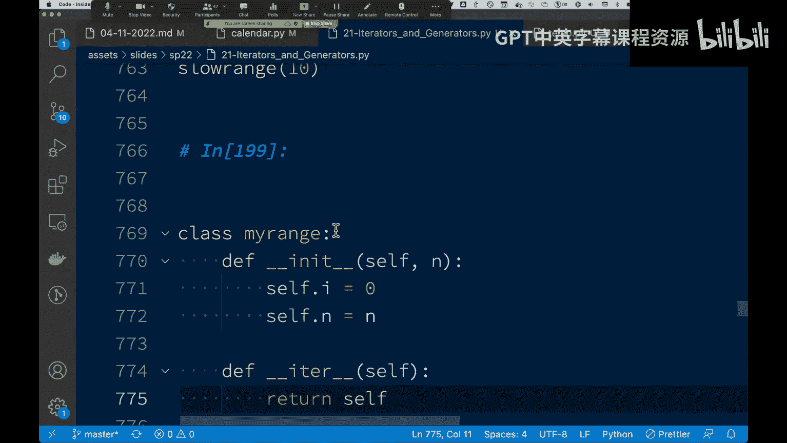

All right。What， okay。

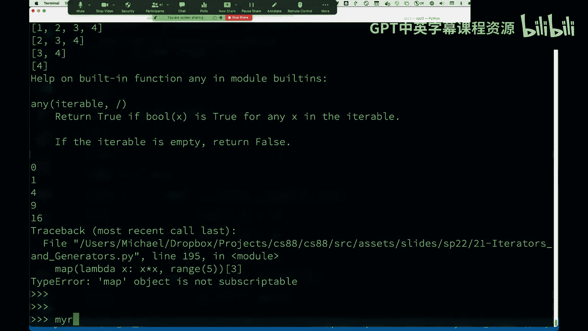

No， what is。Shoot。Something in here。Is not。I not making this happy All right。

 this may be too much to de bug at once when was this working last night。

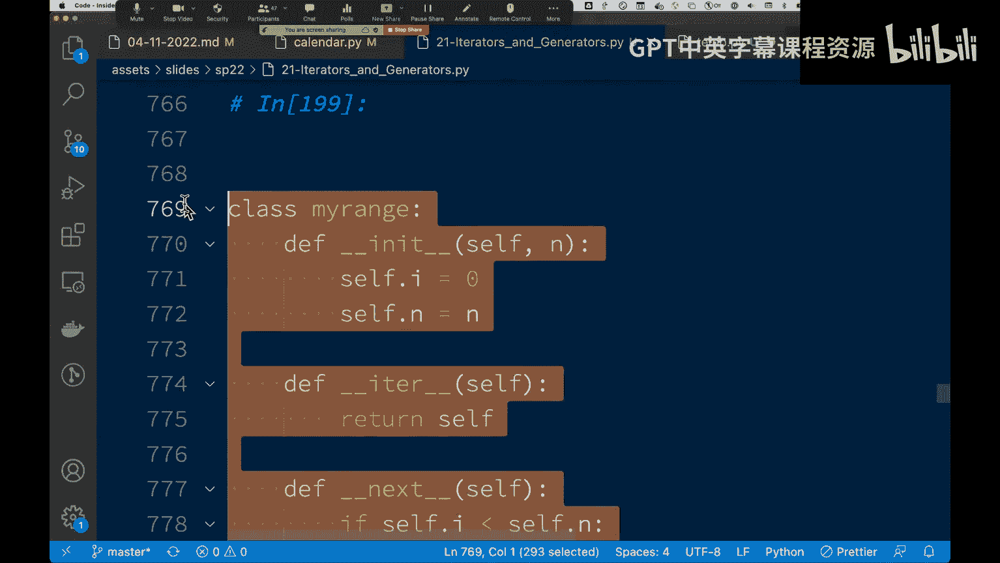

那二。

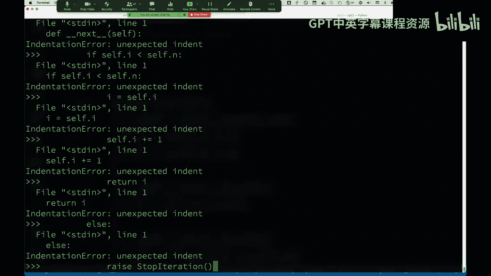

Okay， that's unfortunate。So I can't fully get this run for some reason right now。

 I'll have to play this later。The way that making our own iterators works。

 we have two options here and this is where again， what we're going to do is just sort of think about how we can build out some functional and Python so an iterator in this case is any class that implements。

These two methods here。The iterator returns a self because we're saying that this is an iterator object。

And the iterator then implements。A a method called next and this corresponds to our global next method so in this case。

 if we wanted to make our own range， this is a simplified version for what this range does is it still computes data on demand it still allows us to say for item in range it doesn't yet support things like length and concatenation and counting and stuff like that。

But。Right now， this is an iterator that really does most of the work for range if our step size is equal to one。

 and you could imagine right now right that if I actually took this， I said self do step。

I could even update this here to say。Rangnge N step。Is equal to one。I could say self。Dot step。

Sequ to step。So I could sort of go through in this process and actually build a range function。

 which is pretty comparable to Pythononss built in range function with not too many lines of code and what's going on here is that。

Every time。We ask for my range。We get an iterator object back and when we have that。

 we could turn that into a list with a list comprehension or the list function。

We could still call my range with a really large number because all this is doing right here。

When I call my range with a really large number like this。

 all it's doing is running our init method that sets up some parameters and it's not until。

We later go back。And we call next on some value。That we call that next method。

 that and what that next method does is one at a time。It gets a value， and it returns that value。

 and then。In the case of our range。Oh we just keep track of eye to know what our current position is in our range。

And then we continue on one thing to note here about the next method in Python is that。

When you're building a generator， you yield some data to turn any function into a generator when you're implementing next because next is a normal Python function。

 because we call next in sort of a sequence。Our next function。

Always needs to return some value we should never use the word yield in a next function that would be very weird Python would let you do it。

 but things would get messy。And then at some point we need to raise stop iteration。

These two things together， returning some data。😡，And raising stop iteration are what we need for making any particular kind of class something that we can iterate over。

 so that's the first way to make our own iterators in Python before I continue on there's one other the way which she'll show you。

 but any questions even though I couldn't demo this about how theoretically this next method might work。

不。Once you know how， once you've seen the demos of calling next on Matt。

 you can kind of think about how。You might just。Do one calculation at a time and so on the final way。

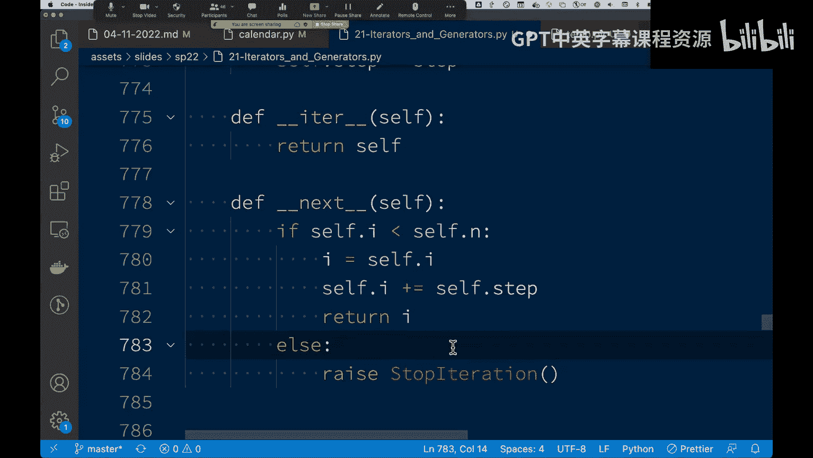

That。You can build an iterator in Python is with a different version of our get item method。

When we looked at our linked list class a week or so ago。We。

We implemented a get item method that just returned the n item in a list。

Python has this special way where if we implement a get item。

Then it actually also allows our for loops to work and turning our object into an iterator。

This isn't the most common way， but it's actually a pretty neat way as well to think about what are the interfaces that we define that allow us to iterate over some sequence of data。

 So if I didn't want to want to implement。The next method。I could say a range。If in this case。

 if we're counting by one， our get item method is if not super interesting right， range of 100。

 if our value is starting at zero and less than you some whatever maximum value is。

 we would just return in this case， I because that would if we start from zero right。

 the value in our range is always item I， otherwise forget item instead of raising a stop iteration error。

We raise an index error to say that that value is not in our sequence。

So this is another way of implementing a function that can become an iterator。

And these are just the two methods that Python supports for building your own iterators in practice I think using iterate next is more common。

 but this allows you using Gitite to do some interesting things as well so unfortunately I can't demo this I will try and figure out why I can't even just run the file which line here is airing out but。

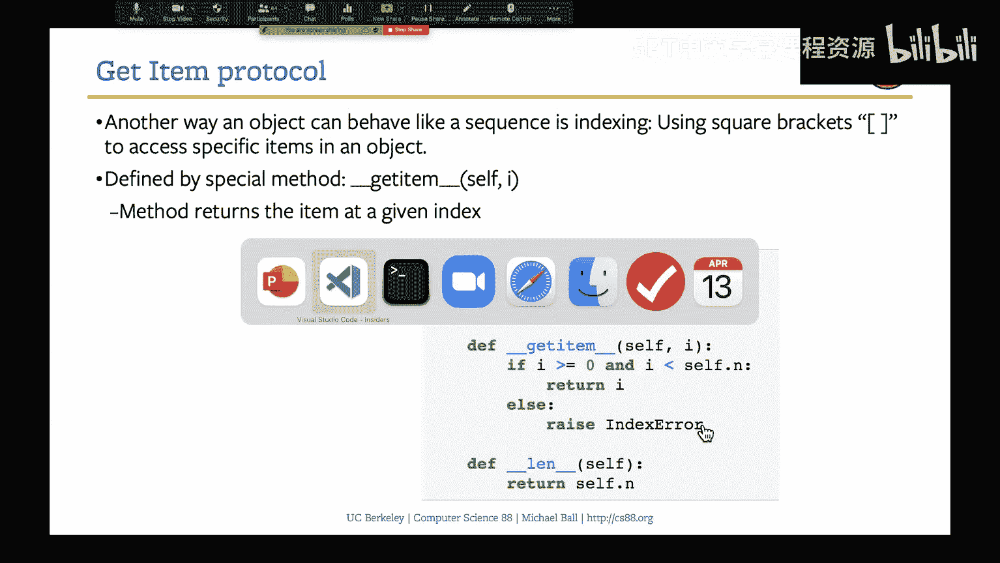

It it's in there you can play with this code as well。

 and so that's really the big idea here with iterators and generators the one last thing。

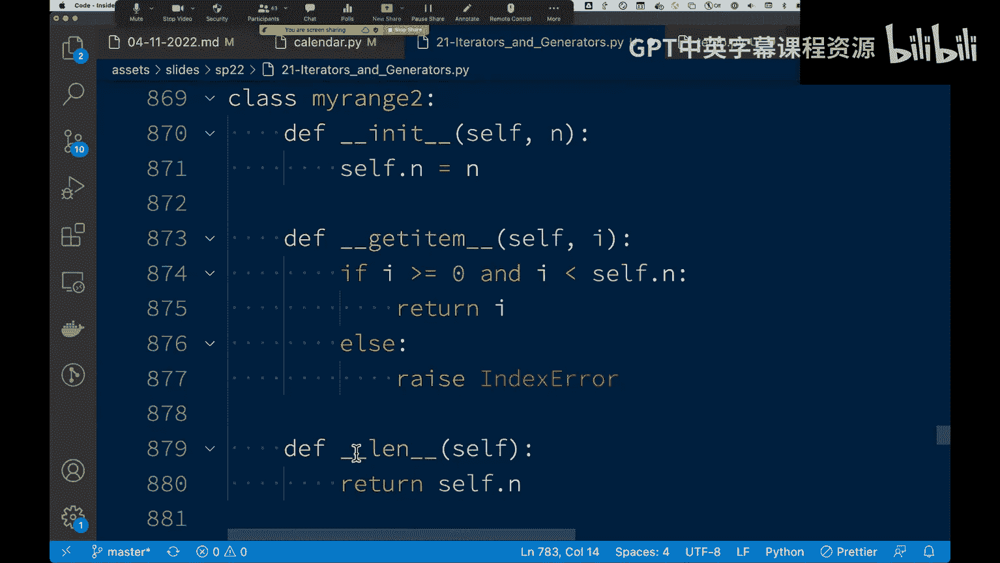

That。Oh okay yeah， that should have been formatted this code that I think is worth mentioning so this is just a random bit of Python sort of implementation stuff。

 but if you're curious at home trying to figure out like is this thing an iterable。

 is this thing a sequence is this thing something else。

 Python has in its tool set the idea to inspect itself so there's this whole library called collections。

abBc and you can import the constant iterable and you can also import the constant sequence and actually if I go here the file should show this？

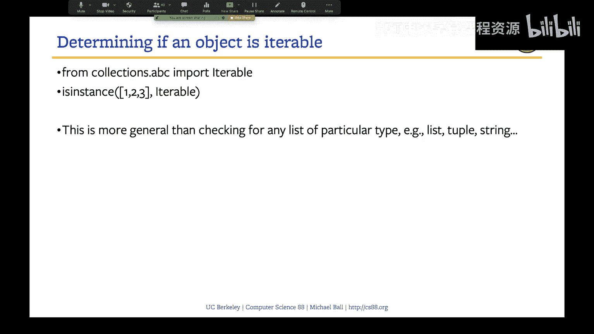

嗯。From collections that ABC import iterable import sequence。

 Python now lets you check using our is instance method if something is a class that follows one of these two types so this is just a handy thing if you're trying to figure out as you implement some code is is this thing implementing all the methods that it needs to will this work in a for loop if something is an instance of iterable then it should work in a for loop if this is false for some reason you have something there is missing but yeah the big idea here is just being able to build and control sequences of data that are generated dynamically an on demandd and for this method we have or get item method but really what we have here is scroll back up for a bit we have two methods next and it oops。

That are our class methods。that are methods that we define in a class that let us really control the order of that iteration they correspond to this global next method。

 this global intermet and so yeah that's one of the last new really new Python topics for this semester so next week。

 we're going to transition to talking about SQL， another programming language which is heavily used in data science and sort of why we talk about learning two languages in CS88 but at this point you know I think we've gone through。

You know just about everything you really need to know in Python and then some to be able to go use it on an internship to be able to go build your own projects to read you know most of the python code that you'll find online except for stuff that's a little bit esoteric and understand how it works you know we've covered you the majority of the types of things that you might see so yeah。

 we will see you all next week， but you've gone through in 13 weeks。

A crap ton of the Python language， so that's it for Python topics in CS38。

And we will see you all next week。I still got lots of assignments that are practiced with Python。

Thanks， everyone。

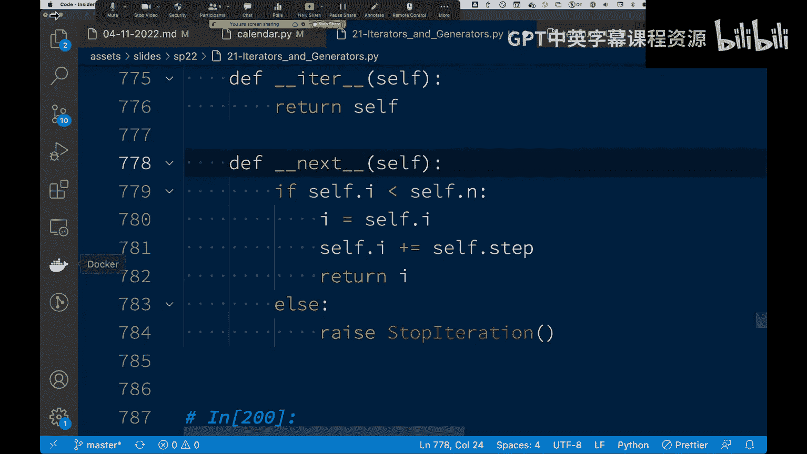

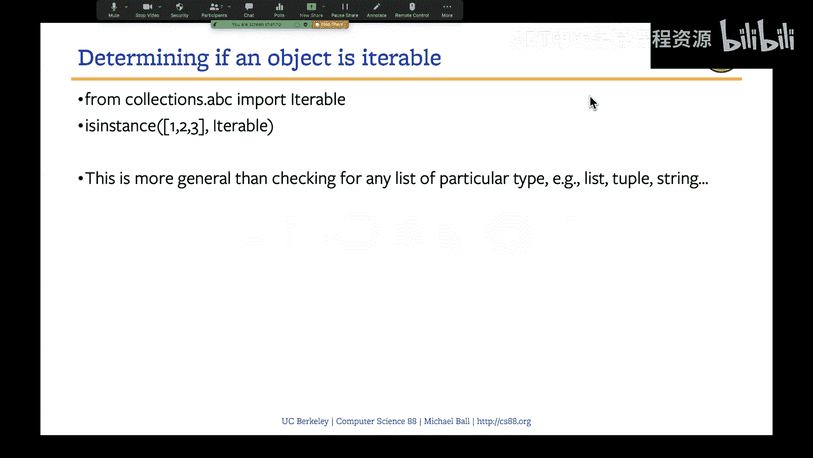