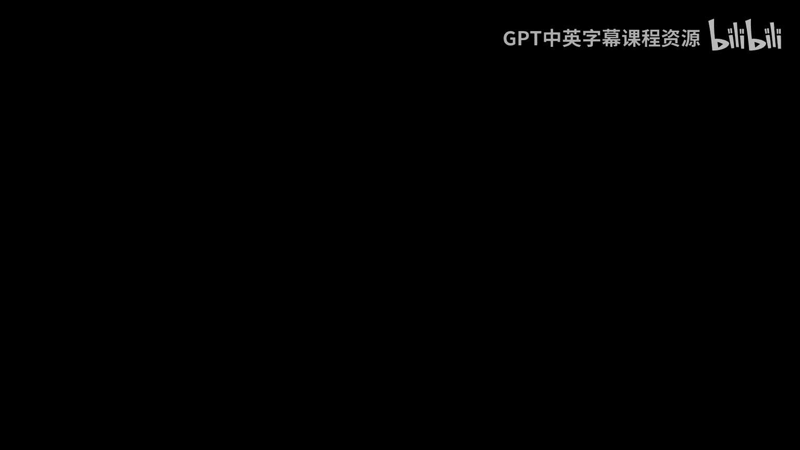
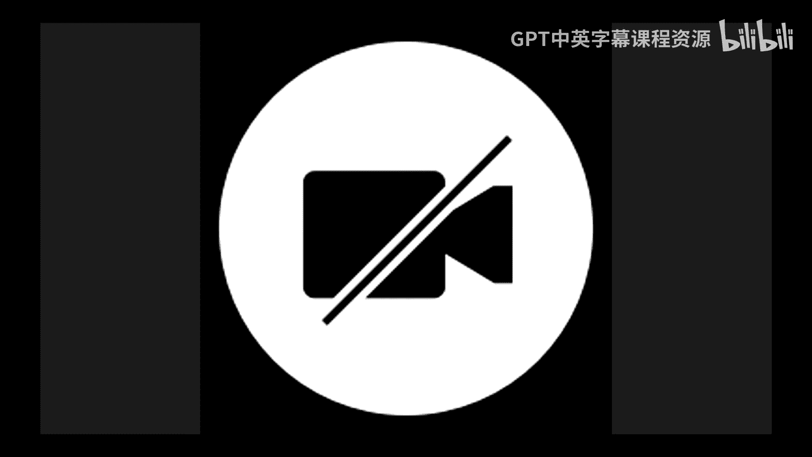
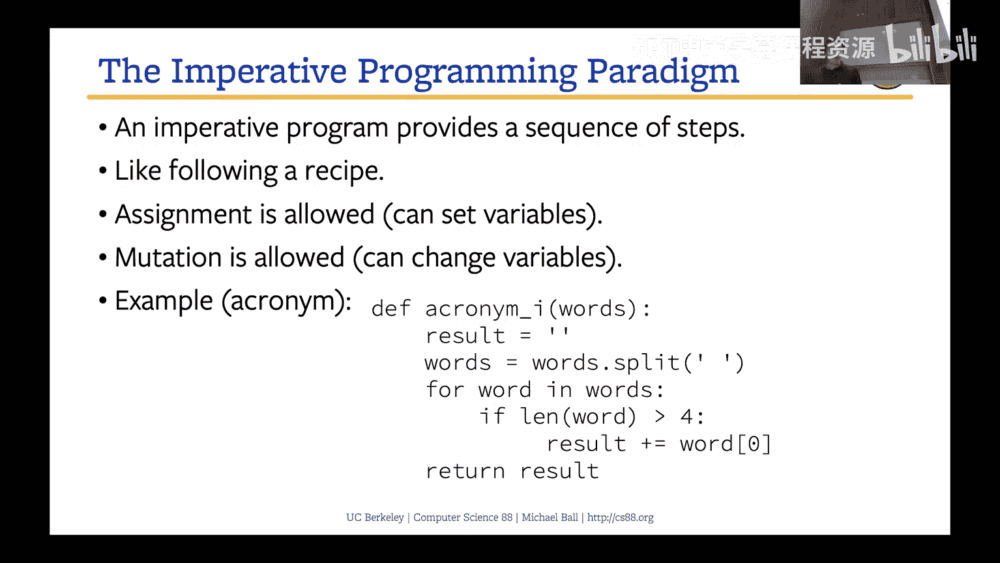
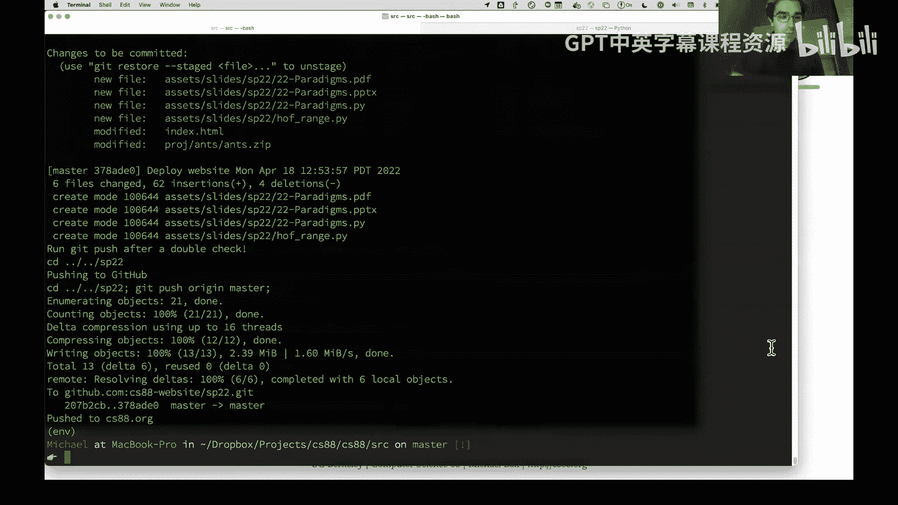
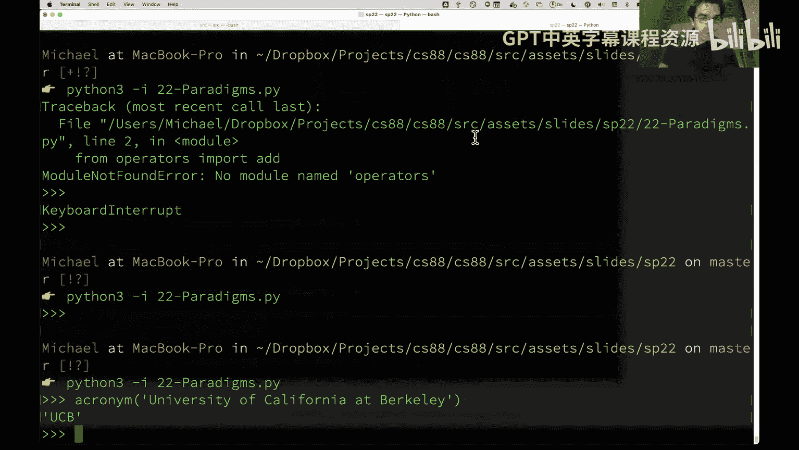
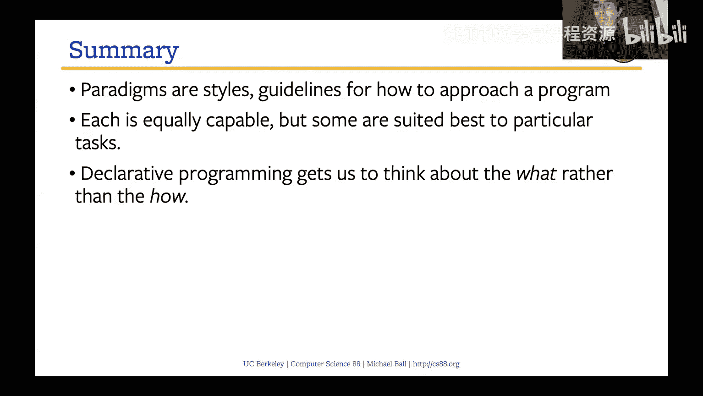

# UCB《数据科学中的计算结构｜CS 88 Computational Structures in Data Science 2022》中英字幕 p22 CS 88 Spring 2022 - Lecture 22 - 4_18_2022.zh_en [BV1516iBfEVY_p22]

是。是。Yeah。是。是。O。嗯。嗯。嗯。え？嗯。啊。不。All right。是。去。不是。All right， so today let me。Yeah like this。Okay。

 that's little。So。There we go， all right， so today we're going to take a little bit。

Of a step back from， oh， yes。Thank you， sorry about that。

We're going to take a little bit of a step back from where we've been talking about object joint programming and various data structures and techniques and exceptions which model OP paradigms。

And we're going to talk about just broad strokes of programming paradigms。

Really the reason that we do this now is because this is a little bit of an interesting time in CS88 so far we've done a whole bunch of stuff in Python。

And for the last two weeks of the course， we're going to switch。

Away from Python to talking about SQL， which is a programming language that is used all across data science。

For interacting and operating on data in a database and so we'll get into SQL a little bit at the end of today。

 but what I want to do before we get into SQL is to just take a little bit of a step back and think about。

Why is it that N CS88？We cram so much stuff into your first computer science class admittedly we cr a little bit less in this course than 61A。

 which is probably a benefit， but why is it that we go through the things that we do in the work that we do that make and a lot of this comes down to this idea of programming paradigms。

And if you haven't heard this term before， which would be totally reasonable。

 we've made references to it throughout the course。

 but a paradigm in general is just sort of a model or a pattern of some kind of process or some example so。

You know you can say like a paradigm of art and in programming a programming paradigm is applying that philosophy to a way that we write and reason about code and programs and。

Various pieces of code that we might interact with， and so in CS88。

What we've really done is aside from teaching Python。

 we've shown you a whole bunch of different ways to think about how to write and reason about and read and construct various pieces of programs and so。

If we asked you to， let's say， return a set of squared numbers from zero to four inclusive in that case。

Or zero to five exclusives， you could write a program that does。

That returns those squared numbers a whole bunch of different ways， right at this point。

We've sort of beat you over the head with map and range and lambdas and so you could write map lambda x squared over a range of five。

 you could of course write this as a list comprehension。And though we have not done it。

 and though it doesn't actually exist in Python， you could imagine some object oriented style code where you have a class range that has a method called square the numbers in this range that you could call and read a method for your particular class that includes sub method called square numberss。

Now， obviously in Python， the built in range probably would not include a method specific enough to square the numbers。

 but you could theoretically imagine that if we asked you to。

 you could write a version of some class that includes a method like that。And so。

Why do we go through these many different styles and methods and today what we're going to do is revisit some of those styles and methods from all the way back at week one to where we are today。

And then set up diving in to SQL， which will sort of be the last of our new kind of programming paradigms if you won suck the video。

Ha's cut out。So let's see if I could fix that。Maybe not。哎。Well， I'll stick to this camera。So。

When we talk about paradigms， the goal is to be able to look at a piece of code that has some tools that we've seen like math。

 like object oriented programming like list comprehensions and be able to sort of reason about the thought that went into writing the code。

 what does it mean when we see a map versus a list comprehension or what does it mean when we see code that is object oriented？

And ultimately， by comparing these styles when you go out and you write your own programs is you now have an entire set of tools that you can use to pick ones that make the most sense for the types of things that you're going to be working on。

 and importantly today， when we think about languages。

 especially like Python where Python is a perfect example of this。

Most programming languages and most programs are what we call multipar that they don't have just one single style and one way of working。

 they mix and match all of these different kinds of styles and techniques in one program。

And of course oftentimes this is like really great because you get to do what feels natural and you get to write code that is hopefully clear and logical to you and sometimes it's a terrible confusing mess because you're mixing immutable code with mutable code you're mixing object rendered programming with functional programming and you're passing stuff around and it's all just a giant mess so hopefully understanding the。

The way that certain pieces are code look and the way that they're intended to be used helps you recognize a sort of。

You what what tools are best and then how to。How to sort of approach fixing。

 updating or writing some bits of code。She。Before we continue on， just eight。

A wood of warning about programming paradigms in general。

Is there is no universally agreed upon list of programming paradigms。

The ones that we're going to talk about today， imperative functional array based objectoriented and declarative are a pretty good set array based is kind of the audible on this one。

 but I'm going to talk about why we include it because I think it's interesting but these。

These five paradigms are really just a start as we work through and think about what it means to be functional versus imperative or array based versus functional。

We'll note that the boundaries between these things are pretty darn fuzzy and that when it comes to an object related language like Python。

 where the plus and minus operators are really just methods on objects。

Where the boundaries are is often more confusing than it is clear。

 but that's okay because really what we're talking about are techniques of how to do things。

 I'll just also point out that while not an authoritative source，嗯。

Wikipedia has a very interesting page on programming credits and in particular every Wikipedia page includes a talk page beyond the main things so if you've never seen this and you're interested in using Wikipedia as not necessarily a place of doing research but a starting point for references to other research the talk page often has an interesting sense of what people are thinking about some of the discussions that actual editors of Wikipedia put thought into so not necessarily worth reading but there's some interesting history and thoughts here about what makes know what are some of the predominant patterns that people have seen in programming over time so。

嗯。In general， with these paradigms， you know there's sort of three。

 we can think about lots of different approaches to how we might do something like spraying a list that I actually didn't include object or on this list。

 but included this arraybased pattern that does not work in Python right now。

 but you might encounter in other forms of data science that if we're talking about spraying a list of numbers。

The CS88 way of doing things， we might suggest that you write a map with a lambmbda。

Over some listed numbers in languages that are array based where arrays are a first class object that。

The distinction of Python is arrays are continuous elements in an array based language。

 so if you go on to where is my mouse？嗯。Tell me you're somewhere， but all right。All right， oh well。

 it's not true， but if you。If you use a language like R that you might take that you might use in Stat 134 or in another data science courses。

 operators like multiplication， instead of just multiplying some list。

 multiplication of work on list and Pythte will actually multiply the elements of lists and add in an array based programming length instead of combining to lists together would add the elements of lists。

 these things are super common in data centric programming languages like R in MATLb will come back to those。

 but you could also perhaps write what we call imperative code just a sequence of steps。

To solve returning a list of squares， right we could set the result to some empty list。

 we could iterate over our numbers， we could append some expression to our list and then the end of the function return our result living list。

And all of these， depending on the language， could be very valid approaches。

 what makes the most sense will depend largely on the context of the program and the environment that you're working in。

We've seen a fair bit of imperative code throughout the semester。

It's hard to avoid it because most programs that we write involve this sequence of steps right we could say it's a little bit like following a recipe。

Imperative code in particular relies on assigning data to variables。

It often relies on mutating and changing the state of variables or at least reassigning them to new results。

 and ultimately it's about following the sequence of steps sort of as is written down so with imperative code。

Like old code right we're going to go top to bottom。

 but we're going to take a sequence of steps so for the next few examples。

We're going to do this acronym program， or we're going to look at a version of this acronym program。

 which I have just here。

呃。So the acronym program， I'm not sure if we did this as a demo lecture this semester。

 but I know it's in some of the previous videos and slides takes in a sentence of words。

 so University of California at Berkeley turns it into UCB and it does this by going through three things it turns a single string into a list of words it filters out all of the short words so the things whose length is less than four in this example。

 it takes the first letter of each of those long words so you C and B in here and it combines them back into one string which has in this case three letters and this program in general is supposed to work in a bunch of different ways in the lecture there are well this is before I rename them but you'll see three different examples the underscore eyes for imperative there's one for functional and one for hybrid。

So。This problem that we have of taking acronym is something that we could write a bunch different ways and this is a version of a functional part in paradigm this one is kind of cool because it allows us to model all of map filter and reduce in one step so we take。

Our words， we split them to a list， we filter those items where the length is greater than three are the ones that we want to keep。

We。We map over our first letter to get just the UC and the B and then we reduce using the add function which works on strings is just another way of combining letters in a sentence together so in functional programming we typically don't use any state directly we just pass results from one function down to the next。

We don't mutate any data， we're always either returning a new array or passing those results on to something else and when we talked about functions before。

 we don't have any side effects， we're not relying on global variables we're not relying on modifying some data outside of our function and so on and so this is sort of a pure functional approach to our same acronym problem using map filter and reduce。

We could perhaps also write this using list comprehensions。

 but the functional sort of approach at least more clearly shows with A lambda here right that each of these steps is a function that we're executing on each kind of piece of data and in this case one of the things that is both neat and cool about functional programming。

Is that we't any we don't have any of these variables and we don't have any states。

 so it's less likely perhaps that we accidentally assign something to the wrong value or that we forget to update some variable because all of that complexity is removed from us on the other hand when we read code like this we actually have to recognize is because we solve the most interal parentheses first right the very first step here is words dot split by space so this just takes our text turns it into a list of words that is the last la code the most indentive thing so following the order of operations in this code is perhaps not as obvious as what happens when say results equals an empty string and words is equal to words split。

But。You know， on the other hand， we don't have any additional variables and data to deal with。

 so there's pros and cons to each of these approaches。So。In general， right， when we compare them。

 most people would argue that functional programming is a subset of imperative programming because everything that a computer does has to happen in some order。

 no amount of not dealing with state and not assign ciing variables lets us execute functions in some amount of random order and expecting to get a correct result。

Functional programming is still a series of steps it just happens to be that we execute the inner items before we execute the outer items in that case。

 but we avoid state and we try and compose functions together to。

To be able to solve the problem that we need。When when we use functional programming。

 one of the things that and this is where CS88 and the way that Berkeley teaches computer science。

 I think gives you a leg up over almost any other computer science program in the country yeah。

 basically， except for maybe MIT where Berkeley and MIT do things very similarly， is。

We try and teach you how to break your program down to see that there are multiple ways of solving the problem and what this really means is that when you get a chance to do this outside of the course。

 you'll have a better perspective on hopefully seeing seeing multiple approaches and being able to choose which one makes the most sense obviously this is easier said than done so it's something that you get practice with but when we talk about functional programming。

 it's often that there are you know more than one right ways of breaking the problem down that each of those functions that I showed those lambmbdas could be written in different ways they might not even need to be lambmbdas they could be named functions and so on so some people like to think of functional programming a little bit like solving puzzles where you're not using state and variables。

But of course you don't have to approach problems exactly that way one challenge though functional programming and this is definitely true of the sort of one liner approach to things is that sometimes those solutions feel like magic and in general how much sort of feeling of magic you want to convey in your program is up to you but what it does mean is that if you understand how that solution works you have a deep understanding of the models of execution that Python or whatever programming language which you're using can provide so functional programming they do tend to be shorter and they do tend to be easier to debug which is why we generally harp on writing peer functions writing short functions it's why for most of your lab and home assignments you're working on things one function at a time because having broken a problem down means that by you can test it very quickly so most of the code that we give you right has。

Dooc tests for a very specific component of that code。

And that is a real big advantage compared to a file which includes 10 functions that can all interact with each other in unexpected ways。

 and so I would say that the benefits of debugging code is one of the best ways or one of the best reasons that we really use functional programming and that it's a model that hopefully you take with you outside of CSA8 the other reason to do functional programming and to think about this model of pure input。

 pure output no side effects is that it leads to us using parallelism in better ways and this is something that unfortunately we don't get to experience really in CS88。

But if you go on to take additional data courses， I forget what the number is。

 but there's a newer course which is roughly titled data engineering where you actually get to build pipelines it's one of the new data operatives but。

When we have this functional programming paradigm where we have functions that don't rely on state。

 we can do a lot of computation to a lot of data and spread that process out across multiple computers because that work。

Won't potentially rely on some other kind of information。

 so you'll find that in industry and research the functional programming model is highly important to a lot of。

A lot of data processing pipelines and there's a number of companies that have actually come out of Berkeley research projects。

 most notably you may have heard of this company called Databricks that built their own data processing engine or this language or environment called Spar that rely on this idea of a pure function as a unit of computation that make it possible to speed up data processing so there's。

There's a whole bunch of reasons beyond just the things that we get to see in this course。

 and perhaps the most interest or one of the more interesting ones is to look at trends of programming languages over time。

 functional programming is just，On the upswing and has been for maybe the last decade or so。

 you might actually say in part that's due to some of the research that other folks at Berkeley have done to popularize this data processing model。

 but also it's because over time as software grows and becomes more important。

 people are realizing that this idea of restricting ourselves to not using as much state and not manipulating our data quite as much and returning new results saves us time and effort even if it is initially a little bit more complicated。

And so when you think about how do I choose one thing or the other。

 those are some of the things to keep in mind of course。

 you know if you ask a programmer what is you know what tool should I pick AirB what language should I pick Python or JavaScript or Ruby or Java the answer that the probably give you is it depends because in general the best thing depends exactly on the problem that you're trying to solve and rarely is A or B always the right answer and so。

Most programs that we write。Tend to have some kind of hybrid approach so this is what we might call a hybrid approach to solving the acronym problem。

 although because it's hybrid you could imagine there's about 40 different ways you could write this that will all be correct and so in this case we have a little bit of imperative code right we have a sequence of steps we assign things to variables but we don't do that much with variables we split some words into a list this by the way right words do split means that words is an object which has a method split so that's object oriented programming filter this list of words with some lambda there's functional programming。

We're assigning things to variables， so that's a little bit of imperative programming。

We've got another map with the lambmbda and more functional programming。

And Python's way in an object oriented style of turning a series of items in a list into a single string is to say string do join with letters as the argument and so that's again object oriented programming and so in a lot of approaches you might or a lot of programs you might find this hyp approach particularly useful where this is essentially taking your functional program and just separating it out giving some names to each of the steps so now I'm kind of just curious。

And of these three approaches， they're all the exact same ones。In for those on Zoom。

 if you want to just raise your hand when I ask or if you want to type in the chat， either is cool。

 but I'm just kind of curious thinking about these things， we have imperative code。

 a a functional program and a hybrid we'm just calling a hybrid program of these things。

What do you think if you were trying to solve this problem going from acronym or text to an acronym。

 what would you prefer so how many people again there's no right answer here。

 but how many people prefer this purely iterative approach of solving an acronym？On Zoom。

 how many people prefer？I had this approach。Okay， got a few hands。Cool。

 I stretch my view really quick so I can see even more of them nice。Cool。

 how many people prefer this purely functional approach of solving this acronym problem？

A few more hands。And how many people like this hybrid approach of in the lower right corner here of solving？

啊。Solving this problem。fewew hands。Cool， yeah， so I think I saw the most notes for the imperative approach。

 and I think this is pretty natural because it tends to be how we think about the world in terms of a series of steps。

It's definitely something that as。As you read through code。

 you can reason about in a pretty standard way what's going on。You，In every case。

 each of these has pros and cons to how we might solve those kinds of problems。

So before we continue on to talk about a couple other paradigms。

I was kind of curious between some of the examples that we've shown so far。

 does anyone have any questions about this idea or why it's important or why it matters？Questions。

 anyone on Zoom？All right。So。2。So we're not going to get a chance to demo this in CSCD8。

 but I did want to just call out this idea of array based programming as something that you might hopefully see in the future because it's something that is。

I would put it sort of as a variation of functional programming。

 but is also kind of this mind blowing idea how often these ideas will come up in ways that you don't expect them and so array based programming。

Is this idea where we treat as of data not just as containers of elements。

 but as things for which we operate on natively， so from Python。

 if I say array or list plus a list I get back some new list。

 it doesn't really matter what the items of my list are。You know Python just says。

 all right list can have anything here's a new list back in arraybased programming。

 what typically happens is we have a bunch of operations that we do natively to that array so if we want to add or multiply numbers together we take some list one time some list two and we get a list back which has sort of pair wise multiplications or if we want to add values together we could add two lists。

Together in。It's really hard， like I think this is one of those problems where appreciating how different this can be until you do it can be a really hard thing。

 but when you start operating in a data centric model where you're solving a lot of really simple computations。

 perhaps adding multiplying divide， doing intersections， cross products。

 whatever it might be on your data。You start to find uses for these patterns and so Python。

 there are bits and pieces of libraries like NumpPI might where you might see some of this functionality。

 but it's not called of Python， but outside of Python array based programming is one of these ideas that has also been around for a while but。

Increasing in sort of popularity and usage so if you take or if you learn R which I believe you still do in Sta 134 the course on probability there's a couple other stat and data science courses that teach R you'll see elements of this if you take engineering courses and use MAlab MAlab has matrices and arrays as。

As core to the language and so operations like this are really natural they just sort of you multiply add subtract divide matrices and if you say matrix times of matrix。

 you MatTlab will give you standard matrix multiplication for free which is otherwise kind of a complicated thing to write you probably won't have a chance to use it in a core course at Berkeley but Julia is another programming language that is really centric to data science that you might find in industry。

And then there are other less common languages like APL。

 which sort of predates any of the programming languages on this list。

 but are still used in data science。It's an interesting idea。

 unfortunately not something we can easily demo but has a lot of really neat implications for what what you might be able to do in a data science domain of course this semester we also spent a lot of time talking about object orpro。

And you know， the object' to design right gives us this idea of thinking about objects。

 constructing methods and attributes that relate to that structure。

And we've seen this used for things like data structures， linked lists and trees。

The ants project we have。A game state which is its own class， we have a place class。

 we have our insect class， which of course has various kinds of classes that inherit from that right we have all of our many kinds of ants which have specializations on their parent classes。

 we have bees which are another kind of insect so。Object for programming versus a ton of stuff and one thing that is really useful to think about with object render programming where we still have all sorts of other questions like should our models and our objects be mutable or immutable how much should we be able to change and our when we implement a method on an object versus returning a new kind of object and in Python the standard is to lean a little bit more towards mutability but you don't have to。

Imutable objects are like tus are a thing that exists。Of course， in Python。

One of the things that is super kind of interesting to see is Python really blends object or programming with this sort of functional imperative style right all over the place we've learned a bunch of magic methods that correspond to global functions like our lane method corresponds to magic lane method。

And of course we've seen many others for things like get item and add and mo and so on Of course object oriented programming is something that can easily be overused if you take CS62b you'll spend a lot of the semester aside from learning how to implement things like trees and various kinds of trees you'll spend a whole bunch of time learning about how to avoid the pitfalls of really complicated object structures you know we teach class attributes because there are a really useful tool but it's very easy to go from one class attribute which is appropriate to far too many class attributes which lead to sort of messy edge cases and confusion so there's been a lot of a whole lot of energy over the past few decades spent into how to write good object oriented programs and quite frankly it is one of those things which there is never a perfect answer to what the best kind of object oriented programming style is so。

Any questions before we continue on to this last topic？Anything on Zoom？Yes。

So we're going to spend the last bit of time today talking about what is， I think。

 the most different of all of these programming paradigms。

And this is this idea of declarative programming。And declarative programming is。In many ways。

 a simple idea， but in practice also challenging to wrap your head around and the idea here is that。

We express what we want without specifying how it should happen and a decative program is really a description of the result that we want to happen at the end of the program running。

 but it is up to that language and environment to figure out how to make that description happen。

And this sounds pretty simple， right， we just say， okay， here's what I want the world to look like。

Don't want to tell you how it happens， but what this means can have a lot of implications So we're going to look at a couple examples and then we're going to talk about。

How this relates to our last topic， which is sequL so in this in this example program。

 this is a map of。Of the provinces of Germany and it's initially gray and the result that we might want。

woWouldd be to say color every province a different color using what we have here， which is red。

 yellow， green and blue， even though the yellow is a little bit weird， but whatever red yellow。

 green and blue we're going to take these four colors we're going to try and color every province。

 such that note to adjacent provinces had the same color。

 so our goal is to essentially color this map， such that we can nicely visually tell where the boundaries between provinces are。

And。We could imagine with a imperative program rate that we could say something like for each province in the state of Germany assign some object some color。

 check if it has neighbors which have similar colors that we could write a series of loops to do this a declarative program on the other hand will allow us to take that description and it will just figure out how to build the resulting map so what does that kind of look like。

Our goal is not to understand this language prologue。

 but to give it as an example of a declaredlarative programming language， prologue is a really neat。

Is a really neat programming language where it gives what we give prologue is a set of rules and what prologue does is take those rules and try and figure out how to reconcile all of the rules with some set of data。

We tell prologue essentially that we have a series of colors that exist。

 in this case we've got four of them， we tell prologue that the same colors can't touch the formattings a little bit off here。

 but we basically say if we've got some neighbors，That some this last line here。

 some state color for A and B should not be the same。

 but in prologue slash equals happens to be the not equal operator。

 but we're basically just saying given this thing called neighbor。

 the result of this should be that the colors of each neighbor should not be the same。

Then what we do is we tell prologue what all the borders areop。So。

W come on all right so we we say that Germany is this thing up here with a bunch of state codes。

 then we specify he listedistic neighbors so we have to tell prolock what that map looks like。

And then what we do， which is pretty neat。Is we call this function Germany that we defined with our list of states。

And what prologue outputs is essentially a list that gives each sort of each state and the color that should be supplied in the map and how prologue does this is well beyond the scope of CSD8。

 but essentially it takes all those rules that has a bunch of tools behind the scenes to reconcile them all。

This is one possible mapping of states and colors that prologue could assign。

And if you click on the links I believe what's also interesting about this is that for a problem like this where we're saying go from this set of rules to this answer there's often more than one correct answer or it's perfectly possible that that could be more than one correct answer so in this case prologue has a bunch of tools behind the scenes it generally picks what it finds as the first answer that satisfies all of these constraints and so。

That's something to be aware of declaredlarative programming languages and environments that if multiple things satisfy the correct answer you have to be aware if that's okay or if that matters or not。

 so this is just an idea to sort of illustrate how we can do something really complicated without specifying how it happens but get a pretty cool result。

嗯。What we're going to do in CS88 is practice declarative programming in a little bit less of a flashy way。

 but one that captures some of the same ideas as well， where instead of writing a bunch of functions。

 we're going to describe the result that we want to happen and we'll be using tools that figure out essentially how to make it happen and。

If you've had a chance to take data8 or you're picking it right now。

 you'll have done a little bit of this using the data science module。

 so what we're going to do is use。This program in language called SQL。

 which stands for the structured query language we' talk a little bit more about how SQL works starting on Wednesday。

 but the idea is that when we are working with data in a database or large data sets。

 there's a whole bunch of operations that we might want to do。

 like aggregate things like statistics grouping data by some attributes。

Looking at views of that data where if we have tables and tables of data， we want to see。

Some particular format or shape of that data and。SQL as a tool will allow us to describe what we want the result to be and it'll be up to the database to determine how to make that happen in data8 the data science module or in data 100 when you use pandas both these libraries have SQL like elements that very cleanly map to some kind of declarative operation where you say give me all the rows where some value is greater than five and the database or the library figures out how to make that happen if you can combine multiple rows together or multiple conditions together pandas or SQL or whatever happens to be will do that filtering for you so what。

So why are we going to do this well I think there's two things about about why we're going to work with SQL。

One is that this idea。Of declarative programming is really different is worth thinking about。

 but the other is。That SQL itself is an incredibly useful and popular tool in data science pretty much all of the data that you will work with throughout your career as a data scientist will have come from data that lives in some form of a database。

 whether that's website data that has orders and sale records。

Whether it's research data that ended up being collected from paper surveys and put into some database that it could then be analyzed。

 almost all this data lives in some kind of database or lives in some system that deals with data that has rows and tables and we'll talk more specifically on Wednesday about what that looks like。

SQL is the tool that everyone uses so if you're going to go out into the world it's super useful super important to learn SQL I would personally say that of the skills that when I went to Berkeley SQL was not taught well 88 didn't exist the time data science didn't really exist but SQL was one of the skills that was only really taught if you took the upper levell databases courses and it was one of the skills that I think I learned the least about at Berkeley but it's been the most helpful to learn over the course of programming and solving projects beyond just being able to reason about code so。

I think SQL is a super useful tool that is worth spending spending a bunch of time on so SQL is a declarative language and we've got that part down and we're to describe what we should compute whereas prologue is its own programming language。

 SQL lives on some kind of a database management system that determines。

What the query is and we'll do all this work behind the scenes to figure out how to turn that query into a useful set of data as a result。

 if that process sounds interesting CS186 is our databases course where you learn how to actually sort of implement parts of SQL。

SQL itself is a standard language， so what's nice is that everything that we show you in CS88 should translate to just about any kind of database that you use in the future even though there are many。

 everything that we're going to do in this class is pretty darn standard。

 pretty darn standard for SQL and the idea with SQL is that we're going to work on these things that are a series of statements in this case。

 some of the ones that we'll see start with this thing called select。

And each of these things represents。A query or a question to the database server that will then return some results。

That we get to that we get to see and so there's other things that we can say like create table where we don't need to specify how that happens。

 we just say and we'll look at this later on， but we'll tellSQL I want a table that has these columns with this set of data。

 you database go figure out how to make that happen。And。

There are plenty of other statements some of which we'll get to see that allow us to analyze data。

 that allow us to insert data that allow us to combine records together。

 and so we'll spend the last two weeks looking at some of those things。With the last couple minutes。

 we'll just take a little bit of a preview of where we're going and how this idea of a declarative language applies so in this case we have a table of data。

 if you've used the data eight data science module。

 we can just call the table function with a series of tus but this gives us back。

 in this case you've just got a series of ice cream cones with a color and a price。

And our goal will be to execute some operations that we call queries on the set of data to get back some information。

 so if we want to say I want a table。Where I have all the data about my cones。

But just the ones that cost more than$5， what we get to tell the SQL interpreter is to select。

Everything and we'll talk about how the syntax works so for today。

 don't really worry about the syntax we'll spend the next few lectures working through that we get to say select everything from my coness table where the price is greater than five。

And what I get back is I get back a table that has just a few rows where the price of those cones is more than $5。

 I could of course ask for a different kind of query I could ask for a table of data where the flavor is chocolate and get back just chocolate cones and what SQL is doing here as we get to tell we'll explain what select star meanss。

 but we're telling the database， I want a table back that has everything you know about these kinds of objects in this case our cones where some condition is true。

And the nice thing is behind the scenes， the database goes and does all this logic to make that happen if you've taken data eight。

 you'll hopefully recognize this syntax from the data science module cones。

ware is taking a table applying some operation。And filtering on whoops some some expression。

 if you go on to take data 100 you'll see that the syntax maps really nicely to other Python libraries like pandas and numpPI that also deal with filtering and selecting data in similarly declarative ways so。

What we have today really is hopefully a step towards where we're going。

 which is to learn and spend the next few lectures diving into some SQL。

 but also to recognize that throughout CSBA what we've really done is show you a whole bunch of programming in the paradigms that after you sort of finish this course will be able to use in all sorts of projects。

 and that hopefully when you approach a piece of code that you don't necessarily understand how or why it does what it does。

 could ask yourself what techniques is this program using。

 what are the styles that they're trying to do， are they trying to do something a little bit more functionally should I be thinking about my code in a certain way。

And that's really our goal with programming paradigms with CS88 and so for the last few weeks we'll switch up gears。

 we'll talk about SQL and hopefully it's a sort of fun introduction into some other data scienceency topics so with that we'll see you on Wednesday and thanks everyone。

Peach。Yes。Yes。嗯。

Okay。