# UCB《数据科学中的计算结构｜CS 88 Computational Structures in Data Science 2022》中英字幕 p23 CS 88 Spring 2022 - Lecture 23.zh_en [BV1516iBfEVY_p23]

Yeah。Okay。对。是。Yeah。

Yeah。

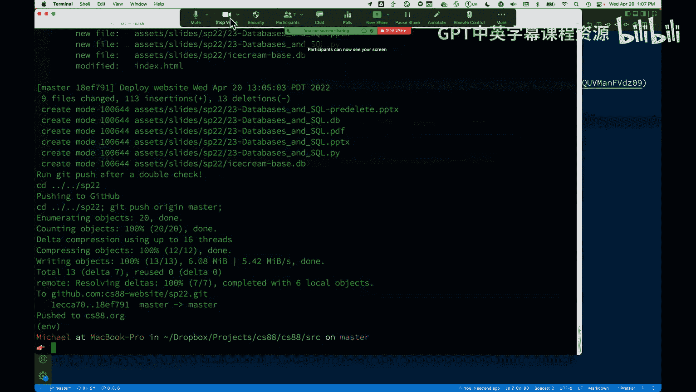

Sure。嗯。是。Oh。

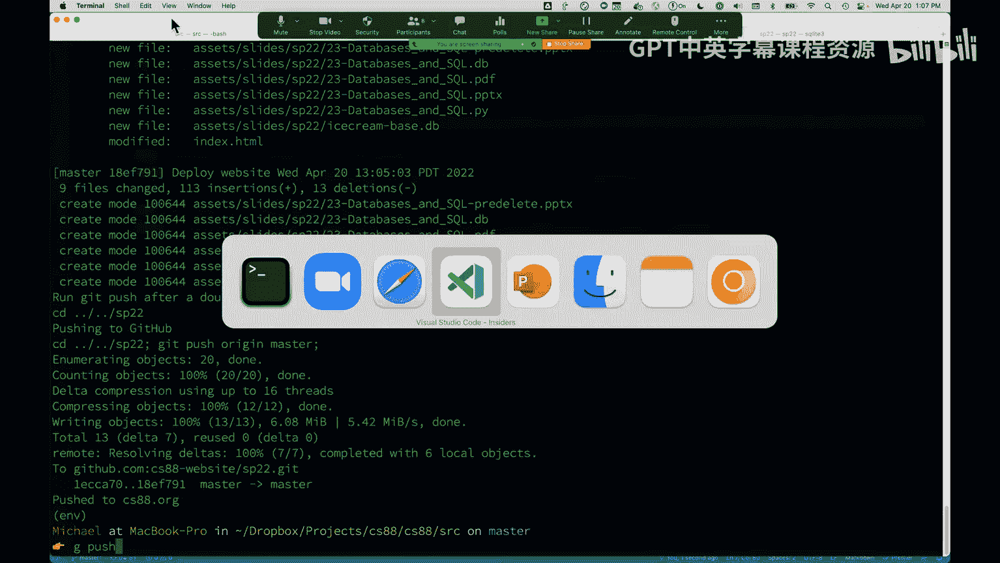

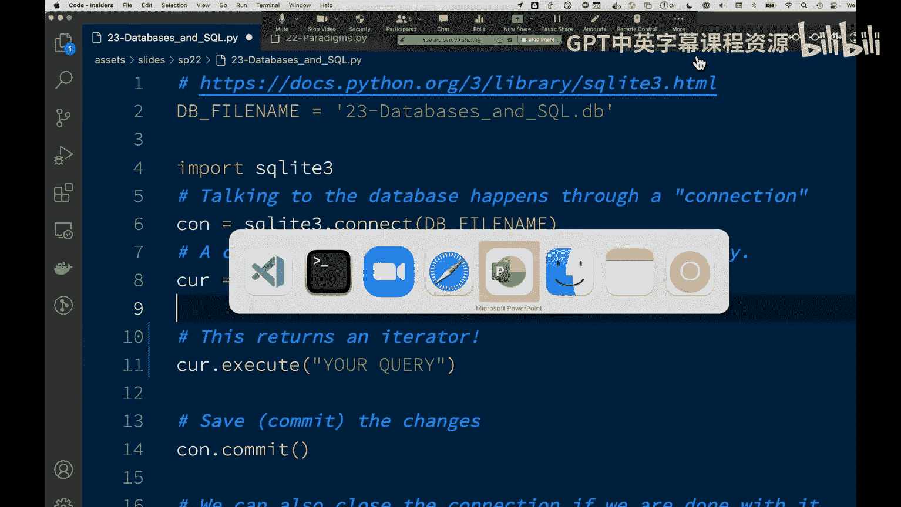

嗯。嗯。嗯。啊。Okay， let's see。Go a couple more minutes， but。So think of' all answer here。出。Okay。好。Okay。

Yeah。Okay。嗯。Yeah。嗯。Okay。对。嗯。Yeah。是的。Me。Yeah。去。Yes。好是。Yes。嗯。Okay， cool。

 so today we're going to talk about using databases in SQL。And other than that。

 if I go back with the PowerPoint， come up new。不。Okay。There we go。

 no real announcements other than just making sure that you're keeping up with the deadlines for ans projects。

The slides should be on the website now。If you refresh， I think they're up there。If not。

 I will add them after lecture， I don't think I can do it right now。嗯。But on on Monday。

 we talked about this idea of different programming paradigms and we said that the next thing that。

We would be using to explore the programming。Is this idea of learninging SQL as a programming language？

And just a minor note that doesn't really matter， but SQL。

 which is an acronym for the structured query language， is written as SQL， but it is pronounced SQL。

 you can say SQL if you would like， doesn't really matter。

 but the wordSQL as an a SQL to a movie or film is the same thing at least as the language SQL。

And so what we're going to be doing is practicing SQL to give you a taste of programming in a different language。

 it also turns out that like for data science，SQL is one of the most useful skills that you can pick up that you can build。

 and it is a skill that I think you can start with what we show you in CSE8。

And from there just keep learning more and more of the tools that SQL has it's not something that you should go you know open up the book and like read all the functions and things that you can do to try and memorize them I mean maybe they find that interesting it's fine but it is something where practicing these ideas is。

Is super useful so what we said is that SQL is a declarative language。

And so we're describing what we want to compute and in particular what we're going to be doing is working with databases。

And tables the data and we're going to spend some time doing that today。

 and so our goal will be to describe what we want the results of our data that is returned to us to look like with respect to some understanding about sort of what data exists in our system。

So SQL takes this idea of a query， a command to the database。

 and it runs through a bunch of work behind the scenes to interpret that query and turn it into a meaningful result。

 and so we'll be working with different kinds of queries over the next couple days。嗯。

One thing to just be aware of is that outside of CS88。

 there are variations of the SQL that you can use in various database systems， so we're going to use。

 we'll talk about SQL light， a particular implementation of SQL， a particular database。

 but everything you' in CS88 should with very minor exceptions。

 I don't think we do anything to advanced， should translate over to any other kind of SQL database that you might encounter in a course or a research or in industry。

And so the basis of what we're going to spend our time today is with this one statement called select。

 which returns to us a new table of data and we'll spend a bunch of time getting there we'll look a little bit at creating tables but all of these things are basically commands。

That we give the database system that have some action that either manipulate data， they update data。

 they sometimes aggregate compute things， they sometimes just give us more information back。

 but all of these things allow us to work with it in a way where we get to describe what we want to happen without necessarily worrying about how that should happen in database so why。

Aside from the Declarative program languages， why is using databases and approaching data in this way useful？

Hopefully you've had a chance for those of you who have taken data eight to sort of get a feel for this or if you've had a chance to do research or be involved in a company。

 data that is all around us sort of lives in various places you can hand someone a CSV file or an Excel notebook which has data which happens to also be in this nice sort of table format of rows and columns。

 but on the internet right， Gmail has a database of all of your emails somewhere。

 that the Gmail website uses to read those messages and display them to you。Have Berkeley。

 all of the infrastructure for better for worse， that powers things like Cal Central and the classes。

bererkeley system。Is backed by not one but many different kinds of databases that contain what classes you're enrolled in and what classes you can sign up for and the ridiculous amount of rules that control whether you can or can't enroll in a course as well as things like grades and things like that and all that data gets read from databases that applications like CalC interact with in a very similar but somewhat more complicated way than what we'll do today with with our own databases。

嗯。😊，But all of these things share the fundamental property that what we're going to be doing is taking this idea of a table of data and treating it as an abstraction that we can query that we can manipulate and so on and so if you enjoy this again。

 if you continue on with computer science， CS186 is sort of the follow-up Data courses。

 I believe it's now given the code data 101 is a data engineering course that's being developed。

 it's been taught under a couple of course numbers recently。

 but that would also be an excellent followup to this course or a data 100。

So what are we talking about here when we say database management system outside of CSAD8 outside of the lecture today。

 what really happens is we take this idea of a query and we're going to work with those today and we send it to some system which is itself another program that interprets that query and whose entire job it is to execute that query against whatever actual data it's managing and so the database system itself manages this interaction between what are you asking for and where do I actually store access。

 save that information a away that is safe that's efficient and fast and the really nice thing about this is that。

Even a simple database that we're going to use like SQL light。

Handles all of this work for us such that when we write a query。

 it makes sure that that is happening fast and efficiently。

 it keeps track of where all our data is and so what we'll see is a new file type today that will be our own database system in practice some of these systems span anywhere from a large server to hundreds or thousands of large servers today the database that we'll use of course is small and so it will just live on our computer Python has a really nice interface to make to make that work。

But outside of CSA CS88， you might encounter。largerger systems the really nice thing though is that like in practice。

 even though those systems get larger， the fundamental ideas of this table abstraction don't really change so。

Our goal will be to use a Python interpreter， which is its own kind of application， right。

 the same Python3 command that we've been using and exploring and running our code deficitta semester。

That is an application which will then make a connection to the SQLite database well ask for some information and then our job will be to process that information in any particular way in data8。

 and don't remember how much things have changed over time。

 but they abstract away some of the logic of reading data from files into the table abstract in the data science library。

What we're going to do today is just look at a different form of interacting with data that lives another place and doing it through a particular interface。

 which is in this case SQL what we're going to do is use some operations that get called relational algebra and that is because we'll talk about sort of what this table means but。

Essentially it's just the logic that our databases use to operate a query so if you're used to saying things like where some rows are greater than some value for data8 or given some conditions A and B or A or B。

 depending on what you want as your result， those types of operators that you've seen in data8 we' map over and if you haven't taken data8 will be a little bit more perhaps catchchup or learning to do but for the most part。

It shouldn't be too bad so in data eight right everything that you do for the most part starts up with this idea of some kind of data in this thing called a table and a table is just a collection of data that has rows and columns。

Each column has some label where that might be a course that might be a number。

 but all the data in that single column should share the same kind of type right those should be。

If it's a price， everything in that column is some kind of a price。

And everything in a row together are related attributes of the same object so I might have a table for a database of courses so a course might have a name it might have a course number so our name might be computational structures and data science the number would be 88 maybe there's a department right which would be computer science and maybe it says time and so it's Monday Wednesday on to 2 pm and then there's another course for data 88 E so the department would be data。

The title would be economics of data science I forget what the exact title of data 8 A E is but those rows would all apply to the same type of the same object so different attributes of the same object so we're going to do this through sQL。

But in data 8 you use the data science module， you use NMPI。

 which has tables in probability or Stat 134， you use some of this logic in R another programming language。

Tables exist in all sorts of places and of course what we do with a table then is aggregate and display that data and today we're not going to get into graphing or making pretty visualizations we're just going to get raw data back from our database。

 but once you have that raw data， you can then turn that into useful interpretations。嗯。

We're mostly going to look at simple operations like reading data today。

 but doing things like grouping data， aggregating data。

 pivoting data so that the shape of the table is different all those things apply so if you've learned operation in data eight you'll be able to apply it in SQL even if the syntax is a little bit different。

And then we will get to next week joining tables from one thing to another。

 but there's lots of operations that we can do。So。The idea here for our database system is that we're going to make sure that everything that we're doing interface our faces with some sort of table。

 so this we have a table of three records。And three columns。Each column。

Ha has a label here each record has our three values and each value of course applies to the specific the specific column so in this case we have Berkeley Cambridge and Minneapolis are three different cities with three different latitudes and longitudes。

And every column importantly， the values in that column share the same type。

 so it would not be appropriate for a latitude or longitude to have some kind of a name or some other value。

In Python， Python is pretty loose with us right we can store any kind of data in a list。

 we can store any kind of data in a dictionary， it doesn't matter whether our dictionaries have different keys。

 if we have a list of dictionaries because those dictionaries are different。

 some keys can have integers as their values， some keys can have strings as their values。

 the same thing can mean or the same key can mean different things， different dictionaries。

 a database system's job is to make sure that this nice rectangular thing。

 stays nice and rectangular that if something is in a column。

 it should respect the setup of that column， but if we say this thing should be a number。

 the database system， its job will be to make sure that we stick with numbers。

That's what we're going to be doing is we're going to be interacting with a database and today we're going to do it in two different ways。

 so the database that we're going to be using is this thing called SQL light or SQLL3。

 there is1 L in the spelling technically but people usually say SQL light as two words。

And one of the really cool things is I will say that this is sort of the first time in CS88 that we give you code which really interacts with the outside world that we are going to be working with a file in your computer and reading and updating that file which also means that this is the first time that like you could potentially erase some data now the data that we're using is like simple database with example data if you erase all the data in there it's not a big deal。

 we're not going to give you anything like erase your hard drive but I do think this is one of the cool things where this is a point that now your Python programs don't just take in some function it's not just running doc tests it is you interacting with code that actually interacts with something outside of Python and there's a whole bunch of other examples so for a very last lecture' try and show some of those of where to go。

Outside of a database as well， but for today。We're going to work with SQL like3 and the really nice thing about this is that SQLL3 is a super popular database for things like managing data that lives on one computer。

 so it's used in a bunch of research projects， but a bunch of applications that are either on your phone even or your computer like on Android。

m pretty sure Android， but on iOS， the photos app， your database of photos。

 at least at one point in time was a SQL like database。

 it might have changed a slightly different technology。

 but it's a database which says here's a photo， here are the attributes about a photo。

 here's where it was taken， here's any photo libraries that might be there if you've used like the find similar people in a photo feature on your phone it stored in some database somewhere the people that it thought was in that photo so that it could do things like select all the photos with your friend's face in them。

That you could find all those things together so SQLL is a really common tool for for databases and problems like that everything that we work with with SQLLite will live in a file called dot Db。

And what we're going to do today is interact with SQLL in two different ways so the first part is we're going to interact with SQLL through Python3 the point is not really to read or understand exactly all of the code that exists on the slide unfortunately it is one of those things where there's a little bit of this boilerplate code that we have to do some setup to connect our database but we're going to interact with the code through Python。

Now that you know about iterators explicitly， I can tell you that what this statement here that it say results that says cur。

 executeecute of some query， this thing returns an iterator of results。That we can iterate over。

And so we'll work with that the other really nice thing is you know if you use a Python notebook for on Jupiterhub or datahub。

 SQLL is also just built in there， the same commands work， but you just say import SQLL three。

The three is important for the module to work。But because it's nice and lightweight。

 it exists in pretty much every environment without too much hassle。

All the same commands you can work through in a notebook on datahub right you might need to upload a file to be able to import that。

 but SQL like3 also works without a file， it just happens that we're going to use some sample data so this database of ice cream cones is a nice simple thing。

The other really useful tool that Selitete gives us is the sQLite console and the sQLite console is。

Similar to the Python interpreter， but for that database and so we give it a file name and once we are in the SQLite console。

 we can do things like interactact with inspect the database importantly the SQLite console has a command that it tells you right when you open up a new console says enter help for usage hints and so if you ever receive something like that and you're new to a tool you just type whatever tells you so in this case help and you get a whole bunch of commands on the slide I've just shortened some of them。

 but these two tools SQLite and Python are going to be two primary ways of interacting with this database for your homework assignments you're going to write some code in SQL files which are just dotsQL files that get run。

Against a particular database， so code that we interact with can live in。

In all sorts of different ways but。In this case， what we're going to do is spend a lot of our time today exploring the SQL light interpreter and then also exploring code from Python So。

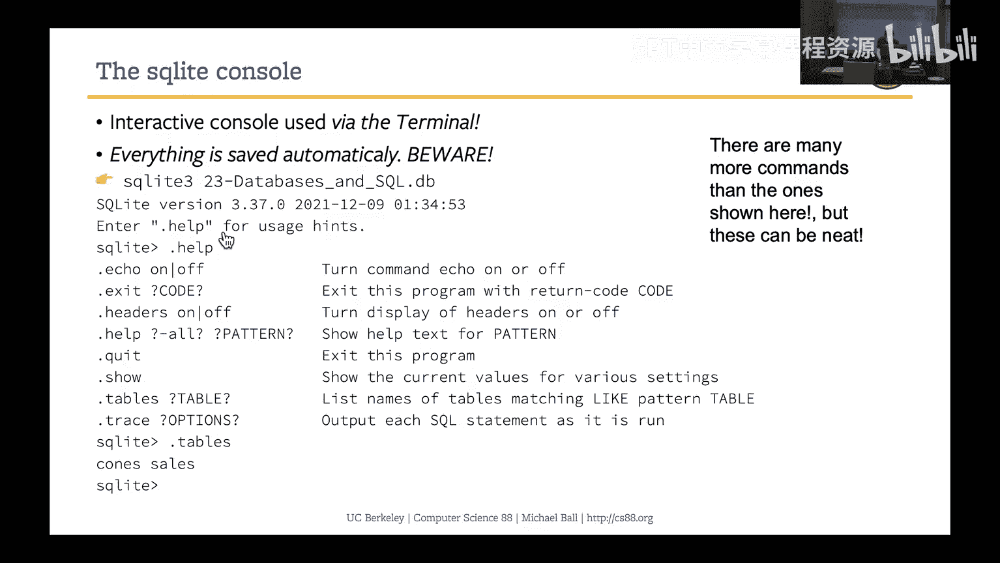

Before we jump。Into that。

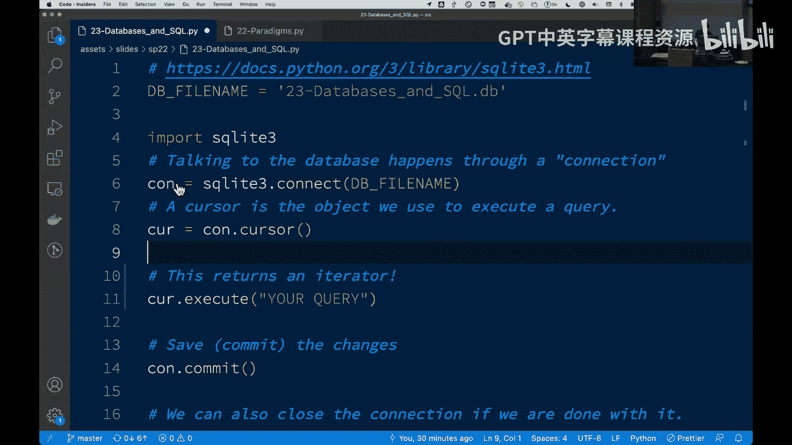

Is there Python code。Yeah， any questions about just this idea of a database so far for the most of the rest of the lecture。

 we're just going to play around with some example queries with the tools that we have。

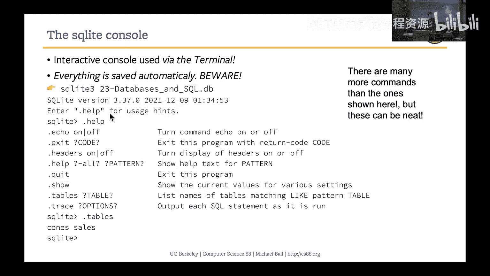

So。😊，嗯。是。All right。I' going to start a new session just so that it's。Well nice and clean， he has。

So makes that a little bit bigger。We'll start with the SQL light console and here we give it a the name is SQLL3。

And all we do is we give it the name。Of of a database file that we want to start with。

 you don't have to give it the name of a database file， but this is in general。

 the easiest way to interact with a database。And when I do this， we don't get much feedback。

But the console loads our database in， it's now in a state that we can interact with things in a database so again。

We type we can type help there are a bunch of useful commands in here that are sort of lost in the list you certainly have no need to understand everything that goes on in here but one thing to know actually is that the SQLite console automatically saves our changes to the database file so if we do something later on like erase all of the table that will be automatically saved so it's something that depending on the context you do want to be careful about but。

Again， for today， there's not really any。诶。You know sort of danger in accidentally erasing the database you could just download it again from the website the one command that I do want to highlight if you're working with the SLite console is this command called headers and this will become really useful because if so what I'll write is I'll say headers on and in this case you just type enter doesn't really give you any feedback but this will ensure that when I start working on queries。

SQL83 will tell me what columns。I am working with so the first query that we'll write。

Is select star from and I happen to know that we have a table in this database with the name cones。

This is perhaps one of the most common and most useful queries that youll write when doing data science。

 when exploring a new database， when doing research。

 it gets used all the time is select star from codes and what this is saying is give me。

All of the data from some table in our database。😡，U and what happens here is our Site database says okay。

 you said select star now what does star mean star is just a term。

That says give me everything that is any of these columns so what's nice now is because I said headererss on our database counsel that I have a table here with a column ID flavor color and price so I have four columns in this table。

And each of these columns has a certain name I could。I could say just to show。

If I set headers off and I again， I can hit the uparrow like Python， I can rerun the same command。

I get no information about what these columns actually are。

Still gives me a sense where I can read this and think through what the data might be representing。

 but header when you're working with the console saying that you have headers on is。

It's a very useful tool to get a sense of what kinds of things you're working with。

That's the first thing about about this concept we'll talk about the structure and format of queries the other thing that is just worth noting is that there is a command here called dot tables so we have two tables in this data set one of them is called sales and I can again do the same thing select star from sales。

Ty it correctly。It gives me a new table which has two cashiers baskets and Robin I know that because the column name is cashier this is just some text and then I have a couple other columns I have an ID column。

And I have this third column cone ID and on Monday we'll talk about how we interact with two tables joining against each other but。

This is this is just another table in our database so one of the things to note that is so implicit here right is a database itself can contain multiple tables within that database each of those tables typically has a name tables don't have to have a names similar to functions but you it's useful for these things to have name we have two in this case cones and sales and in a larger project you might have cones you might have sales instead of just listing cashiers you might have a table in your ice cream shop called employees maybe you have if some。

Other table that represents other menu items or pending orders or something like that so you could have as many tables as you need in a database it really just depends on what what's going on the analogy that I would also make is if you're used to Excel right Excel is or Google sheetets you have one file and in that file each spreadsheet can have multiple tabs so one tab is akin to one database we might have a tab for cones we might have another tab in our Google sheetet for sales those analogies are pretty similar to each other so。

Without understanding sort of exactly how a query works， any questions about this interface so far。

 what's gone on？Any questions on Zoom？ so。So this is the SQL light console。

I'm going to do this in another tab。し。Yeah， that's probably fine。

So now what I'm going to do is open up a Python interpreter again。

 I'm going to do this with dash I so that we can live， write some queries。But what this is。

What I'm going to do is open the lecture file that should be on the website is our databases file。

And when we do this， what we have here is now a Python version of connecting to our SQLL database。

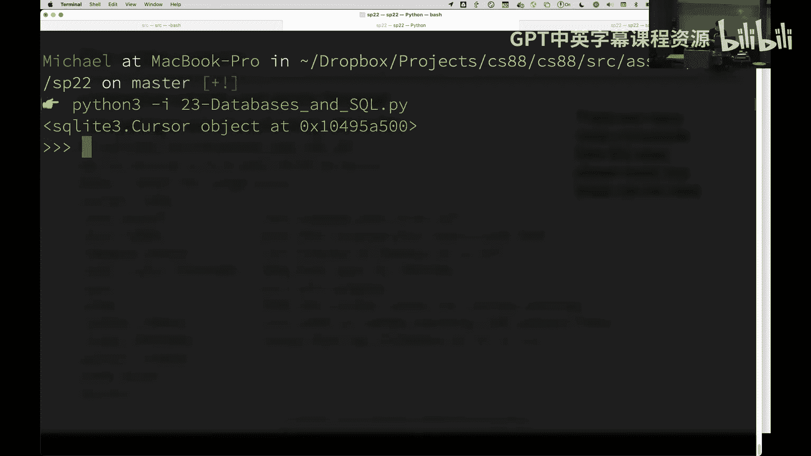

The trick will be that we get to write our queries down not just in a pure SQL console but from inside Python and so what have we done to get to this point actually。

 you know what？

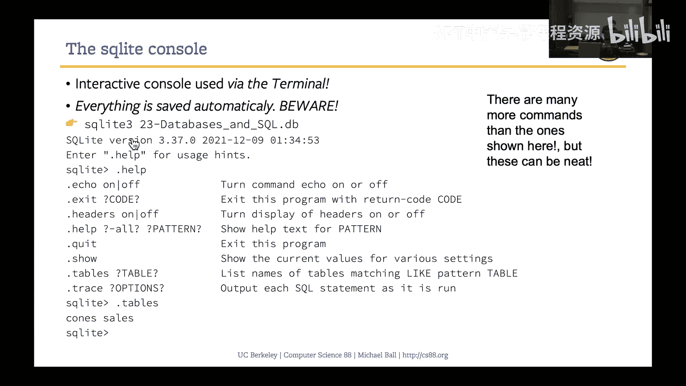

I。Should comment this out。Because we are going to need to。We're actually going to need to rerun。

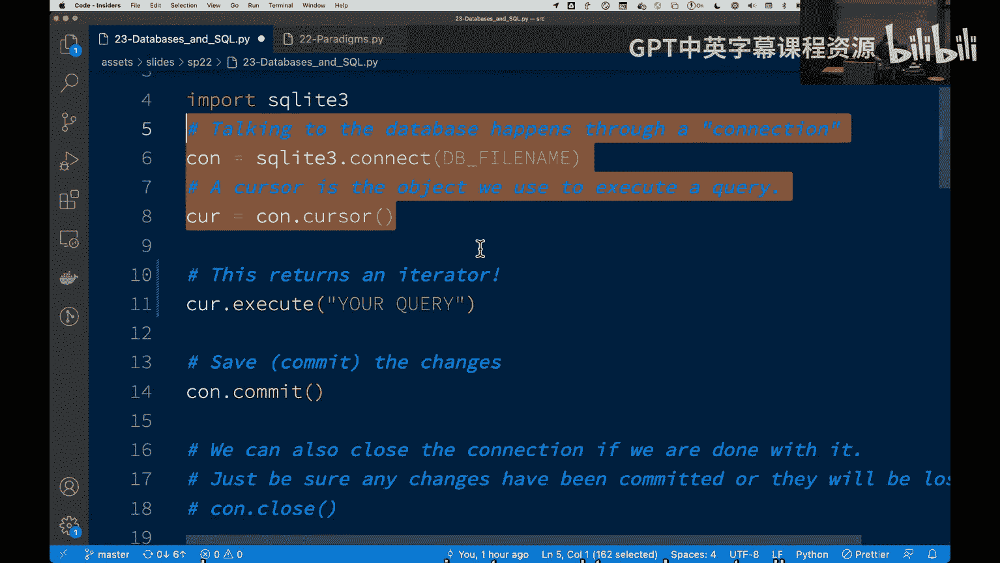

A couple of these lines。

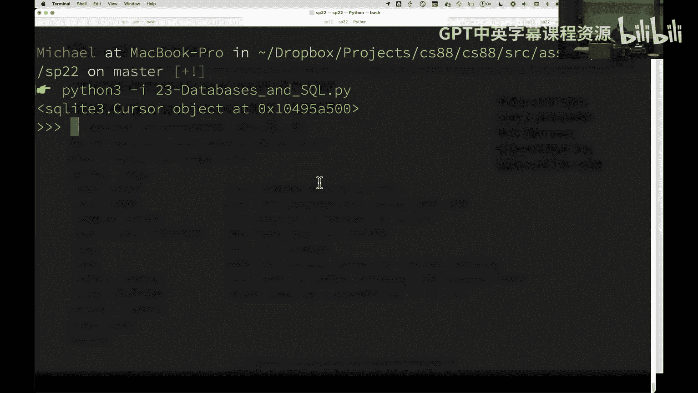

So come okay so what's going on here one thing to note is that when we're working the way that we're choosing to work with our database。

 we always need a file name。So we import our SQLite module and we connect to a particular database。

 so this is one Python program making one connection to a database multiple Python programs can actually be connected to the same file at a time。

 but things can get a little bit messy and SQLite3 is not the best for handling that so you can do it it won't stop you but for the most part we're just going to have one script。

Making a connection to a database and this just says this is the file。

 this is the object that we're going to be working with。

The next step is to create this thing called a cursor and a cursor just is the object for what tracks our positioned in reading data from our database。

And it's the object that helps us manage executing queries， so once we have a cursor。😡。

This cursor object has a command called execute and that execute command is what will actually run the query and return the results that captures that it returns the results。

In the form of an iterator， so if we just write a query。

We'll see that we don't get a ton of useful info。One thing to note with our database。

 Python by default， or I should say the SQLL module in Python does not save your changes to the database。

 so if you want to save your changes from within Python you have to call this command connection。

 commit and that just says everything that I've done take those changes those queries and write them back out to the file today this won't matter because we're just going to be reading data from our database。

 but in the future you might want to actually use this commit function。

To save those changes at the end when you're done there is a dot closed function and this is just good practice to tell Python that hey I'm done with the file I don't need to keep track of this resource anymore if you forget to close the file and or the connection and your python program finishes running nothing bad will happen but that's typically part of the flow so I've included these steps here just to show everything that you might want to do but you won't necessarily have to have to them so。

A couple just handy notes on this file。One thing that you will commonly see with SQL is in Python is to use triple coded strings so this just allows us to in the same way that we have doc tests triple coded strings are just one one string that spans multiple lines where all of our queries or all of our statements can be written in one string without roaring about new lines so this query is not long enough to really need to put up into two lines but it's pretty common to see queries in a file show up in double quoted strings and for demoing today there's just a small little function called show query which she'll be using to make use of that so。

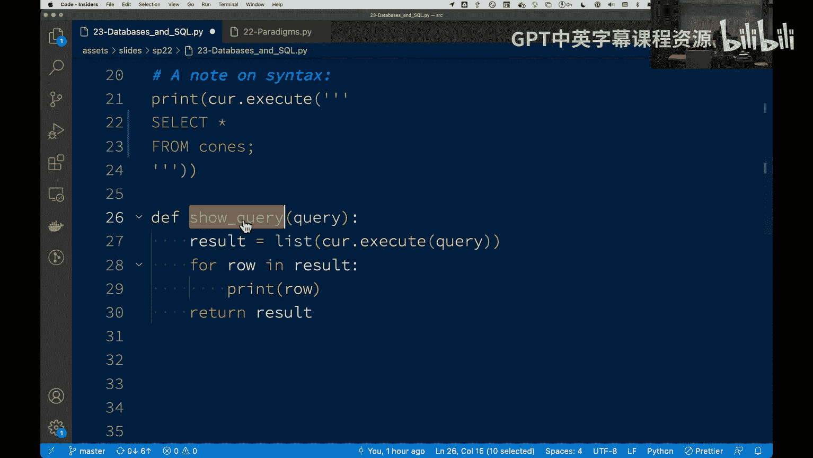

Again Python interface don't worry too much about the setup。

 but the important thing here is that we're going to be making use of just more of the tools that we've learned throughout the semester so in this case。

嗯。We have our cursor。And what we want to do is execute a query， so again。

 we'll start with the same query is select star。From。Cones。Put it inside a string。

 again our queries in SQL will talk about the structure。But in this case， we get an iterator back。

 so Ex King query itself is not super super insightful on our own。But because this is an iterator。

 we can say for row。In some query。We can print our row。

And what we get back from Python is a series of tus where each of these is our four columns again。

 so RID， our ice cream cone flavor， our ice cream cone color and the price。

And we can then do whatever we want by accessing values of that tool one thing to note here and this is where things get a little bit tricky in sort of the tools that we give you in CS88 and where outside of CS88。

 the programming libraries that you use get a little bit more complicated is that all we have access to here is a toolple of four values in this model we don't have a great way of saying。

What。You what are the column names， what are all the tables just to illustrate that。

That this won't work。I actually don't even know what will happen， but if I try and write。

This command dot tables， I'll make a note here。This won't work。But yeah。

 we'll just get back a syntax error from our database because。

Things like dot tables that only works inside our interpreter and what Python is doing excuse only works inside our SQLL interpreter that is a function of the SQLL program but not an actual SQL queries so in many ways if you're exploring the interpreter is really nice because I have you know I have these handy commands here like dot tables。

 but these are not themselves SQL queries so。So if we're operating in Python land。

 what we need to do is stick to SQL queries and sometimes if you're just exploring around you might find it useful to have both tools open and practice back and forth before we continue on just to illustrate another query since we should have before anything that I write here is that's valid SQL works so I could say select star from sales。

As well， if I close the string， close the parentheses。The short query function。

The way that it's written， it just prints all the results and then returns them as a list so that you could then process it if you'd like。

 but today we're just going to look at some of the results。Those are the two tools。

 theyre two different interfaces， but both of them are super useful。

 so we'll be exploring more of those before we get into the nuts and bolts of what a queryirie is。

 any question so far on this bit of Python or what's gone on here。嗯。

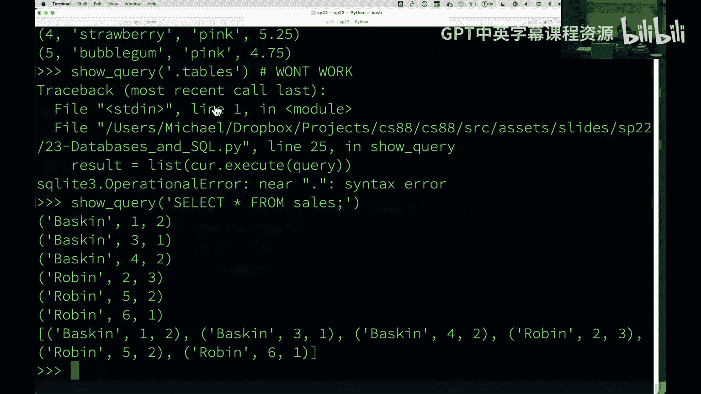

All right， well。嗯，我。Come on， why why。I move those slides。All right。

What does it mean to write a sQL query so the rest of today's lecture and Monday's lecture what we're going to be doing is just exploring all the things or many of the things that we can do with SQL queries so。

Each of these queries that is a select statement， returns some kind of a view of a table and there's lots of different ways that we can。

We can select data in SQL as a tool， but importantly what we're going to be doing today is we're starting off with things that select data from from some data source and return us a table as a result。

 so our first thing will be select our last thing。Will always be a semicolon it is worth。

Just being aware that SQL is a language is a one where every statement needs to end in a semicolon。

 but statements can span multiple lines so in this case what we're going to do is just type。

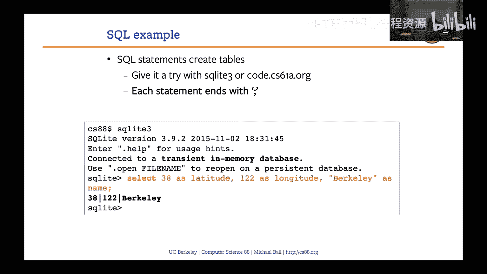

嗯。诶。Type in a query and actually I'll do this in the SQL light interpreter that returns a very simple table or one row of a table that we saw earlier。

And so in this case。I'll also mention that you'll see this on the slides。

 some of the examples the words select and from and other terms are lowercase。

 I typically write them。

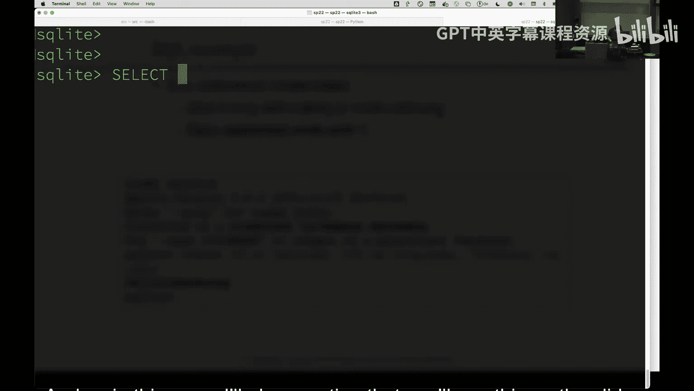

In capital letters， SQL as a language， the capitalization doesn't matter。

 but I personally tend to stick to all caps because it makes it clear what things are a part of SQL and what things are a part of the data or your own database so we can say select 32 as latitude。

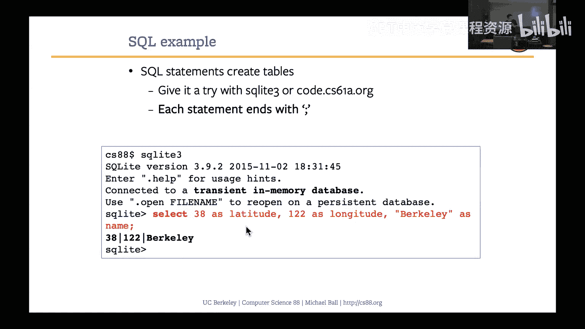

least not that the actual data really matters as longitude。Berkeley。As city。And in this case。

 what I get back？Is a I selected some data。But I haven't selected it from any particular data source。

 and so SQL just says all right， you actually put the data that you wanted。In this query。

 and so on the fly， it makes a new temporary table。

That has one row and in three and three columns in this case。

 it's because I named each of these columns that we see that we have our headers here。

I can't even like I should be to just。Say， actually I think this should work。Yeah， if I want to。

 I could just select some random data and if I don't give it a column name。

 SQL light does the somewhat confusing thing of making our data。Also be the column name。

 so you don't necessarily need to say data as some name。But in most cases， if you're。

Going to be working with data， it's really helpful to give it a useful name because that tells you you know never mind anyone else who's not reading your mind what that data is so we can select data from nothing and what we still get back。

Is a table， but in this case it's just a table of one row with the values。

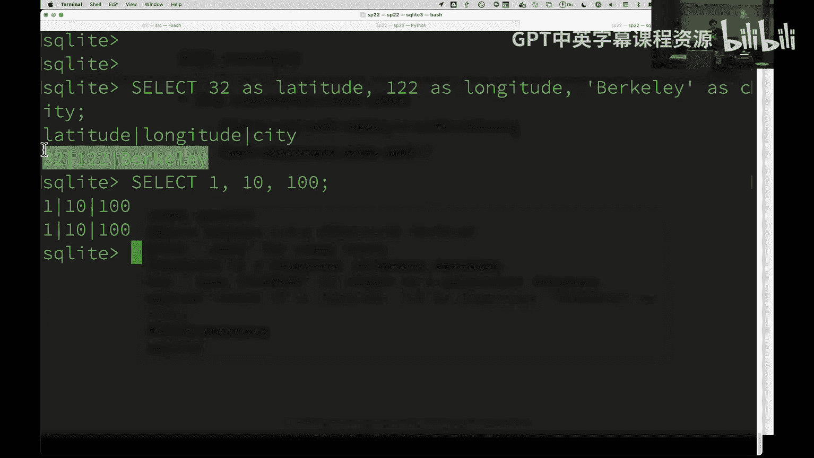

That we asked for。All right so。So everything itself is a table。

And so what we're going to be doing is to keep working with this ice cream data set by demoing you and I mentioned it before。

 but in this case， what we're really concerned with are going to be our three values flavor。

 color and price。One thing that we won't talk about very much in this course。

 but in the datas that we've shown things are set up。

 each one of these rows in our database also has a column that's just called ID and that is just the number that uniquely identifies a row in our database by some value that is not necessarily its flavor color or price but is easy to reference it's always helpful to have some kind of ID value that is。

Not related itself to that particular data， but is tied that ties that data into something that you can reference later on so on one day the fact that we have an ID column will become really useful when we look at our sales table。

 but that's just one note is depending on how much just changed in data8 since that slide was made a little while ago I don't know if the data sets exactly the same。

 but it was there at one point in time so。So what does our select statement look like select from having seen what we did。

 we specify a description of the things that we want separated by comma。

 so we've had latitude of longitude in city。呃。We can select just an individual value so we could select strawberry。

As flavor， pink has its color and 355 as its price。And this creates a one row table of three columns。

And if we want to in our select statements， we can make a table of multiple rows by combining things together。

 so this would be one way that we can start to make a more complicated table in SQL is just by writing it in to a statement selecting data and returning a a larger table and I don't remember actually I think。

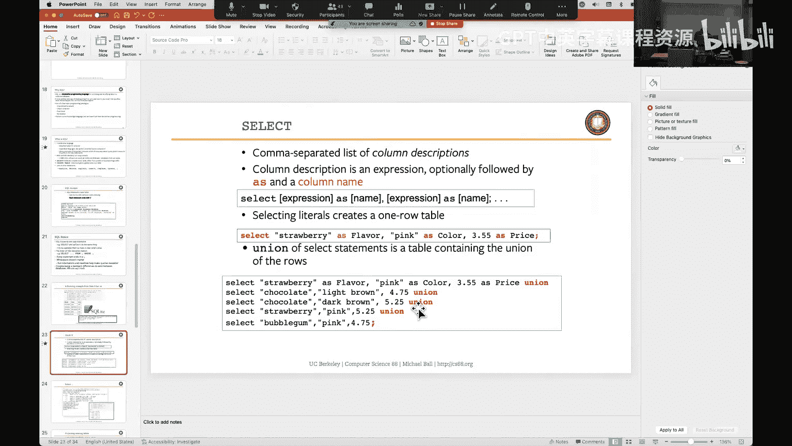

Okay。Yes。This should be something。Fat。If we paste it in。What we can see is。

We get back a very similar looking table。It all works just fine the union keyword in SQL just takes one row or however many waves there are and sticks them together so they do need to have the same number of columns。

But if you're familiar with mathematical set operations， union just works the exact same way。

 it says take all the things in this set and stick this other set of data together in Python we should be able to do the exact same thing。

So we have our show query。Function， so I'm going to take this。Paste all of our lines。

Put it inside three。Triple quotes。And run through the query。And what to get back here are。

Our five rows in this table that we could process again， typically you might not。

You know createreate a table in this way， but this is really just what the select statement is doing is it's taking data and ensuring that it arrives。

In this table format。

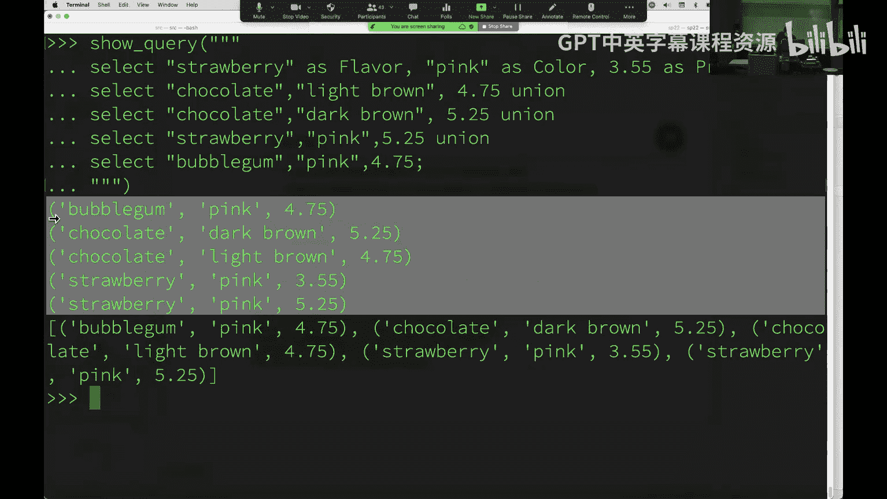

So。That is our select statement， we can select whatever we want。And each of these statements in SQL。

 the really nice thing is like Python where we have an expression。

 we can just start to build up the different kind of values and commands that a statement supports so previously we said select columns we've shown from some table so what this means is any table that has a name in our database。

 we can select value specifically from that and now what we can do is we can also filter data by some particular value。

And we can optionally order that data or the results of our table by some column or some other expression and each of these things selecting from a column name。

From some table where some condition each of these things take similar expressions that operate on columns and data within our table。

 so in this case。We're just going to do。Gocom on。I'm just going to execute a couple example queries。

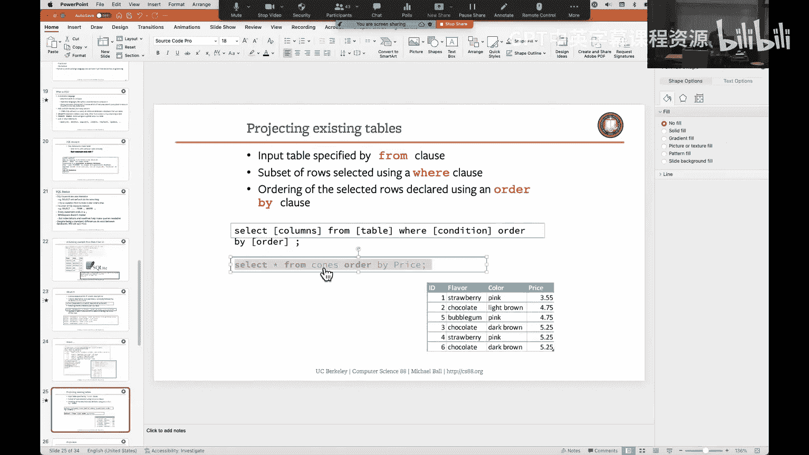

Oh let's get see， that's one trouble is pasting your raw SQL query into Python isn't going to get you very far if you moving to paste it in the SQL like console。

 but in this case what we've said is select star so again starting everything from our table ordering by what by the price column。

And in this case。Order by by default orders from least to greatest value and what this means is。355。

 475，475525 so all of our rows right order it just。And if you notice with the ID column。

 what's kind of nice here is you can see that the order actually did change from what our original result of our table was。

 so we can sort of show that you we didn't just happen to structure the data in this way but。

Ordering is another one of those tools where， again， we don't have to call sort。

 we don't have to say what needs to be done to make this order happen。

We just give it some sort of expression here， this is just a trick。But SQL light has functions。

 one of them is random。And so we can call that random function。

And what Cite does is when it's processing that data。

 it just keeps calling that random function and this will give us。A random sampling of our data。

 if we really needed to， which if you go do research is a useful technique for ensuring that you you're not looking at just the first five or six rows。

And for our final example， we'll do what was on the slides is。

We'll look at using where to filter data， so one one thing to note about SQL as a language。

That so far has been so implicit is that the order of our statements matters a lot。

 so we always start with something like select。From some table where some expression that we write。

Ordering by some particular function， so I can say here where price， not prints。We at price。

Let's see what do we want let's say all of our expensive cones are the ones that are greater than five5 and we're going to order as well by。

At price。So what we have here is just two cones whose flavor value is greater or whose price is greater greater than $5 and our projected table that we get back is just these two rows。

And so this is really the great thing about SQL is that as we sort of build up the things that we can do in SQL。

 each of these things is just a series of commands that we can start adding together to build up more and more complicated query。

 so we have select from where and order are now the before components of a query。And of course。

Perhaps。We don't care about everything else， but I could just say flavor and price。

I type that correctly as the thing that I want to select on and now what I get back is a two column table with just those values so we'll leave it there today that's a start at SQL and now what we'll do next week is just build up the types of things that we can do with the SQL yeah and a good question in zoom chat what is a star mean the star means just give me back every column that exists in this table so if there' are four columns in my table i'll get back four columns of my results yeah yeah other question。

同意。Specify。八こ。Yeah。这か啊。Yeah， so that's a good question so when we said select let's see let's go back up a bit。

When we said something like select some data withouts from。

 this information SQL is building a table in memory， so it's not saving it anywhere。

 but it is a table that we can interact with， but it's just taking whatever is in the query。

And returning and returning that value， so because I showed the random function。

 like I wouldn't actually do this。Very often， but you could just say select random and you'll get back a very large random value but the reason that we do this is everything in a database has to be in a table in some form so each of these things like if I just say random。

Without the word select I get a syntax error because the database doesn't know what to do with random it knows how to execute a random function。

 similarly you know it doesn't know what to do with the value 100， but if I say select 100。

It says you're selecting something you want a table。

 let me make you a table whose only value is this thing 100。你 database。Make a new table，哦。

Yep yep and next week we'll look at the command called create table which will let us build a table with a name so that we can actually modify and create values yeah we're not storing anything here yeahep yeah and it's in the slides already so if you want to jump ahead it's most of the commands are relatively simple once you know it to look for but yeah next week we'll actually look at creating and modifying our tables thanks yep thanks everyone we'll see you next week。

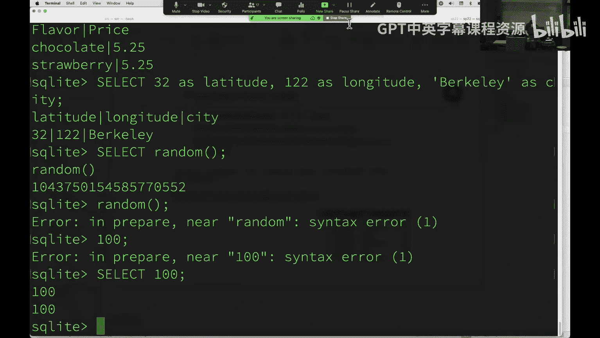

Okay。Yes。即 are you。Yep。It's just like a really weird question but I noticed that like you know in the in the terminal and then like a lot a lot of like other coding sources they have this certain aesthetic of dark gray background and then like you know I noticed towards a brain and then' like you know it's tiny sounds packed together like that like I learned like other design cores that people actually like。

U I don't want to say It it's like they probably respond better to like， you know。

 bigger font and they this isn't the most excessive yeah so like I'm just like I just thought this is super entri in then I do you know like the history of this aesthetic yeah I don't know how so I think like many things right the history is more just circumstantial than anything。

なすそうで。but what so the green on black thing， I don't even know why。

