# UCB《数据科学中的计算结构｜CS 88 Computational Structures in Data Science 2022》中英字幕 p24 CS 88 Spring 2022 - Lecture 24 - 4_25_2022.zh_en [BV1516iBfEVY_p24]

就是。

Testing， okay。Bring the down。Okay， cool。 looks like。

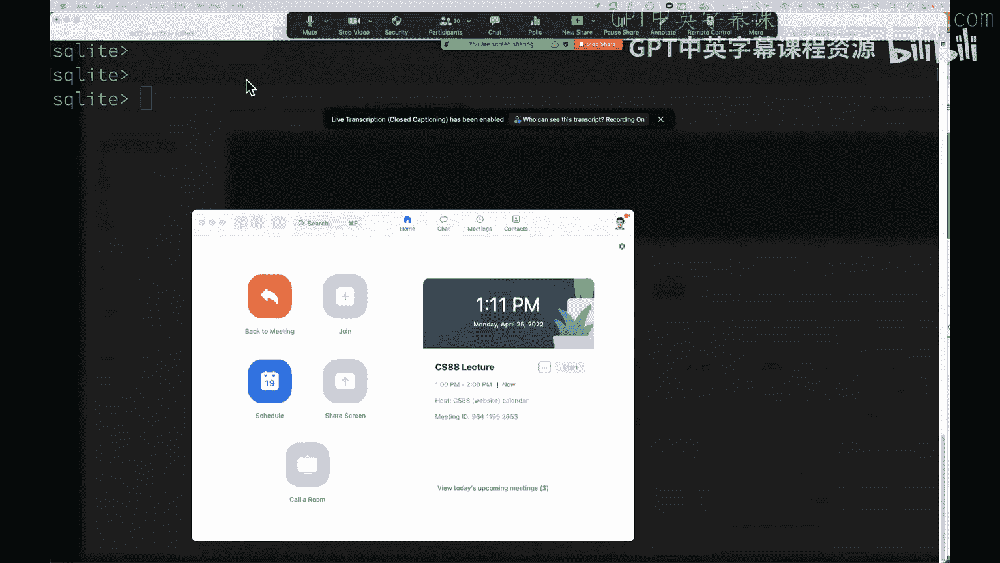

We。Just about ready。

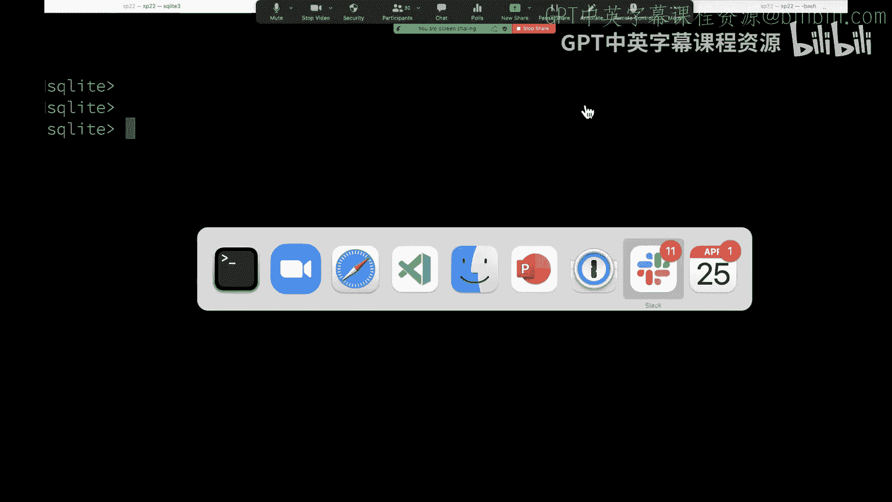

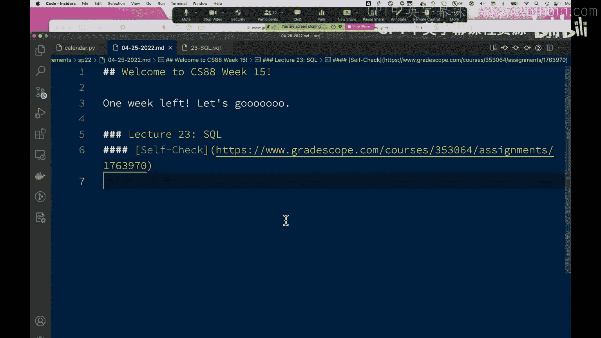

嗯。Right。

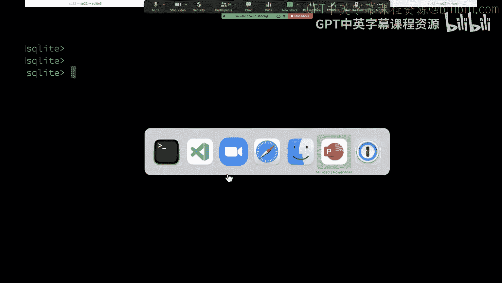

Okay， cool， so。And actually， one。Last zoom thing。嗯嗯。Right right， Zoom camera is not cooper。

So just before we get started today， we're going to wrap up the SQL topic。

 We don't get a ton of time with it， but we'll go through some of the features。

 some of the ways to think about problems that we can solve。

But before that I just wanted to highlight this week so this week is a little bit busy but it is the last week of classes so our goal is to hopefully have everything we'll be wrapped up by Friday you'll have deadad week to study we be posting updates during deadadwe about various externally hosted review sessions the tutors will also be running review sessions as well。

So， there will be。嗯。There will be you know chances next week to get review and on。

 but main thing is if you would like an early extra credit point for submission。

 the ants project would be to you Tuesday night， otherwise it's due Wednesday night。

 if you have slip days and you would like to use them。

 you have up to three slip days to use on each assignment。

So feel free to use your slip days you get to trim the project in late without asking。

 and so that is available as well。For both ants and homework or your last homework assignment otherwise main thing is that ants will be sort of wrapping that up the last homework do Friday is on SQL so today's lecture might be helpful for that and otherwise as we get into the final the main thing to do is to watch out for a couple of announcements so we will be running a final survey。

And enough people fill it out。 The entire class will get an additional bonus point。

 The exact numbers， we always sort of mess around with， but you'll get an email about that soon。

 same deal with final logistics。 you'll have messages on Ed about that。

 But the final will look very similar to the midterm。

It'll be three hours if you need to take it remotely or prefer to you'll be able to do that with zoom proctoring for those of you who have an accommodation that will be provided and will have an alternate time about 12 hours later if you have a conflict with another course main thing is Tuesday 8am final so set one alarm or 40 alarms if you need to set 40 alarms that's fine。

I will fully admit I once slept through part of an 8 a final this is no more panicky feeling than realizing that it is 805 a and your final started five minutes ago you know if it happens。

 you'll be all right things work out in the end， but obviously not the best thing for your grade to sleep the final so I do recommend setting extra alarms so。

With that， what we'll do today is we'll go through some of the rest of the features of SQL and the way that we think about working with tables of data。

And the types of problems that we can solve。So where we left off last week is we were selecting data from a database and we are selecting data。

 which means we are creating a new table that we could view that has some combination of results of that data so what we left off with we had a database that was the SQLite database file。

 we opened it up either in Python or the SQLite interpreter again today I'm going to use the interpreter to type queries in but。

You could do this totally from within Python and we executed a query。

 We got back a view of that data with whatever we asked for。 So what we had done on。

Last week was to do a couple different things is one。

 we just showed we could select any data we want in SQL light。

We'll just create a temporary table that is a view of that data and what we're really trying to illustrate is that whenever we select data。

 the result that we get back is some table some number of columns and rows that we can interact with。

 but what also turns out to be really useful。I。Selecting data from an existing table。

 and this is the majority of what you'll be doing when working with SQL is we select some set of columns from some table。

And we can optionally start chain things that we want to do so we ended Wednesday by saying selecting some data where we have some condition and we could decide how we want to order that data so a really common operation right is in this model we have two tables are ice cream cones which are the things available for sale and a table of sales which you can think of as roughly one row for each type of transaction or each item sold at this sort of mythical tiny ice cream shop。

And so a very natural thing that we might do is to select the types of cones that are expensive and order them by the price or perhaps select the types of cones and。

Order them by their name， you could order and filter by really sort of whatever you imagine your operations to be。

That is where we left off last week again， and we do this by just saying select。

Whatever we want to select so we often again use star to represent every single column in our database so if our database has five columns。

 we don't have to type out all five columns if our database has 500 columns we would get a result with 500 columns back the data that will give you will not be anywhere near that large。

 but there are definitely datas out in this world that have hundreds of columns and thousands of millions of rows which are a different kind of challenge to work with but again these SQL statements because they're operating at the database level because they are operating on a table of data。

 they're fundamentally the same statement， whether we write them in this interpreter。

Or whether we call them through a notebook。Why are we going there。

So we started by filtering queries and here we use the word where to filter on some particular condition。

 so like Python where we have a conditional statement like if a is greater than B。And SQL。

 are where statements are the same thing is any condition that we can combine with price is greater than less than some value with we'll look at some additional things with text contains。

Later on， but anything that is in here that is a boolean expression is a valid wear condition。

 and so we'll be doing a bunch of different queries today where we create those conditions。

And of course， we can optionally order by some number。On Monday。

 what we did and we'll just hop over to。嗯，我给。

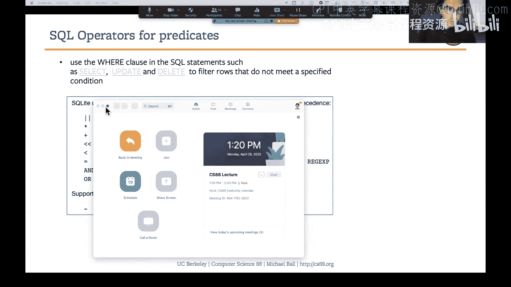

That of the way， actually it will hop over to the terminal。

We left off doing something like this where he said select star。From cones。Where price。

Is greater than some value。In this case， we said perhaps five。

We could optionally say where price is less than five。

 whatever whatever it might be and for things that have direct comparisons， where is a great option。

 you know it's easy to manage imagine using less than greater than equal to as our expressions。

 but what's cool about SQL8 and indeed。

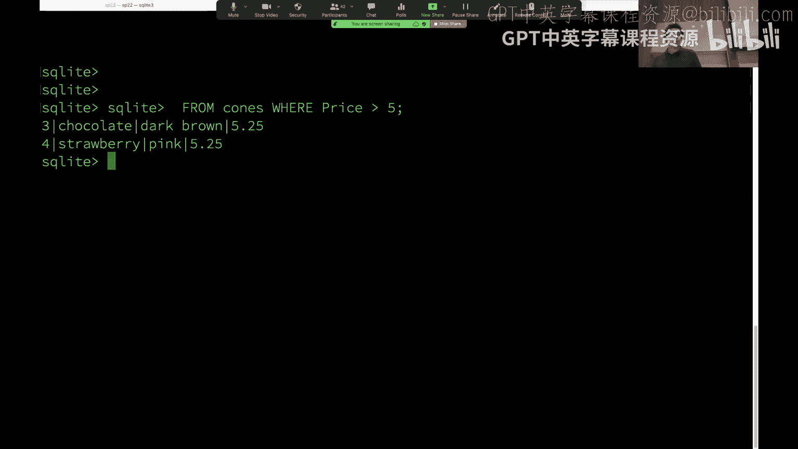

Most databases。

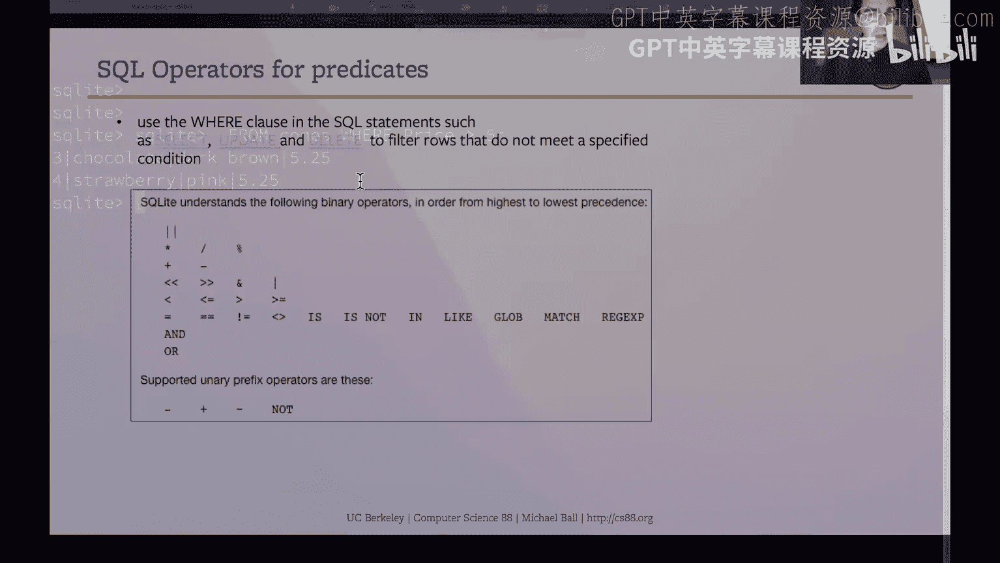

呃，is that。We're not limited to just。A， a few simple operators。 So importantly， you know。

 anything that that is a boolean expression。 So and or or not on this table。

 we're not going to go through all of these， but。There are。Interestingly。

 a few different ways of writing is equal and is not equal in SQL the differences。

Outside of CS88 might matter， but in terms of what we teach you in CS88 don't matter。

 you can use any of the is equal or is not equal functions。

 but there are a couple here that are pretty cool。That are worth highlighting so some of these are the things like in。

Like。We don't talk about regular expressions they're one of the topics that six to8s cover so you could look at recent6 to8 slides but they're a way of matching text together they are pretty tricky to write and to get correct but they're a cool tool but what we will talk about is this idea of。

U。Using some of the functions that SQL has to do what we can call approximate matching or approximate filtering on data。

 and this is sort of giving us flexibility to say I want to find rows that are similar to some value and what SQL gives us is this keyword like。

So again， we say select star from cones。Where flavor。

Is like berry and you might notice on the slide that the way that berry is written is kind of funny is we said percent berry。

 the word be percentage sign again。AndThis is because operators in SQL and indeed places in Python and other program languages tend to have special syntax that affords particular meaning。

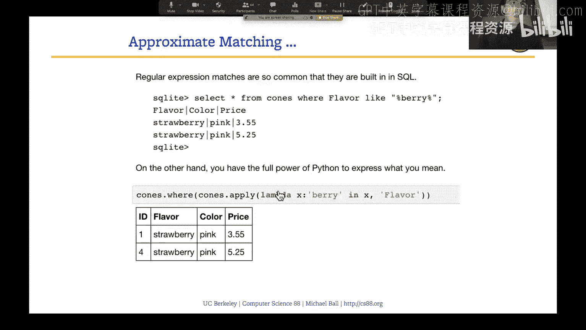

What if I wanted to say， how do I find all the words or all the flavors that are some kind of berry。

 maybe there's strawberry， blueberry， raspberry， there's hundreds of kinds of berries。

 including berries that are berries but not named berry so we won't be able to handle that today。

 but the way that I write is again we'll select star from cones。Where。

And we give ourselves a column name。Flavor。The SQL operator here is like so again in SQL most of our operations are written the same way that we write mathematical functions it is a plus B。

 a less than B A like B in this case and so where flavor is like，Some。哎。Some value。 So in this case。

 we're going to say percent。Barry percentage sign。And。What we get back are。

Two types of combes that are both differently priced flavors of strawberry， so what's going on here？

In SQL。The percentage sign。When we use when used with like has a special meaning in the same way that star matches any column。

 the percentage sign will match。Any kind of text， and then the words vary。

This says that match anything that has the word very inside。 so I could。I could let's say。

 write an expression， so at first I could say， well what if I don't include any percentage signs。

 let's actually try that。B， E， R， R， Y， if I spell it correctly， if I ask for sQL to say。

 give me something like some text。With no additional information。

 the like operation is just going to say are these two things exactly the same pretty pretty typical。

 this is no different than saying where flavor is equal to berry but there's oftentimes when we're looking at data where we might not want to just look at straight matches and so what we can do is use tools like the percentage sign。

To allow us to say。Ma any kind of text that happens to fit here， so in this case。

Wherever we have a percentage line， what like is going to do is find every flavor that matches the letter C。

And then after it finds a C matches anything else。 So if you think about this result。

You can think about if you remember the database， if not， that's fine。

 what we should get back here is we get back two rows where the first letter of our flavor is chocolate or a sea。

Then the rest of our data is anything that comes after C， so actually let's。嗯。Turn on our headers。

So that we could see that。 And before we continue on。

 let's just sort of review what is in our cones table。So again， our cones。We have。

We have five flavors， right， we have strawberry， chocolate， chocolate， strawberry， and bubble gum。

Admittedly， not the most interesting of ice cream shops。 But when we filter this data。

 what we're filtering on is。that last query， anything that starts with the。With the letter C。

And then can end with any other data。 So given these five。rows in a database。

 I'm going to write a query。 So if I say select star from cones。Where。Flavor。Like。Say， percent。

B percentage sign。Before I hit enter。How many。哎。How many rows do we think will be returned from this query？

 So we have percent B percentage sign and there are a couple questions on Zoom。

 so we're going come back to yeah， we're gonna keep setting more time with with how this works。

 But before we get into it based on what we've shown so far。

 what might be a guess for how many rows would be returned。呃 by。By this query。

 So does anyone in the room want to shout out a number。All answers are good answers。Three， cool， yep。

 so， three， and why is that so？For those asking， so what is the difference。

 we got a couple questions here。呃。Let's see， let me go through and read these two exactly。Yeah。

 so what's going on here so whenever we use a percentage sign what we're saying is this can be filled with any kind of text。

 so one thing to explore is。I can say。Select hello。Like。And if I say percentage E LLO。

So SQL uses when it shows you whether things are true or false， it does use one。And zero。

 So one being true， zero being false。 But what's going on here is a percentage sign says up until this point。

Or where this percentage line is placed， we can match any character， so this matches hello。嗯。

You know， we could search for cello and that matches because in place of that or in place of that percentage line。

 an H a C， don't know any other words that and in yellowello， any other set of characters。

It might work out here， so if I just put a bunch of x's。

Those things will be matched What turns out not to be the case with。The Peric symbol。

Is if I now try and match。something like。Lello and if I add a bunch of numbers or text at the end。

 this now fails and what what is the percentage sign I'm doing？

Here is it saying I can have anything before my word？Then I have to have the letters ELLO。

But if I end a string at the end of our like operator without a percentage sign。

What's happening there？Is it saying the last let？Is saying that this string needs to end with the text ELLO and so if I start。

An end。Whoops， get the right character there。With a percentageic sign。

 this is saying somewhere in my string， I can start with any character。

 it can end with any character or any set of characters。

 but I have to have the text ELLO somewhere in this piece of text that I am searching for。You might。

But the important thing is。嗯。That when I。Would I use a。

When I use a percentage sign like this right what I'm what I'm doing is that those letters exactly as they exist need to need to be there。

 So this is going to。Ensure that I match E L O exactly in in my text。

 If I want to do something like find all the flavors that have A E I O or you inside them。

 we sort of have to put in a lot more percentage slides。

 I a lot clever about how how we filter our data。 So I'm not going to do that one because it gets a little bit messy。

 but this。Again， here will match。This matches any sort of text E LL O inside the middle here。

 and each percentage sign before allows us to have any number of characters before the percentage sign at the end allows us to have any number of characters at the end。

 So I think that those are。你嗯。See， where is my。I see if I can this。冇买啊。Yeah。

 cool so I think I've got those two questions， if there's other other questions about what's going on here。

 we can take a few minutes， any questions on on these two examples。Any other questions on zoom。Cool。

 so the one thing that is just worth illustrating again here is。That。As you might expect。

We can combine all of all of the operations so again I can say select from cones where。Flavor。

In this case， I can say like。And since。I know that strawberry is the only flavor。

 I don't even technically need a second percentage to match something that ends in berry。嗯。

And I could say price is， let's say， greater than five。And by combining multiple conditions。

 I can further filter out the rows of data that I've returned so in the same way that if we think about a filter expression in Python with a list comprehension right。

 I could say if A and B and C， I could do that。And in a Lambda function that I passed to the filter function。

 I could make that Lambda be as restrictive or as complicated as I would like。

Maybe I don't know why you would particularly care about this combination right。

 but I could say where something is a berry flavor or its price is greater than five so I could get all of my strawberry flavors and the additional chocolate flavor in the output by having an ore function that satisfies both those conditions so。

Again， in the same way that in Python Mori say something is an expression。

 we can put any valid set of python in that place the same way with where。

We could just keep building up expressions in SQL that are as complicated or as simple as we need them to be。

So before we continue on， any questions on this kind of idea of filtering data？

From from some of our tables。

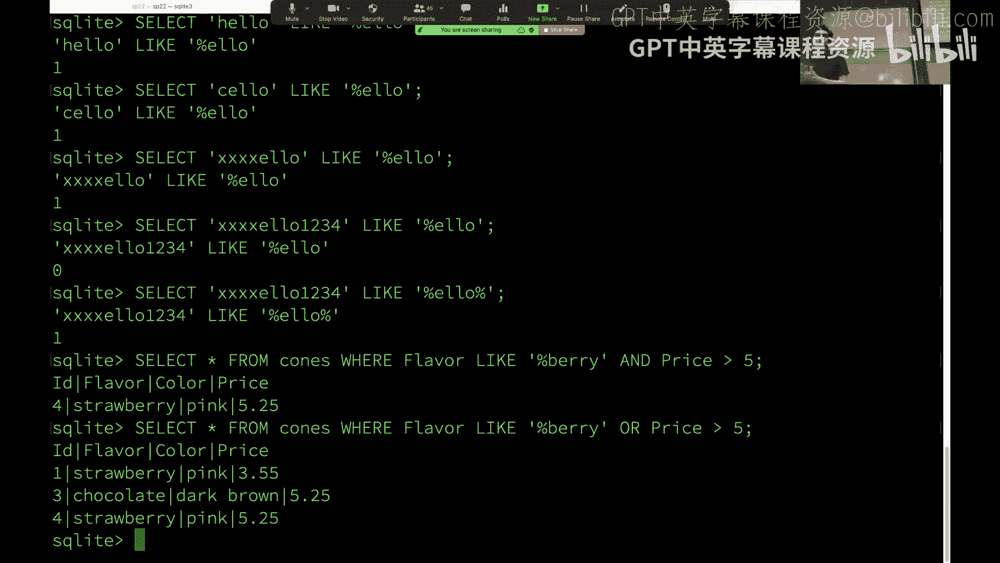

故。这。嗯。So before we go back to some of the more advanced things that we could do。

With filtering and selecting data， it's worth taking a few moments of detour。

Just to mention that one of the things that's great about SQL as a language is that it makes it easy。

 occasionally too easy to modify our data in a database。

 and so most of the time in sort of within CS88 and including outside of CS88。

Datases are read from far more than they're written。

 You put some data in a database and you want to pull it back out every time you load Cal central。

That web page is loading data from a variety of databases on campus but those databases only need to be updated when something like your schedule or grades change。

 so this is a pretty common thing where reading data is way more common than writing and updating data。

 but it's still useful to be able to see some of that。One thing that is pretty useful to do。

Is to be able to create tables。 And this assigns a name in SQL to some table and lets us。

Query and operate on that table in later expressions。呃。

The syntax here suggests that we say create table some name as some statement。

 and there's a few different ways that we can write the select statement。

Including giving it data that we input on the fly。I selecting from another table and including what we're not going to do today。

 but just by giving it the names of columns and their types。So if we wanted to。

 we could create our current table by writing a series of select statements saying select or create table cones from select one is our ID。

 strawberry is our flavor， pink is our color。And 3。

55 is their price and unioning that with all of our other cones that we might want in our table this。

 this way works。 our table already works that way。 So I'm not going to。

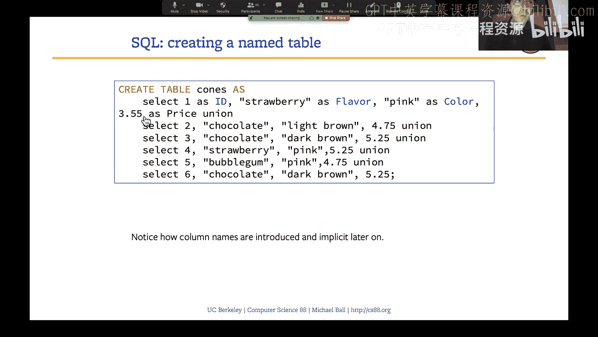

To rewrite that query， but what we will demonstrate is how we might do other things like create table。

Make it call these things， fancy cones。And。We say， as。And then we give this an expression。

 So if I want a table of what we're going to call our fancy cones。

 you can guess that we're probably going to do the same example that we've done quite a few times already。

 but select we type it correctly star from。Cones， where price is greater。 Let's say this time。

 a new number4，50。Now we could put this on parentheses。 Wait， you don't。 Okay， you used to。All right。

Likes that better。 Okay， you do like that better。It's been a while since I've written raw create cable statements。

Prenheses are knowingly one of the things that can differ in some version。

 So create table fancy cones as select star。From cones， where price is greater than 450。

So in this case， what we should expect is to now have a， I can say， dot tables。

And now I see that instead of having our two tables that we had last week， we do have a third table。

And I should be able to see the output of this table by saying select star。From。Fancy cones。

And what we get back。Is a table which has four cones this time that are greater in price than $4。50。

Interestingly， most of our cones are。Or yeah， all in that face。 So we did。

 we did lose one row of a cone that was $3。55。 but that is a typical way of using create table statements。

 They just give you a name。And the shape of that table is whatever columns our select statement returns。

 so as long as this returns， what am？As long as our star represents something that has， in this case。

 four columns， our resulting table will have four columns if our if we only select。

 let's say color and price， that's all we would get back in our result。

And that's up to you is whatever the problem asks， you can create a table with whatever data。

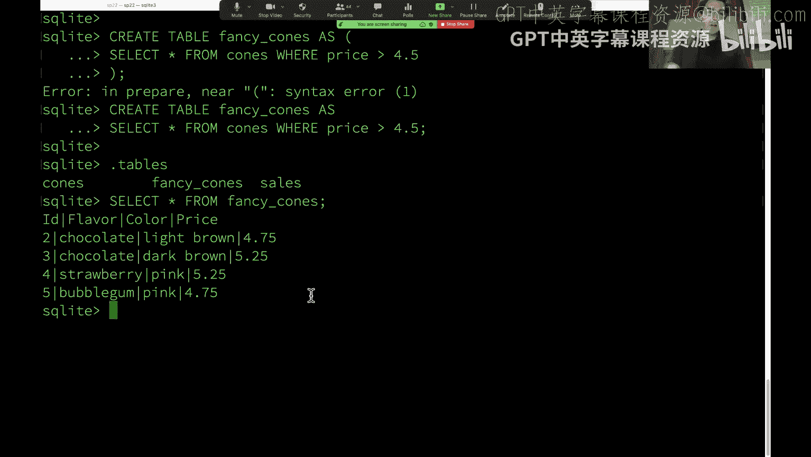

Whatever data you need， but pretty often in practice。

 you'll be working with data that's already created。 So it's a useful command。

But not always one that you will sort of you know lean towards what is useful though is being able to say let's insert data into an existing table so if I already have a table and I want to create new rows in that table。

 we call this inserting that data into a table in the same way that we say we insert some item into a list。

In SQL。We don't typically use words like aend or extend because a table doesn't necessarily have always a defined order。

 So we just insert some additional row into that set of data。 So in this case， what we say is insert。

In two， we have a table name。And insert into is。Pretty interesting because。

We have to give the insert command。Quite a bit of info to make this all work correctly。

 So the syntax here is a little bit wordier than you might expect。

Which is insert into our table name。As sort of like a function where the arguments that function are the columns of our。

Of of our data that we're going to be inserting into。And then what we specify are the values。

And each of those values is what SQL calls a tuple in the same way that Python calls it a tuple。

 slightly different meanings， but same idea of data so and each of those items。

 the way that they're shown on the slide， the positioning is what determines which values what columns so the first item in our list。

 value one maps are column one， value two maps are column2 and so on and so in this case we'll do an example。

 inserting。

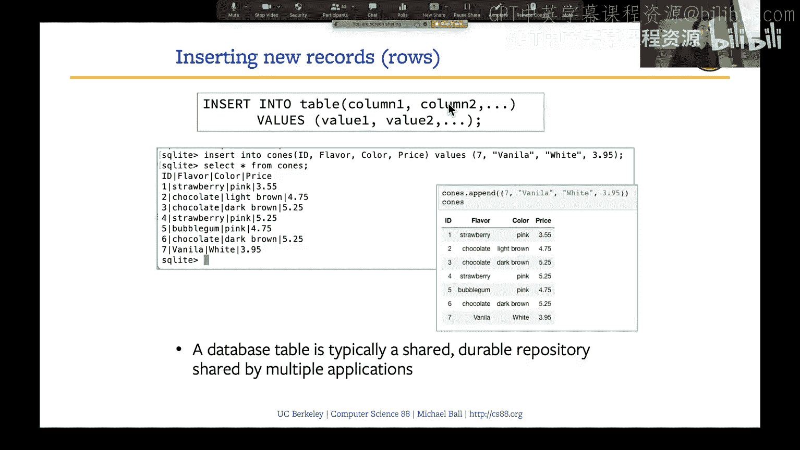

Ice cream data are inserting another cone。Into。Our table。

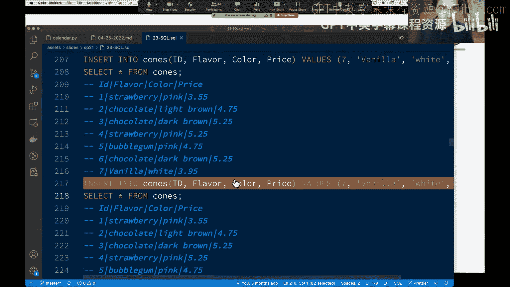

And this file will be up on the website。But this gets a little bit wordy。

 so I was just going to retype it so insert into combs with columns ID， flavor， color and price。

Our values vanilla or excuse our values are7 for R D vanilla for the flavor。

White for the color and price as 395。And we can now verify that this works as select star。From cones。

We should hopefully see7 rows， which we do。 And we have a new flavor and a new cone available for sale。

 What's nice about the insert statement， even though it is wordy， is that as long as your。😊。

Your columns in your values section and your table definition section， as long as those align。

 you don't have to know what order the columns are when the table is output。

You could order them in any order as long as item one and item one line up and item two and item2 lineup and so on you can insert data we're not going to do it。

 but there is a syntax for inserting multiple items at the same time so as sort of suggest by values there is syntax which lets you specify multiple tus at once so you could insert as many things as you might need。

 so if you're curious you could look that up but for the sake of time I'm not going to demo that today so this is really mostly what to know about inserting but before you continue on to other types of things that modify our data。

Any questions on how this idea works？Questions， other questions on zoom。Allright， so。

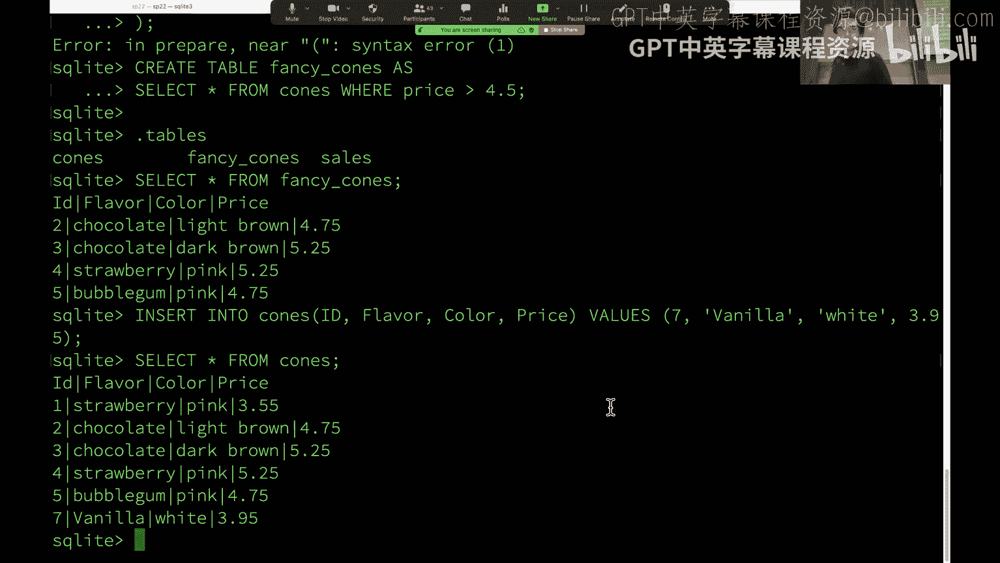

Insting。Really just takes a row。

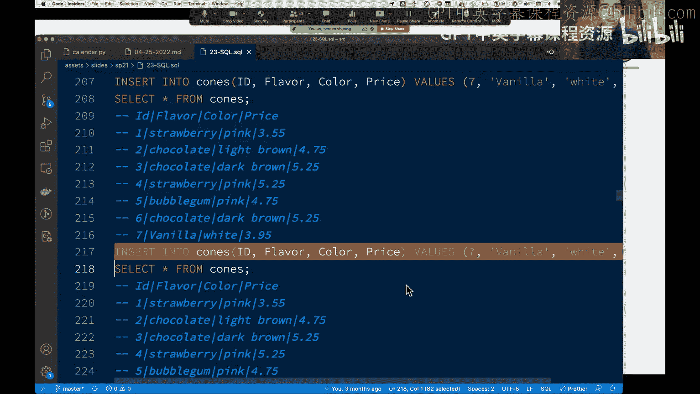

Adds it to the database。Other than that， it doesn't change anything about our particular cable。

What is useful though？Is to be able to do things like updating a row。And this is。

One of those operations where。You can SQL will let you do things that are a little bit dangerous so you might want to be。

A little bit careful about how。嗯。About how you handle some of the some of the statements。

 So the update statement。Similar idea to the where statement or excuse to the insert statement。

 but the syntax is sort of flipped， so we say update。Our table name set。

 we say column equal to some value， and we can specify as many of those options as we want。

 where some condition。It has been met。Notably in our update clause， the where function is optional。

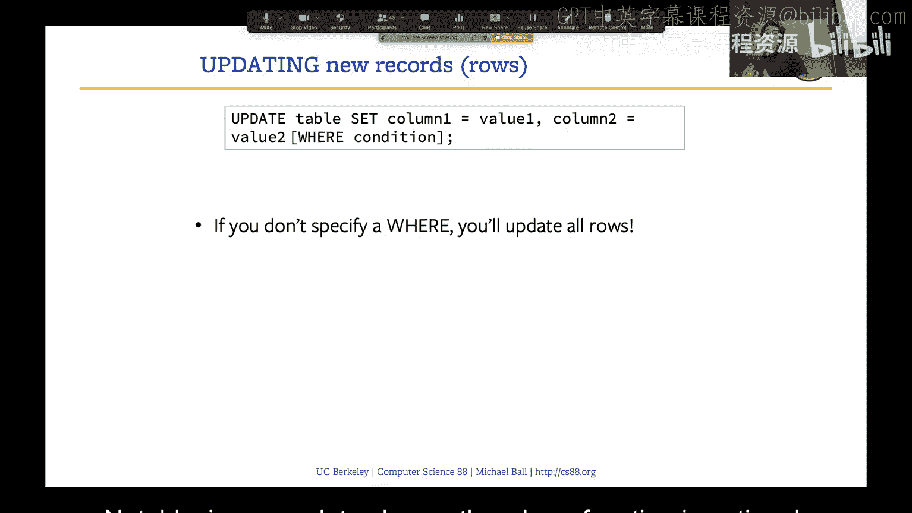

2。🤢，What we can do here。Is update。嗯嗯。If I spell update correctly。cones。Seet。

Price is equal to so what's nice， this is that like Python。

We have access to our current value in our expression， so just for the sake of demoing。

 we're going to say price is equal to 10 times our price。嗯。

Which will immediately cause us to lose all customers。

 but that's okay our statement runs and because we didn't specify a condition。Of what we should see。

Is now each of our cones has increased in price by。10 times。 And so this function。

Will operate for each row。😡，And execute whatever we whatever we asked it to， you can think a lot。

 you can think of update as very similar to mapping some type of operation over some set of data in our table that。

We are mapping some function of price is equal to price times two over over every row in this table。

 The nice thing about doing something。呃， like。Like updating by price is that we could also say。

Price divided by 10。So we can restore our data。Back to。Its original form in this case pretty easily。

 but what is really most important about doing updates。Is that。

And we're actually this time going to say let's。嗯。Let's say that the price of our strawberry。

 guess just a raw strawberries has increased by a bit。

 and we need to increase the the price of just our strawberry flavors， what we're able to do。

Is to say where？Favor。is。Swberry。And I can select star from cones。

And you can see here if we look at like item four。Was 525。Now it is whoops。

I like the right one now it is 550 and so being able to use where when we update our data is super important。

 otherwise we change all of our rows in ways that we don't want to do。

One of the most important things actually。That you might come across as let's say。

Only one one record is changing so in。In CS88 we don't talk about necessarily what makes a good database design。

 there are other classes sort of down the line data 101。

 CS 186 to the databases course talk more about this there's school of Information course on data design。

 if you get the exact number， but very often in practice。

 we just want to touch or affect one single value in our database。

 you can imagine if youre let's say inserting or updating your email address in Cal Central。

 but it really only wants to change your email address in the database and no one else's so very often you might write a query。

Because update some value to set some new parameter where some record ID is some value and when we write a statement like this。

 while we don't necessarily immediately know what ID equals 7 is we do have a sense that only the thing with that ID value should be affected and that allows us to be a little bit more safe and the types of changes that we can make so updating is incredibly useful。

嗯。Thank you。 Yeah， and so here's a really good question in in Zoom chat are you only able to go back to the original data by doing the reverse operations so you have to constantly keep track of what operations you've done so。

Most databases。There's no way by default to sort of undo it change。In practice。

 there are lots of tools out there that give you the ability to maintain a log of what's happened and to do certain things like reverse changes。

 but in general you should sort of think of like updating a database like saving over a file right or updating a rowna database or if you say in Python a equals5 and then you later say a equals 10 you know Python isn't going to tell you what the previous values of that variable were in the database itself is just going to make that change to the data so yeah when you update data you do need to be you need to be pretty careful in some systems that I maintain if I' am doing large and complicated updates。

Like let's say sort of restructuring the format of data。

 I will make a copy of that database before making any changes that way if something goes wrong。

 I have a very clean and you know immediately recent backup to use because things do go wrong if you've ever had a you website that you use go down for maintenance。

It's not always but it's often related to something the database that has gone wrong。

 so it is something that you know for the homework assignments you could just redownload your file for playing around with an assignment like this you can just reload the file none of this data is particularly sensitive but it is definitely something to be aware of and that if you are on a research project you want to make sure that you keep always a copy of that original pristine research data separate from data that you're using so that you don't accidentally erase all of your survey results or something Fortunatelyly its it's pretty easy most labs you you have automatic backups of things but。

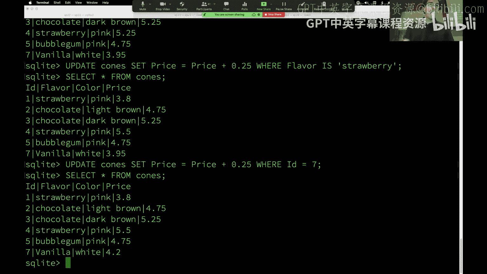

It is worth。Worth calling out。 so yeah， that's a good question the last。

A couple things that we're going to do today are going to be a couple other operations。

 but before we get there any questions on this idea of updating data in a database。是。ho so。

The next thing that we're going to do and this is one of the most powerful ideas of SQL is we're going to aggregate data and what we mean by that is we're going to take groups of data and perform operations that happen over more than one row at a time so previously when we said select some value know where some condition that was always looking at one row at a time individually mapping filtering。

We could treat that as one row， one operation。But SQL databases are also。Extremely good at。

And this is one of the things where we start to think about things and a little bit more of this decative programming approach is aggregating results。

Across different different things， so the color shows up a little bit poorly because I've clicked on all of these links。

 but inside our select statement so for now we're going to go back to selecting data。is。

We can aggregate。Data across multiple columns at once。

 and perhaps the most useful thing that we can do。

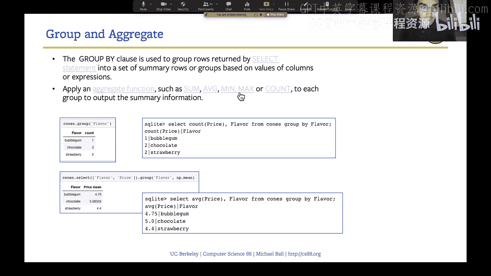

Again， if you are ever in the position of taking on a project where your job is to start to analyze data。

 but I would highly recommend is to do something like this。 select Kemp star。From some table。

And what does this tell me？Why do I have。I thought there should have been seven。

 but maybe something got deleted here。One2th oh， we don't have。We don't have ID number six。

 Oh okay yep。The database is correct， my memory is not， we don't have any cone number six。

 but I chose ID7 for some reason。Select count star from table cones。 What this will do is tell me。

How many of just everything is there in this table and this will give me the number of rows in this table and so aggregations are really useful because they let us start to explore different things about our data。

A particularly useful one mentioned in the slide。We could say average price。We can even say。

 let's say， min。Price。And Max。Pce。For for each of our cones and so in this case we just asked SQL to compute the average the main and the maximum。

 there are things for of course， all of our statistical operations。

 but this will just work over all of our data。In our table and compute each of those values。

 so in this case， instead of operating on a real level。

 it's operating on all of the data that in this case is in the price column for each of these functions。

And again， like other things， we can say where。Flavor。We could even say not like。Barry。So， let's say。

Let's say we want to know the average values of things that are not our strawberry flavors of ice cream we could combine。

In the same way before we can combine each of these operations by aggregating data and so the most useful things are things like count。

 min Max， there is a sum function which we'll come back to later。

 but in this case we're aggregating data over all of the records returned by whatever we're selecting and so instead of getting six or seven results。

 we just get one row， which has the data that we need。Before we move on to another example。

 questions on sort of this idea here of aggregating data across multiple columns。

So we'll try and do two more examples。One of them。

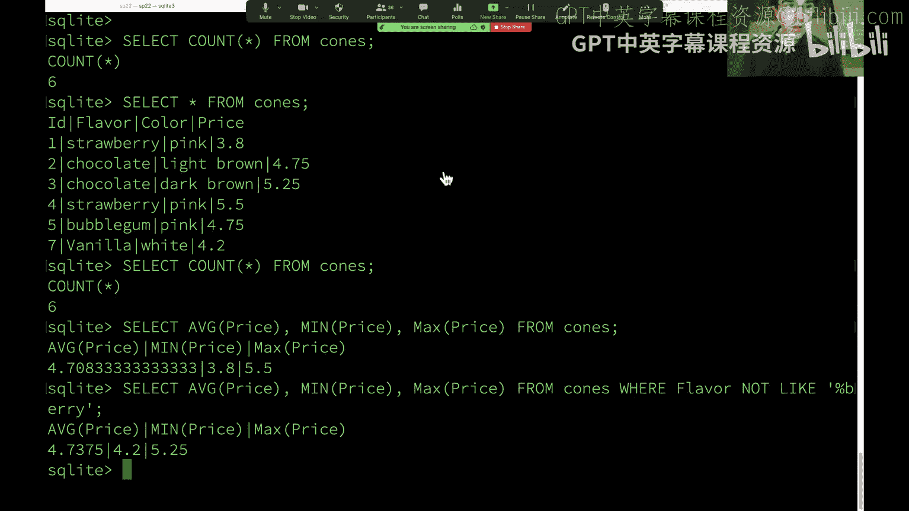

Is。So we're not going to do。

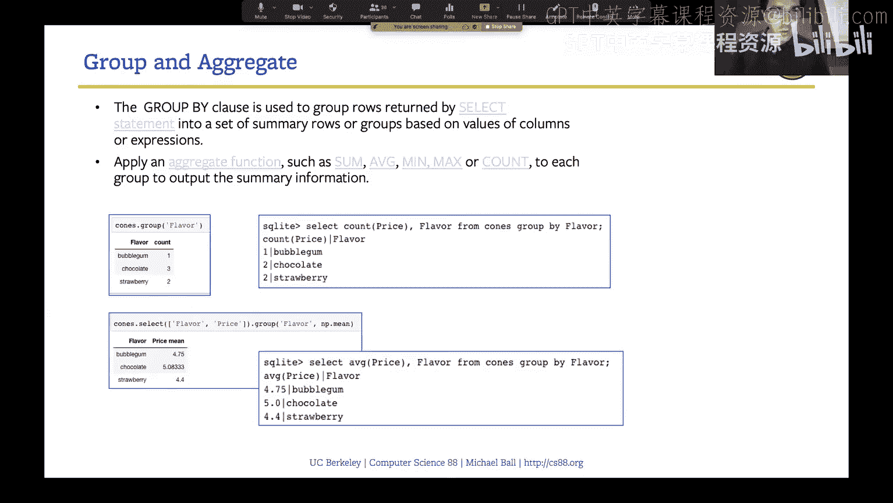

Okay， so on the slide， the next most useful thing with aggregations。

Are to tellsQL how to group our data by some metrics。 So one of the things that is useful。Is。

 if I say select countstar。嗯。As some count value， I'll get of all of the records returned。

 but what if I want to know how many of these same value exist so let's say。From our cones。

 well group by。And in this case。We want to group our results by our flavor。

 so I could say select some count。I could group the data into flavors so I could say。

 let me count the number of chocolate flavors， the number of strawberry flavors。

 but this doesn't look so useful on its own right selecting the count of some values without knowing what that value is。

It's not particularly useful， so what is a pretty common operation to do is to say select count。呃。

By some metric。呃。Select our flavor column and group by our flavor columns。 In this case。

 now our output tells me that I have one vanilla，1 bubble gum，2 chocolate。

 and two strawberry flavors， so。This is again a pretty common operation that we might start to do with our data。

What we also happen to have is we have our sales table where we have cashiers。

So we can say from our sales table。roup。By our cashier。And this tells me that each of our cashiers。

 Baskin and Robin happened to have sold three things of ice cream。So， that is。

That is how we can group data， filtering it down and then doing some aggregation of。Of our table。

We do only have a couple minutes left， so I'm just going to introduce this idea it is in lab and will you spend a bunch of time working with data in lab。

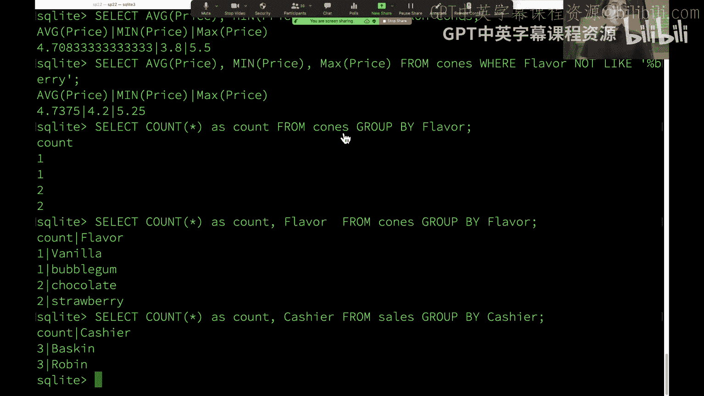

嗯。But in our database， we have multiple tables。 and so one of the other great things about SQL databases。

Is that they help us combine data across multiple tables to get a result and so。

We can ask our database to do something like。

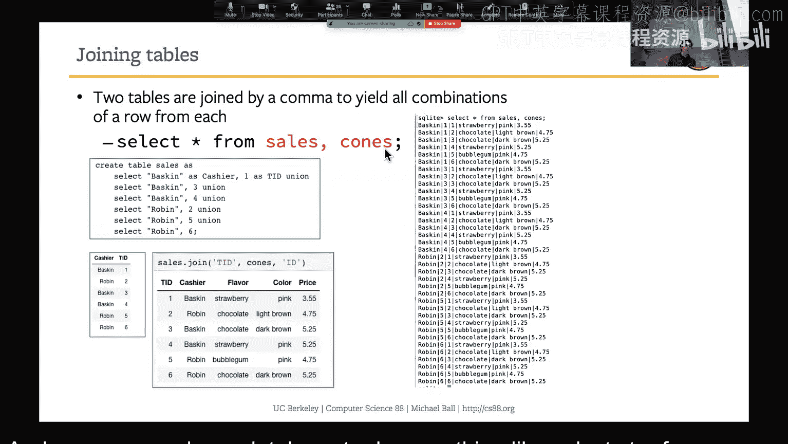

Select。

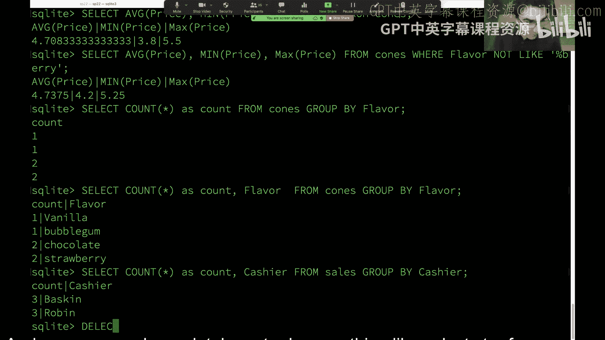

To say select。Star from cones comma sales。And what this gives us back。

Is a combination of all of the rows。 So for each cone。

 what are all the possible combination of sales and for each sale。

 what are all the possible combinations of cone。 So if I have six values in my cones table and I have six values in my sales table。

 what I get back is what should be。Assuming there are six in each， which I believe there are。

We to get back is 36 rows of every possible combination。

Of values that that can be in each table and so joining data in SQL allows us to combine one table with another table。

 but in practice， the very last thing that I'll leave you with today。

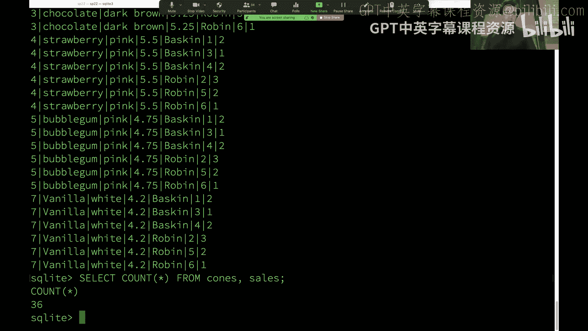

Is that we often want to join data on some particular value and that is we want to say。

Find some data that relates one table to another。 So in this case。

 our sales table includes this thing， this column called a cone ID。

And what that tells us is that you would have to know how this data is set up， but we can join data。

And filter it such that we're combining our expressions across our filter expressions across multiple tables。

 so inside our where clause here， we can reference not just one column。

 but any of our columns across across multiple multiple tables。

 so if I say select star from sales cones， I could say where cone ID is the cone ID column on the sales table is equal to cones that ID on the cones table。

And I get back just a table which tells us who sold what kinds of cones and at what prices they were sold and then you could start to do other things like aggregate and filter data from beyond there so I'm not going to do it today but it will be an example on one of the files uploaded is could I figure out which of these cashiers has sold the more has sold the most money where the most amount of ice cream so you could write expressions that start to get quite complicated that just manipulate the data so that's really it for SQL you can now do most things that you need with the database so Wednesday will wrap up the course and that'll you've now sort of seen everything that we have to show you in this class so we'll wrap everything up on Wednesday。

And we'll see you then， thanks everyone。

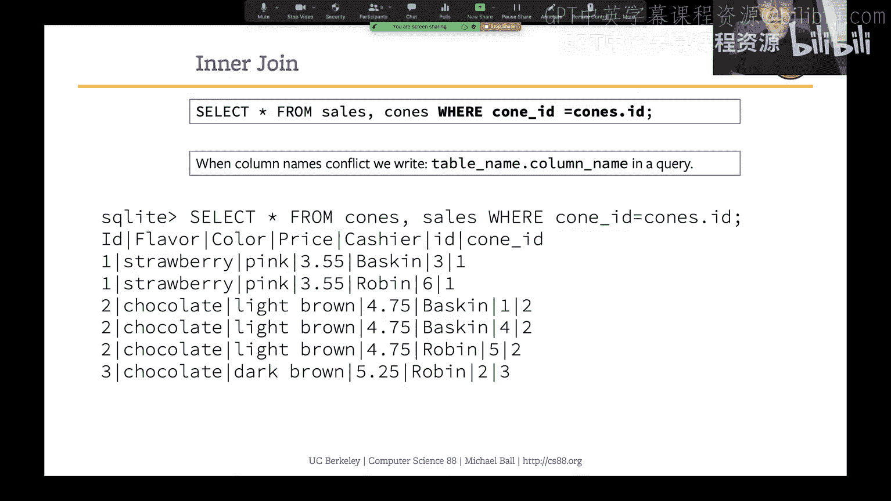