# UCB《数据科学中的计算结构｜CS 88 Computational Structures in Data Science 2022》中英字幕 p25 CS 88 Spring 2022 - Lecture 25 - 4_27_2022.zh_en [BV1516iBfEVY_p25]

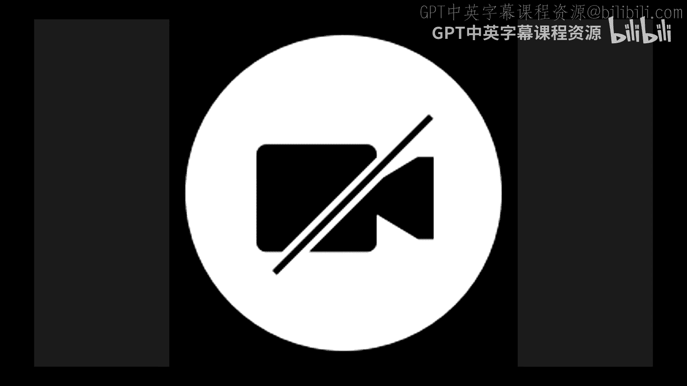

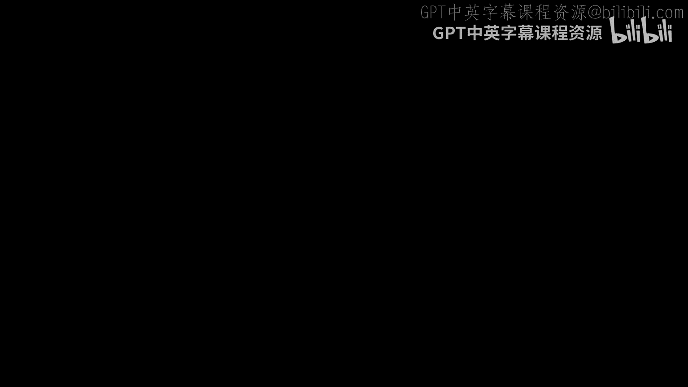

啊。Yeah。系啊。

Yeah。

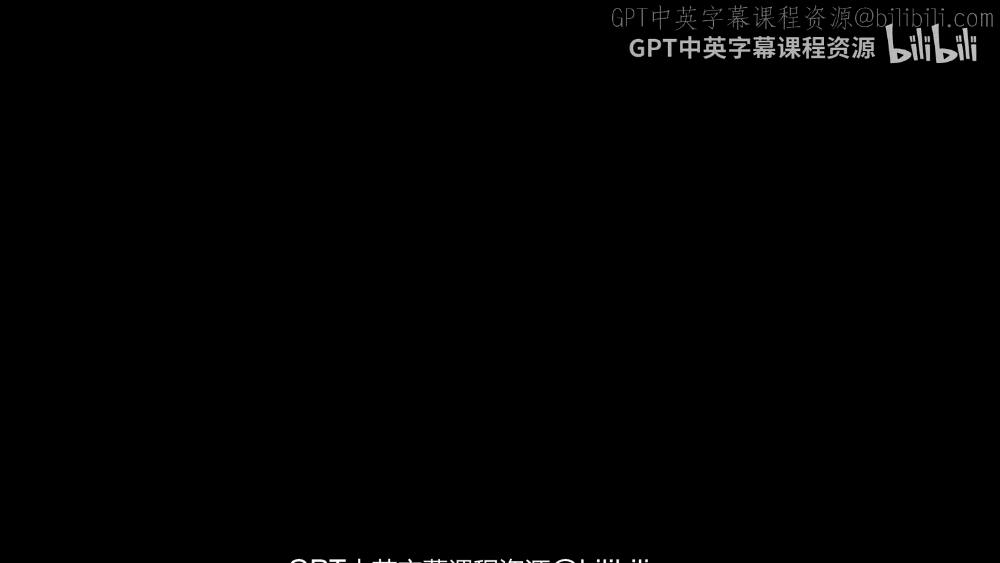

嗯。嗯。Yeah。Okay。There we go。All right， so one last time for this semester。

Today is mostly just a wrap up of sort where we've been。

 what you can look forward to next outside of CS88 and a chance to say thanks to our TAs who maybe a few of them will won't be here on Zoom。

Main thing is again， mentioned on Monday， but 8 am。m final， oh yes， thank you for the transcript。

Also I don't think I have a whole bunch like I don't think we have 50 minutes of true content today so if you have questions about CSc88 data science。

 those sorts of things think of them now and we'll have time to answer some sort of just random questions or just beerkeley questions。

 but yeah final main thing at am， if you wish to take it online because of COVID it seems like by all accounts there's a good amount of COVID going around which is a little bit weird so if you wish to take it online the form will be out there later this week early next week but you can take it online it will be proctored to resume so same deal screen recording submit recording link all that。

 but you will have that opportunity， if you wish to just do it online by default if you get sick during the week hopefully not but if you feel like you need to take it。

at the last second， you will have the opportunity as well。But in general。

 it is way better to take the final this semester than it is to try to let's say。

 take an incomplete grade， make up the final in a future semester it's totally possible if you need to do that。

 but studying for a CS88 final in like seven months in December probably doesn't sound like the optimal plan for you it's a bit of logistical work。

 so if you need it the option will be there， but if you get sick and you're feeling okay taking the final at home is really the best option。

We've been uploading grades to how am I doing so in general we'll send announcements once you know the final set of lecture self checks。

 ants last homeworkmogen stuff are in but。That's your place to review final grading info。

 but again everything in CS88 is a straight sum of points so you get。

Up to 400 points throughout the semester。The grading pins are on the website。

The exam scores are sort of as they're given， and so just sum of your points。

And that's how you doing you know in the course there's not any sort of tricky math the main reason to take a look at how am I doing is to make sure that everything that you've submitted is graded as you expect it to be that you' are earning the points that you expect to have trended and so on and on that note for lecture self checks most of them are all complete and good but just a sort of reminder that correctness for those does matter so if you've been doing them but not getting them correct they should all share the correct answers if they're not there was a couple for a while that needed to be sort of manually fixed up but I think right now everything should show you your full correct answers。

If if you are missing credit on those you can retake them to get things correct there isn't a late penalty on them we always say that if you do all of them at the very last second we could technically mark things off as late because the point is for you to do them during the semester but at this point we're not going to mark up anyone late it's better to do them use them as a study resource so the lecture self checks are all linked there have been a couple throughout the semester that were sort of like bonus self checks so if you look at grade scope there should be a couple things that are beyond the actual 25 lectures of content I think like lecture 10 for whatever reason had two self checks that were related but same content and one of their lecture so。

There's like 27 points available you only need to do 20 of them and if you know it just caps out at 20 points so there's not extra credit there but it's all good practice so you can do those at your own time otherwise main thing today of course is the ants project is due and if you need slip days you've got your slip days up to three and you can just use them you don't need to tell us if something catastrophic has happened or you need a special extension please chat with your TA and fill out the extensions form and we're usually pretty accommodating but we do need to make sure that everything gets graded on time so with that logistics things out of the way。

I think one of the most important things today is to acknowledge that。

Our CS courses in particular but truly none of your courses on this campus would be possible without our TAs。

 our headTAs， our tutors， we didn't have too many academic interns this semester we had a few I believe but。

Matt and Sreya are the two of this semester who have been。

Basically we just have dozens and dozens of slackck conversations throughout the week about everything going on。

 they are instrumental in helping run the class alongside all of our Ts I do have photos just because once you get beyond 10 people and of course staff you inevitably leave out one and that's not fun so Angelli Che Jessica Lucas Min and Tommy are your TAs。

 they all took CS88 or 6A they are amazing， Tommy in particular like broke his wrist at the beginning of semester wasn't sure if he's going to be able to be a TA so he was helping those of you who went to a section with the inability to type completely which is a feat in a computer science course so。

Thank you to all of the TAs and as well， of course， our tutors， no out of the way zoom， thank you so。

😊，There we go， yep， so we have。他med Heel啊。Karem， Kevin and Sebastian， they also all have taken CSAA。

Kevin in particular was an undergrad and now was finishing his master's degree has been a tutor with us for a while like yeah these folks know CS at8 they are part of the course many of them will hopefully be Ts in the fall and so I want to say thank you to all of them and I think。

Let's see。Yeah， we have a few of them online here， so if let me change the gallery view。

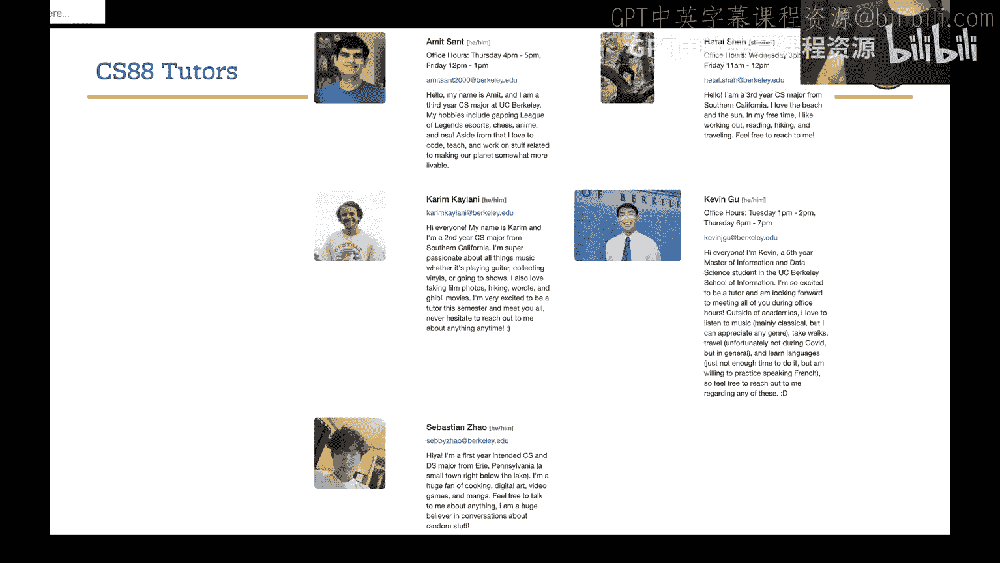

嗯。啊Com on zoom。

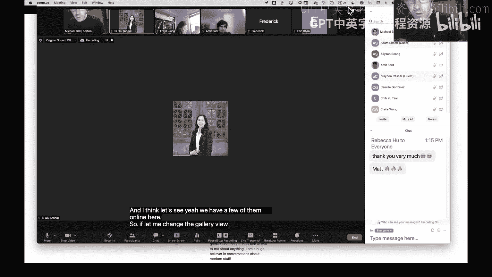

We've done this before and this is not so hard， but yeah if we could give our Ts a round of applause because they they are the people that make this course possible TAs tutors。

 everyone thank you。

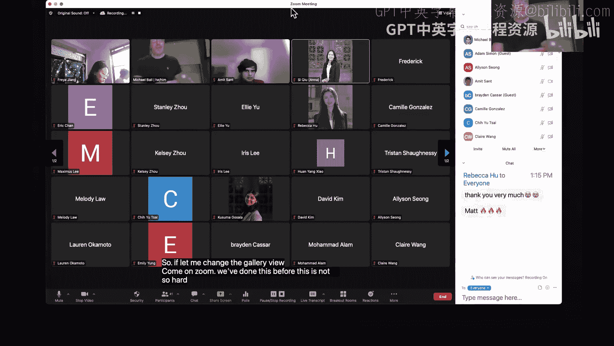

And yeah， without that， we definitely would not have lab sections， we wouldt not have assignments。

 wouldn't have exams， maybe that part would be more fun for you guys but。Yeah， and with that。

 what I do also want to highlight is now if I。

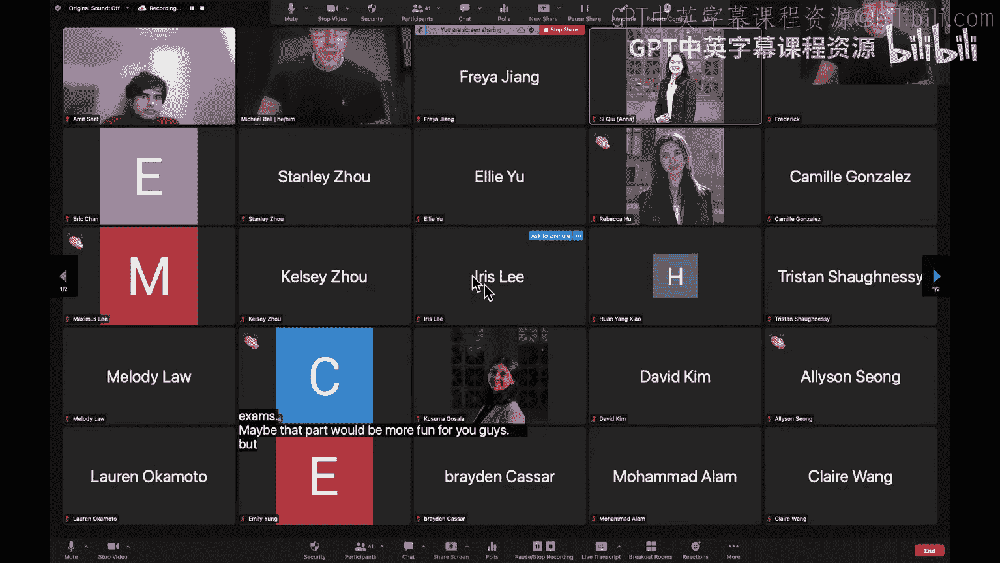

Put this back so I can see things。

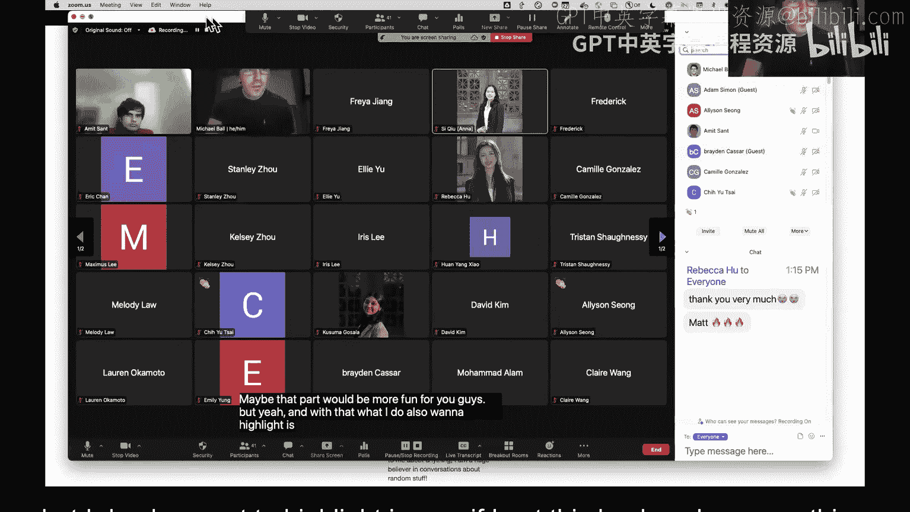

In in a couple weeks probably but also potentially later in the summer depending on how things go。

 we'll be sending out emails to join course staff in various forms the other organization that I should give a shout out to who I do not know all their names because there are so many of them is CS mentors those folks are all volunteers who have taken CSAD and other CS courses and want to give back their time so CS mentors is a fantastic opportunity a bunch of RTAs for CS mentors in the past as well。

 and so they are a super useful group hopefully those of you who have been attending mentoring sessions have found it useful。

But all of these folks who are on course staff were in your shoes at one point in time so if you thought a TA was helpful。

 if you thought that this is something that maybe that sounds fun to try what I would highly encourage you to do is to think about joining the CSA8 course staff and if you have a course hopefully not that you like more than CSAD8 that is also looking for TAs consider joining joining their course staff dude because it's super fun opportunity you don't need to be an expert in everything that we've done you don't even need to have had an A necessarily what we want is for you to be willing to learn to help other students to keep practicing the material if you thought that there was something challenging this semester that you're like yeah I kind of got it but you know I don't get it fully being a CS mentor being an academic intern tutor a TA is a great way to keep learning the material to keep practicing with that so you will be getting email。

From us hopefully over the next weeks and months， depending on how the fall schedules get solidified right now。

Right now fall scheduling is still sort of up in the air for a bunch of courses so you know we haven't yet been able to plan out everything but we'll definitely have opportunities so thanks again to all of them and with that I just want to sort of wrap things up with where we've been because I think it is useful to look back that this is the first slide that we sort of really showed you was this idea of abstraction and。

CA8 is a course that teaches you Python， but more than that it teaches you how to think about building problems up and breaking problems down all of this we do through abstraction in some form trees are an abstraction of relationships between objects functions are abstractions of inputs and outputs and a process that does something and。

Higher order functions are just an abstraction on functions as another piece of data and so。

Everything in this course。Is related to in some form using the abstractions that we teach you throughout the course to solve problems and hopefully you know we use abstractions that give us clarifying ideas but we also have to you be careful that we're not hiding details that are potentially problematic or that things don't get you know too complicated feature so CS88 is a ton of stuff this slide does not even cover。

All of the topics you know that we have seen in the last 15 weeks。

 but it is you know the majority of them so we've seen data types， expressions， calling functions。

 variables， assignment statements， twoples lists sequences， dictionaries， function definitions。

 conditionals， iterations， list comprehensions， wire loops， lambda expressions， hi order functions。

 so returning functions creating functions， passing functions to functions。

 patterns like map filter and reduce， we've seen recursion。

 you've seen complicated forms of recursion on trees。

 we've talked about abstract data types we've talked about mutability。

 we've talked about auditory datapro， inheritance， exceptions。

 we've talked about building iteration and generators。

 and now we just threw a second language at you which is SQL and so if you're feeling like this class a lot it's because this class is kind of a lot it tends to be the Berkeley way of doing。

Things that you know not just in CSs， but perhaps especially so is that classes go through a lot and what this really means is that as you think about what you can do outside of。

Of CS 88 there is a lot of skills that you have in Python that you can carry on to future courses and so regardless of whether you're thinking about doing a data science major or minor in the future。

I would highly encourage you to just keep on exploring programming in some form it doesn't have to be the types of problems that we do in CS88 it doesn't have to be for a job。

 although that's certainly a great career opportunity could be for research it could just be for fun there are so many things that you can do with that so as a reminder for where you could go from here。

 the most natural place for those of you thinking about doing data science。

Is probably to take CS621 B it is the next computer science course。

 it is the same course that everyone who takes CS61A takes and that's good for both the data science major and minor it is a requirement for the computer science major so if you want to switch to computer science and declare computer science it's honestly unfortunately getting really tricky right now because of enrollment pressure and budget cuts so I'm not even 100% sure despite being in dozens of hours of meetings still what the plans going forward are but as far as I know right now it is a possibility to switch to computer science if you wish but to be honest both computer science and data science are excellent programs they both have a ton of programming so。

If you would like to try and do computer science， exploring CS47A is generally the best option rather than retaking CS621A。

 you could technically do that should you need， but if you talk to the advisors you know they've got info about that however if you thought that computer science was cool and you haven't taken data8 I know about 25% of the class hasn't taken it yet。

 I would highly encourage you to explore the rest of the data science major and minor。

 the data science major itself is I think one of the coolest things this campus has done in the past decade or so it is a major which is the true meaning of interdisciplinary work。

It is not just computer science and statistics， but there are courses that bridge the gap with economics。

 physics， history， sociology， demography， depending on the semester of the department that things are taught and importantly in data science now。

 this is one of the majors where，It is a STEM major which from the ground up wants you to make connections to non-tEM horses。

 so you get to have a domain emphasis， it could be a stemEM domain emphasis。

 but also things outside of STEM subjects and also just as importantly there is a human context and ethics requirement to the data science major so you get to really dig into hard questions of am I applying these principles and tools in a productive manner for society how do I think about wrestling with some of these hard questions because there are a lot of things that you get to build in the world that are powerful and cool but have potential implications you know we are many years past the days of someone building a social media company in their dorm room and not realizing how that might affect the world。

You know there are probably some of you building companies in your dorm rooms now where in the future and so having a place at Berkeley to explore some of those hard problems is I think really cool and the data science program is super awesome。

Within data science， there is a whole bunch of courses that you get to continue taking next。

 CS88 is sort of loosely a connector course， you know it's now sort of larger than the two unit course that connectors were imagined to be because believe me two units of CS88 would be pretty unfair so there's a whole bunch of those I would highlight data 8E for economics stat 88 is I believe now also a three unit course if you're looking to build up your stats experience。

But the list of connectors is always always changing and updating and importantly。

 once you've taken data eight。You can take connectors in future semesters。

 I know students who take Data eight freshman year and every semester for the next four years。

They find two units in their schedule to explore something fun and interesting without with already having taken data eight。

 you don't need to take them at the same time。And that's a really nice way to apply computer science and programming to to a different topic data 100 is the natural next course after having taken CS88 and data 8 but from there there is a new course data 101 which is called data engineering so if you like the topics of SQL if you think the idea of databases is interesting if you're kind of wondering。

How do we actually build tools that deal with large amounts of data， how do we build systems like。

PAandndas or the data science module data 101 is a new course that will explore some of those topics and then you have some your other core data science courses 102 I believe there's 103 and 104 now so you've got some statistics one of those is your ethics course I didn't was the slide from memory so I forget which courses are W but。

The data science program has a bunch of options The other place that I definitely recommend looking at is the School of information most of their courses are graduate courses which if you're feeling up for it you can definitely enroll in but they have a range of upper division courses that tend to shift around a little bit when they're offered one of them that's usually offered every spring is called infofo C103 is the history of information it talks about how from a historical and sociological and linguistics perspective we think about the systems that have been developed over the past 2000 plus years that information as a study is not just data that lives on our computers but has evolved from the development of language through the printing press and writing and mass media to now computers in the internet and how that changes our framing so that is a really fun course。

But the School of Information also has courses on traditional databases， web design and development。

 machine learning， all sorts of things and just because I had the list handy after you take CS61B if you choose to。

There's a whole host of computer science courses， most of which only require CS621b as a background。

 some of them also require CS61 c these courses are definitely getting harder to enroll。

 but if you're willing to。Get on the wait list or if you are able or choose to switching to computer science。

 there are some options there and enrollment policies are honestly changing semester by semester but。

There are plenty of additional topics that you might find interesting to study computer security。

 building operating systems， network interfaces， human computer interaction。

 there is a whole host of opportunities there， there are other areas so the upper division courses focus on other applications。

 graphics， databases。Quantum computing CS1 and E5 is the social implications of computing course that is a course which is one unit that explores a topic of how computing has affected some piece of the world。

 whether that's education the risks of software computing and technology relating to things like income inequ quality in the Bay Area it's a discussionbased course there's a little bit of writing which is a really good skill of practice even though it's probably not everyone's favorite so that's a really fun option and that's taught every semester and does not have enrollment restrictions which is nice there's a whole host of electrical engineering and e focuscus courses which breaks the divide between hardware and software so that starts with the 16 series。

That that work on sort of building devices and you build up to designing circuits and designing systems and within EE there's a whole bunch of topics about how we build the building blocks of our physical devices and if you think this is cool one thing to know is the EE courses are much less impacted on the enrollment side they're still not always that easy to get into but if you think hardware is fun you usually have a few more options for enrollment than some of our computer science courses so that's what to do that's sort of there at Berkeley I would also highlight it's not on the slides but keeping up with whatever decals are being offered is super great too。

 the amount of decals that are created and that change is always sort of always in flux so I can't even compile a list but there are so many so many students who are creating very interesting decals。

Some related to hacking， some related to building websites， some related to web design。

And those are always something that are worth looking out for too。That's what to do at Berkeley。

As an aside， there's a whole bunch of things that you can do in Python that we unfortunately just don't have time for in this course。

 but are。Hopefully fun fun topics。继续。So each of these things are things that you could now with a little bit of googling。

 watching some YouTube videos and a little bit of reading。

 you have the background to jump into if you choose so building the backends of websites so you know with with a bit of experience。

You could build your own website that stores and loads information from a database。

 there are tools to scrape websites so that is downloading programmatically and parsing content from web pages。

 natural language processing。So extracting meaning from written words。

 there's a whole bunch of data analysis for which the data courses are there machine learning scientific computing so that's applying data science generally to research problems there's a whole bunch of examples there with climate change building games in Python there's a bunch of tools so there and there's things like just generating your data so combinations of graphics NLP。

And so on and so each of these things there are libraries and tools that you can use so this is really mostly a list if you're thinking like you know I have a website and I've always wished I could take that information and store it in some different form or if I could download all this data and parse it and put it into a nicer format could I do that well there's a library if you're beautiful called beautiful soup that helps you do a whole bunch of web scraping stuff of course these are not an exhaustive list of libraries but if you're curious about solving problems these are probably you know some of the half dozen or dozen or so most popular ways of going out and。

YouAnd as a starting point for where to look for additional things。

With that I actually think it is fun to spend most of the time just hearing questions from folks。

 but I do want to say thank you to everyone these past a few years for those of you who are sort of midway through your career at Berkeley have been a wild ride this past fall and spring in particular you know we're all sort of learning with hybrid so I would say thank you to everyone things have been a mess at times things have broken down in the middle of lecture but y'all have been accommodating so thank you for being here and participating and with that yeah questions things that are。

If you have questions about Berkeley about computer science。

 about whatever else on Zoom or in the room and if you're in the back and you have a question。

 it's kind of dark back there but if you want to just shout something out。

 you're more than welcome to。Any questions？Oh yeah， go ahead。Here are some good classes to take。

 if you're interested in。はす。还有。Yeah， neuroscience， what are good classes for neuroscience and biology？

To be honest， I don't have a super strong。Sort of awareness of what are the classes offered in。

In those departments， I would say。I mean one thing Id just say is to search through the course catalog and this applies for anything and fine so the course catalog at Berkeley right if you go for like classes。

broedduu if you just search for keywords instead of like course numbers right like normally we're typing CSA8 into that but if you just  type some term that you're interested willll usually come up with with some ideas the place that I would also look is at the cognitive science department where cogsci is another really cool department that is very introduceddisciplinary there's cogsside courses that are very much linguistics there's cogsite courses that are about neuroscience and the cogsside department also has quite a few courses that bridge computing as well so。

Otherwise theres there's that if you are interested in the biology side in computing as well。

 the bioengineering department has some courses as well that sort of breached that gap but yeah that's good question I'm going to take one on zoom since I got one cool so I have to take Stat 133 and Stat 131A for the datasense minor I don't know anyone that has taken them do you know how these classes will help with the minor and what they're like that classes also taught using R。

I don't know much about Stat 131 and 133 I think the unfortunate reality is it's very hard to get recommendations about classes where I either don't know the person who teaches them very well and I't or I haven't taken them myself。

 which is always dangerous because classes classes change over time。What I would say though， is 133。

 I do know a little bit more about， I think that any time that you have a course which is programming in a different language。

 you know and this will be true going from 88 to 6 would be。

But it would also be true of going from CS88 to something like StaAT 133 and R is the first couple weeks are going to be harder because you're learning not just the topics of statistics or data structures than CS6 dont be。

But also learning a new language at the same time and so what I would say is every opportunity you get to learn a new programming language is an opportunity to sort of build your computer science skills up in a way that gets easier over time learning the first computer science language。

 the first programming language is the hardest。Running the second is still difficult。

But learning your third and your fourth gets easier and easier over time and so get you will get the opportunity to find connections and patterns between languages and that's super useful that is useful for data science I you know that how much of a statistics bench you want the data science minor major to be is definitely up to you but I would absolutely say that sort of outside of Berkeley。

 there are a lot of folks doing data science and industry who don't understand a thing about statistics and it's kind of deeply scary if you have people analyzing data and you know。

Okay， they know the difference between a mean and a median。

 but if you're analyzing data and you're not aware of whether or not you're making correlations and they're statistically significant and you're making predictions about what product features to build or recommendation systems you know like you can build tools without understanding how they work and so you know I think that going hard on the statistics side is something that can be really useful for data science but for a lot of other things。

Yeah， okay， there's a couple more questions on Zoom which you'll get to。

 but other questions in the room。I like alternating back and forth and if again if you're in the back of the room feel free to just shout something out if you have a question because I might not be able to see your hand。

Questions in the room？Oh that was that a hand in the back or yeah， go ahead。How。Oh yeah。

 so the question is how strict is the CSs major for grade point average okay this is。Yeah。

 what I say so there are officially departmental graing guidelines for CS courses and CSC8 roughly follows them and that is lower division courses are in this 3。

0 to 3。3 grade point average range。Upper division courses are in a 3。2 to 3。

5 average keep gave range。What that means is like a for CSA8。

 we're usually pretty close to the high end of that。In general， what it means though。

 is that like if the average grade in a course is a B plus。

 the unfortunate reality is that it only takes like。

Two or three F grades which are zero on the GPA scale to dramatically lower the grade point average of a course and so in practice what this means is that if the average grade is a 3。

3， you know 50% of the people are getting a B plus or higher and it's usually more like 60 to 65 to 70% depending on the exact semester people get a B plus or higher for upper division courses。

50% of the class for some of them get an a minus so there are grading guidelines they can feel strict。

 but if you take a data science approach to understanding what sort of the function of distributions of grades looks like it's actually not generally as stressful as it seems and the way that I'd say that you we've been able to do this is CSA data is not curved like we just have a set grading scale you're not directly compared to others。

 it happens to be that the scale works well to fit within most of you are going to earn a B plus or better。

You know in fact the you know vast majority of you will earn you know should earn a B plus or better in most semesters and so that's you know I typically it is weird to say that there yeah there are grading guidelines but for the most part I think that you don't have to worry about them a ton so yeah a couple of questions on zoom which are good and actually why don't I。

So others can see the conversation here since we no longer have。

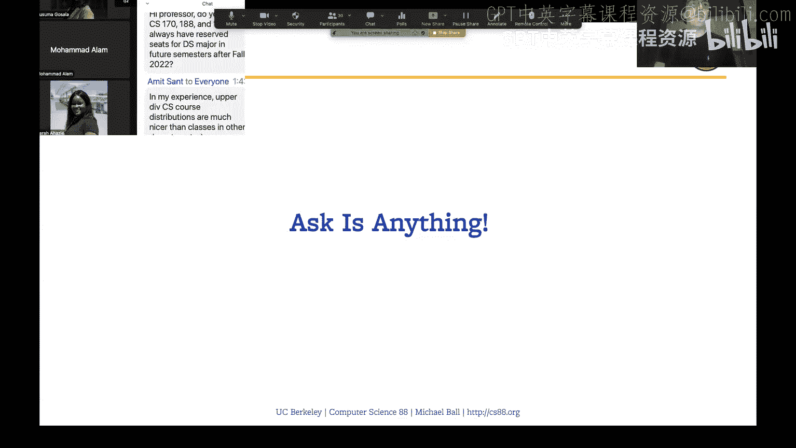

嗯。Slide Julie hide hide that so for those who are you know actually let me not do that because there are I guess some people there's direct messages so yeah curious between the difference between Python and R for how each applies to data science Python and R both are really popular in data science I've only played around with R you know generally in an environment like a research lab you'll stick to tools that work with one thing of the other but I think if you learn both languages you'll have a really good skill set for there are certain packages and tools that tend to work slightly better in R there are certain packages and tools that tend to work slightly better in Python。

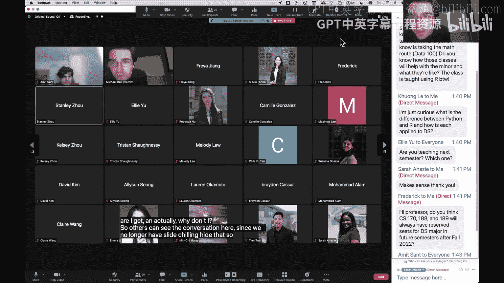

R is built for doing data science and processing so there's a lot of things that feel natural in R that we've kind of bolted onto Python that said Python is arguably you know in the top three most popular programming languages in the world。

 so learning Python learning tools like pandas and NumpI there are just so many resources for these things that you know you really can't go wrong spending a bunch of time learning them。

So yeah， a couple more questions， let's see。What one of them in Zoom what am I teaching next semester yeah so in the fall especially has come back and forth a lot when I say things have been crazy the past a few weeks starting stuff out it has been kind of wild so I' am going to very likely be teaching CS195 which is a social implications course。

 I will be teaching CS88 again， it's not certain but we might actually grow the enrollment of CS88 to about 500 which means we would be looking for a larger than usual group of tutors and academic interns and mentors and course staff so there would be more opportunities there it's not 100% certain and there will also likely be teaching CS 169 which is the computer science software engineering course where we teach you how to build basically the。

And discipline of software engineering but through building websites so things like B courses GitHub to some extent parts of the tools of the CS88 website or OK PI or a system like Ed if you take CS169 you would learn how to build projects like those courses and yeah okay a few more questions。

Between CS 171，88 and1。89 well any of these have reserve seats for the data science majors after fall 2022 I don't know about CS courses having reserve seats for data science majors in the future I do know that it is a goal to have CS courses be accessible to data science students in some form。

 as far as I know the arrangement of a data science section of CS199 which is the machine learning course as far as I know that it's going to continue into the future the rest of the enrollment questions are in flux enough that I really don't know for sure right now。

But yeah， cool， other questions in the room。Yeah， go ahead in the back。Yeah。Yeah。

 so of the Ts that I hire， what is the average grade they have to receive？So。

There's two ways to answer this the first is that I don't know what grade any of our current TAs or tutors got in CSAA or 61A I could look it up technically but I don't know offhand and I've honestly never thought about it because working with them they're all capable enough officially to become a TA for any course at Berkeley you need an A minus or better in that course or a subsequent course。

 I have hired TAs in the past。And maybe this applies to someone core staffness so I've forgotten it where people have gotten B's or B pluses and then we just write a letter saying that you got a B or B plus it's short。

 but we believe that you're qualified to be a TA because you have PE learning when you are a TA we do a lot of training so like you're not thrown just into the deep end we spend a lot of time as a core staff talking about concepts of reviewing things so。

You know what often happens is and this is true for a lot of you know a lot of folks is that I mean I got。

 I'm pretty sure， I don't remember correctly， but I'm pretty sure I got a B plus in 6 to a my first semester taking 6 to a well my only semester taking 6 to a but the semester I took it and then you know you do better in subsequent classes and there are so many topics that you。

You you struggle at first and then the knowledge clicks and builds upon each other so if you get a B or B plus in CS88 but you rock CS62 and B it's not a question or if you do you know。

You get have。You get a better grade in data 100 than like you know that counts automatically it's not even a question so grades。

You they matter a bit， but the main thing is do seem like you're going to care about your students and want to help it work with them and also you know you're typically not going to be a TA next semester right it'll be after being a tutor or an academic intern or doing CS mentors for one or two semesters and so by that time you've almost always learned a whole bunch more about computer science or CSD8 that by the time you're a TA you have plenty of knowledge and experience with CSI8 or other courses。

Yeah some good questions here any tips or for surviving CS62B you looked at their syllabus and it seems brutal。

Cs61 B can be brutal I think what I'd say for CS62b is it's in Java。

 so what I would do if you're concerned about CS61b。Is sometime in August。

 I mean you could do this before August， but to be honest you don't need to go that part over summer is to take a look at the first few labs and spend some time learning and playing around with Java as a programming language don't try and focus on necessarily all the concepts but try and do some of the first few labs。

 just learn Java， learn the tools that work with Java so one of the big differences is Java has a step called compiling it so you have to write your program you run it to this tool that turns your code into another program that then gets right in Python。

 we don't have this compilation step and that has some challenges in learning Java and it can make the process a little bit slower and so what I'd say is spend the first couple of weeks before the semester just learning Java as a tool。

 reading up on it， you know I've heard students say they'll take their CS8 CS88。Cs6 toA assignments。

And just try and rewrite them in Java， like maybe not all of ants， right， but the stuff around trees。

Any of the homework or lab questions like， can I write a similar problem to this in Java？

And just practice that way I think that that's probably the best way to give yourself a head start in CS61 B The other thing I'd say is for this is true of all courses。

 but never underestimate the power of having a good study group and a group of friends who you want to hang out with and work on you schoolwork together is that if you spend time to saying hey I'm struggling with this concept you how are you doing you know CS61 B there are assignments that are solo there are assignments that are in you know groups of two or three depending on semester you know working with peers is one of the fastest ways to sort of level up what you're learning so you know there's that the other thing I'd say is at Berkeley as well。

You don't need to do three technical courses a semester right you can balance things out that you have time to take CS62 B and combine it with courses that are maybe a little bit less heavy and that's not to say that like your technical courses are only your heavy courses you know you'll get more out of R1 B if you also dedicate time to that course so like you don't don't go if your other courses either but you don't have to pack everything in into into a single semester over hopefully eight semesters you do have some time and flexibility to spread things out including if you wanted to to do summer sessions you know that can be a good time to give yourself know a chance of trying another course summer courses go really fast though so I generally feel like。

knowIt's best to take a summer sessions course if you're feeling more confident about the material or maybe you take one of your less core courses or bread requirement of the summer to free up space in the fall。

 those types of things can be good options。Yeah and then another question here do I look at grades for courses other than CSC8 when hiring kidss only like occasionally future courses if you know you。

Like if you've got a B and CS 88 we would probably look at your future course grades。

 but in general hiring for course staff is not based on grades it's largely based on。

You know grades grades are sort of a barrier but we're not hiring by GP at all I don't rank anyone by GPA you know we check that you meet the campus requirements which is an average of a 3。

0 GPA but beyond that don't we don't really look at grades for course staff it's much more about when you fill out the application what did you write have you been involved as an AI or a tutor or a mentor or something like that and so on and also like for CS mentors you know like some of those folks who volunteer their time CS mentors will do interviews we will do interviews some semesters depending on how many people were hiring so there's a lot more than just grades that go into the course staff process but yeah good good questions so we have a few more minutes other questions in the room。

啊。What else？And if I'm missing in someone's hand， feel free to just shut out a question。Yeah。非了さ。

Yeah， this is a good question what I recommend taking data 100 or CS61b first。It's。

I a few people have asked this and I honestly think that you can do them in either order what I would say about programming in general。

 again like most subjects is。The more experience you have。

Going into course you know the easier will be right so if you have more programming experience from data 100 going to 6 to1 B that would make 6 to1 B a little bit easier if you have a little bit more experience from 6 to B going into data 100 even though it's Java and not Python just that experience programming will make solving some of the data 100 problems easier as well and so。

My gut says that if you're feeling less confident about your programming skills is that already knowing Python is going to be a comfort going into a course that means you could take 100 before CS62 B。

So my gut kind of says that if you're not feeling as confident。

Then maybe data 100 will feel a little bit more natural just because you are in Python the primary mechanism of data 100 is Jupyter notebooks and so if you liked that workflow from data 8。

Then you know you might like that aspect of data 100 CS62 B is going to be a little bit more like CS88 in that respect where you're working in a text editor with files there's auto grading it's not okay pie but similar style where you have test cases and test results for each of those cases so I would kind of say you know are there aspects of one course that you like you know more than the other the other thing again what I said earlier though is if you have a group of peers you want to take the course with together you know that probably counts for like half the reason of choosing to take it at a certain semester is that if whatever reason your frame group says hey let's do data 100 together in the fall and CS62 B in the spring like and you've got you know good group of。

Three or four or five people together like you know having a study group going into the course will probably make it better than anything else but yeah it's a good question it's a common question the other thing that I would ask or that I would suggest is actually so with the last couple of minutes I will mention this because it is。

Just worth highlighting。嗯。There is， if I spell it right， piazza， nope， I did not spell it right。

 so there should be a link。

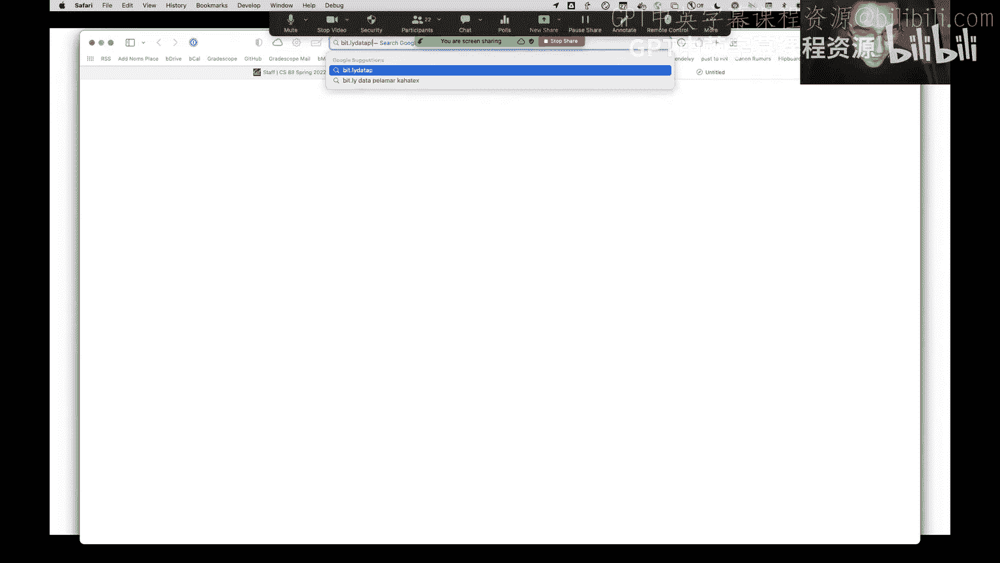

HeyZoom， I need you too。Get out of my way so I can see what I'm trying to type。It should be Biley。

 oh， now。

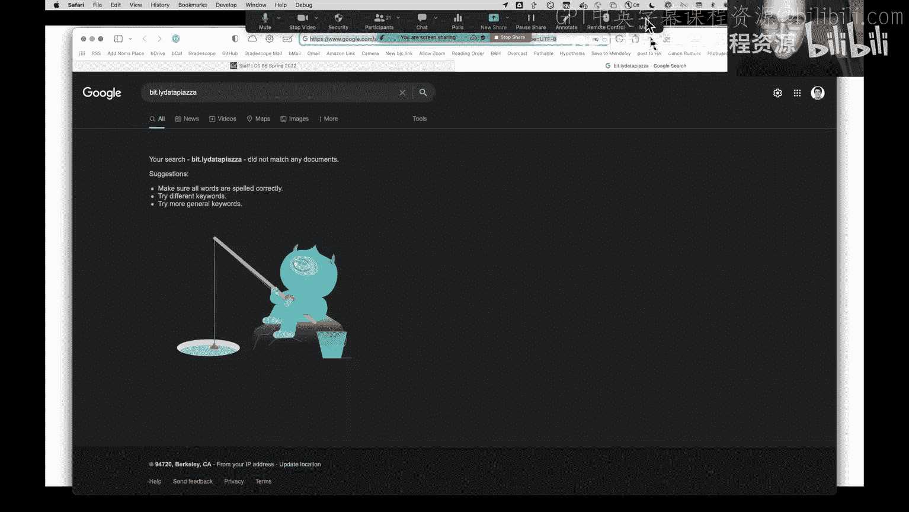

C 10 final。Well， no one in here is taking CS10， I hope。Wow。All right， okay， anyway。

 so Biley slash data piazza is the link for the data science piazza and bitley slash Es piazza is。😊。

Okay computer thanks is is the link for the Es piazza both those places I would say are worth posting and asking questions of your peers as well because someone who's done both recently would probably have other good advice so yeah I will also go back and add those to the slides so that and upload them after lecture so you have the links any one sort of last question from anyone who has something to want to ask。

With the last minute or so。And if I'm missing someone's hand， feel free to shout it out。Oh。

 was that a hand up there？No okay all right well if there are no more questions then thank you everyone good luck on your exams good luck on finish up the semester do take a break during dead week I know there's always a ton of studying but like。

You know， if you've got a full nine days between Friday and the start of final exams use most of that time to study。

 but you know take a couple days to relax before diving into things so thanks everyone and I will see you at the final exam or hopefully in another course。

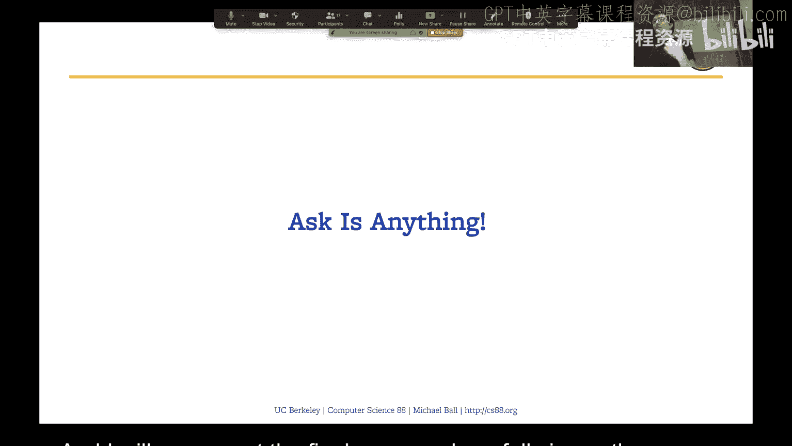

Thank you。Oh。Okay。Okay。Yeah yeah sure， what's up's more like practical。😊。

Yeah I'm doing this subject for。