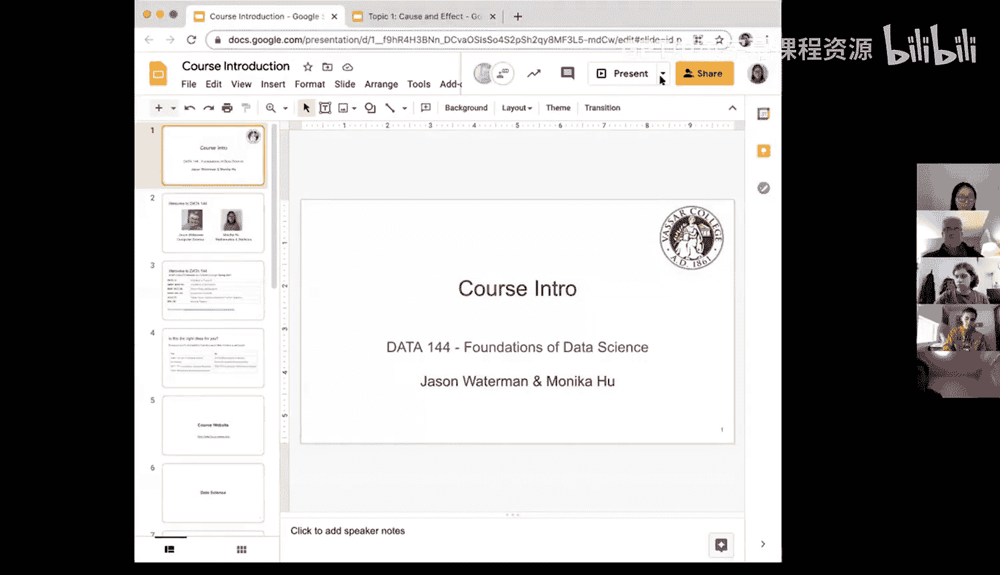
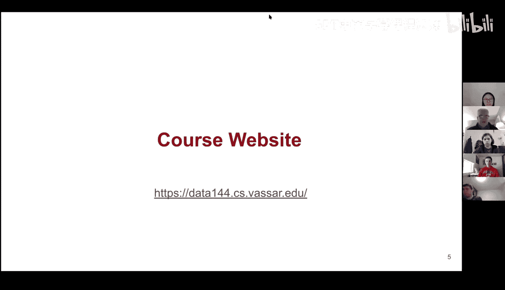
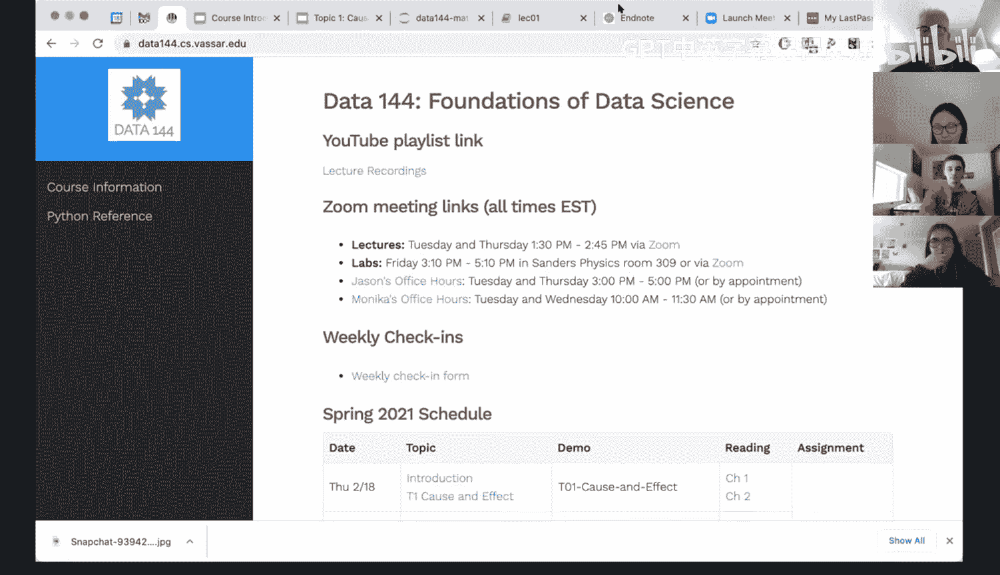
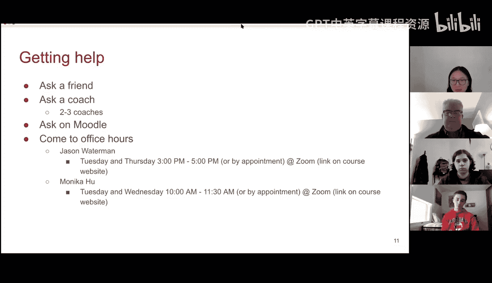
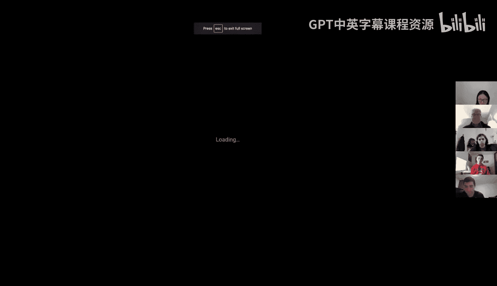
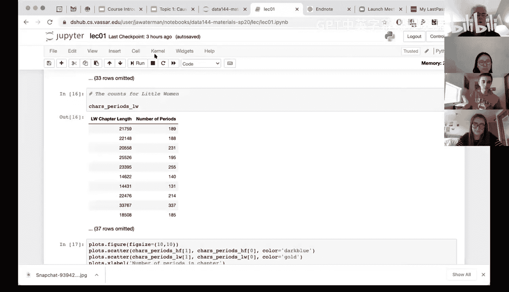
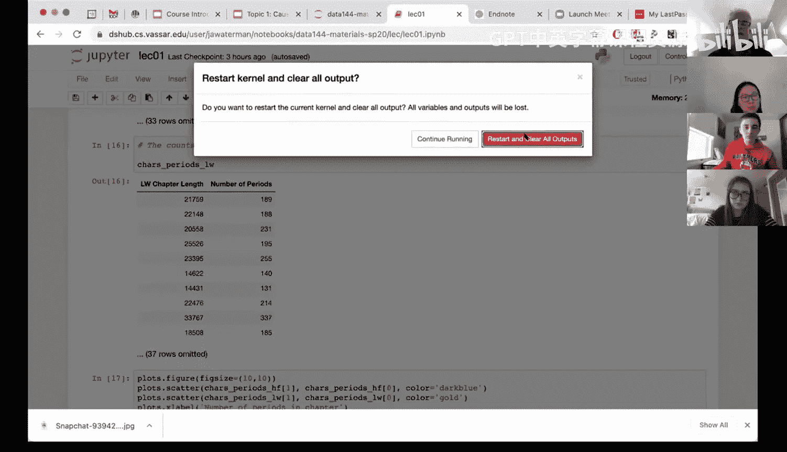
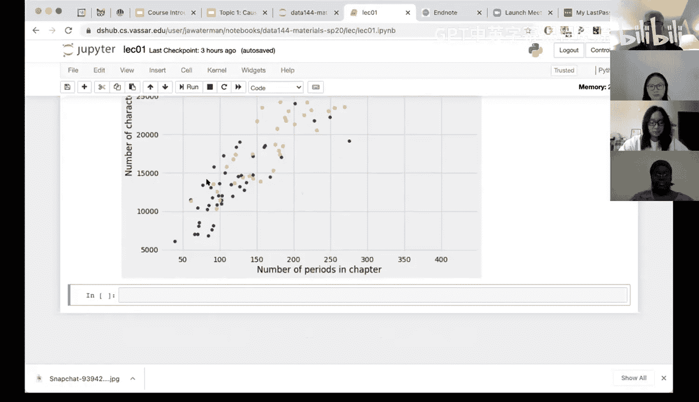

# UCB《数据挖掘和分析｜DATA 144 Data Mining and Analytics 2021》中英字幕 p01 [P01]lecture1-[T0 Introduction] Introduction-4jxr2ZiULpo.zh_en [BV1efBEBuEVg_p1]

Court on this computer， great， all right， we're live。

Perfect all right thank you Jason and thank you everyone for coming we will get started so this is data 144 well we call it data 144 is cross listed between computer science and mathematics and statistics and and one of the instructors Monica who and Jason do you want to。

So yeah I'm Jason Waterman， I'm a assistant professor in the computer science department。

 actually Monica and I we joined the same right we're part of the same cohort right we both joined in 2015。

😊，And my area of research is in cloud computing and virtual machines studying security efficiency of virtual machines in cloud computing。

Thanks Jason yeah so I work in the math and Sta department and like Jason said we joined Bassar in the same year of 2015 my research is on data privacy and data confidentiality from the statistical point of view and so we're the co- instructorstructors for this course and I think maybe without further ado I will share the screen of the lecture which is also available on our website as you can check yeah if you click what we have the link we post each link of the slide。

For each lecture under the under schedule so you should be able to also exit at the same time and all right so we talked about both of us quickly and for this course is actually part of the grand challenges if you have noticed it is HHMI Grand challenges on climate change and we're running the course for the second time okay and last time it was spring last year so for this spring in addition to our data 144 foundations of data science there are few other grand challengesll courses we're listing them over here and for more information about them and there are many other activities and events going on around the grand challengesll on climate change topic so if you click that link I think you'll be able to find out in addition to courses there are other opportunities that you'll be able to be engaged in this topic so feel free to check it out。

We also wanted to make sure that just double check that is this the right class for you and we're the listing here is really just as a guidance and we're trying to make sure that。

You are now enrollding a course that you have maybe known much of the material and we also want to make sure that you feel that this is the right class for you so on the yes column。

What we're saying here is that if you have experience or so first of all the course has no prere okay so if you have none of the experience。

 don't worry this is the right class for you for sure。

 but then if you already have taken like computer 101 I think and then AP statistics or math 141 intro to statistical reasoning or psychology to00 statistics experimental design you'll see that theres certain overlapping material but still we think you will be able to learn a lot from this course however on the no column if you have taken mathth 240 mathth 242 or the summer introduction to data science course which is independent 103 183 sorry then we think this might be too much overlap for you that will recommend you to take different course so if anything is related to your situation let reach out to us later so we can discuss with you individually about the course selection for you and one thing I would add about that is。

Yeah， if you've taken 101 and that's the only computer science class you've taken。

 I think you'll still get a fair good chunk out of this class but if you're a CS major or a correlate and you've had you two or three CS classes but come chat with me to make sure that this is the appropriate course because I want to emphasize the fact that there are no prerequisites from this course if you've never done anything with a computer aside from you know use it for the internet。

 you've never done any programming， this courses for you。

 we're going to teach these things from first principless， if you've had a handful of CS classes。

 I think the first you know probably the first half of this course would be a bit too slow paced for you and I know you now that we're down to just 32 courses you know in your college career。

 every course is precious and so if you've taken a couple computer science courses and you're kind of you know not quite sure message me in Slack and I'm happy to have that conversation with you。

Yeah thanks Jason and similarly for the math and stats background and like I said on the right hand side I already listed most of the courses that we think will be too much overlapping。

 but if anything else that you have and that is not on the list。

 feel free to reach out to us afterward。All right so the course website I hope many of you already get the chance to take a look at it and maybe Jason do you want to go ahead and then just walk through the structure of that page yeah sure I think then I have to can I oh hold on I think I can I have the technical multiple participants can share simultaneously so I think I can share my screen now。

Yeah， if I click on。If I share this。You see my lovely zoom session and then so this is our course website this is kind of our one stop shopping for all things course related here you'll find the schedule the topics down here as Monica said copies of the slides will get posted we will do our best to post them before lecture I think we'll do pretty good about that you'll see that for many of our classes we're going have live demos where we'll walk you through code so really this is a course where we're going to learn a little bit of programming and some statistical techniques and we're going dive right in and a lot of times we'll actually show you working code we'll talk more about this on the lab on Friday but we use something called Jupiter notebooks and i'll give you a demo and so these demos once you get once on Friday we're going to set you up with accounts so you'll be able to log in and actually follow along and。

The demos with us。Next to that we have our reading chapters so the textbook is a really good textbook and the best thing of all it is absolutely free it is freely available online a lot of this is the textbook that Berkeley uses for their data science initiative it is a huge initiative at Berkeley I think well over a third of the students who attend Berkeley take this course so the materials are pretty well vetted and the textbook is really really good and they've generously made their materials available online so we don't have to penny thing for textbooks which is exciting and not only is it free it's actually good it's actually you know I really enjoy it the chapters are self-contained have a lot of good practical examples from there and then when we start getting assignments posted they'll show up on the website there so this is really meant for kind of ones stop shopping links to the zoom lectures are going to be there and then links to my。

😊，hours and Monica's office hours from there and then so that's kind of the main page when you go there that's kind of the most important ones like where where zoom and what are we talking about today and then the kind of traditional syllabus is on the course information we're going to have a set of undergraduate helpers we call them coaches their students who have taken the course the first time we offered it。

And they're going to post their own office hours and they're going to be in lab with us help to help you out with the assignments and this is the description of prerequisites from there and then as we learn more code and we learn the data science library package this is kind of a handy reference for some of the syntax of the libraries in the code will be using so right now none of that we don't know any of this stuff yet but you'll kind of come back to that page and we'll add more resources as the course goes along so I think that's about it so in general we don't at least for information we don't we don't use Moodle the last year we did give grades back via Moodle I'm still I'm trying to do something a little better than that but I may succeed I may fail if not we'll just revert back to passing back grades on Moodle like we did before but if I get this kind of really cool technology that obviously you can tell by my voice i'm very excited about if I get that working we may not need to use Moodle at all but。

But at least for information， the data 144 website is your kind of one stop shopping from there。

Okay I think that's all I have to say about that oh do you want to are we talking about later about the checkins or do you want to say something about that now maybe later yeah to that but thanks yeah all of the links yeah as Jason pointed out later we're going to talk about the components of the course and and then most of all of the links actually on our website so later when we refer to it as long as you go back to the website you'll be able to find all of the information that you need。

All right， sounds good and let's come back here。Okay so now let's talk a little bit about data science。

 how we understand it and how we think you will what kind of exposure you're going to get to it throughout course so we define data science is drawing useful conclusions from data using computation okay so they're of course you have to use computation。

 how to do them and then of course thinking about what do we mean by useful conclusions and then how to draw those conclusions okay so we talk about three important aspects of it。

 the first one exploration that usually involves doing data visualizations once you get a data you want to try to start identifying patterns of information in the data set and then the most commonly used way is to use data visualizations so through Python and then the data science library that we're gonna introduce you to you will get to try so many different ways of visualizing data okay so that's the first aspect and usually the first step as well of doing data science the second one is。

Inference okay typically we call it statistical inference like making inference based on the data that you have so usually we refer this to as quantifying whether those patterns are reliable okay so suppose you identify certain feature or certain trend in your visualization in the exploration step then we're trying to figure out whether this patterns are reliable whether they're just really due to chance that it happens in this particular data set or it does have a wider implication out there that it does tells you some information really interesting and useful and you will see that in this course we're going use a lot of the technique called randomization for doing inference and that again relies on computation okay so you will see soon throughout the semester that we really motivate everything through the computation point of view and once you're able to do a lot of writing functions running functions in Python and then all of the inference is pretty straightforward from there and the last。

it is okay we now have exploration， we have made some inferences and then we want to make use of the stuff that we know okay so we're gonna to try to use predictions and then that is in another words saying that we're making informed guesses based on what we have done okay so depends on how far we can get the material off if we get to it we can talk about certain machine learning aspects of doing prediction otherwise we can also we will also include other more traditional ways of brain predictions overall this are the three important components and aspects of doing data science so we want to highlight them and then you can think of them as a progressive manner but then in the end when you're really doing data science when you become a data scientist I think you have to think about all of them at the same time and then you have to work them through。

Simultaneously in some sense， okay？And so here this is a slide for you to think about well this is a course like we said with NoPEEC right and then we're trying to build a data science program on campus with different courses and then other opportunities so here we want to give you a list of different courses that we have identified that might be useful so for CS we list a CS 101 but as we said earlier if you have taken it still you will be able to learn a lot out of this course in particular and so Jason do you want to speak a little bit more about other CS opportunities after this Yeah I mean I think the one thing that is worth mentioning is is that data science is really a new it is a really important trend in many fields computer science included。

And so this class， you know why we're so excited to offer this classes is that we really do hope that this is the first step into bringing a data science correlate to Vassar and maybe you know a data science major and if you think about you know what a liberal arts college is。

 this idea of interdisciplinary data science hits at the heart of that。Nowadays。

 no matter what field you study data is important about it in the humanities for analyzing text。

 for social justice， for biology psychology I mean honestly you know you pick a major and I can tell you that there's going to be you know that that data analysis is going to be a really important part of it so you know so that's why we're really excited and hopefully you know you will give us feedback on how the course is going and you will become ambassadors really this is kind of planting the seed and we're lucky for this opportunity to do it within the grand challenge and really we hope。

That this becomes something more established in the curriculum and so we're really hoping to grow from there and so you know regardless of what your background is if you're kind of dipping your toes in the water of computer science and you find you like it you know come chat with me and we can talk about kind of what the next steps are and both Monica and I we're having broader conversations throughout the college about bringing data science more widely and you guys are going to be a big part of that so I'm kind of excited from that but I think to answer the specific question right now I'm in discussion with the CS department on how we can incorporate more data science throughout our curriculum right now I think the right thing is exactly right if you're interested in kind of learning more about computer science 101 is the next step but we can also talk about what other courses you know apply from there so I think that's probably yeah。

Thanks Jason yeah and then from the math and stat side again because we already have a pretty robust statistical curriculum and so I'm listing all of the related courses here and actually after you have taken this one。

 all of them well sequential will be eligible for you so we have 240 introduction to statistics which use a different programming language R okay and then 241 is probability and once you have that I think actually let me agree in this way So introduction to statistics 240 and then after that you're able to take 242 apply statistics modeling so if you're really into the applied side of doing statistics and then data science related I think this track will be really good for you 240 and 242 and if you want to and later if you want to do a math major with a stats pathway especially after taking this course and you think that oh I'm really interested in the inferential aspects of doing data science then when you consider that then a sequence will be a really。

241 which is probability to get you started and then once you have taken that。

 all of the 300 level courses I'm listening over here will be open to you okay so this is again because we are able to show this list because already have a stats program or like a stats pathway in the math major but again just like Jason was saying we're having a broader discussion like between the two departments as well as between other departments trying to figure out there's other opportunities including courses that we can co-offering just like the one that we're doing right now that we can open it up to a wider audience and then even I guess more diverse background of the professors as well as the students okay but in the meantime we also listed the other courses to the best of a knowledge and as you can see coming from biology。

 Coxci economics and some other departments that we probably have missed but if you know any other courses that or later you take any other courses that you think are really relevant let us know were。

Did you pass that information to the leader students as well。All right。

 so for the course structure and this is where I was talking about earlier we're gonna to discuss the components okay so the lecture is going to be live on Zoom and is interactive in a sense that we will talk about concepts using slides but then we're gonna switch back and forth between slides and demos which is going be done in Jun notebook which I think Jason today actually we will get to do that a little bit as well so lectures every Tuesday and Thursday afternoon okay and we have a weekly lab assignments okay it's going to start this week and is going be every Friday afternoon310 to 510 thank you everyone for filling out the survey we conducted earlier I think most most of you are able to do it in person but we do want to say that because of some remote students as well as preferences of doing it doing the lab remotely we also gonna host the same time at the same time lab online okay so if you ever feel like you want to attend the lab online it will be the same material so Jason will be doing。

One in person I will be doing the one online and we each of us going to have coaches working with us and working with you。

 so whichever one you're going to join which is totally fine okay and the lab information。

 the link to it as well as the room information if you're going to do it in person it's on our course website。

And you also see that especially in the first half of the course we're gonna to have weekly homework assignments okay all of them are being done using the Jupiter notebook as well so the link and the material。

 all of them are on our website as well once once they become available we're gonna post it and for those ones we encourage you to make use of our office hours as well as the coaching hours or just doing the lab sessions if you finish your lab and then want to ask more questions about homework feel free to reach out to any of us me Jason or the coaches or even just your fellow students say on Slack or something I think that will be we really encourage this collaborative work we just want to make sure that you are submitting the work of your own but then we encourage discussion and one piece that we are adding this time especially now the whole course is sort of fully remote especially the live lecture the live online lectures and we're adding a weekly checking form the link is where Jason earlier was showing is on the first front page。

For our website it's just a Google form okay and we ask you to complete it every week by the end I guess by by Sunday midnight okay so we're gonna send a reminder for us this is really it does not come does not compose of any of the grades or anything but for us we really want to have this weekly checking with each of you to make sure that you are following the material well and then you are able to use the checking form to share any questions or concerns that you might have okay so like I said we're going to send reminder the link is on the website and we're going starting from this week。

And the final stuff components of the course is we have two individual projects。

 those will be you can think of a longer lab like they're constructed by sections and then you're answering questions in a sequence and for those who will ask you not to communicate with others because and as well as do not ask questions about the individual project to the coaches as well or two for us you can reach out to us if you have clarification questions but there individual projects you can think of them as exams but then they open book Openn openended so just so you know but we'll make those announcement early on and the last component is one final project potentially I think we're going to do teams of three so we're gonna to have eight teams in total and we'll provide a list of possible data sets for you to use and well help you guide you through of doing the project proposal as well as the project like doing the actual work of the project and the final presentation。

So really these final project for you to synthesize all of the material that you will have learned towards the end of the semester and then trying to put it into application that is of your own interest as well as utilizing all of the material or some of the material I should say that we have covered in this course okay。

 so the details again Jason earlier showed us the course information which is the s syllabus and all of the details stuff is over there as well。

All right， getting help we talked about Elizabethluis so we definitely encourage you to ask a fellow student as a friend as a coach we're gonna post the coaching hours soon well we can probably cross off that as autdo let's just do us on Slack ask on Slack exactly as that would be perfect and then come to office hours coaching hours so this is our like office hour times and then this is all of the links our own zoom as well and I want to kind of say one thing about you know kind of office hours in the times of COVID I mean you know given that we're remotes it's I think we need to be a little more intentional about making these connections you know I think it's different like you know in in the before times you know I had an open door policy and that was literally if my door was open that is your invitation to come chat with me you know outside of office hours and obviously you know that's harder to do and I don't have a door and not even。

Loud to keep it open right and so I really I just worry that in these times that it's going to be easy to withdraw upon ourselves and really we should be doing the opposite and seeking out connections and so I do hope that at least through the slacklack channel that we can start to form a community of data scientist together I really do think of you as the seeds that are going to sprout a data science correlate here a Vassar and so feel free to communicate on the slacklack channel and and I just can't emphasize this enough。

 please reach out to us you know via slacklack channel you know definitely during office hours please。

 please please come and I'm glad that we are able to do some of this class in person where we can start making those connections but know keep in the back of your mind too that at the end of this course we're going to form in groups of three you know so you're going to。

Have two peers with you and you know the sooner you start thinking who you want to work with and start forming those groups。

 you know I think the better and so I'm going to try to reach out to you guys and you know hopefully sit down and have chats and get to know you and that's the part I miss you know about doing that is that I think we can still do it I think we still can make these connections I think we can still get to know one another I think we just have to be more intentional about it and that is my signal to you that I really do want you to reach out because I in these times we really do have to look after each other。

And I think it's just a little harder to do that when a million things are going on。

 but let's all try and so please come to my office hours， they tend to get underutilized。

And and also also thing the thing is is that that's why we have kind of the S the discussion channel you know that's for that's for if you have a question you know because I know you guys don't get stuck on convenient office hours points right so even if you're not in office hours post a message you know to slack and then who knows right you know probably you know there's a good chance you know one of the instructors or one of the coaches will chime in even if it's not official coaching or office hours so let' let's just all try that。

Sounds good and I should also mention if you see a question on Slack and then feel like answering totally go ahead and I think we really want to use Slack as an instant messaging tool that and you will see that Jason and I were constantly on it and we're clicking likes to feel all of the stuff that you guys are saying so far so really we're making effort and we really hope that youre also committed to this and then making effort to make it happen。

😊，All right， thank you， and let me okay find my screen again。YeahBut its here。Is it here sorry。

 I cannot seat my give me a second I cannot see your screen。

Something is happening。 Oh okay， let okay， all right， Should be fine now。Yes。

me backOkay so again， course policies， we actually just elaborated a little bit and then a link to the policies are on also on the course information website。

 so make sure that read it carefully and then if you have any questions feel free to reach out to us。

Again we just want to highlight the importance of collaboration our encouragement for it okay asking questions greatly encouraged and except for okay cross that out re quizes except for the individual projects that we're asking you to do as part of the grading otherwise all of the other stuff feel free to discuss about in-class questions lab questions demo questions or like lab questions okay and we talked a little bit about this already for the lab assignment you will submit it individually but you can discuss with us with each other and with the coaches in the lab and you should submit homework individually but feel free to discuss individual projects are the only one there are two of them are the only one that you cannot discuss but you can reach out to me or Jason if you have any clarification questions and the final projects as we talked about is going to be done by team of three so you're going to work with two other partners and just like what Jason says were really encouraged to get to know each other as soon as you can so you can form the。

Tams by yourself and then later will be able to make everything work more efficiently okay and one of the things I want to say about the assignment in kind of relation to collaboration a lot of our assignments you get instant feedback we've incorporated a little bit of auto grading for some of the questions so you you know one of the worst one of the worst things is doing an assignment and not knowing whether you understood the material and then you submitted and then maybe a week or two weeks later you get a grade back and you've already moved on so one of the things that we've done intentionally with this course is try to think of ways that you can get more instant feedback on whether you're on the right track or not and so because we have you know a little bit of kind of selftest built into the assignment the need for the need for kind of looking over someone's shoulder is a little bit reduced in the sense that you do get feedback on whether you're on the right tracker or not。

And I think， you know。You know definitely the individual projects。

 you know that you know we're going to be pretty strict on I really like to think of us as a community of learners and so if you're stuck on something and there's not a you know coach around。

 you know it's okay it's okay to ask a friend where the really the line is wrong is if you're just copying if you're if you're just like cutting and pasting or just typing。

 looking over at someone else's monitor and typing exactly what they're typing。

 right I mean let's use our common sense， like if if it feels wrong， it probably is。

Thanks Jason yeah and that's exactly the collaboration we were planning to do for the limits of collaboration so again except for the individual projects。

 everything else we really encourage collaboration and then asking for help and then feel free to do that whenever you encounter some challenges。

😊，All right， so Jason are you ready， I am and so what I really want to do。😊。

Right now is just kind of give you， oh， could I just start a poll， I did not mean to do that。

But so many buttons， oh， the poll button is right next to the share screen button， I understand。

All right。Great。there all right， so this is going to and we're going to talk we're going to talk more about this in lab tomorrow。

But I want to kind of just give you a taste and kind of a power for what we're doing here and so one of the things that we're going to use and I'm very excited about this is that for this course we're going to use something called Jupiter notebooks and what that is is it is a way of writing programs inside of a browser and so you know one of the challenges with an intro to computer science course is that oftentimes there's a lot of there's a lot of technology that needs to get installed and set up and are you running the right version of this and oh does this run on Windows versus a PC versus a Mac the beauty of this is that we have simplified all of this is that if you can get on the internet and go to a website you have all the tools that you're going need for this course and so what that means is that you day two into the course lab on tomorrow we're going to be up and running and we're going to be running and typing some actual code and programs and so the thing that we're going use。

something called Jupiter notebooks the language that we're going to use in that is a language called Python it is one of the world's most popular languages for computation for computer scientists and for doing data analysis you are joining a community of millions of other Python programmers I basically got my PhD by writing Python simulators so I love Python great it's a great language for doing data science and general computation from there and so to just give you a flavor what it is is that you're going to type in in these cells these are called code cells and by doing control enter you can execute the code in that cell and you'll basically run many programs in these cell so this person so for today I don't want us to kind of focus on exactly how we're doing all of this stuff and and if all of this looks kind of like you know kind of like a third foreign language don't worry're we're going to explore but this is really just to give you a taste and kind of。

power of what we can do and as you'll see there's really not a lot of code here and so we can do a lot of great things with a little bit of code so this this here is just kind of boilerplate stuff to load libraries into code that we're going be using from there and so when I do shift enter it executes that cell so notice you can see next to the end there's nothing there and then what on the lab to do is type in any python code and we can see Python will evaluate expressions so something like two plus3 will give me the answer5 and I can go in and I can just type like if I wanted to do two plus two instead I can just evaluate that cell I'm executing that little snippet of code and then i'm immediately getting the results back okay and we'll talk more about the language the syntax the rules much like any language has rules like English French German the python programming language also has rules and we'll talk a little bit about the syntax of that as the course develops but for now what we're gonna do is we're gonna to show a little bit of data analysis a little bit of visualization。

And what we're going to do is we're going to read two books really fast。

And I want you to I want you to I want to kind of watch right so notice in next to the little the in there's nothing there right i'm going to execute the cell and then you're going to see for the briefest of moments a little asterisk will show up there that that's the tool letting us know that it's thinking and then when it's done that asterisk will go away so I want you show so we're going to read two full books。

We're going to read to it， are you ready， a count of three， one， two， three。

Boom what it took that took less than a second， less than a second to read two books if I。

 if I could read that fast， I would be much smarter than I am okay， but but let's be clear right。

 you know， while I say the computer has read those books it has it is actually what what's going on here is going off on the Internet is going to this URL It is。

😡，Ftching off the internet， the text， and it's reading them and storing them into this name。

 which we're calling Huck fin text。In computer science that is known as variables。

 but I want you to think of that as just a name that stores data associated with it。

 and then we're going to take that take that book Huckleberry Finn and divide it into chapters and we're going to do the same thing with the little women。

Book as well and so if we want to see what we we got。

 we can just evaluate that name H Finn chapters and it will show us。All of the chapters。

two hook thin。From there， Okay， and so you can see that that is。

A little hard to read and so what we want to do is we're going to be using this data science library that is kind of the data science package that we're going to use from this course we're going to take that data and we're going to create a table table is just a two column rows and columns a way of organizing our data and again。

It took not very long time， and so now what we've done is we've organized each chapter into its own table。

😡，From there okay， so now that we have this organized as a table。

 we can use a bunch of tools that operate on tables and one of the things that we can do is if you just had a question。

 how many times does Tom Sawyer does the name Tom appear in this book？

Now if we didn't have a computer， how long would that take， that would take what hours， days。

 maybe even weeks， depending on how fast you you can read and skim again。

 how long did the computer take to do this， just watch the little asterisk。😡。

Less than a second less than a second and and what we've done here is we've gone through each chapter we've counted the name that Tom appears in the book and we've summarized that by chapter so this is just one number for each chapter so what that's saying is is that in the first chapter the name Tom appeared six times the second chapter 24 so on and so forth and then Tom disappears for a few chapters then he comes back and then he disappears again and then at the end you know he makes a strong showing at the end there right and we can do that for any character in the book or really any string in the book just by changing the name to this function here and so we wanted to see how many times Jim appeared in the book again。

We can get our array okay and so that's kind of useful but it's like what happens if we wanted to compare how many。

 you know what chapters did Tom come in versus what chapters did Jim come in it's a little hard to compare because you're kind of just lining up and again what we can do is we can take that data same data and just visualize it we can put it in a table。

😡，And then it comes a little easier to see。And again。

 each row represents the chapter and each column represents the count for each of the characters in there。

And you notice there's many more chapters and so just one of the things that Jupiter up does it just shows you the first 10 lines。

 if you want to look at all of them， there's ways to do that as well。Okay， so that's interesting。U。

But I think you know when we're looking at these things it might be a little easier to actually visualize through a graph。

 the data science package that we have has graphing support and visualization support so again we're just doing the same thing that we've done we're counting up the number of characters and creating them into a table and now we're going to plot we're going to plot cumulatively how many times each name appears in chapters one。

 two，3 and so on。And again so the thing I want you to kind of focus on not so much you know exactly what's doing how little code we're actually writing to do this because we're using this data science package look at this I mean so what did we do we created this graph we've created this graph that's showing us the cumulative time each numbers appear how many lines of code did we write how many realize this is like you know I mean we set up the thing here and then it really took three lines for us to plot that this is the power of abstraction。

 the power of using data libraries and it's the power of Python and it's the power of the tools and so the cool thing is is that you know you know the thing I want to kind of dispel is is like oh making this graph right oh my god this is like you know hundreds and thousands of lines of code now I mean there are code in there but through the miracle of abstraction all of those details for how that how we actually generate those plots those are hidden from us and that is complexity I am happy to shed。

From there so this is kind of the level this is gives you a taste and a feel of the type of programming that we're going to be doing we're going to be doing interacting and programming at a higher level we're going to let all the low level details of like how to make this graph being handled by a library and that is awesome right that means we can hit the ground running and that means we don't have to spend hours week today's you know writing hundreds of lines of code just do something as getting a plot here from there Any question so far。

I know it's hard to you know， get interactivity from there but but that's， you know。

 that's pretty cool that's pretty cool in you know。

 and I think Anthony right you have a you raised your hand yeah ahead yeah so this may be a silly question but when it broke it down into chapters it was identifying like the markers where it says chapter within text or okay right？

Where so which line we're talking about which which book Huck Finnin Huck Finnin， so yeah。

 so so this is where you have to know a little bit about kind of so one one of the things about data science has how to clean the data。

And so what we did to kind of get that， we actually so HubF is out of copyright。

 so the text is freely available through the Gutenberg project。

And so you know you can actually go and look at the raw text by going to this URL and then you can see the way the format for this particular book。

 each chapter starts with the literally the string the characters' chapter all in caps followed by a space and so we took advantage of that fact that was a constant delineator for breaking up the chapters and it turns out that's how little yeah and that's a format of how Project guttenberg does their books from there if you were grabbing another book from a different source there probably is going to be a different way of breaking up the chapters that's not a silly question all that' that's a great question。

And we can do so the idea here is is that you know kind of the steps are is first you kind of explore the data。

 you get a sense of it， you know how to load it and then you visualize the data and then once you start visualizing once you start visualizing then you can start looking for patterns you can start looking for relationships。

And so for here right， you can see that you know， just by looking at the data， not reading the book。

 you can see that。That towards the end。You know， I would say that I would say that。

 you know not not reading， not remembering the book I've read it， you know at some point， but many。

 many years， but not remembering the book， I would say in the second， you know。

 for maybe chapters like 33 on， I would say that Tom and Jim are probably doing an adventure together because look at how kind of they're kind of correlated right or there's a relationship between them here's another interesting question。

 you know， the name of the book is Huckleberry Finnin。

 but yet Huck Huck is the character out of these three that are mentioned the least。

Does anyone remember the book and why that's the case， there is an explanation。😡。

Isn't one of them the narrator Huck is the narrator exactly。

 and so he's going to get his name mentioned less because it's told from his point of view。

From there， so right awesome and we could do the same thing with little women。And again。

 just marvel at how little code we're writing to do all of these things and here we're plotting the cumulative counts and I have not read I have not w little women。

 but I mean it is popular enough that I know the kind of basic premise and and I know that it's a story of four sisters during the Civil War and that Lourri is a young man who marries one of the sisters and if you haven't read the book。

 if you have read the book， you know the answer to this but if you haven't read the book and just by looking at the data。

 you know can you predict or can you guess who does Laurri marry of all of the characters。😡。

Someone who has not read the book want to venture a guess。Just by looking at the pattern in the data。

😡，A Joe。Joe， okay， why would you say that？Like it seems like his name is mentioned like a lot a time。

And there is a good reason for that Joe is the one of the sisters that is the protagonist of the story。

 she doesn't narrate it but she is what I would call the protagonist so she does get top billing and then at one point she does move to New York so we we will sadly have to eliminate Joe from this competition it' not a competition from there but so out of the others out of the others does anyone want to venture a guess but I could see why you would think that right because she's mentioned so often。

Yeah， so there's an answer in okay two answer in the chat and then I think Samantha is raising her hand。

 Samantha， do you want to？我们。I was also going to guess Amy because based off of the frequency of the names appearing they seem to be practically the same and like Yeah absolutely right and that's the sort of thing that is that it's hard to see unless you actually visualize the data right if you're looking at tables if you're just looking at numbers you can you know and so that's going to be one of the key aspects of this course visualizing you know and you know loading the data visualizing it and then looking for relationships and then finally making predictions based on these relationships。

And so that's kind of a taste and so the other thing that we can do we'll just do it real quick so we can kind of get back on that。

 you know， so we talk about characters in the book， but we can also talk about physical characters。

 the letters and so now we can actually do text the same books that we can do textual analysis on on the characters on the actual characters and again using a computer you know something that would take days weeks months to do by hand takes literally you know less than a second。

And so what we've done here is now we're counting， we're counting the chapters。

 so we're counting the actual number of characters， you know。

 the letters and the punctuations and we're basically comparing the length of each chapter to the number of periods okay you know delineating you know a sentence and we can see just by looking at the table and this is not like you know this is not a great revelation。

 the longer chapters tend to have more periods， short chapters tend to have less characters。

 less sentences， less periods from there。But one of the reason why I'm kind of showing this is is that one of the things that we can do is is we can take data sources from different we can take data from different sources and we can analyze them together and so bringing in different data sources and looking them together so what happens if we want to compare the length of the chapters and the number of periods from both books and again we can do this with a scatter plot again just marvel and how little how few lines of code that we need to write this to do this plot and so what we're doing here is we're doing a two-diional plot and we're looking on the one axis here I can almost hit everything else we're looking at the number of periods in each chapter so this is counting the number of periods this is the same information in the table here but just showed graphically。

And as we can see between the two books， we can see that Huck Finnn tends to have shorter chapters compared to little women and if we look at it and so the little women are the chapters and little women are are the yellow dots and Huck Finnn are in the blue dots and now we can start seeing kind of a pattern。

 kind of the thing that we kind of suspected ahead of before was that the longer the chapter。

 the longer the chapter， the more the more characters in the chapter。

 the more periods right but what's interesting is now we can start to see this relationship。

 we can start to see this relationship， and I would say that this looking at this。

 this is kind of a linear relationship。As the number of characters in the chapters grow。

 it seems to follow that the number of periods go and as the length of the chapter doubles。

 you know on average roughly approximately， it looks like the number of periods are doubled and if you if we kind of zoom in on this idea of looking at 100 periods。

We can see that a bulk of the chapters go between 10，000 and 15。

000 characters and if you divide that by 100 what do you get you get each sentence is between 1150 characters and so that kind of jumps out into me when I start thinking about what was the original length of Twitter the original length of Twitter was 140 characters and this is born out in the literature 140 characters is about how many characters you need to express one thought one sentence and so you know I don't know how I don't know how the Twitter people you know kind of came up with 140 but you know they're right in the right ballpark from there so all right that's I think all I want to say kind of for the demo but that's kind of a taste and we're going dive in tomorrow and we're going to start running our own Jupiter notebooks from there。

Awesome， any quick questions about what we have talked about the general structure of the course and then maybe the demo that Jason did。

Okay if not Jason make sure that we stop recording for this one so we can break it so we have to thank you I'm going be really bad at that so thank you all right so i'm going to because we're changing topics now so we're going to wrap up but don't go away I'm just going to stop recording and then immediately recording what that's going to do is it's going to break up the video so you can you can find the matching videos based on topic so don't go anywhere。

