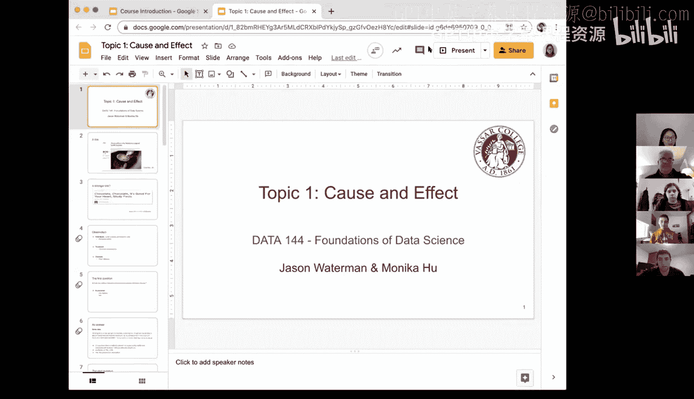
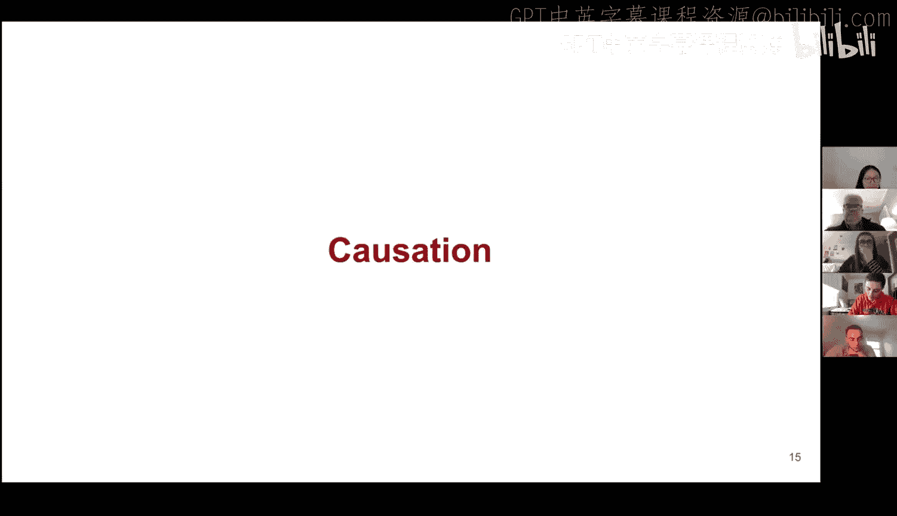

# UCB《数据挖掘和分析｜DATA 144 Data Mining and Analytics 2021》中英字幕 p02 [P02]lecture2-[T1 Cause and effect] Link and Association-8zSDf-r9S88.zh_en [BV1efBEBuEVg_p2]

We are we are live thank you all right so thanks for everyone staying and we're gonna start with our first topic of the course and this topic is mostly talking about understanding cause and effect so won't so much of demo in like the fun stuff that we saw Jason did but like what we said we'll be dive into this soon in those labs and then homeworks that we're going to work very interactively with Juvinter notebooks Okay so topic one is causing effect and it's one chapter one section of the book itself Okay so we're going talk about relationship between variables or between data points and things like that and we're going to start with a link okay so the Guardian is。

😊。

Newspaper in the UK has an article a few years back saying that three copies a day linked to your range of health benefits okay so notice the way that they're using the word a link okay there are many different ways to think about what a link really means and in this course we really want to differentiate two types of links that people are trying to say okay one is the two。

 so three copies a day， the first item and a range of health benefits。

 they are related to each other okay they're associated with each other okay so that's one type of link associated okay but then there's another type of link what we call causation okay which is I should I would say like based on the title of this news article。

 three copies a day linked to a range of health benefits is definitely I think to me trying tolude that while three copies a day can help you to obtain range of health benefits okay so depending on the reader I would say that some people will。

Li or a link here as just these two are related associated with each other。

 but some of them might some of people might read it more like okay the first thing is causing the second thing to happen okay so different interpretations of course and for this course early on like right now we're trying to differentiate these two types and we really want to highlight that relationships or multiple types and then also how to determine whether it's one type or another really affects how we are doing the analysis or I should say depending on how the analysis is being done one type of the of the relationship that we're talking about can be obtained based on the analysis but not the other okay so remember there is association and there is a causation and we want to try to differentiate those two okay so another as you know a lot of the news articles are really about foods and the nutrition okay so a struggle link okay chocolate chocolate it's good for your heart study finds。

Okay， and this， I would say， or we won't have time to go into the detail of the study itself。

 but if you look at this sentence， the title。It's I think is hinting more as a causation okay so like it's good for your heart。

 meaning if you eat chocolate， well your heart will become better in whatever sense they're defining。

 so we do want to highlight this as another example of showing different ways that people are trying to hint their study and well the thing is if you really go into the study you always find this kind of discrepancy between the actual scientific study。

 the findings there and then the study， how it's done there。

 how does that affect or how does that relate to the actual news articles and a lot of times you will see that a lot of exaggeration is happening news articles whereas in the original scientific report may be causation is not really being influenced as the news article will say in that way。

So for us as a data scientist， we want to get it clear early on and there are a few definitions we need to get started knowing first。

 okay， so observation， okay， this is one term that you're going to hear pretty often throughout okay we refer observations as individuals。

 you can think of them as study subjects or participants or sometimes a unit maybe not necessarily as a person。

 maybe sometimes as a whole household or sometimes like a whole class if it's a class level analysis is being done okay。

In that particular news article， we didn't get the chance to read it， but just so you know。

 the adults， European adults are the study subjects that they are looking at for the chocolate study。

 that chocolate is's good for your health。So another important term terminology here is treatment okay and treatment in this case is a chocolate assumption okay so if you're really doing a study here。

 okay what we care about it as well you can imagine that well in order to do a study like that and trying to come up with a conclusion like chocolate is good for your health then when you have two groups and then one we call it as a treatment group which will be the group that will have the treatment in this case was have higher or a lot more chocolate assumption than the other group which is what we call the observation group for example。

 that they won't be。Having the having the treatment okay so when whenever we're talking about this relationship between two outcomes we really need to make sure that we have one treatment group and one nontreatment group okay and the outcome of course in our particular study that we're reading just now is about whether people were have heart disease or not okay so this again not shown in the title as you can see because news article they were really sometimes exagating certain things but the study itself。

 the outcome is the heart disease how many like the infection over there。All right。

 so the first question okay based on what we're reading chocolate about disease heart disease is that is there any relation between chocolate consumption and heart disease Okay so this is a question posting to you actually and again we went over the few terminology over here and then the actual instances in the study there are the study was done on European adults okay and then they have the treatment of chocolate consumption so they have two groups and they're evaluating the outcome of the two groups the two groups the outcomes there are the heart disease status so based on what you have seen in that title do you think there's any relationship between the chocolate consumption and heart disease okay the first one like what we're talking about is that we might think that okay there's probably is association we're not seeing one is causing the other because that one is stronger we have to make more assumptions we're making more。

Anas to make sure that is true。 but then based on。Comparing the two groups， for example。

 the outcome of the two groups you might be able to see that okay it does show that chocolate assumption。

 higher chocolate assumption leads to a lower heart disease。

 so the first question which is the first first definition of our relationship is association okay so we're not saying one is causing the other we're just saying that they're related so for association where we're just hinting any relationship okay or sometimes were use the link。

One answer to that， let me just show you the data。 Now we get some experts from the。

From the news article here among those in the top tier of chocolate assumption。

 20% developed or died of cardiovascular disease during the study compared to 17。

4% of those who didn't eat chocolate okay so notice here they are doing a study okay。

 they have two groups okay one group is having chocolate consumption the other group is not having chocolate assumption。

And then the outcome as we're talking about is heart disease right and they actually evaluated。

 they numerically evaluated that  12% have developed a died of heart disease during the study from the consumption group and then the nonconsumption group is 17。

4% so based on this data let me just ask you do you think there is a relation between chocolate consumption and heart disease Okay well discuss with the neighbors in this case we're going to do it quickly using breakout room so。

Let咪。I think let's see， Jason， I think here you have to pause reporting so we don't record pause not solve。

How was was the discussion？Did you have a debate？Or everybody agreed on one。 so yes， some knows。

 Okay， we'll see and。I think we're still waiting for one room， so bear with us。

Welcome back everyone and Jason I think oh recording okay yeah thanks okay yeah we're just saying did you all have a debate in the group or everybody sort of agreed on there is or there is no association what do y all think？

😊，You can type in the chat or just speak up yes or no， and then we can discuss okay， Jeff。

We thought it was like a negative correlation， so yes， it is a relationship Okay， thanks and Michael。

Oh Michael， I thought okay， oh there are multiple Michaels let me see yeah I saw Michael friend unm muted so I thought Michael wanted to say something was was that right？

😊，Oh never， but what about the other Michael？I know I caught on you so if you want to share anything feel free Yeah。

 we definitely think that there is a relationship between the two but not necessarily a causal relationship and I guess the reason why you think there is a relationship is because you will think that 12 and 17。

5 they're like large enough a difference over there。All right。😊，Right， yeah sounds good。

 And I think yeah， and thank you for those who type in the chest about your thoughts and your discussion。

 So yeah， so many of you and I think many people actually looking at the difference of the two values will will think that there is a。

Link and the link over here is mostly about association because we don't really know the causation direction whether whether it's the consumption of chocolate leading to heart disease or vice versa right even though maybe intuitively would think okay it's about consumption causing lower heart disease rate。

 but who knows so the data itself doesn't tell us and the study itself doesn't tell us so the next question now we know that it has a we think there is association there then the next question is does chocolate consumption lead to a reduction in heart disease okay so this I think like I was saying well the data like the study itself unless we are given more information it's really hard to tell given what we know so far okay but regardless this lead to term is referring to causality or causation okay this question is often much harder to answer okay and let me show you one quote from it the study。

doesnn't prove a cause and effect relationship between chocolate and reduced risk of heart disease and stroke okay and well this is religious day。

 I guess like a conclusion， but throughout the course。

 especially early on right now we're going to talk about in what scenario how the study was conducted and how that can affect whether we are able to draw a conclusion of of association and in what scenario that we're able to draw a conclusion of causation but at this point make sure that you know they're different okay and causality is usually a harder question to answer Yeah so one lens that we can view this courses is that we're going to give you the tools to answer that question precisely with。

You know， with some meaning behind that。いや。😊，Thank you。All right okay so for association。

 let's dive into a little bit more and we're gonna use the example from early 1850s in London okay and this is an illustration from my book in 1852 and maybe some of you have seen this or not but this is a call for keen chlorlera okay so it was a disease back then that people don't quite understand and theyre causing a lot of trouble back then and in particular back then London has neighborhoods which are better off the neighborhoods are worse off and this is happening a lot in the worse off areas okay so the scenarios maybe some of you know some of you don't the issue is there are some best mouths okay given off by waste anderotic matter and then people get a lot of bad symptoms over there it's like vomiting diarrhea things why and people die in the end and many of them in the end as well okay and it came and go like it's usually like。

In a year， it started off in somewhere not in London or not in Europe like Asia。

 but then slowly slowly advancing through Asia to Europe and they eventually in in London can get really bad in the end okay so people at the beginning even。

Maedicine people like Florence Nightingale and Adwin Chadwick who is the commission of the general Board of Health。

 they thought okay， it's just it's the main source of the main source of the diseases is really just the best mouths that people are observing okay and people are suggesting that oh。

 just go to cleaner air and then trying to stay clean as you can and they really think it's the smell。

However， there is this person called John Snow， okay who made a great discovery and we're going to walk through how he made his discovery from association to causation in the end that he was eventually able to figure out what was causing the clra in the end。

So what's interesting about his approach is he took a data science approach as we are calling it right now okay so in particular he had a map as you can see that's the map of a particular area Soho area of London back then and in particular he so you will see that this's kind of little stack up items okay and he so each of this is representing a death okay so hes really doing a mapped version okay he was trying to find the location of the death and then he is telling it up and trying to show a general feature of how the like the I would say like the distribution of the death scattered around in the Soho area okay so you can see that well obviously here a lot okay whereas in some other areas there's none right but then many other areas also have a few a much fewer number of death。

So we're going to pause here for a moment， okay， and I already highlight here that there is a lot of death in this particular area。

 okay？And I want you to take a look at the map a little closer a closer look and think about what might be the issue。

 I know it's a really open ended question at this point。

 but try to pay attention to different symbols and logos that is being marked on this map and then if you find anything interesting or fishy or like maybe can help you decide certain things。

 let us know。Then I'll try to。I think I have to stay on the presenter mode so we can see it so feel free to speak up I will just pause for like a minute or so and then because I couldn't see everybody's face at this point because it's full screen on my end。

 but if you have some thoughts feel free to unmute and speak up and after a minute or so we're going to move on to understanding it together。

Um， go ahead everywhere that I see like a lot of deaths， I also see like a short little like line，um。

 which I'm assuming if it's like cholera， maybe it' like a sewer line or something。Oh yeah。

 good point Well now in the hind side right we know what is causing it so yeah so sewage indeed is an important factor later on people find out so I don't know the answer whether like that line that you're referring to would be a sewage or that but on a latest I'm trying to lead you guys to to a way to think about it is that a particular symbol that is being labeled here on this map is the water pump okay so there's one here so this is the time before plumbing and so if you wanted to get water you would walk down to the pump and then you would just pump in and it would be attached to wells some of this pumps are scattered throughout there's one kind of in the middle in but there is one in the upper left hand corner as well and there's one right yeah yeah there's one here there's another one here and I think this one is probably another one that okay yeah but but it was right sorry I didn't I couldn't see the name。

😊，Was answering the question， but yes， it is related to water。

 but then back then is really showing off in terms of the location of the pump Okay so indeed the pump on the broad street。

 which is the street over here has a lot of death around it okay and that's where John Snow start to get a little bit suspicious of oh I don't really think it's the air especially theres so many row houses like scattered around in in London and then he was noticing in particular that while some houses adjacent houses some of them are everybody was fine but then the next house everybody was not fine Okay so since theyre breathing the same air he was really suspicious that it's not really about the air or anything but then once he started putting this onto a map and then doing the tally here he start to see a pattern and then we want to highlight to you that is the pump okay that later on。

Was figured out as the issue Okay so we're gonna get into in more detail soon。

 but if you're curious if you do a Google search Google map。

 you will see that in that area around the Broadway area there is a John snow pub and it well highly hydrd。

 I guess if you ever visitit London maybe pay a visit to that as well and also there is a pump over here it's not used anymore right so this is actually a memory for him because in the end he was suggesting not really the air it's probably about the pump and then the water is probably contaminated。

 So how about you turn it off okay， put the handle off okay so in the end the the city actually did that and then the cases of Clara cholera reduced a lot Okay so this is really like a memory for memorial for John Snow and then he was using data in that sense that are trying to figure out that there is a association right between between the pump。

And then the number of death cases， Okay， and the issue here， as you can see， is that， well。

 from this data that you're able to see， we really just can see that there are a lot more death death counts around this particular pump okay。

 but we don't know if it's indeed the pump causing the death right。

 we know that are related to each other。 So at this point。

 what John Snow can say was really just theres association， Okay。

 but he was right that once he cut off the association， but putting off the handle of the pump。

 the cases reduced a lot。So but that alone again cannot say that it's the pump leading to the issue of the of the colors the death cases。

 okay， so he really needs to do something else and we're going to carry off next Tuesday when we come back of how he actually used causation。

Or I should say used in particular study to figure out the causation and then he succeeded and then that was a really important story and history in the public health space。

Great so I think we're at time so we'll let you go so welcome we're excited to have you herere excited to be back just a reminder that you have the option of attending lab tomorrow in person and so this is the lab will be held in Sanders Ph room 309。

😊，So remote is fine too， whatever you're most comfortable with。

 so I'll be in lab in 309 and we actually have the adjacent lab as well known as the Asprey lab。

 so I think the state capacity of 309 Sanders physicsy， I think we can fit 10 people in。

 but then we can fit another 10 or so in the adjacent labs and I'll be kind of circling between the two labs so it doesn't matter which one you go in you go into and then Monica will be leading the online lab as well。

So see we'll see you either in person or virtually tomorrow， thanks everyone。Thank you everyone。

 take care to see you tomorrow。