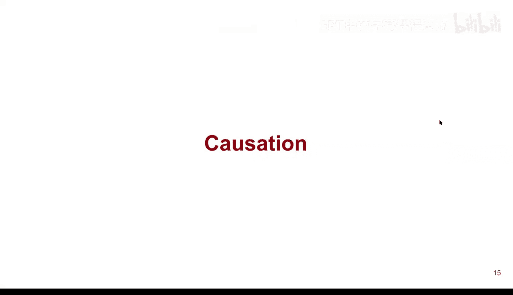
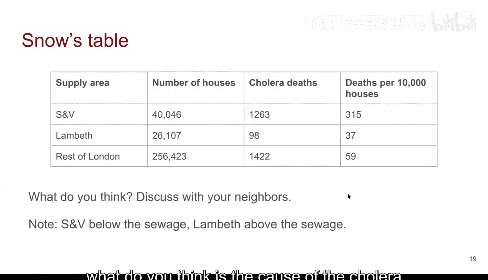
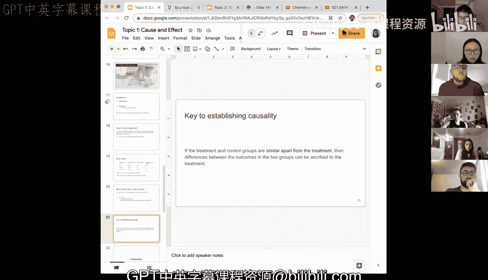

# UCB《数据挖掘和分析｜DATA 144 Data Mining and Analytics 2021》中英字幕 p03 [P03]lecture3-[T1 Cause and effect] Causation-DJSVH2cdG0I.zh_en [BV1efBEBuEVg_p3]

That start today's lecture and we will as you see that last time we were able to go over most of lecture one topic one cause effects。

 but in particular I think we stopped at roughly where John Snow was trying to use remember the tally of the death counts on the map and then trying to figure out whether like what was the real reason behind those diarrhea and then he realized that is not so much about the air right it's about the water but then at that point is really just about association like what we talked about because you well we see a difference but we cannot say whether one thing causes the other but back then John Snow actually figure out how to do the causality statement as well so that's what we're gonna continue today so I'm going share my screen I think everybody should be able to see this okay。

All right， so the causation， okay， that's sort of like the last topic of this last subtopic of this causing fact topic is let's try to figure out how John Snow indeed his final study of the causation。

 okay？

So here's a map， this is another map okay this is a map of London water supply and let me just show you there are two companies。

 two water companies one is Southwalk and Voloxmore。

 which is one called it S&D okay so you see that it's on the northern part of London and then the other company water company called Lambeth and it's in the southern part。

What's special as you can see here is that the water like the sewage beneath the city。

 so in fact the SMV they receive water from downstream of sewage and then lambmbeth they receive water from the upstream of sewage okay so I mentioned this's mostly because I think now we all know it's about the water so like where the water is received above or below the sewage will be important but back then people didn't really know。

But what's important and interesting on this map is you can see is that there is one area which is what we label both okay that is the area where the households in this area actually。

Could receive like some households receive from like SV。

 the other one receive from Leda okay so I want to highlight here because I'm going to ask you actually the question that if you are given this map okay and then remember for us to establish a causality or causalusation relationship we need to compare okay remember last lecture we talked about well if you are doing a experiment like this in order to establish this kind of relationship you will need to have a treatment group and a control group okay and then you're gonna to compare them if you remember our discussion about the chocolate and heart disease right and we have those treatment group who has consumed a lot of chocolate and then the control group who does not and then we're comparing that two values 12 and 17。

4% okay that's the outcome in the heart disease percentages so my question for you keep in mind about this this map before I send you to the breakout room is that well remember。

That we want to compare Okay， compare the outcome， which I guess in this case will be the diarrhea and。

Clara symptoms。On this map， if you are selecting a particular area of households。

 you do the comparison。Which which one you're going to choose and why？Yeah。So。

Let me send you to the breakout room this is probably going to be quick， but take your time。

 I will bring you back in a second。

Okay so the question for if some of you didn't hear it Phil the question is now we have this under water supply man okay and we know well or John Snow back then he knew that it's about the water okay and we indicated that there are two water companies okay and depending on where you live you might only get water from SB or you might only get water from London or one particular area which is the boat up here some households receive water from one and some others receive water from the other okay so the question was。

We know that we want to do comparison and the treatment of course in this case will be what kind of water you're receiving okay and then in particular related to the sewage okay so the treatment group will be whatever is receiving I guess the water that we know from the Broadway pump okay and the other one is the control group which does not receive the treatment so this is generic okay but in our case in particular if we were to do a comparison here especially we know that there's two different water companies and then one is above one is below the sewage so the particular area that you will want to choose to do this comparison is that both area。

Because as we will see soon that if you choose all of the households to do your study in this area。

 we know that some of those households going to receive water from SB。

 some others going to receive water from lambmbeth。

 but what's important is that we can generally assume that households in this overall area going to share most of the other characteristics。

 very similar from each other， except that some of them are receiving water from one and the others are receiving water from the other company。

Okay so as you will see that in order to establish causation。

What's very important is that we really want to what we call control。

 control the observations between the treatment and the control group， meaning that。

 so if we actually repeat and then quote from Snow's grant experiment。

 there is no difference whatever in the houses or the people receiving the supply of due to water companies or in any of the physical conditions with which they are surrounded。

So what this is telling us as we highlight below here is that the two groups are similar except for the treatment。

And that's a key in establishing what we mean by causalal or causation when you do this kind of experiment or when you design this kind of experiment。

 you want to make sure that the two groups， the treatment group and the control group。

 they're only different。By the treatment that they're receiving。

 okay treatment is the treatment group is receiving the treatment while the control group does not receive the treatment。

So in terms of what we do in this particular example， like what we already described earlier。

 that households in the both area， they are similar except for the water supply。In that way。

 we're able to eliminate the effects of the other characteristics like I guess food。

 supply or just the environment in general， they will be similar。

 but the only difference between those two groups at this point will be the water supply。

So actually I have a table here based on what snows John Snow had done back then， okay。

 so the supply area we are showing in the first column， okay， the column over here。

 and we are comparing the first water company SMB。The second is Laeth and the third is rest of London we're just going to show you for comparison okay so the number of houses well this is in the both area okay it's 40。

000 versus 26000 okay the chlorra death counts are 12098 respectively but we also very importantly when we're doing this kind comparison we want to make it on the same scale okay so the last column is giving you deaths per 10。

000 houses okay so it's 315 for SMB 37 for Lambeth and then 59 for the rest of London okay so based on this。

What do you think is the reason or can you like I guess earlier or already you talked about that we're able to？

Establish causality if we're doing this kind of experiments。

 we control for everything else and then now with this table with this difference in the number of deaths per 10。

000 houses， what do you think which one or what is causing you think the chlorra death in particular and the note down here we're showing is SMV is below the sewage and lambeth is about the sewage as we're talking about。

So I will bring you back to the breakout room， I know this probably will be quick and just remember the question here is given this table。

 what do you think is the cause of the chloroddes that we're seeing here？

So without over the you。All right， so let's hear from some of you you're willing to share your thoughts okay。

 so given this table we compare the deaths per 10，000 houses。

In the two area and remember we have controlled okay we have control for for the other characteristics of those households they're only different by the water source that you're taking so anybody wants to share what you think or the discussion out of your breakout room。

What is your conclusion here and why yeah so we。Looked at the or remembered it so even though。

Lambs is a smaller number of houses in total， the number of deaths per 10。

000 people is significantly lower than S and V and also if you look at the rest of London。

 that's also larger and it's a larger number of houses， but it is it makes sense that the lower。

 you know， if you're farther from the sewage you're going have less deaths。Yeah。

 yeah sounds good yeah so I think She was just pointing out a very important aspect that we really need to focus on the ratios right because we put them on the same scale for comparison because as She pointed out the number of houses were quite different between the two water supply areas and then the rest of London because then if we put on the same scale looking at deaths per 10000 houses。

 then clearly lambmbeth is having the lowest and almost like 10% of the one under SMV so again because we already identified that we're able to establish fiity over here。

 so this biggest difference between the two almost 10% of the death rate is indicating that well is probably the water supply of lambmbeth which now we know is about the sewage sorry below the sewage of SMV that is coming causing the plera deaths okay and I should just point out before we move on because。

Remember last week when we ended the first lecture。

Some of you stayed over and asked about well if we're just comparing the numbers and then we see how do we know exactly how whether the difference is big enough or not okay so that's a good question and I think many of you who if you have experience with statistics in the past you will probably know that oh you actually need to do such tests before you're able to say anything for surgeon so I would just say that yes down the road in this course you will see that we will do this kind of more detailed analytical solution back then but right now we're really just focusing on the comparison between the association and causation okay and then we're just trying to focus on how to differentiate this too as well as what are the key aspects that we're looking。

So we will get you those tests and you will see that how we can do that once we have learned the Nelson bolts of doing Python programs。

Okay sounds good so lastly for this topic I just want to highlight that the role of data science and data scientists now you see that we need to know okay where and what to look okay just like that example we need to make sure that we know is the both area okay that we should be focusing because the other areas if you only focus on let's just say the let's just SMV only or lambeth only we're not too sure about the other characters okay we're not able to control for them so those are not the good solutions to choose whereas the both area we're able to control the treatment and the group okay and well need to learn all of this because they're going to be very useful for analyzing reflecteded data but I would say maybe more importantly as a data scientist。

As you get involved in the study design， like all of the knowledge and skills you also go into design the study and experiment。

Okay so I shouldnt say that like don't know back then the study was not designed if you're thinking that way it was natural。

 it was a natural experiment and he was really smart to come up with that that you can just really just focus on the both area。

 but in fact in many of the I guess modern studies that we're doing now or you will be doing the future。

 you really want to design your experiments and study in a sound way that you're able to make those analysiss in the future。

And I will just wrap up here saying that the key to establishing causality again is that we need to make sure that the treatment groups and the control treatment and control groups they are similar except for the treatment。

 then if you observe any difference in the outcome。

 you can attribute that difference to the treatment itself。Otherwise。

 there might be certain things that might not be able to help you to make your conclusion here。

With that in mind？

