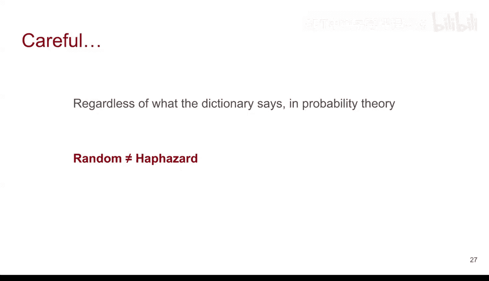

# UCB《数据挖掘和分析｜DATA 144 Data Mining and Analytics 2021》中英字幕 p04 [P04]lecture4-[T1 Cause and effect] Confounding-vGyG1i_XnF4.zh_en [BV1efBEBuEVg_p4]

Get to the last topic here since we're talking about well we really need to make sure that we have control for the characteristics between the treatment group and the control group。

 so I'm going to show you one more thing that sometimes if you don't control them。

 you might get what we call confounding variables or confounding information they're going to distract you or like make your conclusion not sound。

All right， so the trouble if the treatment and control groups actually have systematic differences other than the treatment okay。

 say for example， for that water supply example， what if the SMV area。

 SMV only area the households all receive not only water from SMV but also they let's just say they get their meat from a particular vulture。

 let's just say okay whereas the lambmbeth group they not only receive water from lambmbeth only but also they receive their supply of meat from another vulture okay so this is actually what we call systematic differences okay meaning that there are other characteristics that are systematically different between the two groups。

So in this case it might be difficult to identify the causality itself okay。

 however such differences often present in observational studies okay so observational studies we talked about it before that is。

When you do not do any kind of control， you just have observation。

Or I should say if you have a study， but like you and now are not able to control the treatment group and the control group。

So such differences are often present in those cases and that's why well first of all first of all we know that observational studies that in those cases we won't be able to establish causality like the best you can do is the association but also important as we see now that those confounding factors going affect observational studies and the experiments which is the causality studies as well okay so we really need to make sure that we don't really have systematic differences other than the treatment for the experiments so let me show you one example and you might have all kinds of reasons of why you think these two are so related to each other so both of them okay let's see so this is we're putting on the same scale so don't worry about like y access exactly what they represent but you can see that we're putting on the same scale and then this is looking at ice cream so and murders okay between May and July okay so if you're just looking at this you can say that。

You might want to say that okay they're highly correlated if you know the word or like they have a really strong association okay of this two but if you really try to come up with a reason or like say whether murders is causing more ice cream sold or a vice versa or like why exactly this two are related it might be quite confusing because it's not something intuitive to think about like what was the reason but then another variable just just as an example another variable in this case actually could probably be the temperature okay so the temperature which could be a compoundfoing variable here is related to ice cream sold as well as related to murders but then if you take that out from the picture like what we're doing right now you're really only seeing the relationship with ice cream sold and the murders but then those two might not necessarily related to each other okay both of them related to the temperature but not necessarily with each other so this is what we mean by compoundfounding and there is a very interesting website actually will。

I encourage you to take a look and we will now take a look of whatever they're showing right now on their website is called spurious correlations okay it's actually a book and it's funny that people try to come up with all kinds of funny results or correlations out there so and they posted on this website pretty interesting and you will see that they have what they call like a correlation coefficient which we're going learn later in this course as well。

 but the idea is that well if you have two variables like this you are。

You are able to compute the correlation coefficient between the two and the higher the closer it is to one the stronger the positive correlation Okay so this tables or this graphs are just showing you certain what they call spurus spurious correlation so first one is US spending on science space and technology correlates with suicide by hanging strangulation and suffoc and the correlation is as high as 99。

79% like I said closer to one the higher the correlation so。

I don't know the particular reason behind， but this will be some data that if you just collect them and then just plot them whatever the way that you like。

 and it might start to look a little bit suspicious or not really important relationship they're showing now and that this could be important for you to start to think about whether there are compoundfounding variables behind。

I will just show another example， like I said， feel free to check out the website later。

 say the number of people who drawn by falling to a pool corlates with film Nius C appeared in。

 I guess that's even random like it's for whatever reason is going together between like starting from 1999 to 2009 okay but well I don't know the reason behind but just so you know a lot of times we do collect data and we want to show their pattern。

 but sometimes if you don't make sure that there's no confounding variable out there that the results that you're seeing might not be what you're really seeing。

So those are important lessons and I hope you will later get a chance to take a look of the website and then think hard about those results Okay so lastly just to highlight one more time how can we make sure that we can get rid of those systematic differences okay so the thing you could do is what we call randomize okay so imagine now we're in the space of designing the experiments okay or designing the study here if you are able to assign individuals to treatment and control groups remember we have two groups one is receiving the treatment we call it a treatment group the other one is control does not receive the treatment if we're able to assign individuals to these two groups at random he that。

Like we have 50 lets say we have 50 observations for individuals。

 we randomly take one out of the 50 and put it in one of the two groups and then we keep doing that unless each is having 25 individuals。

 each group has 25 individuals but then the entire process is random。

 then the two groups are likely to be similar apart from the treatment okay so this reasoning is that if we are able to randomly assign individuals into two groups before we provide the treatment to the treatment group。

Then we're having a higher chance that the two groups going to be very similar to each other on any other aspects。

 except for the fact that one group later going to receive the treatment and the other group later is going to not receive the treatment。

So this is the key that you will see of establishing causal okay and we are able to in this case account mathematically for variability in the assignment and we call this kind of experiment as randomized control experiment okay randomized the term is talking about we're doing assignment a random okay control again。

 control the words here is mostly to talk about we're able to control between the treatment group and the control group of the other characteristics other than the treatment itself。

Okay， so later in the course， you will see that how we can use Python programming to help us to do randomization of assigning。

Individual also subjects into different groups at random。

 and then were able to do the comparison like the one that we were seeing on the table of S snow's Grand experiments。

So definitely be careful， okay， sometimes like random the word hopefully you will get more used to it in this space in data science and statistics in this space。

 we are talking about at random， okay it doesn't mean haphard or anything。

 but we're trying to provide the reasoning of how to do things at random。

 meaning that you are able to do it without any other factors and then Python programming in particular will be super helpful for you to get to that point。

All right， I hope all of this overall makes sense and any quick questions before we go to topic two tables。

Okay， all right， yeah， okay， if not that's。