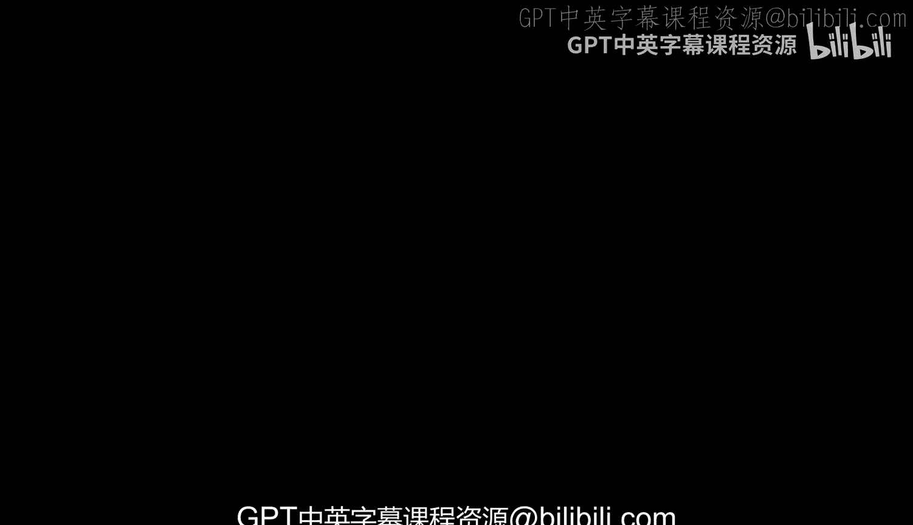
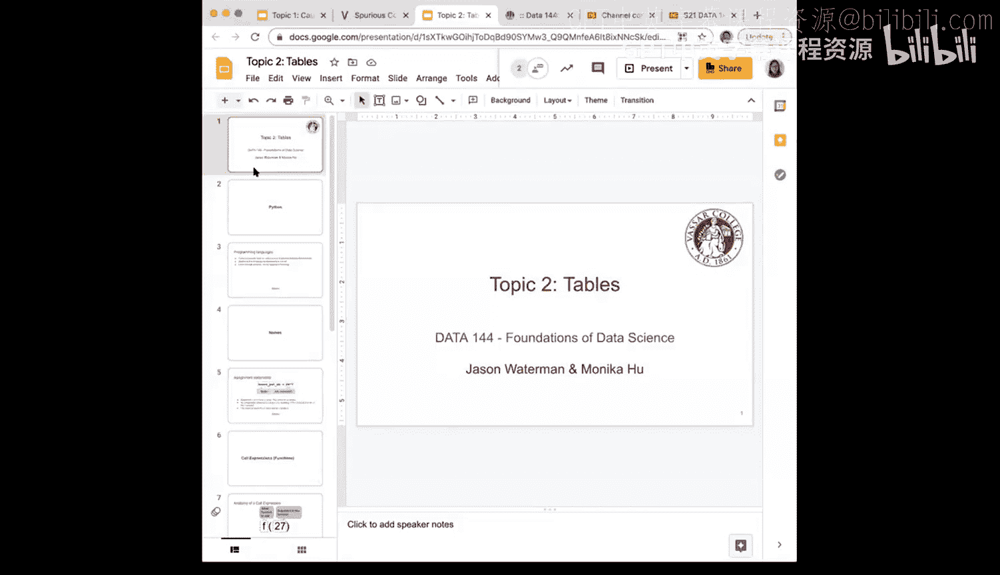
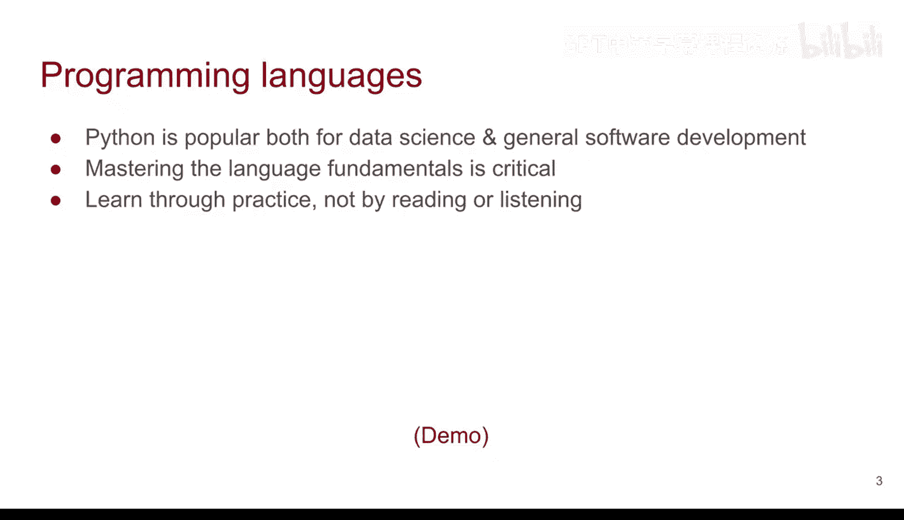
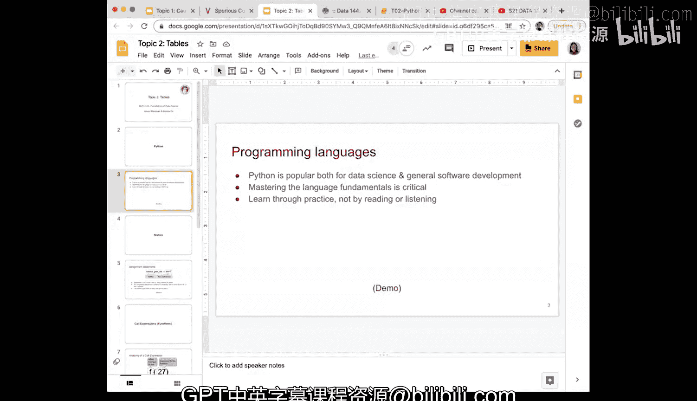

# UCB《数据挖掘和分析｜DATA 144 Data Mining and Analytics 2021》中英字幕 p05 [P05]lecture5-[T2 Tables] Python-kJgGRMhiEqE.zh_en [BV1efBEBuEVg_p5]

Second topic of the course and again the link are all of the links are on our website so make sure if you want to view them at the same view view the slide or like the demo as we're doing along the way feel free to do so and I will just mention that this lecture the second topic here many of the material you probably have seniors already because the lab happened last week only after first lecture so this like I said we do it relatively little quickly but definitely make sure to stop me whenever you have questions and will just now sort of like review overview of Python programming and some of the key terminologies and then how to do certain things with Jupyter No。

And like I said， some of you of everybody I should say up have seen juven notebook bookss here and there and how to do it。

 so many of this might not sound very new， but regardless。

 I think it's very important to go over certain topics in detail so we're able to make sure that we know the terminology and we know why Python works in the way that we have seen in the lab。

All right， so the Python programming language okay it is popular okay now you probably know it or maybe that's one of the reasons why you sign up for this course and it's pretty popular。

 especially now for data science and if you have taken some other statistics course in the past then you probably know about the other programming language are okay so both of them are free and it's open source。

 meaning that people actually can write packages themselves and then share it widely online so that's actually one reason I think those open source programming languages are becoming ever more popular and widely used okay but Python is also very good for general software loan okay whereas are I would say mostly is for data science and statistics。

And so we hopefully you'll be able to master the language fundamentals especially as soon as you can in this course and later on you'll be able to learn a lot more other functionalities okay and we're also gonna highlight and I think everybody probably know this now after the first lab is that we're gonna to learn through practice okay not just by reading the code or listening to me or Jason talking to you about this and a lot of times you learn by mistakes as well okay so definitely feel free to reach out whenever you run into issues but also take the chances with those mistakes or challenging questions they're really good learning opportunities for you to get to know Python as well as I should also mention actually once you get more fluent everybody has their own。

Programming style okay so maybe some of you like writing functions in this particular way。

 some people were like writing functions in that particular way so you will also gradually develop your own style and I think there's no like better better or worse or wrong or correct there's really I should say as not correct there's nothing like better worse but I think you would take practice for sure and that I will definitely urge you all to develop the programming style that you you like and feel comfortable okay so the demo we're gonna do is if you go to our website okay the first one is called Python expression okay so you can click it and you should bring you to that Juviter notebook for this particular case as well okay so we'm going to do your demo and I think like I said many of you have seen this already in the lab so this will be relatively quick but they are quite important you talk through。

So first of all， I think by now you know okay and we put a words of caution at the beginning to make sure that you always need to run the first step where youre loading the data science library for the course okay so remember to do it you round any cell you can either click run up here okay and then you will see a little star and then once it's done like it's going be like the index of which index of the cell being run okay so you can click run and you can do it multiple times now it becomes two okay if you do it one more time it three okay and so that's one way to run it and the other one maybe some of you are familiar with it now if you click。

Push， shift and enter， it's going to run the cell for you as well。Allright。

 so for this particular demo we're looking at Python expressions and all of the examples as you see even before I run it。

 I think youll see that we're really using Python as a calculator at this point okay we can do submission okay multiplication division and then this is multiplication and then addition okay and then well the rules of Python using using Python as a calculator as you can see here I really also just follows the arithmetic rules that you do by hand okay so multiplication comes before addition so even if I add the parenthses here。

 it doesn't really matter it because it should be the same order okay you always do the multiplication first and then the addition。

However， now we know right if we preparehes and。In the addition first。

 so that would go first and then the multiplication， however。

 the result here is the same because we're really doing the same calculation okay？The last one。

 I think many of you have seen that in your lab because one of the exercises I remember is about this is the power okay so if I want to do two times two times2 of course I can do two times two times two is the one that we by the way the pump sound here the sign this is commented out so we're not running it okay but if you want to run it or by the way you can always add a cell you look at the top okay the U notebook is your own so you can do any kind of changes if you want so if I do all of this right and if I run it it's gonna be eight we know that but then it will be the same as putting two stars next to each other and this is power okay so two to the power of three is eight as well。

Okay， so this is， again， we're really using Python as a calculator at this point。

 but you can see that it' pretty flexible and then we operates in the way just like a regular calculator that you will do。

All right， so that's for a quick overview。

