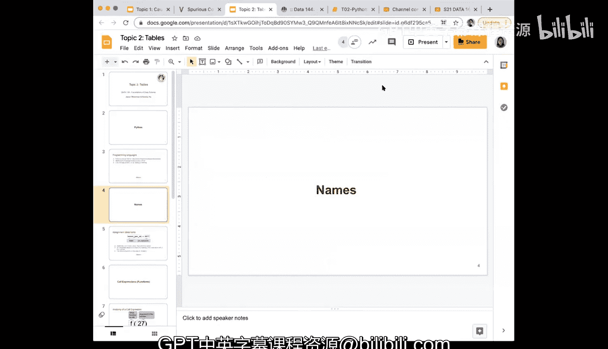
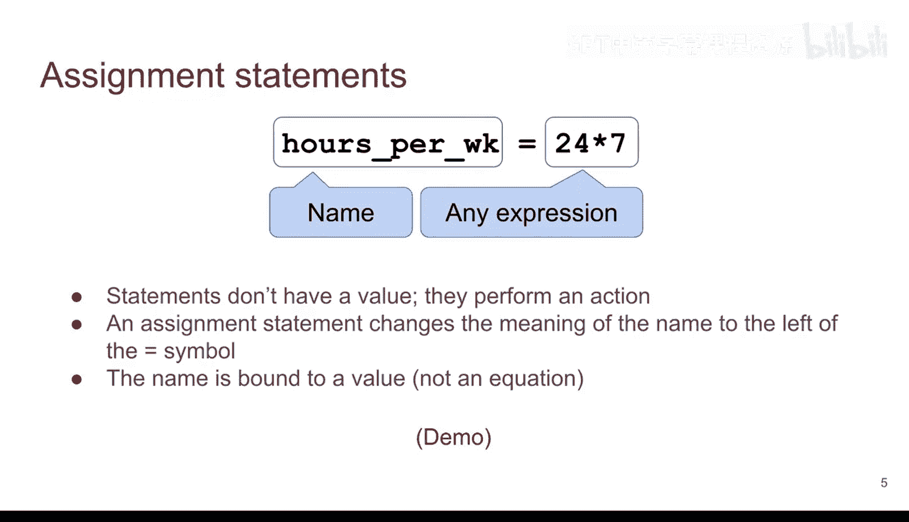
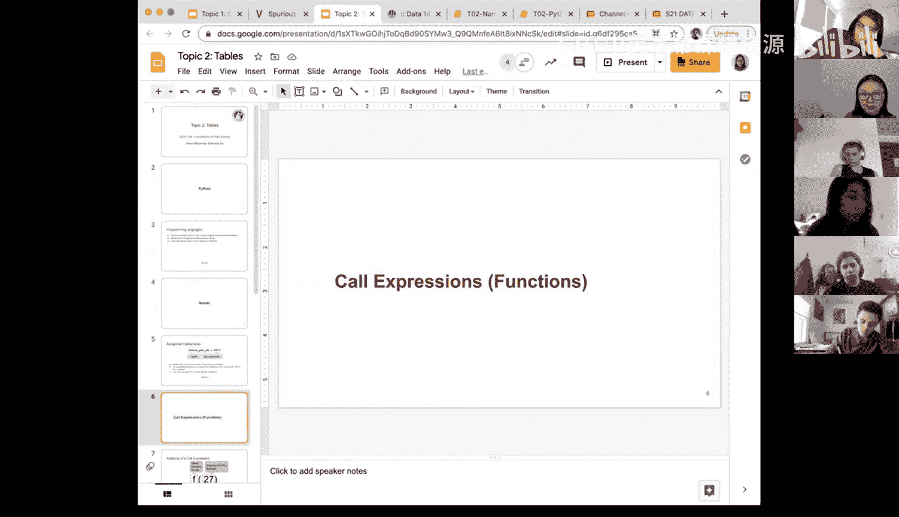

# UCB《数据挖掘和分析｜DATA 144 Data Mining and Analytics 2021》中英字幕 p06 [P06]lecture6-[T2 Tables] Names-G7JMT9q55L0.zh_en [BV1efBEBuEVg_p6]

And now the second topic of this second topic of tables is names Okay。

 so this I think some of you have seen it as well in the lab okay。

 so this is getting to see Python really as a programming language okay earlier is really just a calculator。

 but we can also assign expressions to names that we are able to use later。

So the assignment statement， okay we are doing the anatomy over here okay so our hours underscore per underscore week okay that's the name okay you can think of it as an object okay and that goes before the equation sign okay on the right hand side is an expression okay for us well hours per week as you can see over here well you can actually calculate it and if we know so by the way this is also a good example of choosing your name as informative as possible okay so here we're talking about hours per week and we know that well 24 times seven okay that will be the hours per week if we actually want to calculate it correctly but then again on the right hand side can be an expression in this case we're just showing you in the in the definition itself。

So these kind of statements they do not have a value okay they really just perform an action so that equality that equation sign equal over here it's assignment okay it's not saying that hours per week equals to that even though well intuitively you would think so but you can apply it to any other expression on the righthand side okay but the whole thing is really just perform an action okay and assignment statement changes the meaning of the name to the left of the sorry change changes the meaning of the name to the left of the equals in both okay and of course the name is bound to a value it's not equation okay it's a value so once I round this line as you can see that once I do 24 times 7 which I think is 168 right 168 then we assign that value to hours per week okay so the assignment statements I think we have seen this again I think multiple times in that black and。

Just to not to like duplicate， but you know that we really are learn by practice and just going show you how to do various names and then give you some examples to make sure that we understand how names really work。

So just like before， okay， make sure that you're round the first line， which is loading the library。

To our firstspace， okay。All right， so the first one we assign6 to a a is the name okay。

 so after running this nothing changes okay we don't have an output or anything。

 but we know that after we round that a equals to6， we have done the assignment of assigning6 to a。

So if now I just tried to type a， which is returning the value of a， then it gives me a six。

Similarly， this line assigns4 to p and then if I。Just return the value of B is four okay so now starting from now you will start to see why would you want to have this kind of naming as well as assignment because once we have assigned values to certain an object which we have a name for。

 then we're able to do many other things about those objects。Okay so for example。

 the total now we define so total again goes before the equal symbol okay so this again is a name okay and then on the right hand side we're doing an addition okay and in particular we're doing the addition not directly with six and4 anymore we're actually doing a plus B so meaning that whatever is scoring in a and whatever is stored in B after we run this total equal a plus B line we're adding whatever is stored in a with that story in B okay so we know here the total a will be 10 okay because6 plus four。

I is 10 okay but let me just show you one more thing。

 so let's just say here okay instead of let me just add them so we don't get confused okay so now instead of four let me just say that I want my B to be three。

If I round this。诶。Now。I'm going to run total。What do you think after I run this， the total should be？

Feel free to speak up or just type in the chat based on your understanding of how Python works with the names now。

 it' would be mine， right？Okay， so we got one answer to be nine， everybody agrees。

Wouldn't it still be10？Okay， another question another comment is1 okay。

 and then Matthew in the chat also says1 okay so this is a I guess I asked a good question here。

 okay。Yeah， so up until here if you see this okay total is a plus b okay and up until here we know that a is6 b is four so the total as we have run it here is 10 Now what we did we change the value assigned to B Okay so if I run this I run it already I guess so if I actually just return B is going to be three。

And total we know is a plus B。However， unless we round this A plus B one more time to assign it to total。

 this total won't change。Okay so let me show you so if we do this here。

 we'll still be 10 because when we round the total line。

 when we assign total with a plus B back then the value of a is6 and the value of B is10 is four so total will be 10 at that point。

However， if now I add this line， I repeat this line number ninth total equals a equals to a plus B。

 and I run this。Okay。😊，And if I run it again。Now it should be known。

Okay so this is what we mean by assignment， okay the value of the name that we're do the expression over here。

 you will change after you run it but the issue back here is that the total we only run it when b equals to four。

We had not rerun it， even if we have reassigned the value of fee。So if we don't do that。

 then youll see that the total will still be 10 even though B becomes three。

 but now I reassign A and B the sum of A and B to total again so here at this point B is three right and A is six so once we do this new assignment the newly assigned total will become nine。

So this is again， why we say that it's not really just a calculator now because we're actually working with those names right we're having those objects with names that we can assign values to them。

And then this will start to play so many different roles in all of the programming that were going to see out。

I have a question yes go ahead so you know you rewrote the the total again you wrote a plus B after updating it what if you just ran the original total again without oh yeah no that's a great point Okay so I could have done that as well so for example okay because I already did everything so let me actually okay so。

So the answer to that question will be that yes we're gonna get the same thing。

 but for me I just rewrote it just to make sure that it's not confusing。

 but let me reproduce what Anthony was saying okay so A B。

 everything is good right the total here is 10 okay and now if I do B okay and my B here is is three right if I run total now is still gonna to be 10 because nothing changes but instead of doing the total again done here I can actually come back to this one。

Okay， and that's why actually Jupyter notebook is really useful because they tells you the index of the order okay of the cells being run so if I come back up here I run this again。

 this becomes 11。Okay， and then running this here or here is equivalent okay because I'm essentially just reassign A and B the sum of it to total so I run this as the line 11 here and if I do it this's going to be prominent。

OkaySo yeah， Nixon。Yeah， so I would definitely recommend， I mean， I guess either way will work。

 but I do remember I think there was one question from La last week that sometimes it's very easy to say。

 for example， like you're working on one problem and then maybe you got stuck but then you continue working on the other ones and then when you revisit。

 if it happens that the later sections of the code actually redefine some of the values for the previous question。

Then you're going to start to get into trouble。So I again。

 this is a style thing like I guess I unconsciously think that I'm going to rerun this like with new lines just to make sure that I don't get start later。

 but really it's the same thing and meaning that you can always come back to rerun the line and then the indexing in the bracket next to it going to tell you about it but overall I think if you want to avoid getting start later about those different assignments。

 it's probably always good to start a new line of your new code and then run it in the order of the way that it's written so later you will be easier for you to navigate it across the post。

Okay。😊，All right， so the couple of other examples here okay so earlier we're doing assignment and an addition okay and now what let's try to do multiplication okay length is four sorry length is six with this four so if it's a rec rectangle area we know it's the multiplication of the two so if we do that and then we know that this becomes 24 okay and this is actually another example okay if now I switch my width to5 instead of4 so the rectangular area up until this point if we around it will still be 24 okay because I have not done the assignment one more time。

So it's still going to be 24， however， now I reassign rectangle area with length and width and we know that now length will still be six okay。

 but width will be what we just assign which to be5 so here will be 30。

So hopefully the street examples can illustrate to some degree about。

how the assignment is working and then the running。

 the order of the running of the code and we also just discussed like whether we can go back to the previous line run it and we can see that you can。

 but always make sure that you know the order because otherwise sometimes it might get a little confusing。

The last section here is well you might be wondering why use names okay and as we go along this semester I think iss going to become more and more obvious why we want to do it。

 but even now I think we can do some quick demo so let's just see let's just say here hours per week is well working hours work hours per week let's just do eight times five which is 40 and the weeks per year。

 52 okay so if I do that well if I assign 42 hours per week。

 52 to weeks per year and then if I want to compute right the number of or the hours work hours per year that I'm doing I'm really just small time is two。

And then I can assign it to this new hours per year。

 so this is again an example of showing I guess the importance of naming your objects like informatively because later you can you know exactly what you're doing okay so when we do this it's going to be a multiplication it's 2080 okay。

And now you know the total hours per year that to do for this particular case。

 and let's just say the New York hourly minimum wage is $11。8 okay， so we assign 11。

8 to this fair to this object called NY hourly minimum wage and if we do that。

 then we can actually get the monthly wages okay， which is hours per week。

Times the hourly minimum wage。Which is。4472 and just as i'm doing this I guess we probably know this is actually a bad example of using a non informative variable name I think this one should really be weekly wages right because we're doing what。

Hours per week， times minimum。Week minimum minimum hour hourly minimum wage so we should really call it like weekly wages sorry about that and the years yearly wages we know that's going to be hours per year times the minimum hourly wage so if you do this okay that will give you。

Those numbers Okay and of course well let me do 11 point if you don't want to go with all of the stuff that we had done。

 you can always just type type those values right using Python as a calculator that will give you the same answer for sure but then what if later you want to use this objects like later I want to use hours per week for some other purposes and then it's always much better if you're able to name it beforehand so later you can use it at a convenient at your convenience okay so this are maybe to examples maybe not as relevant as you see right now but like I said as as we go along this semester I think it will become more important and obvious to you that you really want to use informative names and correct names so bad example here it should be weekly wages wages just not not monthly because we're early only hours per week to multiply with minimum wage okay and eventually。

You're really using it as a you can't always use it as a calculator。

 but more efficiently you want to use those names informatively and then later you were able to revisit that。

Quick question here。Com yeah， okay good like I said， many of this are showing to you。

 I think in our class so maybe not so much new， but it's good to be see them multiple times。

