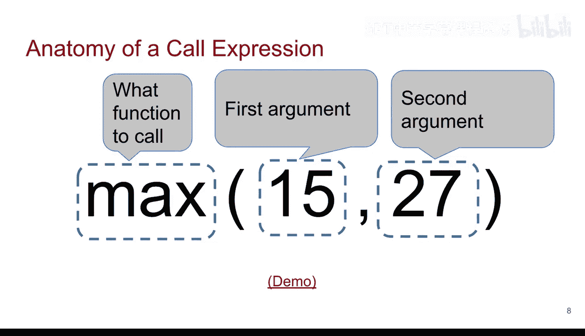
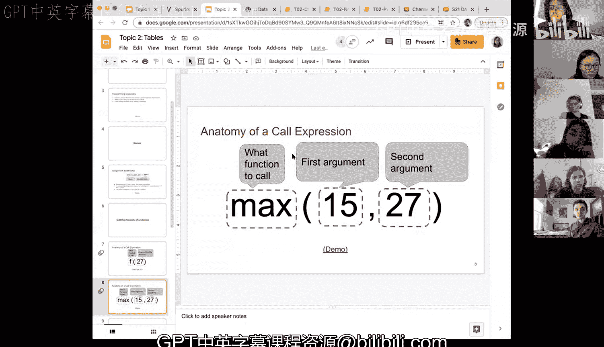

# UCB《数据挖掘和分析｜DATA 144 Data Mining and Analytics 2021》中英字幕 p07 [P07]lecture7-[T2 Tables] Call Expressions-W5TX29rGlk4.zh_en [BV1efBEBuEVg_p7]

Alrighty okay， so the last of the next I should say topic here is call expressions or functions okay we have seen it in the lab but let me show you like give you anatomy here of what we mean by call expressions what kind of thing takes and what kind of output it will do。

So anatomy of a call expression， okay， so F we use it generically now F we can think of as any。Yeah。

 any function we just use F to stand a stands for a function， okay。

 it's the name of the function okay， and in Python， okay。

 you have the name of the function and then you put apprenheses。And inside the function。

Is the argument what we put into the function okay so at 27 at this point probably doesn't mean anything to you or to me。

 I really we just want to show you that the function name goes first and then you put a parenthes and whatever argument that is needed you should go into the parenthses and this example you can see that we only have one argument but it depends on the function they we're working with you could put in multiple arguments。

So we can call this it's called F127， whatever F is， it's going to be applied to 27。Okay。

 so for example， mathematically， just say， let's just say the F function is dividing whatever argument by three。

So then if I apply F， I call F on 27 and if F itself is dividing the argument of the input by3。

 then the outcome of this going to be 23 27 divided by3 which is now so really like you said you see over here the function itself depends on what's the function is about you will see what the outcome is。

So let me show you another one which is more realistic and I think some of you have seen this in the lab already so this is a function or coex we call max okay so max again is the name of the function okay so we type that first okay and then you will have input go into go into this function and actually in this case we have two arguments the first and the second okay and we know that mathematically the max is taking the maximum over the two if we're having two arguments right so the output of this going be 27。

If my function is called min， which is actually also available in Python， which is MN， okay。

 if you do min 15 and 27， then it's return the minimum， so it's going to be 15。

Okay so this is an anatomy of a co expression in particular for the max function。

 and let's look at some other examples that we might encounter in this course。

Always important round the first line， so we load the library， okay？

So the first one is the absolute value okay and we call it ABS okay so we know that in mathematics absolute value we just giving you like if it's negative value you take out of the negative sign right so it's really just like the positive part of any value that you're doing so absolute value of negative5 is 25。

OkaySo ABS is the name of the function。And it has one input argument。

 and it's going to be applying the ABS function negative5， which gives us five。嗯。Okay。

 so if we come back to what we did before。Even though maybe absolute value of the difference of this to doesn't really make sense like。

In the physical world， but we can still run it， so sometimes you see if the server is a bit slow you will see that we have to wait until it's done i'm not too sure why exactly it's taking longer to run this land equal to six it should be overall straightforward so maybe something is not entirely good with the server right now that's why it's taking long time so let's just maybe wait until it's done but if we run this line absolute value of land minus width what do you think the are going to be。

Okay it's gonna be two okay oh yeah， I guess it's my internet was unstable just now thanks for all of the chat that only saw it Oh oh thanks okay I was frozen sorry about that and I think now I'm back and everybodys moving so I think okay sounds good so is two and like I said maybe it doesn't have any physical meaning like the length minus with take the value but still you're able to do that kind of calculation okay so minimum of 14 and 15 we know that's gonna be 14 okay and this is the example of the min function that I was talking about。

Another useful function for us to use in this course is the round， okay so round。

 as you could I guess， the name from it， it's like rounding a value to its nearest integer。

Okay so if I have 123。45456 if I run it is just going to be 123 okay but you can also see that the round function actually could have more than one input okay so earlier we only have the input of the value that we want to round right but another option here is to how many digits we want to round okay so by default is going to be running to the nearest integer。

Okay， but you can choose one， which is going to give you， I think one did it okay。

 and if you want we can try out。We two digits， and then it's going to run it into two digits。Okay。

 so round is actually an interesting function among the ones that we have seen so far right like there is a default second second input I think which probably is zero yeah right。

 so the default is zero okay， if we don't type it the default is zero so it's always going around it to the integer。

But if we do one two， then we're able to control to how many digits we want to do the round。

Okay so I think throughout the semester we can learn so many other functions available out there in Python。

 but I should also mention that soon， I think maybe one thirdd of the semester once we get through the one thirdd of the semester。

 I think you will be started writing your own function you're able to write your own function depending what kind of purpose that you have this function for and then you're able to as you can see。

 well not now because those functions I guess we don't know how they're written but as we start to write our own functions you will see that where you're going to have the input how you're like in the bulk of the function。

 how you are allowing those inputs to interact with each other and then in the end you have a return argument in the end that is going to return whatever it is to。

So those will become very useful and I hope you will。Enjoy when we get to that one。

Okay。