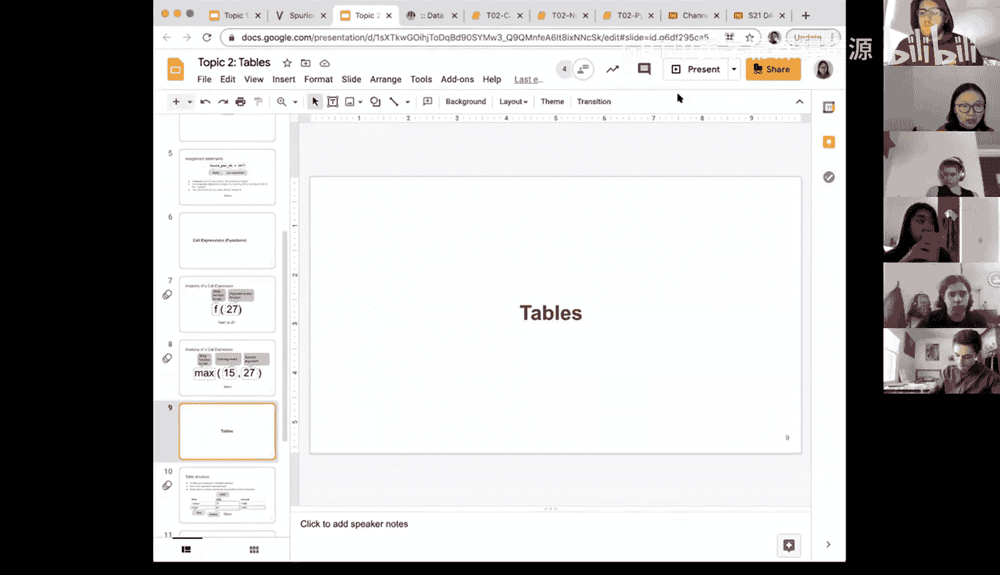
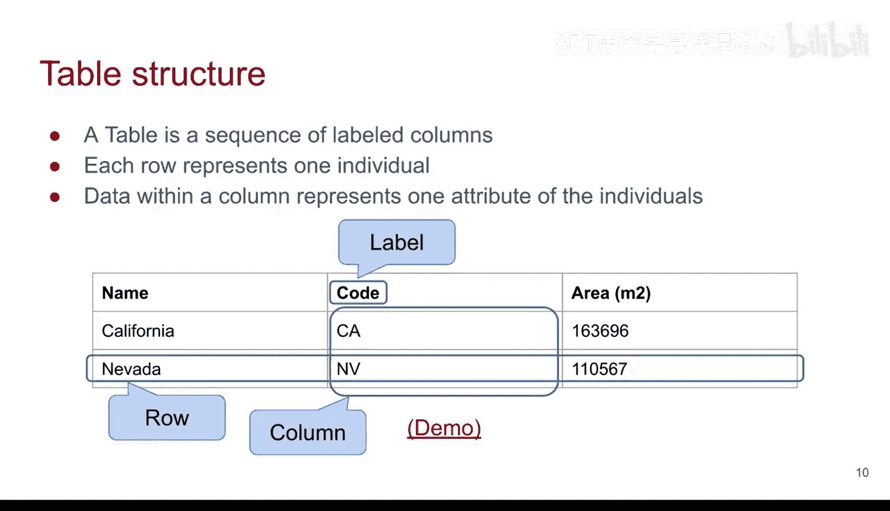
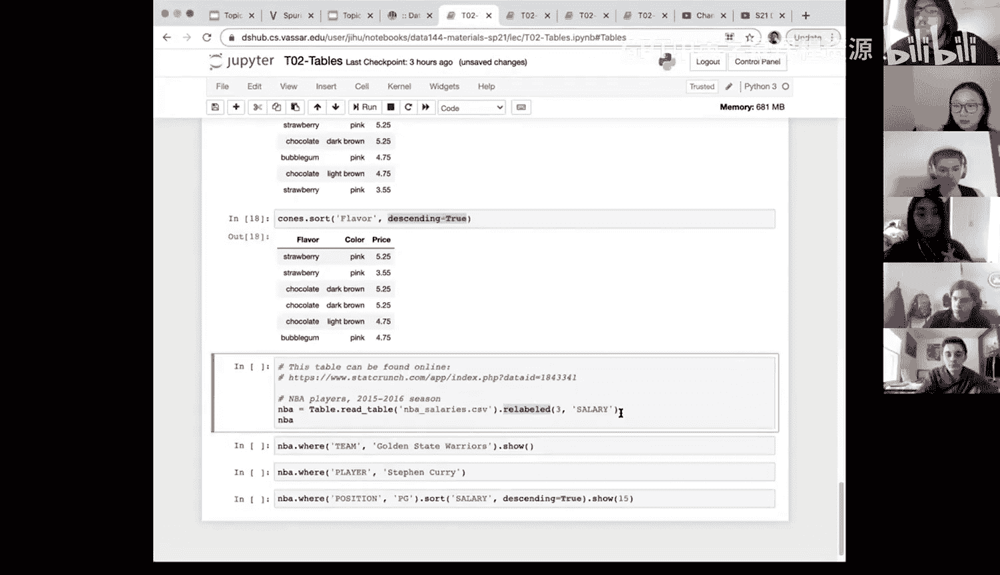

# UCB《数据挖掘和分析｜DATA 144 Data Mining and Analytics 2021》中英字幕 p08 [P08]lecture8-[T2 Tables] Tables-nkTuXFF_evM.zh_en [BV1efBEBuEVg_p8]

So the last topic of this topic is tables finally I mean the topic is not tables so now we're ready to talk about tables and then since this is a data science course we're going to deal with data set a lot okay so that's why actually the data science library that we're introducing here for this course they have a pretty comprehensive list of functions to deal with tables so tables as you will see now we define tables to be data tables。

Okay data tables meaning that well we're going have each row to represent a observation or individual okay and each column is what we call like a label okay and it's talking about whatever information that you are coding for each of the sorry for each of the individual okay so in this particular table we have well the first row is always like the name of the columns or the name of the labels okay so but then the number of rows like the actual data rows here is two we have California and Nada Nevada。

So the name column is the first column is the name of the state。The second column on label。

Theres code okay， that's just the abbreviation for each state okay and the third column or label is the area in square meters。

Okay， so data like we usually going to represent a data set as a table structure like what we're seeing right now。

 okay you will see that we have rows， we have columns。

And each row represent an individual or observation。

 each column is representing an attribute or sometimes youll call a variable of the individuals。嗯。

Let's do a demo， so you see what we need， we're going to bring in two examples to data set。

And then we're able to do all kinds of manipulation with okay so always make sure to run the first line Okay it is do loading the library okay the first table that we're going introduce is the columns okay it's saving the CSV format and then the table capital okay capital T capital T table do read underscore table is reading a CSV file into a table okay so this part of the code。

Is showing us like is reading the table and notice here we assign it into a object called cons so this is only reading it。

 but you want to assign it to some object that later we can access。

Okay so this first line altogether is showing the entire process okay so let me run this and I'm printing the cons okay。

 so you will see that it's going to print it out。The difference so let me actually just add one more cell over here if I only just read it but I do not assign it anytime any anywhere Im only going to read it but it's not assigned to anything like object that called combs so if we only when we assign it to something that we're able to access otherwise we're really just reading the table and printing it out so the most useful way to read the table is read it as well as assign it to our object and you name it in this case we name it as cons okay just well that's the name of the data so we can go with it but we can go with anything okay。

All right， so the data table， let's see how many columns are here。

Three okay sounds good and the first one is about the flavor。

 second is about the color third one is the price okay the rose is one， two， three， four。

 five six okay so there's six individuals observations okay each of them we have information about flavor。

 the color and the price meaning dollars。All right。

 so let me show you some very important interesting functions of the table object， okay。

 so cones right now is a table。Okay because we assigned it and we first read the table and then assign it to cones so there are so many different functionalities of tables in this data science library。

 the first one as you can see is show。Okay， and you see that to access that。

 we type the name of the data table is for homes， right， and then we put a dot。

And then we use the name， which is show， and then we put in apprenheesis three meaning that we're going to show the first three goals。

Okay。So。😊，Once we do that， you will see that only the first three are printed out。

 but it's going to also show you that three rows are emitted so by this you know that there should be six。

You can also just show all of them， so if you do show and then put nothing in the app parentheses。

 it going to show the title。So this is slightly I guess well from the output it's the same as just like typing cones around it right。

 but then cones is really just like printing out whereas show I think is specifically asking it to show it I guess like I said the outcome is the same is showing the entire table but the show can be more flexible by choosing a particular number of rows that you want to print。

So just notice the way that we're using it， we first of all。

 we are working on the table called cones okay and the function is called show so we do cones stop show and then in the parenthes depending on how many rows we want to print or all。

So get familiar with the feature or like how the synct is because now we're getting to a second。

Function that were able to apply to a table。Notice again， we're using cons， okay。

 that's the name of the table and we'll use dot okay and the function called select。

And then you can see here in the parenthees we do quote flavor。

 so what do you think if you were to guess， what do you think this line after around this？

What do you think the pre child is going to be？And from that。

 what do you think the select function is doing for my doing to my table？If you work your guess。

 what do you think that？Okay， I see okay let me bring up the chat and feel free to just to speak up only the flavorvo column thank you Samha so let me try to。

Do that， okay。Okay， so this is one and other use of a function called select， okay。

 and you can select flavor as a column， okay， and then the print tower will be a whole column。

So now I guess you will be able to guess， well if I select two columns， what we're going to do。

 we're going to return table with two columns， okay， the column of flavor and the column of color。

And notice the outcome like the print out is the table again okay so if I want to actually have a reduced table of only the column of flavor and the column of color maybe I will call it like cons underscore flavor and color and assign it to it then I'll be able to access my new table reader okay for now we're just really demonstrating the the use of select the function so we're printing it out but if you want to use it later you want to assign it to something and then you can access it。

That's a good practice if you really need it。All right， now the second I guess guess here。

 con start drop。And then parenthees quote， color， what do you think this going to do？There you guess。

It doesn't print the column that you name so remember color is one of the columns right we have three columns okay so if now we drop it okay。

You will see that well， the entire column of color is being dropped from my original。系。Okay。

 so select is selecting the ones that you want to keep or like maybe you want to use later and drop is actually to drop the drop the column that you don't want Okay now my next question for you is that now if I want to print my combs again。

How many columns are left？I've done so many things now， okay I've selected。One flavor。

I've selected two columns， flavor and color， I've also done some dropping here of color。

What my con is going to be now after all of those manipulations。

Still going to be the same original table。Yes。😊，Oh did you ask why because。

We didn't like change the name as still Cohenes from the original definition。Yeah exactly。

 so that's what I was saying earlier if we want to select and then access it later。

 we have to assign this whole function or expression into something。Otherwise。

 we're not changing callss at all Okay so now let's run over。

And we still have our original three column， every observation is there。

Okay so this might be a little bit surprising at the beginning。

 but as you work on more examples I'm sure you'll get used to it， but let me just run you up front。

 I think is still the most common mistakes people make later on as well so get used to it I'm sure more practice will help you a lot。

All right， so if I really want to have no color column at all。

 then I should really do what I'm highlighting now okay， remember on the right hand side。

 I have dropped the column color column okay， but at the same time I have assigned to a new object called cones no color。

Now I have assigned to object and if I print that object out。

 then this particular object finally will have no color because I have dropped it and I have signed it okay but of course if we now again type cones so let me just add a add a cell here。

 if I do cones again cones never changed okay I never really touched it I do many things on it。

But I don't change it， but if I assign it to something else like Cols no color。

 while the name as you can tell does not have the color column anymore。

 then that is where we have made the change and I should maybe not even say that this is a change this is really just I never really changed columns。

And now just assign it to something else that， well， later that would be what you， okay？

All right a couple of more functions and then we're going to end today the first one is where this is super useful you can see that well again it's cold do where okay where is the function Okay so where as you can see it that we're trying to find the flavor。

Which is chocolate。so that's how you read this one okay so what that means is that so now you can see that the where function has two inputs right the first one is the column name or the label name the second one is the value of that name that you're looking for。

So if I run this， what do you think I will get？I will probably get three rows right I will because I'm searching for where is searching you can think of like trying to select I'm selecting the flavor which is chocolate and if I look at my original poems database like data table I have three rows that is chocolate flavor right so if I do that。

It's going to give me all of the chocolate flavor。And then they are associated color and。

So you can call this subsetting or subset。And notice how the where function is being used here。

You will have to first get the input of the column name or label name， which is waiver。

And then the second input is the。Val that you're looking for for that column。

OkaySo really quick over here， what if I want to select all of the rows with color pink。

 what should I do？You can just speak up。Any you I do cones， right？Cones that wear color and。WhatW。

 which color what did I say pink， what does say pink pink Okay， so now is pink Okay， yeah。

 so first input thanks first input is color okay second input is pink and make sure that you're spelling it exactly the way to spell like capture letter is smaller make sure it's the same so if we run that well we're gonna get three rows again because there are three pink colors。

诶。All right， so the last one I want to show you is sort。Okay， and by the name。

 I guess it's informative enough what is doing okay。

 and in particular we're sorting the column price。Okay。

 so this is sorting usually is being done to continuous variable like price。So if we do that， well。

 we're exporting from the lowest price to the highest。Okay， and then of course。

 this is another example of well。If you don't supply the second。Let's see。

 if you'd also select the second input， it's going to be ascending because by default。

But you can always put the second input， say I want to do it from highest to lowest。

 then I can do descending equal to true， and I'm sorting in that way， the highest。

 so the most expensive from the top to the least expensive to the model。嗯。And most likely。

 like I said， I think this kind of sorting is makes most sense for numerical variables like price。

 but I think you can also sort other things if you want。

 and I guess here if we're going to sport by flavor。

And I guess descending or ascing this case is really， I guess in this case。

 just showing alphabetically the first letter。Of that in this case。

 if I'm doing descending for true for flavor， then I'm going to show strawberry first because as is last okay and chocolate and then a bubble room。

Okay。😊，Yeah so in the same demo there is one other like demo that maybe you can try it before we meet on Thursday。

 but I think on Thursday when we come back we're going to revisit those important functions of table and then do one more demo with and then the MBA salaries from 2015 to 2016 student data set and then do where as you can see and the sort and descend and show and there's one other thing called relabel okay if you don't like the name of one variable you can relabel it to something else and that's another function that is really useful later on。

O。😊，All right， so I think that's all for today and any questions comments and I know some of you need to do the like couldn't get on slackck so you can feel free to stay over I will walk you through to make sure that everything has everything seems right。

And any comments？Questions。Okay yeah Anthony I saw that okay sounds good so but anybody else if you need help to get on flag feel free to stay over or if you have any questions feel free to stay and otherwise we'll see you on Thursday and all of the recordings will be uploaded to our course the YouTube playlist so if you ever want to revisit some so we're recording a topic by topic like a little topic so maybe you'll be able to like like navigate more easily to see which you want to rewat to catch up。

Okay。All right thank you will take care on Thursday。

