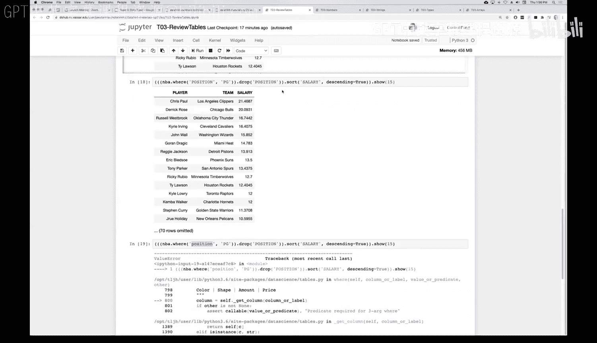

# UCB《数据挖掘和分析｜DATA 144 Data Mining and Analytics 2021》中英字幕 p09 [P09]lecture9-[T3 Data Types] Review Tables-TWFSNB8taUQ.zh_en [BV1efBEBuEVg_p9]

This computer here。Great， and so I want to start up kind of。

 I want to pick up where we left off last time and we want to we were talking last time about tables。

And so I kind of I want to finish that that part of that， and so let's do a little demo。

See if I can get the。嗯。Right。All right， fantastic， everyone can see my screen okay。

I will take no news as good news。and so yeah， so so we talked about tables and we're going to talk a little bit today。

 hello， we can't see again screen you can't see anything yeah oh how sad is that。嗯。😊。

Let's try that again， thank you everyone， that was good real time feedback。Okay， Chroe。对。

How about now？No， no。How come， oh my goodness is。This is truly troubling and puzzling to me it's telling me I'm screen sharing。

It shows up on the screen that you're you have started screen sharing but then the screen itself doesn't pop up Okay all right we can here let's just do this for now maybe it's how about。

This。Do you see my desktop now， you see everything？Okay， all right。Fantastic。All right。

 so's sorry about that。😊，U。We're going to do just kind of a review a demo again in Jupiter notebook right you all have accounts and oh。

 by the way， the first homework has been posted and so if we go to the class website。

You can see under the assignment section and you guys can all see this window， right？

You can see the class website yes， awesome if you click on homework one that will auto magical launch Jupiter H for you。

And basically it copies all the files and starts up Jupyter hub for you and then it's just a couple of questions to give you some practice。

And you have a week to do the assignment so the assignment is going to be due you know Wednesday at 1159 pm so kind of the way the course is going to be setting up so we'll have our labs and the labs are really practice the labs are kind of practice and it's okay to help each other out with the labs like if you're stuck on something ask me ask a coach we've started to get our coaching assignments in so I think we'll have some coaches and the lab with us on on Friday and we'll have some monitoring the remote channels and so the labs are really kind of the。

Way to get practice ask for help you know from us from the coaches socially distanced from your neighbors in the class and so that's really kind of and the labs really we kind of check them off as kind of you've completed the lab and they don't really get a grade they get kind of a check or a not check and when the idea is that the labs a good chunk of the lab should you should be able to get them done during lab period but don't fret if you can't if you can't finish during lab period or for whatever reason you can't make you lab period you can do the labs on your own and then when you're done you can just message us on slackck and we can we can look at your files and check you off so the labs are really kind of you do or you don't and then the homework will actually get grading and so that's that's the homework is kind of more of your individual effort and it's okay to talk to us and the coaches but that's this is the one where're kind of you know sharing screens with your neighbors。

You don't want to do that for the homework， okay？And so that will be due and you can also， you know。

 part of the reason why I want to release the lab， the homeworks on like Wednesday night。

 you know Thursday， if you have questions give you it will give you some time to look over the homework and if you have any questions during lab period。

 we can also answer questions about the homework as well as the labs。Okay。

 so that is that is the homework so let's get back to the tables and so again。😊。

We're going to have kind of at the start at the top of a file a little bit of boilerplate and we'll talk as we learn a little bit more about Python we'll talk about what these lines actually do。

 but for now it basically gives us it gives us functionality that we're going to use in our program and the two big packages that we'll use a lot of is this data science package and that's going to give us tables and allow us to do operation on tables and then the other one there is something called NPI that's short for numerical Python and that's going to give us some mathematical。

Functions that we'll use from there， but for now we just you know we just need to remember to run that cell。

So we run that cell and then。We're going create a table and we'll look at a couple of different ways of creating tables。

 One of the easiest ways of creating a table is actually just reading a cV file a CSV file is a text file CSv stands for comma separated values and you can actually see this NBA salaries and so if you go and click on up in the upper left hand corner the Jupiter that's fine it's just I'll save my work so won't give me that error or that message so if I leave here this will show you all of the files and all of the files for this class are going to be in this directory this data 144 materials spring 21 these are all your files and so when you click on that link on the web page it's your homework in your labs and your demos it all get copied into this directory and you can see there's three folders here homework labs and lecture the lecture or the in-class demos so if we click on that we can see。

😊，Here are all the particular demos and down at the bottom you can see here is the file。

 the actual CSV file that we're going to be reading in with that with that table function and so if you actually just click on it you'll see。

It's just a text file separated by commas and then the first line is special it gives the name。

 the it's called the header for all of those and you can see it's just a text file with our data。😊。

Okay。All right， so let let's go back to our demo。Review tables。And so here what we're doing here is。

And we'll talk a little bit later today about types。

 but a table is an object that we get from importing the data science library and so this table is an object。

And we can call functions on objects and so what this line right here is doing it is it is calling it's calling the table part of the data science library and it's calling this method called readtableable it takes one argument the name of the file that we want to read and then we're doing something here and I'm going to explain this a little bit later this is called function chaining。

But basically the way I want you to think about it is is that this part， this first part right here。

 what that's going to do is that's going to open that CSV file and it's going to give us it's going to create a new table object。

😡，嗯。Can you make the screen bigger with a control plus， absolutely？嗯。嗯嗯。

Give me one second here see if I can do that。How's that？

That's amazing thank you no problem Thank you for letting me know I'm on this big 30 inch monitor so I probably I。

😊，It probably looks a little smaller like on on a like a 11 inch laptop or something along those lines so thank you I will remember that setting so what am I doing am doing about 150 that seems to work well。

😊，Excellent so what this line here is doing is that this is opening that file and it's creating a new table object it's creating a new table object and on that that table object we can call certain functions on that table and and this function one of the functions that we can call is relabel and that's going to just change the name of one of our columns and it's going to in particular the way this works is it's going to change the third column to whatever it was to salary and if you remember if you happen to notice when we looked at the CSV file the header for that column is like。

Salaries 1516 and so that's just giving it a kind of a more human readable name so if we run that cell and then you can see what it's what Jupiter notebook does very nicely for us is when we load in that table we've now assigned it we've given it the name we've given it the name NBAA so we can use that later in our code and so NBA that that name has a particular type and that type is a table。

😊，And Jupiter notebook very nicely kind of displays the first 10 rows of the table for us and we can see player position team and then a relabeled or a renamed salary column。

 okay？Now that we have this table we can call we can call different functions。

 different operations on that table and we do that by using this dot notation。

 so if you look at this line right here， you can see NBAA is our name it's the name of our table so it is a table object and one of the operations one of the methods or functions that we can call on tables is where and what that is going to do is that is going to show us it is going to show us all of the rows。

 all of the rows where the position so this the first argument to this function is is a column name。

It's going to show us all of。The rows that have the position matching the string Pg for point guard okay。

 and we're going to save that we're going to save that。We're going to save that table。

 so this operation。This operation returns a brand new table， creates a brand new table。

 so point guard will also be a table just showing us the particular rows that match the criteria。

So if we run that。We didn't see any output because the assignment right we're taking this what we're taking whatever is on the right hand side and we're giving it the name on the left hand side this even though this is an equal sign it's not like a mathematical。

Equation saying that these things are equal what it is is an assignment and the way assignments work in Python is whatever's on the right side of the equal sign。

 whatever's on the right side gets evaluated。😊，Whether that is a number， a string。

 a table some other object， this whole thing， this is an expression that gets evaluated and in this case this expression calls this function and then whatever returns from that function is we're going to give it the name point guards and so point guards is a table and so if we want to see the contents of it we can just run a cell with it。

By itself and by default， Jupyter notebook will。Show us the value of that and the default for tables is to show us the first 10 lines and so if you notice this was our original table right the first row in it was this was this player Paul and then Al and then so on and so forth and you can see now the table。

It's a different table， all of the。All of the rows all have the position point card because we've only we've we've we've only we've told it to give us only the rows that。

The position is as point guard Okay and you can notice the table is much smaller right You can see that we gave the first。

10 lines here and then it says 407 rows have been omted and down here because we're only selecting the point guards。

 we have much we have the table has 85 rows in it。Okay， any questions about that？

So that allows us to select。That allows us to select rows that match a particular criteria。

And now yes， so just the first the first I guess it was cell number two why did that have an output if it's just an equal sign great great question so so the question is and the reason why is because of this line right here all right if we take this out if we take this out and run this cell again you see that there's no output。

And the way the Jupiter notebook works is that。It will run every line in your cell。

 one after another in order。😡，And so in this case， what we're doing is。😊。

We're running this cell has two lines of code in it and so by convention。

 what Jupiter notebook does is it only shows you the last output。

It only shows you the output from the last command。And so for example。

 if I had if I left this line just like this and then I did something just like an expression。

 if I just did two plus two right， you can use Python as a calculator and so when I run this cell。

 it's not going to show me the NBA table， it's just going to show me the output from that last line。

 which is going to be hopefully it should print us four from there， okay？

And so this is this is really a Jupiter notebook convention if you actually want to see the output of something after an assignment。

 you just have that name by itself。And this is really doing this is doing nothing other than displaying the content for us in that cell the assignment is actually the important line here。

Great question thank you and so for example and so we can see here if we run this if we run this we are。

😊，Going to get the output。Where we're going to drop。A particular column。

 so notice that drop the drop method again operates on tables。

 it's going to take a string which is going to be the column name。Like for example。

 if we got if we mistyped this。And we ran this function notice it didn't give us an error notice it didn't give us an error and that's kind of by design what it's really doing is it's checking to see if there is a particular column with that name and if there is it will drop it if there isn't one there it doesn't give us an error it's just not gonna do anything notice that this is the same has the same number of columns as before so that's something to kind of watch for when you're writing your own code if you have like a typo it may not exactly do what you think it is and again Python is a case sensitive。

Language， and so if we did position all in lowercase。Notice that it did not drop that column。

 it did not drop that column because a Python is case sensitive， it's going to do an exact match。😡。

And so when you're writing your own code， those are things to kind of keep in mind。From there， okay。

And now interesting okay， so now here's a test to see kind of what's going on so I did this point guards drop right and so it evaluated this expression and it is the only line the in the cell so it showed us the output what's going to happen when I run this cell。

What's going to happen is it going to show me this column， is it going to show me this table。

 the one with the drop column or will it show me this column up here？😡。

It will show the one with position because you didn't reassign it Yes。

 yes so if if we show this cell right here the position came back and that's and that's exactly right and that's a good thing to keep in mind is that this whole thing this whole thing is calling the drop function on this table the output is a brand new table it creates a brand new table it doesn't touch your own table and we saw examples of that on Tuesday as well and so if I wanted to keep this if I wanted to keep this table and use it in a future calculation I would assign it I would give it a new name I would give it a name from there so great and and here's an example for that right to keep that table around we're going to put it as part of the assignment and so now point the point guard table we've created a new table and we've given it the name point guards。

And so we can do things like now that we have that， we can sort by salary。And this show here。

 so again， this is an example of function chaining and so we're taking the point guard table。

 we're going to sort the table on salary and in descending order。😊，And then by default。

 if I leave this off。I leave this off what it's going to do is going to create it's going to create a table。

 it's going to create a sorted table。And it's only going to show me the first 10 lines okay and so what we're doing and so kind of the way I want you to think about it is is that there's a bunch of operations。

 there's a bunch of functions you can call on tables this whole expression this whole expression when we run it what does it do it creates a new table it creates a new table and that table we can actually call functions on as well and that's exactly what we're doing with this dot whoops。

😊，Oh gone there we go， hey back that's exactly what we do when we put this dot so think about everything think about what type is everything here。

Right so point guard sorts returns a table， so what operations can you call on tables show as one of them and what show is going to do is that will just simply show us the entire table。

From there okay， so that's that's where that comes from This is an example of function chaining you'll use it a lot just to save yourself some typing we could do。

We could easily just you know break that up into a couple of lines and sometimes if you're chaining if you're chaining a bunch of operations together and you get like three or four of them chained together your code starts to look a little unwieldy it just looks it's just long that's usually a good idea to kind of break it up in a you know save。

😡，Save one of the intermediate tables give it a name and then you know do the operations on that the computer doesn't care but one of the things that i'd like to you know you as a computer scientist and me as a computer scientist one of the things I'd like you to come away with is writing code that is easy to read and maintain so this is the sort of thing where if you come back to this code six months or a couple months later you can actually look at your code and go yeah I remember exactly what I did。

😊，And' that's a big reason why we have why we give these expressions names。

 so they' they're really human they're really for us。

 they're really for us to kind of remember exactly what we're doing from there。😊，Okay。

 and so here's here's an example of a lot of things chaining together and so the key to kind of reading these chain functions is really just start at the left and figure out what each step in the chain is doing。

And so here what we're doing is is we're taking our MBA table and we're getting all of the rows where the position is point guard okay。

 so now so that's going to create a table that's going to create a table with just the point guards in it。

😊，And now since we know we just have point guards， we're going to drop。

 here's the second part of the chain， we're going to drop the position column。

Because we know we just have point cards and then finally the last thing that we're doing here is is we're sorting by salary and then we're doing in descending order so highest salaries first。

😊，And since we don't care for this example， we're just wanting to look at the top 15 okay。

 so this is the equivalent of doing all of these individual operations one at a time saving each one in its own table。

😊，So we run that， we can see that's exactly what it's doing， it dropped。😊。

It dropped the position and then sorted our salaries from there。Okay， and then let's see。

 what are we doing this。This line looks exactly the same。

From there and it should give us the exact same but oh， what am I doing why all right。

 what what let's see position where。Okay， so the difference in this line here is it gets back to the fact that Python is case sensitive so here we're setting we're trying to。

😊，We're trying to select for the position point guard and so in this example。

 because it's matching on a particular column， there's no column matching so this is not going to actually give us a table that we can do that we can drop the position on okay。

😊，From there and again that will give us an error as well so the really kind of takeaway from those last two cells is Python is case sensitive and you got to be you got to match the column names exactly from there。

😊，Okay， great， all right， so let me stop sharing there and I think that kind of wraps up our review topic so what I'm going to do is I'm going to stop the record。

😊。

