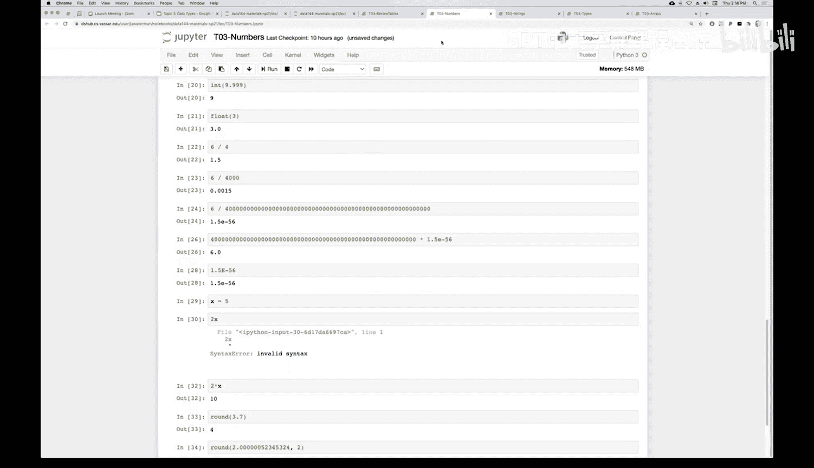

# UCB《数据挖掘和分析｜DATA 144 Data Mining and Analytics 2021》中英字幕 p10 [P10]lecture10-[T3 Data Types] Numbers-Z-RpS4VyzDM.zh_en [BV1efBEBuEVg_p10]

Rund this computer， fantastic， okay， so。

we've been introduced to a bunch of different types so far we've looked at the table type we've talked briefly about numbers and so let's kind of revisit them a little more in depth so we're going to talk about numbers and numbers are born right for data science you know and computers you know we pretty much a lot of the time work in numbers so it's a good place to kind of start thinking about how do we represent things in our in our system okay so。

There's a robust set of operations arithmetic operations right computers are really good at doing arithmetic and there's a kind of all the usual suspects we have addition subtraction multiplication and the good news is is they all were and division so addition subtraction multiplication and division they all work exactly as we expect them to work there's one little twist there's one little interesting thing too is that so division works exactly as you would expect it to like seven divided by three is going to return to you a floating point number a fraction number from there but but Python also supports something called integer division and notice the two slashes that's not a typo the two slashes will actually do integer division and what that means is is that notice seven divided by three is so three goes into seven two times and you some change right two thirds from there the integer division is just going to give you。

😊，The integer part， it's just going to give you the whole number parts。

So seven you know so three goes into seven two times and that will just show you the whole number part it basically ignores any remainder and if you actually wanted the remainder you can use the remainder operation which is the percent sign it's also known as the modulus operator and that actually gives you the remainder so if you do seven modo or remainder three that's going to give us the fractional part of it right so so three goes into seven two times with one remainder left over。

From there okay and then the other one we saw this kind of in the lab explanation explanation explanation I'm not saying that right expon taking the taking the exponent of something raising something to the power and that is two stars right after another right so one star is multiplication two stars is explanation。

😊，Ex question yes I wanted to talk this is just I guess more of a general question。

 but I wanted to ask about the importance of spacing。

Just because I see like sometimes it's hard for me to tell that in division is like a space between the seven and the first bracket great great me yeah no。

 that's a great question。Python is a little more sensitive to spaces than other languages and as we learn as we start writing our own functions and more complicated code we'll get into that but in this case there is no space there is no space between the two of them and in general and in general symbols will not have spaces with them。

 so spaces are in general used to separate things and so when we think about names when we think about naming things and an expression there's actually a couple of rules about that and one rule is is that your name can't have any spaces in it。

And those spaces are important because that's how Python knows when one symbol ends and another one begins。

And so here between the two stars there's no space between the two slashes there's no space so here in these examples the space is optional so you can have two plus three and you can have space。

 you can have a space after the two and a space after the plus you can have multiple spaces as well or you can have them together and the reason why you can have them together is that Python knows that any that that two is a number and that plus is a mathematical symbol and it can disambiguate them。

From one another。And by the way， because of that in Python， names cannot start with a number。

Names can have numbers in them， so you can have a name that has a number in it。

 but it can't start with a number。Um， and that's just u that's just so it makes it easier to know whether you're dealing with a number or or a name from there。

Okay， great， did that answer your question？Yes， it did thank you awesome Okay。

 so let's let's take a look at a let's take a look at a demo where we can see some of this in operation。

😊，All right， and again we'll just run our particular cells and so we can just we can just use Python as a calculator and we can just type numbers。

 we can just type numbers and what's going to do when I evaluate this cell it's just going to see the number 30 and then it's going to evaluate that expression and give us back 30。

😊，Here we could do mathematics。😡，We can do operations this is just multiplying 1010 times three dividing again it's going to do regular division so it's going to turn in 3。

333333 so notice right。😊，Because we're writing things as decimals。

 notice really really at the end here。😊，This is not exactly right what you would expect。

 what is kind of the mathematical answer to 10 divided by three， well it's 3。

33333333 forever and ever and ever and ever。😊，But as where you see is， is that。

For floating point for fraction numbers， these are called floating point numbers in Python they're represented by a they have a certain amount of precision associated with them and how precise you can represent fractional numbers depends on how big the number is but you can see down here that is not quite right but how many decimal pointss points are we going out we're going1。

2，3，4，5，6，7，8，9，10， 11， 12， 13， 14， 150， 16 places okay so for all intents and purposes。

 this is pretty equivalent we're going out 16 decimal places before we get kind of a difference in there。

 but just be aware that you know if you're dealing with very。

 very precise numbers there's a limit to the precision that we can represent in a computer。

The good news is for this course we really don't have to worry about that too too much。

 but I pointed out just just to be aware that this is normal。

 this is not like a bug in the system or anything so we can do division。And so notice right。

 so 10 is a whole number that's known as in computer science， those are known as integers。😊。

And so it two， but when we divide the two of them together。

 even though it comes out as a whole number， the result of the division operation in Python will always return you a floating point number will return you a fraction and why you see that's why you see that the answer is not five。

 but it's 5。0 and when're looking at when you're looking at the value of an expression。

 that's one way you can tell whether it's a floating point number。

Or an integer based on whether it has that decimal point associated with it Okay here is showing an example of raising the power so this is the equivalent of 10 times 10 times 10 which should give us  a thousand and this exponent this exponent does not have to be a whole number it could be less than one it could be a fraction in this case right taking something to the the 0。

5 so 10 to the half is the equivalent of taking the square root of that okay。😊。

🤧And so if you multiplied 3。1 all of that together times itself you should get back 10 right we can actually do that that's a fun little exercise if we add a cell here if we actually i'll just cut and paste this we do。

😊，And we multiply that again。嗯。Evaluate that interesting。

 right We got close to 10 and we got 10 point all the way out right to the 16th test point again。

 again， this comes from the fact that this is not a perfect this is not the perfect square root of 10 right the square root of 10 goes out for for for an。

 you know， infinite number of digits， but this is pretty dn close right。😊，It's good enough。

And then so while there is a limit to the precision of floating point numbers for fractional numbers Pythons integerts and python can expand to be as big as you need them to be so here we're taking one two。

 three four five six which is a fairly large number and we're raising it we're taking that and we're taking this number times itself。

😊，890 times I don't know what the answer to that is。

 but I know it's a darn big number and so we run that what do we get we get guess what a darn big number。

And look at that python was actually able to do that calculation and show us in all of its many。

 many， many digits glory Okay， so while there's an infinite while there's a finite precision to。😊。

Fraactctionional numbers， integers can grow without bound as needed。10。

33 points right right again I show you that and so here's another example we kind of we saw this limits to precision when we squared we took the square root of 10 and then multiplied it by itself to get the original back we can also do another example here is if we have some number with a lot of decimal points right so we're writing them out so it has a lot of precision if we evaluate this expression what we get back is something a little less right so here's our number here's our whole number and here's our fractional point but it really just kind of stopped at this point remember I told you the precision the precision how many digit to precision you get really depends on the size of the number as well so this number is a fairly large number so we got a little less precision then we did up here here you can see all the decimal points going on and what Python did was just basically rounded at this point from there okay so but what that means is if we go back to our original original。

😊，And then we subtracted this right so you can see if we actually did this in pure mathematics。

 we should get some small fractional remainder， but if we run that here we actually get zero because we've exceeded the precision limits of representing this fraction。

 this floating point number。Any questions about that？Makes sense。Really。

 the kind of takeaway is that at the very， very， very end， you know。

 there's a limit to the precision。From there。Again。

 we're not really going to have to worry about that too too much or at all for this course。And again。

 another example here of just not getting back exactly what we started， but it's pretty darn close。

 right？From there。Okay so what are we doing here so here we're taking 10 divided by five that should give us two。

 but that's a floating point number。😊，And here we can convert things to an int。😊，Okay。

 so 10 divided by five converted that back out， what happens if we try this？

Interesting right so if we divided a 10 point if we did if we didn't do the conversion to an int。😊。

What do we get 10。4， we get 2。5， and you can see what the in does。Is it converts to an integer， but。

It actually just ignores the decimal point a trunk case and so for example if we put。Int 9。999。

 right？It is not going to round for us it is not going to round for us it is just going to give us the integer part of that number so that's that's something to kind of be aware of and by the same token we can convert we can convert a integer into a floating point number and that should give us 3。

0。😡，嗯。Okay。😊，The other thing we can talk about is that Python supports scientific notation for writing really big or really small numbers and so if we divide 6。

4 we get 1。5 if we keep making the denominator larger our number is going to get smaller and smaller okay and so instead of writing out all of these decimal all of these zeros Python will hopefully show us the result in scientific notation and so here here's our base 1。

5 and then the E is just times 10 right to this whole thing is 1。

5 times 10 to the minus 56 and so really kind of the way you want to think about it is is that minus 56 means we're going to move the decimal point we're going move the decimal point 56 places to the left。

Okay。And。You can see if we take what we just did and multiplied it by back we took this was our denominator and we multipplied it by this small number we got back exactly where we started from and you can type you can type。

You can type as an expression it in scientific notation from there and it will understand that too。

 and I believe it will also accept the capital E。😊，Yep， it looks up both from there。

Okay here's an example of assignment and remember the mental model I want you to have an assignment because it can trick some people up when if you start thinking of it as an equation。

 it is not an equation， it is literally a very mechanical process assignment and I want you to think about assignment is having the left hand side which is always a name。

 the left hand side is always a name， and the right hand side is some expression that evaluates to a value。

And so here we're evaluating the expression， which has the value of five， and then we're giving it。

 we're storing that under the name x， we're actually storing the value five we're not encoding any other variable like if there was like another variable or something in there。

 we're actually computing the value of that expression。😊。

We're competing computing the value of that expression and that number or。

Object or type of whatever depending on the variable that is what is associated with that name okay and this thing here and so that this is just giving it a value right it's going to return nothing so the thing to remember is is that even though we can do a lot of computation and Python it is not like algebra it is not kind of mathematic like2 x right that's something we could see in like an equation and we know that that two followed by x would be two times x that this is not valid syntax。

😊，Remember what I said that all variables have to start with a name it is going to get very confused that there is a number here and this name and there's no operation in between this will give us an error and in some cases this is just you know a very generic error syntax error it couldn't understand what we were doing and so if really what we were trying to do kind of in the mathematical equation sense of do two times x we need to put the operator the multiplication operator and again in this case spacing is helpful for readability but the Python doesn't care we could easily just do two times x and it's going to accept that just just fine。

嗯。😊，Okay and so since since the converting from a floating point to an integer if we call if we call the the int built in the in function is built in by then we call the int built in that just truncates that doesn't do any rounding there is there is a built in for round and round will do exactly what you expect it will round to the in the default case to the nearest whole number and then you can also give an optional second argument which is how many how many digits a precision do you want to round to so this will give us two places right so here's one place and then one after the decimal point from there okay。

😊，The other thing to kind of realize is kind of the result of operations， so here we have an integer。

😊，So we have an integer type and we multiply it by a。Well because we have the decimal point there。

 this is now a floating point type if we multiply an integer times a floating point。

 the thing we're going to get back is a floating point number okay。

 if we add if we left this office three， the thing that we get back is going to be an integer。

It's going to basically automatically convert because one of the arguments was a floating point number。

 okay？Any questions about that？So supports arithmetic。😊。

You know we have a limited precision in floating points。

 but that precision is going to be more than enough that we're going to need for this class and then just be aware of kind of some conversion and syntax I think that's kind of the big takeaway from that。

All right， stop sharing。

Actually， now I want to go back so any questions？We're doing all right。

We we're all together if you've seen some if you've seen some programming before this might be a little slow don't worry the pace will absolutely pick up and if you haven't seen this before this might seem too fast that's okay too we're going to give you practice we're going to give you practice with the homework in the lab so if you feel like things are going just at the right pace awesome if you feel like things are going too slow things will pick up and if you feel like things are going too fast we're going to give you more practice。

So hopefully that covers all all of the major food groups all right。

 let me go back to screen sharing just to make sure yeah all right so。😊。

