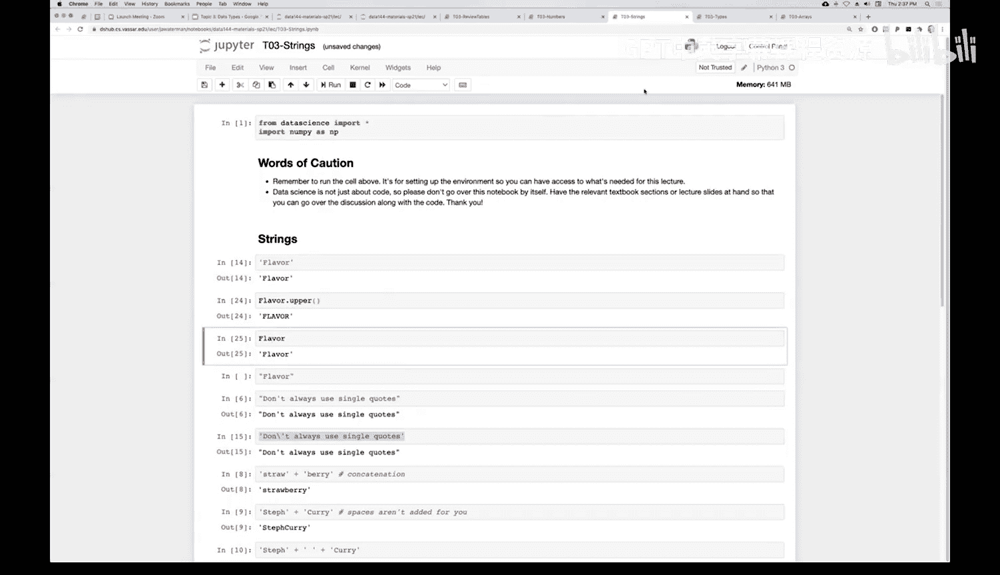

# UCB《数据挖掘和分析｜DATA 144 Data Mining and Analytics 2021》中英字幕 p11 [P11]lecture11-[T3 Data Types] Strings-5BvIM0qPENA.zh_en [BV1efBEBuEVg_p11]

Okay， so at this point we know we know three different types in Python。

 we know three different types， we know integers which are represented as whole numbers and possibly negative。

 we have floating point numbers which are fractional numbers numbers with a decal decimal point both positive and negative and we know about table objects we know about tables。

We're going to introduce you now to our。Fourth type and those are strings and these strings are convey data convey text text data。

Okay， and so what is a string， a string is really just text of any length and how do we denote strings we put them in either single quotes or double quotes and so this first example here is a string that has the length one that contains the letter A。

😊，We can again have strings of any arbitrary length as long as they're enclosed in either single quotes or double quotes Python doesn't care。

 but you have to be consistent if you start a string with a single quote you have to end it with a single quote。

And you can put really almost， you can put anything in in any text。

 any character in between these two strings in between the quotes。

 and as a matter of fact we saw in the first lab on Friday。

 we can even do things like have emojis inside of our text， inside of our string。嗯。😊。

If we have a string that represents a number。We can there are conversion techniques that allow us to do that pretty seamlessly in Python and so remember the int。

😊，Function， if we give it a string， we give it a string。

 it will actually try to interpret this string， this character right so because it's in quotes。😊。

Because it's in quotes， that is a string， that so the thing that's inside these parentheses here is literally the character symbol representing one and the character symbol representing two。

😊，It is not an integer， it is a string with the characters one and the characters two to actually get it to be an integer to go from an integer。

 you actually call this int conversion and then that would return the integer。

 the actual integer with the value， the number with the value 12。😊，Okay， and by the same token。

 we can convert floating point。Strings into an actual decimal number using the float built in。Okay。😊。

And any value could be converted to a string。By calling the built in STR that' short for string。

 so if we give it the number five that will return us the string。With the character five in it， okay？

All right， let's take a look。Okay so again a string is anything enclosed in a single quote or double quote the choice is up to you just I would pick one and just be consistent with it I think a lot of the examples you single quotes because you don't it's a little easier type because you don't have to type the shift key so this here this whole thing this expression evaluates to the string flavor notice if I leave if I leave the quotes off what do I have do I have a string。

😊，No， I have。A name of something and in this example we have not assigned right this because there's no quotes because there's no quotes this is not a string This is a name This is a name to something that。

😡，Hopefully we previously assigned because if we haven't assigned it and then we try to evaluate this expression this will give us an error this will give us an error and actually in this case Python gives us a pretty decent error it gives us a name error and it says name flavor not defined find because we have not assigned it to anything now if we did something like we could do flavor equals。

😊，Labor， that works， that would。嗯。That would work。From there， but remember。

AA string of characters without quotes around them。

 is that is a name that is a named object and if we haven't previously defined that from there。Um。

Again we like I said we can have any string start with either a single quote or a double quote we just have to be consistent and so here's a good example to use double quote if you actually have like something that is using a single quote inside of your string Python will have no problem with this。

😊，But if you decided to use single quotes here so what's going on and the syntax highlighting and Jupyter notebook is being kind of giving us a clue to what's going on here it's being a little helpful and so what's happening is is that remember Python is thinking anything is a string in between single quotes and so even though this is the phrase we want don't always use single quotes what it's doing is it's taking it our starting quote and then here this。

This apostrophe it's taken as the end， so it now has it is basically saying。😊。

The string DON Don is a string and then now it's getting very confused because this is it doesn't know how to interpret the rest of this this will give us an error。

😡，It will give us an error right it doesn't know what to do with with this because it's。

You know it's thinking it's a variable， it's thinking it's a variable at this point right up right up against the string with no operation in between so that's why we're getting the that's why we're getting the syntax error here。

😊，Okay， you can do operations on strings， you can do operations on strings and one of the operations you'll see a bunch of times is something called string concatenation and so it is literally adding the two strings together。

And we'll make a new string， which is a concatenation of the two strings。And so notice。

We now have a new string which is this string immediately followed by the second string and you can you can have as many of these as you want you can add them all up together but one thing to note if you are like doing it for like a name or something like that right it doesn't automatically add spaces for you so if you wanted to have spaces you would have to put them in so notice this what we're doing here is this this expression has three strings it has the string with the value stuff here this is a blank space and then finally a name curry so if we add them all together then we get a single string which is the first string followed by the second string followed by the third string okay。

😊，So strings support the addition and concatenation and this is kind of crazy this is kind of crazy strings will support multiplication and this is kind of weird it is weird but sometimes it is actually useful and what this does is。

😊，It takes so if we have a string in this case， Ha， and if we multiply it by 100。

 what it's going to do is it's going to create a new string。

It's going to create a new string of the in this case， Ha。Basically added to itself 100 times。

 and so we're going to get 100 times。From there okay it's kind of a weird thing but sometimes it's occasionally useful so we just had 10 from there okay there's limitations to this you know because it's kind of a weird thing multiplying a string by a number but again if you think about you know the addition is being concatenation multiplication is kind of a normal kind of。

😊，extension of that I just got a comment from the from the from you guys what if you want to print an apostrophe and don't don't you have to don't you have to put the yeah so what happens if you really wanted to use single I think I think the question is and if I if I just please ask again in the chat if if I'm not answering the question I think you're asking what happens if you really really really want to use single quotes and you can and what you can do is is you can escape you can escape the the apostrophe and to do that you do that by using a backslash whoops。

😊，Right just like this， okay， and so what this is saying here is that this whole thing is saying don't treat this apostrophe as the end of the string。

 treat it as being part of the string。And if we evaluate that that is actually going to is going to work okay for us right notice the default in this case。

😊，What's interesting is is that the default is actually replaced it even though we specified it with single quotes。

 it actually just said now you probably want to double it just use double quotes easier to display hopefully that answers your questions。

😊，Hopefully that answered your question， if not， please。Pop something else out in the chat。

So multiplication kind of makes sense if you think about it in terms of concatenation it's just it's just adding 10 times or 100 times so but there are limitations。

 you know it doesn't really make sense to multiply a string。😊，By a fraction， right。

 this will give us an error because it has to be a whole number from there and this will not work。

You can't add， you can add you can concatenate two strings together。

 but I don't necessarily know what it means to add 10 to a string so this will give us an error from there okay and it's basically saying must must be a stir。

 not an inch right this must be you can add two strings together。

 you can getate them you can add two integer together but you can't kind of mix mix them from there。

Okay， and this is just showing examples of the conversion。

This will take the string three and turn it into actual three this will take the string 3。

0 and turn it into a it will not right because what it's trying to do is it's trying to take the argument here and it's trying to treat it as literally an integer this is not technically an integer this is a string representing a floating point number and so that is going to fail that is going to fail but it will work with floating point numbers from there and vice versa as we said you can take any any number and convert it back to the string and this will return to you the string。

And then this will return us the string literally the characters so what is what is that right that is literally the character symbol for four the decimal point character and the character five from there okay so the thing that I kind of want to kind of take away with you know so there's different operations that we can do on strings here's some fun things I'm gonna to go off script a little bit and so let's see so if we have flavor right that's still defined for us right so flavor is a variable and it has the type string and you know how tables we can call operations on tables we can do the same thing using the dot notation from that and so one of the things that you can do is you can call upper。

😊，On that and so what it's going to do is much like we're performing an operation on the table。

 we're going to perform an operation on the string and upper happens to return a brand new string brand new string with everything capitalized from there okay and so much like tables it's returning a brand new string and our original flavor our original flavor variable。

Is unscathed from that， okay？So that's just another example of using a dot notation so I want you to so now that we know about integers we know about tables。

 we know about floats， we know about strings， I want you to start thinking about especially when you have a name of something I want you to start thinking that about these names of having types because the type determines what operations you can do on that particular name on that particular object and Python everything these things are called objects and you can perform operations on these objects and this flavor name has the type and actually we'll talk more about that one types but its as a good lead in to kind of our next topic here okay。

Any questions on strings？We'll be using them to kind of display output for this class。All right。

 that will wrap up this topic so I will stop our recording。

