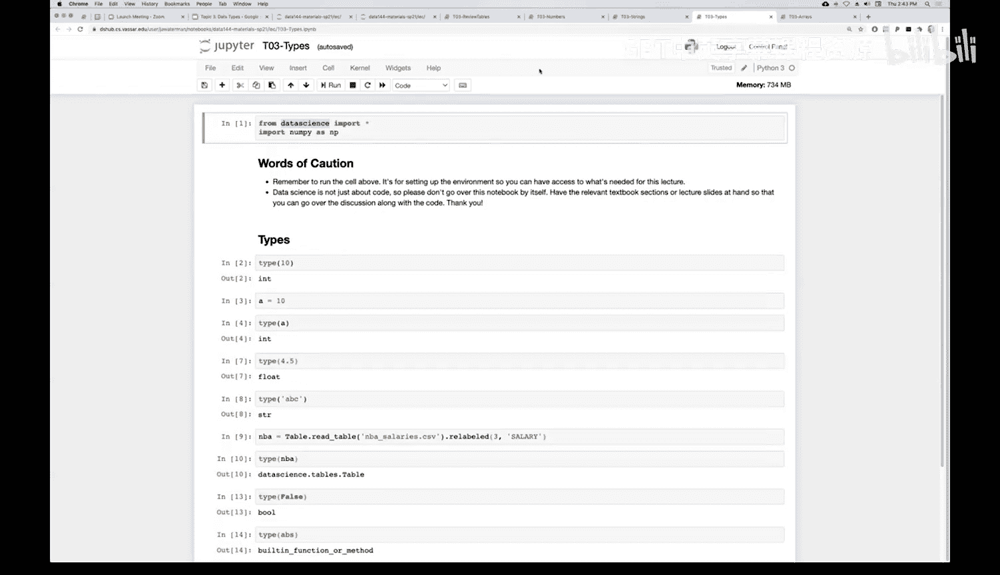

# UCB《数据挖掘和分析｜DATA 144 Data Mining and Analytics 2021》中英字幕 p12 [P12]lecture12-[T3 Data Types] Types-8AANKmYoSB8.zh_en [BV1efBEBuEVg_p12]

Okay。Great， all right， so now we know about we know about our different types。And basically。

 every name， every value has a particular types associated with it。

And we've actually seen five types this is right so we've talked the four that we've talked about we've talked about integers floating we've talked about strings we've talked about tables and we've actually talked about built in methods or functions these are things like we saw the STR function the int function the float function and here's another example one the ABS the absolute value function。

😊，And so there is a command and I'll show you an example of this where you can actually if you give it a value。

 you give it a value or give it a name， it will to actually tell you the type and that that function that does that is type from there and so。

😊，TheFor any expression， its type is actually based on its value， not how it looks。

 and so what do I mean by that is we have x equals  two。

 so we have assigned x to have the value of two。And if we do type X。

 that is going to return us an integer and let's see an example of that。Here， okay。And so again。

 we can take any any expression， any value， any name and get its type in this case we're giving it an integer 10 so its type should be integer and it is。

😊，And now that we've assigned， in this case， we're assigning the integer。

10 to the to the name a now we can type we can type type。

 we can get its type and that will also return an integer by the same token we can get the type of 4。

5 which is float。😊，Interesting question， what would be the type of this？Would that still be a float？

It would be a string。RightThat really makes the difference。Strings， even though they look like。

 even though if a string looks like 4。5。Even though it looks like a float it is not a float。

 it is an actual strength from there and that will show us tight。😊。

Here's an example right here is the demo that we looked at， we're reading in that table。

 we're taking that file name and reading in that table， so that's going to create a table。😊。

And then we're going to perform so that as a table and then we're going to perform the relabeling operation on that table and so that gives us a new table so we're creating this operation is creating two tables it's creating this table。

 the original table and then it's creating a new table that's going to be relabeled and then we're assigning at the name MBA and so if we see that if we check the type of MBA we're going to see that it is a table and in particular remember this import that we did up here。

 this import imported the data science library and part of that library is this table object。

 there is this is a library this is a table's object and this is a table object that we can use okay another type of object we haven't talked about yet but when we talk about how to how computers make decisions through if statement we're going to talk about a name that either holds the value。

Sure or false and computer science lingo， that is known as a Boolean。Um。

And so this is the symbol true and we can also have the symbol false。对吧。

From there we'll come back to that we will come back to that and then last thing that we saw was these built in functions and so the the function name is actually just a name of a function object just like everything else in Python as an object so you can actually get the type of the absolute function and it just it tells you it is a built in function from there so our min and max built in functions too absolutely yep and so if we did type。

😊，Men。Okay。Built in and max and there's there's there's a handful of these built in functions and maxes is one of them as well so basically you're going to get functions by either having them built into the stock default python or you're going to use these import statements and so in this case we're importing the numerical python package and we're just giving it a handy name called NP and we're going to see that by using the that notation we can when we talk about arrays which are coming up next。

😊，We will unlock some of these operations that we can do from there so functions are either going to be built in or we're going to get access to them by importing from a library from there and the number of libraries that we import is very small because the data science package gives gives us between data science and NI that gives us I think a pretty much 99% of the things that we're going to need for this course from there。

Okay， great， all right let me let me stop let me stop the recording here and we'll get I'll introduce to you arrays we won't have time to finish them。

😊。

But。