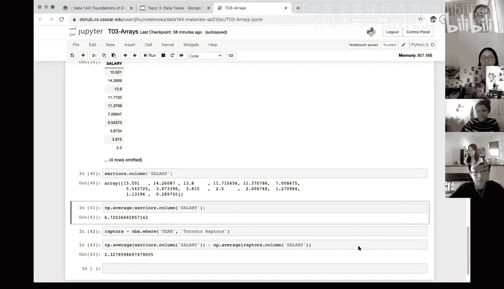

# UCB《数据挖掘和分析｜DATA 144 Data Mining and Analytics 2021》中英字幕 p13 [P13]lecture13-[T3 Data Types] Arrays-g2gy-8w-Kn8.zh_en [BV1efBEBuEVg_p13]

Okay， all right yeah， so let's get started I think Jason told me that we're almost down from the data types so I guess we covered numbers strings and types okay and then the last topic is going to be on a and we're going to pick that up from here。

All right， so for arrays， many of you， I guess everybody I should say have already worked on it to some degree and we're just gonna go a review but also like a view of the method that we have seen in the labs before okay so an array contains a sequence of values okay there are a few features of arrays that we need to take care of so we don't get confused later and sometimes if you run into any kind of error messages it's probably one of the one of the cases here that we forgot okay so the first one is all elements of array should have the same data type okay so we talked about types before like strings or numeric so if you're looking at an array in particular all of the elements should have the same type okay one thing to recall in this cases that when we're working with data table if you remember like each column right is the attribute or it's a variable and they're all have the same data type okay so let's see the examples。

From last week， let's to see the like ice cream cell if you remember like the different flavor and then the different price and different colors。

 things like that， so all of them if you think about those columns。

 theyre a particular attribute of each observation but the same time they're all from the same data type for each column。

Then if you're doing any kind oftic arithmetic computation it's going to be applied to each element individually so if I have an array and then I multiply like with numbers like say one two3。

4 if I multiply that with two then I come to a new array of two4 six eight okay so that multiply by two is being applied to each of the elements there。

Moreover， you can see more arithmetic we can do here when two arrays are added okay they first of all have to be the same size Okay otherwise you're gonna to run into your error message and corresponding elements are added in the result Okay not surprisingly and we're gonna see a demo soon as well Lastly pretty important is that I was using the array example earlier like the column example of a table in fact。

 if you're using the column method from a table you're actually going get that entire column in terms of array。

So with this in mind， let's go to our first demo today， which is going to show you。

 so it's on topic three here， okay， so open that。Right， first and foremost。

 always load the library and because otherwise you keep constantly getting into error messages Okay。

 so here's some examples about arrays Okay so the one thing that we didn't show in the slide earlier is that you can always make your own array Okay so if you see we're using this method called make underscore array and that I type in the element that I need and don't forget that I assign to some object in this case I name is my array because later I can do manipulation about it Okay so I assigned this and it's gonna to be array of integer here Okay12。

3，4。All right， let's see one of the properties we were talking about earlier any kind of arithmetic being done to the array is going to be down to each of the elements。

 so when I multiply by two okay two4 six8 okay remember this notation okay this is the power okay we're raised to each raise the power raise each element to its power of two so here we're going to get one4916。

Another example， if I add one element in this case still doing arithmetic we're adding one to each of the array it's pretty straightforward you're just going do my array plus one and then that add one going be add added to each of the elements okay Lastly this I think we are all getting familiar was now is that we never touched my array itself right we're doing multiplication we're doing power we're doing addition but we never touch my array so if we still look at my array itself is still going to be one two。

 three，4 of course if you think any of this you're gonna to use later then what you can do is my array new my。

Aray let just name it differently Okay， and then later I can access my array new here as well Okay。

 so this is just example have a question so。So you're making a new array here so if you want to add another integer or whatever it is you're making a array to the original you have to make a new array there's no way to add on yeah。

 no that's a good point So yeah so okay so share question and I can demo it here so what if I do this okay so earlier the example that I gave is that okay I guess that's relatively good practicing J like you don't want to touch the original thing like if I try to create a new one I better assign it to something new so well I guess the what okay let me show this the way that I'm doing here once I add the underscore new is that maybe later I want to use my array and my array new if that's your goal then you better name it in a different name and then do it however what Sha was asking is what if I do this okay so this is saying that my array add one so we're gonna get two34 or5 and actually assign it to the same name is before so if I do this I think。

Were still going to have everything fine， but then if we return it， it's going to be two， three。

 fourth by。Okay so yes， so this is a lesson I guess here is that you can always rename your original object and if you don't think your original object like one。

 two， three four I don't need it anymore so you can always do this but if you want to use both later then it's a better practice to choose a new name for it but regardless if I run it once like we just don't then it's gonna be two。

 three， four， five right and if I run it again well not surprisingly I'm adding one to each of the elements one more time right so this time I'm gonna get three four。

 five six。Okay， great question thanks go ahead yeah what if you want to change if you want to change the size of the array like for example now it has one234 could you just go back into the originals and make it one2345 Yeah Ray。

 I think yeah in that case you always need to go back to how you define it in the first place。😊，Okay。

 yeah， so this example here， what Samantha was saying is okay。

 I do my array now and then my new array now is one， two， three， four。

 five okay and then whatever follows follows。O。Sounds good。

 so just to make my later examples working I'm going to turn everything back into one two3。

4 and reround those lines up until here。Okay， all right thanks all right so continue here so this is when were manipulating each element by some kind of arithmetic okay by like multiplication by adding a let me actually do this one more time。

Now I should have done Okay， let me rerun it because I think I didn't change that line earlier。 Okay。

 so I still have okay， yeah， and and now we're trying to demonstrate the other arithmetic that we mentioned in the slide earlier is that what if I am adding two arrays together Okay so remember if you want to add them up you need to first of all have them in the same size Okay otherwise you're going run into some issue So here we're demonstrating with another array we call it another。

 Okay， use the make underscore array function here and then this new array is 56，7。

8 Okay so I run that and I add them together is just going be the element wise summation Okay based on what we have done So it's gonna be 6 a1012。

Because it's one， two， three， four， plus five six， seven， eight， okay？

And this is an example of what if you don't have the same size。

 then it's gonna to give you error message okay and sometimes the error message is useful like here opera could not be broadcast together with shapes well I guess maybe not so much。

 but then if you look at how they're describing it。

 I think this is saying that one of the arrays it has four elements whereas the other ones only has three so when you do the submission it doesn't work。

ok。😊，Okay， coolう。So now let's look at some arrays of different types， okay。

 for so far we're looking at integers or numeric values here lets let's make an array of different strains here。

 Ha he hole okay。And what this happens actually is that this kind of arithmetic really only makes sense to what we had do like say had done earlier with integers okay when you do this kind of multiplication。

 I know if you do like string at a time， you can do the multiplication， but once it's put into array。

 I think only certain types will work and then usually it's the type that we're familiar with like say numbers and stuff like that。

诶。All right， so there's a string array， we can initialize string array。

 but then the manipulation that we can do with it is quite limited。Still。

 it's useful like if you remember the ice cream cell example that we have certain columns right。

 like say the flavor as well as the color， then those are definitely string array so it is still useful whenever youre making array of a different data type Allright so now we come back to my array which is one。

2，3，4 okay so other arithmetic you can do functions such as like sum can be applied and max and then absolute value things like that you can think of okay so some when we do that1。

2，3，4 add up together is 10 okay and the average so maybe this is the first time you have seen average we're using the average function from themp library where we have loaded at the beginning nu okay we do if you remember import and then the name of the library and we always use a short form for it so we don't need to type the entire name every time so typically people have Ny is really widely used and people like to。

Use MP for it okay so the average function that we're doing here is from this library。

 so remember if we do that we always use the dot after the name of the library and then type the name of the function。

So if we do that， while it's 2。5 because total is 10， right the sum is 10， there are four elements。

 so the average is 2。5。One last thing you can always return the length of an array well this might not be as interesting here because we actually create the array our and we know that it's one two。

 three， four is four elements， but sometimes you might be dealing with a really long array and then you really just want to get a quick count out of it then LEN is a good handy。

Function that you can use。Okay yeah so again the demo is available on our course website so feel free to check it out and one last thing I want to demonstrate in this demo is that if you remember from the slide we're highlighting that a column of a table is an array this my sound intuitive since I was using the example about the ice cream and then think about each column and things like that but let's get into it a little bit deeper because there are two different functions that we can use on tables I would just highlight them now so we're gonna see it soon one is select you have seen this before we're selecting certain column okay the other one is column okay so one of this gonna actually return us another table of those column like the particular column that we like the other one actually gonna return the array。

Okay so it depends on what we're going do or what you're going to do with it later on you might choose one or another Okay this is just a highlight overview and let's now get into the specific examples of MB if you remember the NBA salaries I think it's season 2015 to 2016 and then it has different I think positions of the players different team names and then salary etca。

 etc cea Okay so okay actually let me just。Show it right we have MBA show。

 I mean just do the first four okay。Yeah， if you remember the yeah there is also the player name。

 sorry about that so we have the player name as a column position of that player。

 the team and the salary in I think million dollars。Okay， so just to refresh your memory。

 this is what we worked on before。 Allright， so this is reviews。

 but also preview and overview of how to use a in terms of the columns of tables So if you remember the where okay we are selecting remember where has two inputs right we're selecting the team which is Golden Stay Warris Okay so in order to select all of the rows only about team warriors。

 what we do is we use MB that's the name of the table we do do and then we use this where first input team second second input is Golden Stay Warris So if we do that then we're left with and don't forget I'd assign it you should always assign it to something that you're gonna access later So here we call a warriors just the name of the team and then so you see that now this entire table that we're seeing over here only contains the rows about go to golden。

warriorriors players Okay so this is the first step Okay and okay。

 so my demonstration here about the column， whether column is a column or column is a array， okay。

 especially what you're going to do later is here So if you just select which I think we have done before in the lab that we're trying to create a new table if you remember like only selecting certain columns then if you want to do that you're going to use the select function。

Because once you do it and if you return it， you can see that it's still going to be printed out in a column format okay so for example。

 if I now want to assign this to a different object， say like warrior salary， something like that。

 then I can do that and then if I access that object it's going to be given me a table with single column。

However， if you use the column， sometimes it's useful， the column。

 the column function here is actually gonna return the entire column as an array。

 That's what we mean by actually the column can be returned as a data frame。

 if you want to use it later as a data frame or if I do which we're gonna demonstrate a second if I want to do certain kind of summary of that particular column then I will probably use the column method so let me return that to you so you're gonna see immediately here。

 see here once I do the column it shows me that it's gonna to be an array and it prints out the values for each so see how the two different from each other and also like I said doing the select you might use it later。

 especially if you're gonna select multiple columns to create a new data frame。

 that's what we usually do use the select okay however if you want to do summaries like what we're gonna see soon like if I want to know the average salary of warriors players。

If I want to do that， then themp do average， that method should be applied on the array。

Not the column itself。That's why it could be useful that you're going to use the Warriors。

 column in order to return the whole column as an array。

 then I can do all kinds of arithmetic about it if I want。So this again。

 we covered this in the arrays lecture because while we first of all talk about all of the arithmetic you can do right about an array and then now in terms of like now moving from CS to data science here then we're thinking about how to summarize particular columns especially numerical values here that could be useful。

 then we still focus on the idea of array， so in order to get the array we can use the dot column method。

And then we can do all kinds of arithmetic we're curious about。Okay， so I around this。

It's going to give me the average okay， 6。7 million。On average， for the Warriors team players。

Make sense。Makes sense， all right， last demonstration is what if I'm curious about the difference of the average salary of warriors compared to the average salary of Toronto raps？

So to do that now okay we already did MP average of the salary of the warriors right。

 and now if we want to compute it against Toronto Rectors。

 we can do where again to select team which is Toronto Rectors and we assign it to a object which we now we know is going to be a data frame about rapctors only。

Okay and then lastly we select oh sorry doing the doc column method on the raps as well。

 and then from there we can do the average and then we take the difference of the two in order to get the answer to what we were curious about earlier。

 what is the average。What is the difference between like the difference of the average salary between the two teams？

So you can see that we always use the dotware to select certain roles， satisfying certain conditions。

And then in order to do arithme manipulation on numerical columns。

 then we are doing the dot column method to turn it into array。

 and then we do our arithmetic based on that。Makes sense， overall。Okay。

 yeah sounds good like I said I think some of this we have seen。

 but then now we get the chance to formally talk about what we mean by arrays and then all of the details here and there。

Okay。All right， sounds good， any quick questions before we move to our new topic of building tables？

Okay那啊 okay sounds good。Let me stop recording here。

