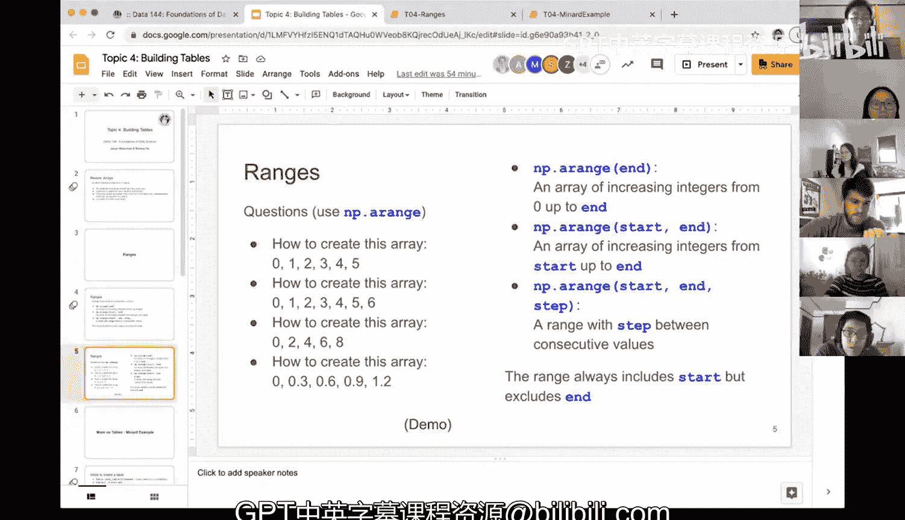

# UCB《数据挖掘和分析｜DATA 144 Data Mining and Analytics 2021》中英字幕 p14 [P14]lecture14-[T4 Building Tables] Ranges-mF-qG9wB8go.zh_en [BV1efBEBuEVg_p14]

Okay， so now our new topic。For today。Is if you go to the course website。

 you will see building tables， okay？So we have seen several examples of tables now okay and now we're going to build more and part of it is a review of what we have seen part of it is some new skills and then terminologistologies here and there so all of them will become super useful later on okay so here we provide a review of arrays but we just talked about it and just again remember same same data type okay and arithmetic is applied to each element individually they have to be the same size if you want to add things up or take the difference and then lastly a column of a table is an array and then we can do arithmetic about it。

All right， so for tables， okay we're going to get into more about building tables and then thinking about table and manipulations and before doing that we need to introduce one more concept here。

 which is ranges， okay。So。Rangs as you can see， range is array of consecutive numbers okay and just now we made array if you remember 1。

2，3，4 okay I can use my underscore array and then parentheses 1，2。

34 with commas in between I can create array in that way but sometimes like you want to create like say one through 100 does this mean that you have to type like 12。

34 up to 100 then might sound a lot of work to do so in fact there is a handy library or handy function here that can do that for you if you're working with consecutive numbers okay so when I say consecutive it could be 12。

34 okay but you could also be 1，3，5，7 odd numbers things like that so as long as they're consecutive and then with the same numbers in between then then you can do this method okay so the method actually is coming from the non library so it'smp so we use MP again。

And。The method name is a range okay， and if you do only one input。

 it's going to be an array of increasing integers from zero up to end。Okay， just as an example。

 if I do MP dot a range parentheses5， then what that's going to do。

 as you can see from the note like from the definition here。

 is's going start from0 up to5 but does not include5 Okay so that's the thing important to keep in mind Okay。

 so if I do MP dot a range 5 is going to be 0，1，2，3，4 but not five。

So that's the case when you only input like do one input。

 but this function actually you can do multiple inputs， so if you also start like add a start input。

 then it's going to be an array of increased injuries from the star value that you choose up to end。

Okay， so if I do star as zero， then it's going to be the same as the first version of only inputting end。

 but if I start with some non zero value， then I'm going to start at that value and then。

Going up to the value of end， but does not include end。So if I do start with one and it' five。

 then it's going to be one， two， three， four， exactly the my array that I created earlier by typing out each of the element。

You can also do step okay so that's what I was saying that as long as consecutive numbers。

 it doesn't have to be like one， two， three， four like with only one value different you can do two。

 three four exactly like depending on what kind of thing you want to do so this will be arranged with step between consecutive numbers。

Okay so I will do a demo soon based on these definitions。

 but just to highlight one more time the range always includes the start。

 but it does not include the end， so if I really want one， two three， four five I need to end a six。

And then start at one。Okay， now one thing you might know is that here the third option。

 if I add the step I can start to add different increments。

 so the default of that is always one okay that's why like in this two versions here if we don't specify what the step should be the default is one so we're getting one。

 two three four， things like that。All right， we'll do the demo in a second。

 but let me actually ask you to brainstorm this。😊，Different scenarios here Okay I have four questions for you on the left Okay the notes that we had from the previous slide is kept on the right So I have four questions for you to think about I would just say I do want to put you guys into breakout rooms to discuss this So maybe either you write this down like the four different exercises here like0 to 50 to6 this for in a note in your note or you can just go to our website and open this slide and this is I think slide 5 Okay so so then you have you know what you're gonna be talking about once you go to the breakout rooms because you won't be able to see my screen anymore once you're in the breakout room okay。

So let me stop share here and I'll come back and yeah， so for those questions。

 let me share my screen。Yeah so we're going to keep this here and I will just let's just talk through this one by one and then again the cheat sheet is on the right hand side hopefully it's useful and then we're going to go to the demo right so for the first one zero to five。

Anybody wants to just speak up to show what you think we should do in order to get this array Would you domp。

arrange and then six yeah that will do and if you want to do like super comprehensive you can do NP arrange zero because that's the start right comma and then six that will be the end and then snap goes do one okay but yes。

 for this case and I guess for the second case as well you can just use the end is one input and then you're gonna get it。

Okay so the second one， I guess I will just answer that quickly， so if you domp。 range of seven。

 then this will give you this particular array Okay so it goes up to end but does not include end。

All right， what about the third one， how to create this array， zero，2，4， six， eight。Anybody。

Would it be？NP do range zero to 10 step two yeah okay yeah so Samantha was saying that we can do start zero n is 10 okay because end again is not included okay and here because the step step step size is two so we need to specify that third input as well。

Could we use nine instead of 10 question so Julianne's question here is that what if we do MPD range zero9 and then two？

Any he guesses here we're going to do a demo quickly about that as well。

 but what do you think can we also get to02，46，8 by putting the end as nine？

My guess is that it works I just wanted to check Yeah indeed yeah it is gonna work So if you're gonna yeah so end again you just never go up to it right goes close to it Yeah so if you do 9 I think you will do fine and then we can also try later what if I do like 9。

5 Let's just see what happens Okay but then of course if you do 10 that will be fine but if you start to do 11 then probably not because it's gonna go up to 10 you won't stop until 10。

So those are some tricky scenarios， so that's definitely a great question。And what on the last one。

 step size here is 0。3， right？So my start， I guess， will be zero my end， I guess is anything。

 I guess greater than 1。2 right， but not as great as 1。5。Oh sorry， never mind let me take that back。

 I cannot go up to I cannot do greater or equal to 1。5 but anything below it， but greater than 1。

2 probably will work with the step size of 0。3。😊，Allright。

 so let's look at those demos that we have in mind okay but again you can always create。

 I think all of you know by now you can always create new cells in those Jupyter notebooks and try it out yourself okay like the question Juliana asked earlier what if we do9 instead of 10 can we also get up to 8 that would be a great example that we can try in a second once we go through this ones first okay all right first always round the beginning so we're able to get the libraries loaded okay so here arrays of zero to6 okay and we can domp so that's answering the first part of the question the second question I think this is just another example if I want anything not starting at5 not starting at zero I can pick my particular starting value okay this is going to0 to 18 if I do 20 and then with step size2 okay and here's。

R to Juliana's question here， if I do zero as the start and as 21， then I do two as the step。

 so this is the case that is going to go up to 20。Because the n is 21 it won't go up to it was only go up to 21 but not 21 then plus 21 wouldn't be printed because it's only even number okay so this is the case that you can do this and let me just add a cell。

Oh sometimes you see it's very easy to accidentally delete itself anyway， I intended to do。😊，Okay。

 add here。 And let's just do 19。 Okay， because this is more related to Gil last's question earlier。

 Okay， if I do this， I think it's going give us the same thing。Okay。

 because you won't go up to 9 you won't go to 19， you will go up to 19， so 18 will still be printed。

And my other comment just now was， okay， what if I do not do an integer as my hand？Vally， okay。

 what if I do 19。5 okay， I'm still having step size two。What do you think this might happen？

going to get zero24 right probably up to 18 but what's interesting here is that it starts to have a decimal point。

 even though all of them are zero Okay so I think this is because we are using like at least one of them either both or like as both or one of the starrow and values starts not to be integer but just like。

A double point， double， then it's just going to go with the double okay。

 but I guess in essence it doesn't really make a difference。

 but then it does show in a different format here。All right， so with different step size。

 we can also do0 one or like the earlier exercise will be 0。3。

And one last thing I would demo is you can see that， well。

 we can always assign like what we had done before。

 whatever the array that we created to an object so later we can access it。Okay。

 so if I do MB dot arrange8， so I know0，1，2，3，4，567， okay， so that's my a okay。

But let me show you one thing， like say this stop item。

Its a useful function to be applied to an array if I want to access certain index right now。

And notice the one that I'm picking is eight。How many objects do I have here。

 one two how many elements， I should say， one， two， three， four， five， six， seven， eight okay。

 I do get exactly elements。So what if now I put eight in my parentheesis？

Do you think it's going to get me seven， the last element？Maybe， maybe not， maybe， okay， let's see。

Yeah， apparently Python does not recognize like this， whatever input as the index， okay。

 is going to be index plus one。This is just like some tricky thing here So what I mean here is that well although I'm trying to get the last element and I know if it's indexing。

 I know it's going to be the eighth one。But apparently， this is because if you remember。

 the array is always trying to like MP dot arrange is always starting at zero。

So it's always sort of like had a one plus like a plus one index at the beginning。Okay。

 so if I do want to get the seventh or like the eighth one。I actually need to do。

Seven is the index to get the eighth1。It's a little bit tricky and I don't think it's going to happen too often anyway。

 but I do want to show you that this is possible， so sometimes it could get a little bit confusing。

What about a raise that don't start in zero。 Yeah， good point。 So I think， yeah， good point。

 So I think the array， Okay， let's do like a Bmp range Okay， let's try out Juliana's question。

 Let's do do one9， Okay， so we still get eight elements here， Okay， and my B， Okay， Okay。

 so how about I'm getting8。All right， so apparently like it's not really about like the starting value of whether it's zero or not。

 okay， it is like about the indexing so I know if we do count。

Clearly this is the eighth element right and I really just want to get the eighth element。

 but I guess a lesson here is whatever when you're using the item function here and then the index that like the value that you type is index plus one。

So if I really want to get the eighth one， I have you to seven。And again。

 this is pretty specific to Python so like if I do seven here I would get eight sorry the numbers are just like a little bit confusing as it shows here。

 but I think you get my point that even though you can use item to get each element as you like but then you need to do the index correctly okay so if I want to get the first one so maybe easier to think about this if I want to get the first item I have to type zero。

Okay just because the indexing works in Python in this way and we're going to see that later as well。

 I think when we're later going to work on particular。Data frames。

 for example and I want to look at the first row then the indexing actually starting from zero so if I want to get the first row I have to get like zero more row even though it looks a little confusing at the beginning。

 but I'm sure like as we see more examples and then practice more we'll get more familiar with this。

Okay。Sounds good。Anything else？Okay， cool。 Alright， so that's the ranges。

 So let me stop recording here。

For this part。AndThen we' gonna。