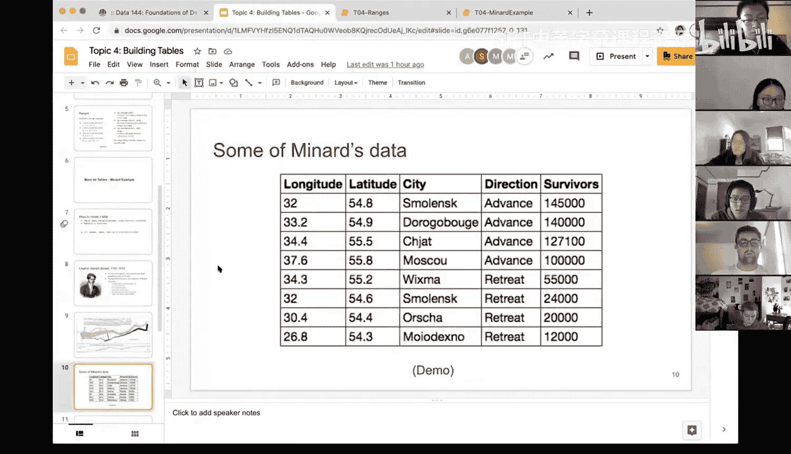

# UCB《数据挖掘和分析｜DATA 144 Data Mining and Analytics 2021》中英字幕 p15 [P15]lecture15-[T4 Building Tables] Minard Example-nrdK59w0MmU.zh_en [BV1efBEBuEVg_p15]

To the new topic， right？

The new topic of our table building tables is more on tables okay and we're actually going bring an example of mean arts so some of you might know the name。

 some of you might not maybe from high school history or whatever history before and but anyway we're trying to use this as an example to show more manipulations about tables and that can go a long way for us in data science。

All right ways to create a table okay we talked about it a little bit if you remember from last week that we're creating a table well I guess well maybe not when I was teaching maybe Jason did some but let's just show you a few ways to do it first one is the one that we have seen already table dot read underscore table and then the file name。

That will read a table from a spreadsheet or a CSV file So most of the ones that we have seen if you notice like how they ended like the extension of the file is CSV Okay comma separated file Okays you can think of as a spreadsheet is you saved slightly different and that is reading it from a outside source okay and we have seen that I think most recently with the MBA data set but soon we're gonna look at the meanar example in a second and that's how we usually read a table from an outside source。

You can also create an empty table we're going to use we're going to do some demos there soon as well and while of course when you create a create an empty table or like a new table adding new columns and things like that make sure that you always assign it to some object so later we can access to it Similarlyly when we read a table from a spreadsheet and then we always name it like say the MBA data that we just name MB so later whatever。

Things we do to the table， we distribute MBA dot， whatever the function that we're going to use or method we're going to use and then go from there。

Okay， so once we create a new table， the select function。

 where source and all of the other ones that we have seen can also be used on any kind of tables。

 whether it's red or like source from outside， or if you create a table yourself。All right。

 so keep those in mind we're gonna go to more examples once we get cover the basic of the Minard example so Charles Joseph Minard 191781 to 1870 in quite long longevity back in those days so he was say French civil engineer who created one of the greatest graphs of all time especially if you think about back then people don't have computer well many things are really hard to calculate by hand for sure。

 but then I should also say that I think back then people are super creative as well when they're creating graphs and then this is definitely a great example maybe later in the semester we're able to introduce some other examples as well so for this one what were gonna look at is he created a visualization of Napoleon's 1812 invasion of Russia okay so imagine he was trying to include all of this information into one graph okay the latitude and longitude of each city when the invasion was taking place。

Okay， of course， also the name of the city also because it's an invasion like going forward。

 he was also recording the number of soldiers at each step。But at the same time。

 also the direction of the March， okay， moreover， the temperature or the return journey。

 as well well when each city or how the invasion at each step happening on particular dates in November and December。

Just imagine like how much information that graph has to include and then now let's turn to the graph。

Whi is pretty impressive and really nicely done okay I'm going to take a pause here to let you take a closer look of this graph just to see what we mean by well he was trying to include if you remember the name of the city。

 okay， the date okay， the temperature， also the number of soldiers。Okay， also like we were saying。

 the direction of the March。Okay。And oh， latitude and longitude of each city。

So it does include a lot of formation like you can see over here， pretty impressive， like I said and。

And I also think back then people are really creative now people were creative too I have to say。

 but then computing resources really empower us， but also I mean someone who've been working in this field for a while by now I feel like sometimes I am a little bit restricted in terms of what kind of plots I can make because of the sources I have or like the computing programs I have maybe I restricted to some degree that oh for that kind of data I always gonna to use this kind of visualization and I think all of you will gradually get into that as well。

 but I will also urge all of us to be creative especially when things are pretty rich in its information and then we can sometimes think outside of the box of what kind of plots we can do。

Okay， alrighty， so just to bring us back to the data source and then think about what we can actually do with the Python here。

 this is actually if we load the data like somebody clean up this data Okay， and then this is。

A screenshot of some of the data observations in this data set。

 you can see that it has the launch you led you and the CDA， okay， also direction。

 whether it's advance or retreat， and survivors， which is the number of soldiers at that point。

OkayAs you can see well the fibers while starting from the beginning right and then it's advancing right。

 and then after four the last four rows are talking about retreating and then the number of soldiers while slowly decreasing and then in the end is probably only about 10%。

Allright， so this is the data set if you look at a screenshot of it， but let's go to our demo。

 which is the second demo here Minar example okay notice that here we're trying to use this to demonstrate like creating tables as well like using all different kinds of functions that we can apply to tables for our purpose so this is where we're gonna get started so we load the library okay and the data okay it's Minar。

csv okay so this is if you now see it more carefully okay remember we're saying that if you're reading a data set from a spreadsheet you can use this method called table do read underscore table in the parenttices typically is a CSv file that you can download or we provide it to you。

And just keep in mind later on for the course project when you yeah。

 we're gonna to announce that soon， but when we get started doing that。

 if you're like collecting data yourself or're downloading a data from online then what you need to do actually is to put this whatever the CSV file that you're gonna have into the same working directory and then from there you can do this table read underscore table method in order to reading your own data set right now all of the data sets we're providing it providing for you so you don't need to do that step but then once we get to this step of doing projects we're gonna do more demos of collecting your own data putting into the right data directory and then go from there。

All right， now we save the data as we know into the object of mean art， okay。

 so this is what we mean， okay？We have the longitude latitude city okay direction and the survivors okay Alrighty so let's do a few things okay。

 especially if we're curious about let me put in this way there's so many things you can do about this of course and I'm now saying that we're going recreate whatever the visualization that we know already did before but let's let's maybe focus on some of the questions okay maybe one thing we could do is that I want to know the percentage of survivors okay at each step of this invasion okay advancing and then retreattweet。

If you look at this table， we had the longitude latitude。

 probably not really useful for whatever we're trying to do in terms of getting the percentage of survivors。

And most likely if we look at all of the five columns here。

 the survivor's column going to be really useful， okay that is giving us the number of soldiers okay？

And my question is， okay， how can I quickly manipulate this table in some way that I do want to get the percentage of survivors？

Compared to the initial stage of the invasion。Okay。

 so if we don't like don't worry about like how to do it in terms of coding。

 if you just think out loud in terms of answering that question。

 what we really need to do is that we need to get this survivor's column right we need to do something about this okay and again it's array okay once we do the column it's going to be array so we're going to start doing certain manipulations about it。

So if I want to get the percentages or like the percentage alive starting from the beginning。

 essentially what I need to do is that I need to get this column， I need to get all of these values。

 okay， I need to I probably I most likely I have to like take the ratio of each of the item over the first item because that's the beginning stage。

Okay， so mathematically that is what we need to do if we want to get the percentage alive， okay。

 we need to get that column， we need to do the division， okay。

 column like element by element division by the first element because that's the initial value。

Okay so keep that in mind because now we're gonna show you how you can do it through Python。

 but a lot of times you have to think ahead of what you actually want to do with the particular column and then you're going to design and think about the steps that can achieve that okay so I am now giving you all the goal of creating percentage life so we know that that's what we want to do we want to take the column of survivors we're going take the ratio of each of the elements with with respect to the first one so we're able to get the percentage。

Okay， so now let's see what we can do how to do that okay， a few things。

 well select now just one more demonstration of the select versus column。If I do select， okay。

 we know that it's going to keep a new like create a new data frame actually with one column in this case。

 okay， only the city， but if I do column if you remember then。I'm returning away。Okay。

 and we're turning our away in this case， it's a string array because all of them are just name of the city okay。

Allright， so back to our original goal okay we wanted to create the percentage alive okay so between select and column because remember when we do column we're able to get that like get that column as array and that's going to be a numeric array that we are able to do arithtic about okay so in this case we better use column okay so we're getting a and each of the elements is the number of survivors。

Okay， all right， okay， so let's get started。 like I said， we wanted to create a percentage alive。

 maybe one extra column there added to the original data frame that we're able to get that percentage。

 So what we can do。 Okay， so first of all， remember， the percentage has to be。

Created by each of the item， each of the element in that survivor's array divided by the first one the first one because the first one is the initial stage so we do need the initial one one way or another okay so the way to do it as you can see we do the mean our doc column and then survivors so that will give me the array okay and now this is a demonstration of what we are discussing earlier if I want to get the first element of it I can do dot item remember but then I have to choose zero because the indexing goes that way。

Okay so and then I assign it to initial size because I'm going to use this object later on so let me round these two lines and show you what I mean okay so we know that the first item is three4 340000 okay that's the initial stage in order to get that we have two steps okay first of all we create this array。

And once we get the array， we want the first item。And we know that you get the item。

 you can do dot item。And then you get the first element， you have to use index0。

So with this two steps combined， you're able to get this initial size as 340，000。

 which is the initial sta size of the， I think， number of soldiers。Makes sense。Okay。

 so now I have this initial size as a object that I saved of with that particular numbers。

 so I know the entire thing that I need is going to be the survivor column earlier with the array divided by the initial stage so I'm getting the percentages here。

So this is the array， final array that we want。Okay， and this is giving us the percentages。Lastly。

 let me show you one new thing that I think probably new to everybody is if you now have a array that you created。

And you want to attach that to your original table。

The way to do that is while you have your original table name meanard， okay， dot。

 the method is called with_ column。Okay， so what that does and you can see that there are two inputs here。

 the first one is the name of the column that you want to give it to it。

The second is what we just repeated of this percentage calculation from the previous step。

So what this does， as you can see， is that I'm adding a new column called percentage Al PCT Al。

And then that column includes the percentage of the lives that we are able to calculate。

And notice this is actually also a good reference to one of the earlier questions that we talked about earlier is that I can always reassign the object right with the same name。

 so if I do this like Minard and with column and then now I assign it back to Minard then my meanard going to have this one extra column that I want。

So this will be the case that maybe later on I don't want to deal with the original data frame anymore I always want the new data frame with the new column so this is a good practice here that I always I can assign it back to the original name so I can just work with that。

Okay， so let's see what we have achieved， okay， once we have done that。

 see the new column is called PCT alive okay， and each of the items here correspond to the calculated values that we have earlier。

Sounds good。Sounds good okay yeah， and then there are some other things we can do like set format if you want the format in a percentage format so now we're like one which is 100% right 0。

5 is like 50% so you can actually use the set underscore format function to reformat this percentage of live column and the way that we do it is called percent formatter this is again。

 you probably have to look it up to know the particular input option here。

 but this is just a demonstration if you want to put in percentages you can use this function and again this function is being applied to particular column right so you have two inputs in this function the column name and exactly how you want to format it。

And then lastly， if we do one more time with the column。

Because we never assigned this to Minard right we only just did some formatting we didn't assign it to the Minard data frame so we actually haven't changed that column this is just one more demonstration of always make sure that if you do something to your column and you actually want to keep it for future use you need to do the assignment step。

Otherwise， we would never change it Okay， so let me demonstrate one more time here if I do assign。

This new thing to Minard。And then if I do call them， oh。

I guess it doesn't matter never mind let me take that back I guess the presented format thing probably doesn't change much this is really just showing us like a way to show the results。

 but if you return it as a column which is array I guess just like printing out either way in this case is mostly just the integer value sorry the decimal points instead of a percentages but they're the same thing so okay let me take that back this is just one way to show how you want to if you do want to make that into a percentage format then the set underscore format function will be useful。

Okay， let me just like recap because I know it's a lot going on Okay。

 we started with the Minar example， we load the data okay we decided that we wanted to create a new column called percentage of life and we know that in order to do it we have to divide each of the element okay in the survival column we need to divide that by the first element in order to get the percentage so that's well the goal and then we show you step by step of how you can do that through Python Okay first step is that we actually first of all make sure that we do we we choose to do column in order to get it as array。

Okay second because we need to get the first initial size because that was still saying that we're going to divide for each of the element and it's going to be array manipulation right so we better get that item first and the item index is zero just because Python works in this way and then we actually want to save it so later we can use it。

喂。And then the third step is that we know that well， in order to do that rate。Manipulation。

 we select the column which it becomes array， right。

 and then we divide it by the initial size that we calculated so we can get the percentages。

But then of course， we learn something new today， we're able to use dot width column。

To actually add that new array as a column into the original data frame。

The way to do that is that the with underscore column function takes two inputs。

 the name of the column name。And then whatever the column that you really want to be。嗯。

And we also show if you really want to have percentage format of showing that column。

 you can do that。AndBut also， always make sure that if you need to add it back to that original data frame。

 you need to reassign it to the original name because otherwise all of the manipulation you're doing is only just with on it。

 but it's never affect the original version。Makes sense overall。Okay。

 yeah so this is actually pretty important and useful later on and I think again through lab and homework you're going to get more exercise and don't get frustrated I think a lot of times it's it's really challenging to even just think it through what you are trying to achieve and then of course to achieve that you have to。

Synthesize the stuff that we have learned and figure out the ones that is most useful and it does take time and practice so definitely reach out whenever you have those questions and then we're always happy to help but like I said always useful to look at those demos runner yourself and then convince yourself why ST works in the way that we want it and that can definitely be a really good learning material and then learning experience for you all。

Al righty， so。