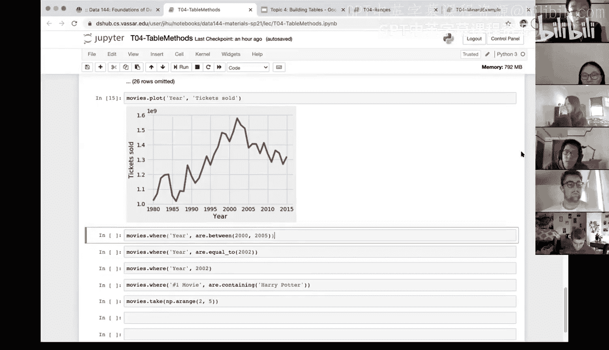

# UCB《数据挖掘和分析｜DATA 144 Data Mining and Analytics 2021》中英字幕 p16 [P16]lecture16-[T4 Building Tables] Table Methods part 1-njI5gmxlKbo.zh_en [BV1efBEBuEVg_p16]

Sorry to cover the last topic， so we would be good to go to the next topic on Thursday， okay。

All right， so a few more table methods like I said we have covered a lot but there are always more to learn and always more to that can be useful so let's go over some of this so this is again might be a little bit boring we're going through what we have learned but sometimes it's a review like I said but sometimes it's new and even if you have seen this all of them before is' always good to review some of this because again practice mix perfect so creating an existing or creating and extending tables okay so creating you can read it from outsource okay or when you're extending a table when we say extending we're adding new columns so that is the width column method that we have seen just now。

Okay。And find the size of the of the table Okay， so this is really useful like once you have the table name。

 we is use T to represent it， you can use numb underscore rows or numb underscore columns to get the size。

 which is the number of rows and number of columns Okay number of rows give you。Sorry。

 the number of observations in the data set and the number of columns gives you the number of columns or attributes in this data set。

Referring to columns， okay， you're able to do well you're able to choose like labels or relabelings or using indices。

哎。For example， if I do T， which is the name of the table that we're working with dot labels and dot or dot relabeled we're able to select if you remember like choose those columns as well as relabel it into certain way that you want Okay I think in the MBA data set that we have seen I think salary was probably small letter and then we always relabeled as a capture letter just to be consistent with the different like all of the other column names okay and also column indices star as zero okay so actually in Python I guess anything the inices are as zero so it's always a good lesson to keep in mind。

Accessing a data in the column， okay， so here， just keep in mind， when we do do column。

 we're taking this column or label and returns the array。Okay， and earlier。

 if you remember if we do T dot select then its actually returning into a different data frame with that single column okay。

 but of course when you do select you can select multiple columns so that's another story but what I'm trying to highlight here is that only t dot column going to return it as an array。

 but then if you do T dot select it's not going to return as an array it's going to return it as a data frame again a table again。

Lastly， using array methods to work with data in columns okay we can do t dot item some minimum max。

 so again all of the arithmetic that you're able to do once you turn a using the T dot column turn a column into array you can do all kinds of stuff just like what we showed earlier like trying to get a percentage okay if you also want to do create a new tables containing some of the original columns okay you can do T select okay like when you do that if I want to have multiple columns I just put all of the in quotes and then with comma separating them I can also drop certain columns I don't want to work with anymore and we have seen that I think in the lab as well。

All right， so let me do that demo now， so I know we do watch the time。

 but I think we should be able to get to some of this at the least。All right。Okay， so I think yeah。

 actually this is new I think to most of you create a table from scratch okay from scratch like I said。

 we're going use the table parenthsesis and then dot with column to create the new columns so before doing that let's just say our goal here is trying to create a table four different Vasor dorms okay and then also the year like year built for each of the Vaad dorm four of them okay so we're creating a table from scratch okay so now let's see how we can do it remember each column is a array each column of a table is array okay so if we're creating a table from scratch we're really starting from scratch by creating the array first and then trying to put it together into into the table format All right so we're gonna start with door names okay we're gonna focus on strong Raymond Davisson and noise。

All right， so once I do this， make array， okay， there are strings， I put quote in them all around it。

And then now I'm going to use this table parenthesis underscore with column you remember this the first input is the name of the column that you want where just use name right now is the name of the dorms okay and then the input the second input is actually the array that we just created so if I do that and assign it to dorms now I start to have a single column data frame okay a table with only names。

All right， that's one thing and like I said we also like like the year built those information is given to you and then we want to add that into our original。

嗯。Original table so one thing we could do is remember wave column is always what you can do right you can I have the first input as the name of the variable and then the second is the array itself so let's do this first Okay so this is well。

If I do dorms dot with column， if I do this and just return it。

 this seems to give me like a two column table。Right okay by the way that we're doing it already have the name and then we're adding the column of year built however。

 this is just to highlight one more time， unless you assign it to dorms otherwise the new column is not added Okay you're really just demonstrating that you can add it but only if you assign it to like in this case the dorms which is the name of the table otherwise we're just like showing that you can but it's not being assigned so in order to do it okay always make sure that you assign it to whatever you want it to be named。

And then you're able to access it later。Okay so look at between these two okay all right and then lastly we know that labels okay so labels also columns。

 so if I want to return the list of the labels of a particular table I can do the name of the table dot and then labels in this case I have names and illbu okay so I can know the two names if you forget about them but I guess you can always see it from the table itself。

The second thing is what we showed earlier， the number of columns and then the number of rows。

 in this case， the number of columns is two， the number of rows is four。

Okay so this looks I guess straightforward enough， but like I said。

 when you're working with a really large data set， like once you like read that into your notebook and then you have a really large data set with large number rows and large number columns。

 then those labels like labels method and then the non columns and non rows method will be really useful as well。

Okay。All right， one last thing here， let's look at selecting data in a column and we've been talking about different ways to do that already okay and this is just one last one new demo here。

 this is movie by year with ticket price okay from I think 1990 to 2015 something like that so let me load that data for you。

And this is the set， it's kind of long。Is listed from a decreasing order okay of the year and then the average cheek price of that movie。

 the total gross， I think in millions okay， number of movies。

 sorry for that year and then the number one movie。Okay。

 so this is a data set like as a movies by year with ticket price， it shows you the year。

 each row represented a year and also the average ticket price for that year。

 I think total grosss number of movies and then also gives you the top rank rank one movie for that year。

Okay so rich data oh yeah， it goes back to in 1980 s。

 I guess okay alrighty so here like I said this is total gross in million so sometimes people actually do not like the format they really want to see in the full for size so what you can do see what we're doing here。

We are creating a new array， Okay， called gross in dollars instead of a million dollars。

 So what we did is you do the movie dot column and then we select right， remember by doing this。

 we're getting it as an array。Once you're getting an array you can do all kinds of arithmetics。

 so we're multiplying in by a million like 1 e6， so we're able to get the gross in dollars。

And to why we do that， we actually want to know the number of tickets sold。

Okay so in order to do that， well， we get the growth in dollars because well this is total gross in million dollars but ticket price is in dollars so we need to put in the same unit okay。

 so we get the total gross in US dollars and then we are dividing right by the average ticket price in that way we're able to get the total number of ticket solds for that year。

Okay so again， this is like a test I give to you so we're following this logic but like I said a lot of times you have to think a little bit more about what kind of stuff you actually want to return and add as a column okay but regardless you always have to think about that first and then decide and think about synthesize the methods that we have learned in order to show that so anyway so what I've done here like I said is that we get the ticket sold and I'm trying to attach it add it as a new column to the original data set which is movies okay so let me show you that quickly。

Okay， so all the stuff that I did。We'll be able to add the new column called Tick sold。

And the way that we have done it is we do calculate。

 okay we had calculated the ticket sold based on the math that we understand that use the correct code to do that and then also use the with underscore column to attach that into the original table。

Okay， of course， well， if you want a different formatting like this is again。

 I guess scientific formatting， like computing formatting， but you can always like show the exact。

 well， you know， there's some digital like decimal points doesn't really make sense， but you know。

 because it's just the average that we took。Once we get the number okay one last thing I will do I know we're on the top of the time so well see more of this soon one thing we could do is that the plot method can also be applied to a table if I want to plot the year and the tickets sold one against each other Okay so I just want to do a quick demo there okay。

So on the X axis is the year that's the first input of that plot method。

 the second input is whatever like here is ticket sold so we're plotting tickets sold against here。

OkayAnd this already， I think tells you a certain interesting feature right slowly going up around I mean up to like 2000 2003 inch right。

 and then it starts to drop。Okay so this is what we usually talk about is visualization okay a quick visualization of the data can tell you something that you really want to dig into later okay it doesn't tell like it's it's way to summarize information okay。

 but then of course。Were learn more methods in order to do specific things over there。

Okay so I think yeah since we're out of time so i'm going to stop here。

 I think Jason Norths are going to resume with this table methods and then we're going to move to the next topic。

Okay， so once more， all of the demos are on our course website。

 so I strongly recommend I'm sure many of you are doing that already of going over it or even beforehand if you want because we post it before the lecture if you want to get ahead。

Has started on that and yeah so on Thursday we're gonna continue and then start the new topic and we're gonna have a Friday lab as usual okay we're gonna post it beforehand so you know some of you want to work on outside of the lab time but make sure that you're always checking with the coach or me or Jason to get you checked off for your participation great and lastly I think homework one is due tomorrow I hope everybody is making progress and we have office hours Jason is having office hours now and then like I said starting today the coaching hours gonna start so make use of them the link is different and link is on the course website so click the right link to talk to the coaches if you want and I have office hours tomorrow so hopefully that can cover all of your questions about homework one before it's due。

Alrighty。Okay， sounds good， yeah， great turnout， everybody's here。

