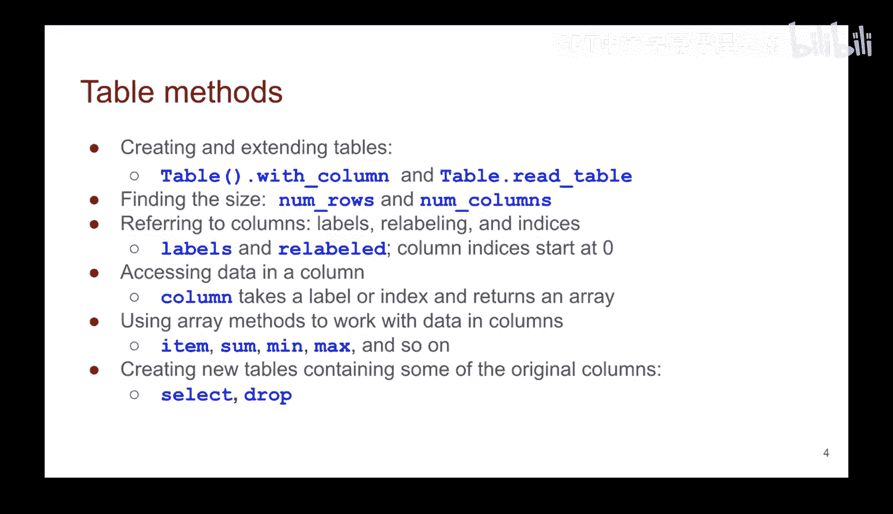
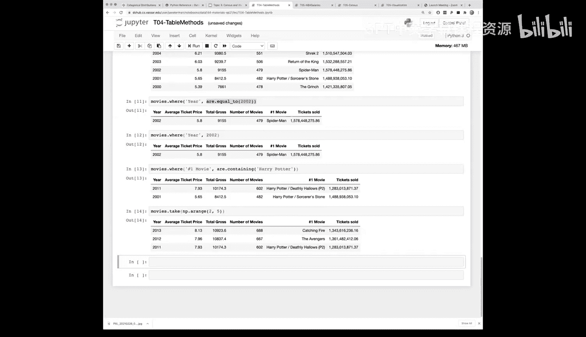

# UCB《数据挖掘和分析｜DATA 144 Data Mining and Analytics 2021》中英字幕 p17 [P17]lecture17-[T4 Building Tables] Table Review-LGwpQ_gpU_4.zh_en [BV1efBEBuEVg_p17]

computer okay welcome yeah so we're going to pick up where we left off last time and we want to where we were last time is we started talking about arrays arrays and then tables and and so I want to kind of review tables a little bit and the reason why I want to review tables is。

They're the primary form of organizing data in this class and so really this idea of a table is going to be very central to the analysis and the visualization that we do in this course。

And we're using this data science package which is kind of custom purpose built for this course and it's wrapped around this concept of tables and so really we want to kind of think about our data as being organized in tables and get an understanding of the table methods and so kind of I come up this is from from the point of view of a computer scientist and so whenever I learn a new language or a new library I always want to think about first of all the syntax the syntax of the language and for this course we're using Python and so that's why we're talking about。

Variables and how method you know method or function calls work how naming conventions assignment you know that's kind of the syntax of the language and then the other thing I want to know about is what are the primary objects in in a particular language and and we saw we have our native types we have numbers we have integers whole numbers we have floating point numbers we have strings those are all kind of native types in python and then we through the use of this data science library class we have this this concept of tables so objects and in python。

The the way kind of the language is used is that once you have objects you can perform operations on those objects and so there's a lot of operations that we can do on tables and so we're going to take the time and really dive down and kind of see the operations provided by the data science package what operations can we do on tables。

And so just as kind of a quick review right the way I want to think of a table it's really two dimensional data and it's really a sequence of labeled columns right so each column。

😊，Each column represents some attributes。For example， for this table of states。

 the label that's highlighted is the abbreviation code for it the column over to the right is the area and so that represents。

😊，That represents kind of an attribute and then each row is an individual it's each you know。

 I like to think of it as its own data points。And by putting them together， we have our data。

From there。And so。We have a couple of we have a couple of methods that operate on table so once we have a table there's a bunch of methods that we can do and I think actually now is a good point I'll come back to this slide but now I think it's a good point to kind of remind us is that so you know we're learning a lot of syntax here and we're throwing a lot at you and there's a lot of different ways you can manipulate and use tables and really the best way I really think of it as kind of like learning a foreign language。

The best way you get familiar with it is by practicing by reading and looking at code and writing your own code and so that's where the labs come in that's where the homeworks come in but until you kind of get familiar and。

You know do a lot of work with the tables it's going to take a while for all of the the operations the methods and the names to kind of become familiar and that's okay and so on our course website and it's worth kind of mentioning now is if we go kind of to our course website we have this python reference so they see the link over to the。

😊，To the left hand side， this is kind of the one stop shopping of the Python and the data science library syntax in all of the operations and so here's some string methods array methods so if you forget if you forget how something works just come and that's okay just come back to this Python reference and here you can see all of the table functions and methods that we'll be using in the course。

Okay， so that's I just kind of want to remind you that that's there for us anytime you want it and so if you're forgetting how to do something。

You know， there's a couple ways we can do it you can go back to the slides and find the slides where we we cover that information。

Go back to the appropriate chapter in the textbook。

 but if you just need you just kind of forget the syntax coming to this Python reference is going to be kind of the quickest way to do that。

From there okay， so I just kind to want to make you aware of that resource and then there's be some there'll be some stuff we haven't covered yet。

 but that's okay。And this should cover all of the the syntax or a good chunk of the syntax that we're using in the course and so just kind of to highlight。

Some of the operations that we're going to do on tables。Right for creating tables。

 we can just call the table method and typically what we'll do is for this course we usually create a table by reading in a CSV file。

 so that's the read table method and so we a we give it some preexisting data and it's going to populate our table for us。

If we ever want to find the size again， so once we have a table stored in a variable。

 then we can call these methods on our table object。

And so most of the methods are going to be they're going to be function calls， their methods。

 they have parentheses， the size， the nu rows and nu columns that's kind of the one thing that's a little different with the dot notation there's no parentheses after nu rows and nu columns all the rest of the methods that we call are actual true methods and they have the parentheses denoting that they're a method call the number rows in the columns are they're kind of in python speak they're defined as attributes and they're actually just data associated with the table but you can really think of them as a method call that returns the number of rows in the number of columns there's just no parentheses after that so it's just that's a little bit of syntax。

Just to remember， with the number rows and nu columns， you don't have parentheses。

 but the rest of the methods， we will。We can refer to columns。We can relabel and。Down here。

 kind of accessing data in a column， this is something that we're going to do a lot。

And so the way the mental model that I want you to think of of the tables is is that each column has defined a particular attribute and we can get。

 we can get that。😊，Column， we can extract that column from the table。

One entry for each individual and when we do that we do that with with the column method on a table the thing that comes back is going to be an array it's going to be your array with one entry points for every member in that table and what's nice about that we talked last time about all the different operations that we can do on arrays we can add to array together we can subtract it arrays we can multiply we can add there's a lot of operations that we can do on arrays。

And so typically you know if we're doing some type of manipulation or analysis on data。

 we extract the column that we want as an array and then we can do all sorts of fun things like get the sum the min the max pull out different items of the array from that so that column command will be making frequent use of。

😊，And we can also kind of do table level operations as well。We can select。

Some of the columns to create a new table if we want to create a new table with a subset of the columns。

 we can select the columns that we want and if we want to get rid of some columns， for example。

 if the data has more data than we need the table it's a good idea just to make things simpler just to drop the columns that you don't need so select we' pick the ones you want drop will get rid of the columns that you specify and keep everything else。

Any questions about tables？We're going to get a lot of practice with them。Okay。😊。

So we talked about kind of the column for getting for extracting out a particular column。

 we can do a lot of operations on the rows themselves。

🤧One thing that's very very handy is that we can sort on a particular column。

 so if we had like salaries or populations and we wanted to see that table in an order of a particular row。

 we can sort on that and by default we sort the rows in a order。

 you can add a parameter to sort by decreasing。The other thing we can do is we can take。

We can take some number of rows。And the way we want to do that is is we can use the take method and you can specify the row numbers that you want so the one thing that that trips a lot of people up is is that Python counts from zero so rows have an index and this is a fairly normal convention in computer science when you index something the very first element。

Is is zero and so the way I kind of think about it is is I mean just the one thing just to remember is is that Pythonons you know often starts counting from zero when you index something it's going to start from zero and really the way I look at it is is that that number is how far how far that element is away from the beginning。

Right so the very first element is at the beginning it is you know it's zero length away from the beginning。

 so just remember we're not indexing by one so if you wanted the first row if you wanted the first row of the table you would do take zero。

😊，Where the where method we get a lot of use out of。

That allows us to perform decisions right this allows us to selectively so take will just give us the particular row number that we want so you just specify the rows and then you get them the where allows us to specify we'll give a column that we want and to look at and then we can have some conditions in essence what we're doing is we are。

Get to keep only the rows that meet some criteria and there's a very very rich set of these conditions and if you forget what those are the Python reference will show them if we go down there's a whole section on the wear prediccateates so we can do things equal above above equal below in between between or equal from there so it's a rich set it can basically do all of the operations that we would want for selecting。

😊，Okay， and then the last thing。We can use the wear with these R predicates as the reference kind of specifies。

 there's also kind of a syntactic shortcut。If we just specify a column。😊。

And don't use this R condition if we just look at the value that we want。

If we just put a value there it's just going to it's going to do an the equivalent of our equal。

 it's going to keep all the rows that match that value in that particular column。From there， okay？

All right， let's take a look at that so this is finishing off the demo from last time and so remember we always want to。

😊，Run our first cell and I believe you guys did this last time。

 so this is creating a table from scratch， so I'll skip down here to selecting data from a column。

So the first thing we do， we want to create our new table， we read。

 we specify the file that we want to read as a comma separated valued list， a CSV list。

 and then that automatically magically reads it in in the speed of light。

And if we want to look at our table。We can use the show command and this particular column。

 this particular table has movies。Sn by year and with their ticket price Okay， so we have the year。

The average ticket price for that year。The total number of the total gross so the total number of tickets sold times the average price。

 so notice what is gross in， it looks like gross is in millions of dollars and the total number of movies and the number one movie and so it's kind of crazy how ticket prices have increased you know kind of over the last 25 years you could go see empire strikes back for $2。

69 that was a bargain in the day。so anyway so that's our table now we have it and so now we kind of we know we have enough tools that we can actually start doing analysis for that and so one of the things that we may want to see is。

😊，Remember the gross was shown in。Millions of dollars if we want to actually see it in dollars。

 what can we do？Well that's actually very very simple and it's literally one line of code it's one line of code and what and how do we get that so what we want to do is we want to we want to extract the column that we're interested in and that column has the name total gross。

😊，So we're going to extract that column and so here and we can do that with this movies column right so what that's going to do is it's going to take our table because you notice。

Our table is called movies and so we can we can perform operations on the tables so so we're calling the column method which will extract the column specified in its。

And it's in the input to the function， so that is going to return this gross to total gross as an array now since it's an array we can do mathematical operations on it。

message in the chat oh sorry， thank you， I will en big in， thank you for reminding me。😊。

Give me one second。There we go， 150% work last pretty well last time。Thanks， everyone。

Sorry about that。Is that better？I will take。I will take that as yes。

 but please ifs if it's not big enough， please shoot shoot me another message in the chat and i'll make it bigger so we have our column。

😊，Now that it's an array we can do all the fun array operations that we want and one of the things that we can do is we can convert it into dollars if it's in millions of dollars and we want dollars we just multiply by a million and so instead of writing out all of the zeros we're just using scientific notation so this is just one followed by six zeros which is the equivalent of。

😊，Multiplying everything by a million and so now now we have this array。

 the total number of the gross for that year in dollars and so now if we wanted to calculate if we wanted to calculate the number of tickets sold。

 well we don't have that information we don't have that information in that table。

 but we now know the total number in dollars， the total number of sales from there and if we have the average ticket price。

 we can take this column。This this gross in dollars and divide it by the average ticket price and that is going to give us a new array so if you think about the types right so gross in dollars is an array we're extracting the average ticket price。

😊，And we're going to and remember when we extract these when we extract these columns。

 they're going to be extracted in order that they are in the table and so this array gross in dollars will correspond with the average ticket price and so it's going to take the gross the gross in dollars divided by the average ticket price because this is now going to be an array so an array divided by array that mathematical operation will work out and that will give us the number of tickets sold in an array。

Okay， so notice nothing got printed in the screen because i'm doing the assignments and so we could look at that。

 we could look at that we can just put ticks sold。😊，And if we rerun that cell。

 we'll get the array there and that， but that's a little hard to visualize。😊。

So what we're going to do is what we'll do in the next cell is is we'll add it back to our table so we're going to take our table。

 we're going to take our。We're going to take our table movies with column and we're going to。

Add that。Okay， so we're using the movies with column and that is going to allow us to add an additional column to our existing table。

Or I will create a new table， but we're reassigning it back to movies。

So with column is going to add a column。The first argument here is the the name of the column and then the array to populate the data and so now。

And then we reassigned our movies table， so now what happened was we created a new table and assigned it to the same name of the previous table that overwrites our old table and replaces it with new the new table that has the additional column of tickets sold。

Okay， that's a little easier to visualize than just looking at an array。

 but still this part right here， this is。This is a little hard to read now if you're kind of familiar with scientific notation you know that even know that E to the6 is a million e to the ninth is a billion。

 so this is 1。3 billion is what is representing there but can we do a little bit better and it turns out the data sign yes。

 the answer is yes absolutely and it turns out that there is。

A set format method which allows you to control how the excuse me。

 how the columns are being presented when you look at a table。😊，And there's some default。

 there's some default formattters and one that's actually very useful is a number formatter。

 which will basically say please print this column as a reasonable looking number。😊。

It is kind of the unscientific description of that and so now if we set the formatting to the ticket So column。

😊，Now we have something that looks a little more a little more presentable right and so instead of having this just decimal in scientific notation now you can even you can see that it's that in 2015 they sold 1。

3。😊，Billion tickets。From there， okay。So this is just kind of a once we have these basic things down extracting columns。

 performing operations， we can create our new columns， we can do analysis for that。And of course。

 you know seeing having things as a table is really good for kind of looking at it and deciding the type of analysis that you can do。

 but really kind of the theme of today is that we want to start thinking about how we visualize our data and so this is kind of a sneak preview of some of the visualization stuff and we'll come back and look at visualization in a couple of the other demos that we do。

😊，But there's just no way of， you know。It's just so much easier kind of visualizing the data and so that's why our data science library has a bunch of plotting and visualization libraries built in and what's nice about it is is that we get these really nice plots with just very little code and so if we wanted to plot。

The year versus the ticket sold it's just one line of code it's just this plot function and this is going to and we'll talk more about this in some other demos。

 but as a sneak pre， this will give us a line plot。

 So if we run this here and now we can see a really good visualization of。😊。

How many tickets were sold in a particular year and you can see kind of the movie industry kind of peaked it looks like around 2002 and was kind of under steady decline since then and I think we all know kind of many of the reasons why streaming ticket prices are getting high and of course now if we got the data for now would you know it would look very。

 very very sad。But we can。We can dive down and we can drill down and so we can kind of see between 2000 and 2005 right we see kind of this peak if we wanted to drill down and look at that we can。

Just get this table。Where we're selecting between 2000 and 2005 and if you remember how does the R between work？

The R between work starts at your first argument 2000 and goes up to but not including。

The second argument and so this will show us， this will show us all of the。

All of the rows starting at year 2000 and stopping at 2004 right because we're going to go up to but not including 2005。

So if we wanted to zoom in and we can see the。The movies from that time and the number of tickets sold。

 and you can see that really peaked right just by looking at the numbers you can see that it peaked in 2002。

From there， okay？And if we wanted that particular year。We can just。Do the R equal to and again。

 as a shortcut， if you know exactly the column that you exactly the row that you want to select for。

 instead of writing out the R equal to you can just do your column name and what you want to compare to that is syntically the same thing and will give us exactly the same answer。

From there。And what's nice about what's nice about the containing so this is this predicate clause containing this will do a it will do a string match。

 but it will do it will match a subset of of it will match you know a super it will it will look for a subset in a larger string and so if we wanted to see what years had the number one movie。

Of any of the Harry Potter franchise we can do that so it's just looking that if anywhere in the title of the movie or the number one movie title that it has Harry Potter somewhere in there and if you can see that we can see that actually。

😊，Two of the movies， two of the Harry Potter movies was the number one movie。Both in 2001 and 2011。

Okay， and if you wanted to take。A subset of rows。We can use the， remember。

 so the NP is the nuP numerical Python， and this is the array range operator。

And this will give us the range starting at two， so the rows starting at two。

 but remember Python counts from zero and then going up to， but not including five。Okay。😊，And so。

Any questions about that？Makes sense。Good okay， so that kind of wraps up our review of tables and so let me start a new topic。

