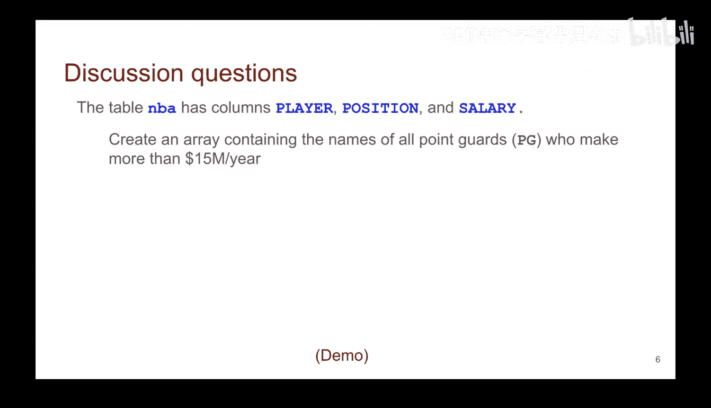

# UCB《数据挖掘和分析｜DATA 144 Data Mining and Analytics 2021》中英字幕 p18 [P18]lecture18-[T5 Census and Visualization] NBA Salaries-w_a7KVHzWm4.zh_en [BV1efBEBuEVg_p18]

Okay， so as kind of as is just a review， so you can think about some of these table operations by yourself。

Let's take a look at。This table here okay so soon we have the MBA table this is one that we've seen before it has the following columns the player position and salary so now just is kind of and it took sometimes it it's useful and helpful to just try some of these things out on pencil and paper to see that you got the syntax right and that it's kind of all sinking in so I want you to kind of take a moment and so imagine so the task that we want to do so say we want to we have that table with those columns so we want to create an array and it's going that array is going to have the names of all the point guards who make more than $15 million a year。

So take a moment， take a moment。go back and look at the the Python reference if you have to。

 but like let's write out so the table name is NBAA so take a few minutes。

 take a few minutes and try to see if you can kind of write that out on your own。

And I will pause。