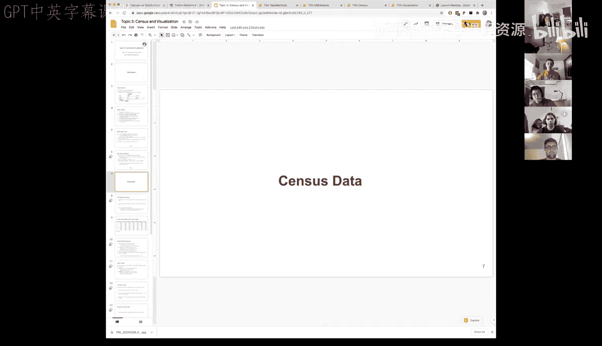
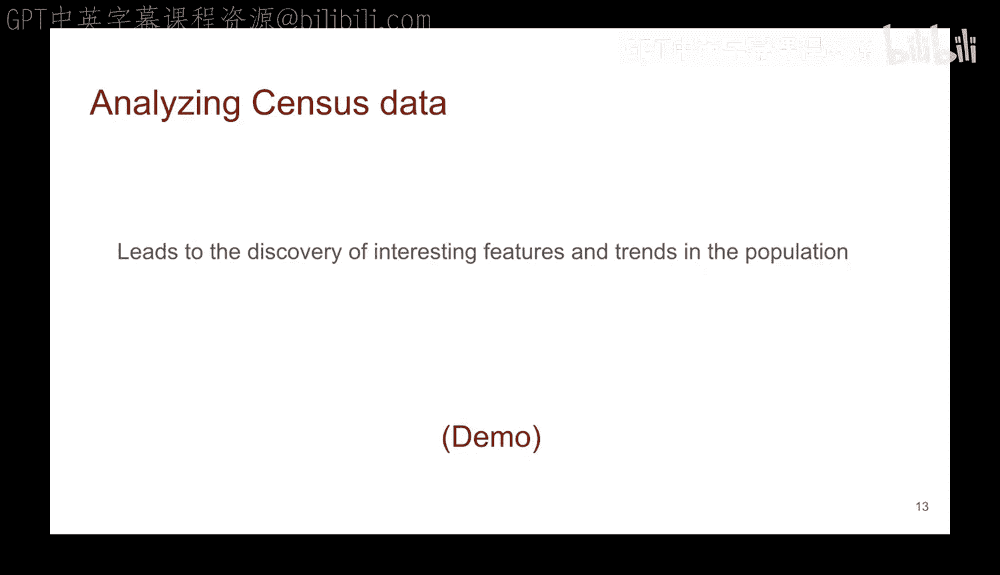
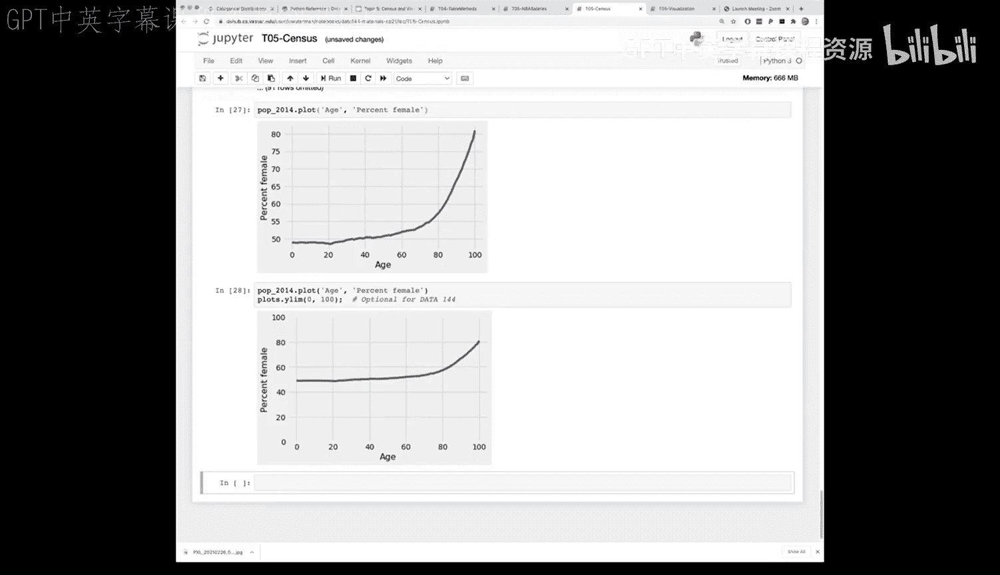

# UCB《数据挖掘和分析｜DATA 144 Data Mining and Analytics 2021》中英字幕 p19 [P19]lecture19-[T5 Census and Visualization] Census-21dG2pls6kY.zh_en [BV1efBEBuEVg_p19]

Okay， so now what I want to talk about is now we've learned enough to be dangerous we've learned some python syntax we've learned about tables we've learned operations on on tables and so now now that we have all of this we can now really kind of dive in and look at actual real like。

😊。

Kind of substantial data so kind of what we want to do today is kind of have a running example through some actual census data and we'll go through some some some ways of kind of looking at the data in table form manipulating the data and then we'll get into some actual visualization and and we can start to see the power of visualization and how it kind of can tell a story。

😊，Excuse me， it can tell a story about the data。In ways that just looking at the numbers can't。

And so。So the census happens in the United States every 10 years and so we actually so we were up for census in the year 2020 and if you follow some of the news you might know there was a lot of controversy about that about certain citizenship questions that one could ask and the speed of completing the census under a global pandemic but we're doing it we've done it and there's still kind of tabulating the results so the last one was done in 2010。

😊，And that's the data that we'll look at because the 2020 data hasn't been released yet。

 and so 10 years is a long time， 10 years is a long time to go between censuses。😊。

So why is it once every 10 years well， back when they started doing the census。

 everything was done by hand and it was getting to the and it actually would take years sometimes to calculate the census。

 and it got to the point where the population in the United States was getting large enough and it was growing enough that they calculated that they would not be able to necessarily complete the census in time and then it stepped in a company that was called IBM。

 you probably heard of it， but they started as company making tabulation devices which was able to kind of complete the census in a much faster。

 faster way by using computers and from doing the census the whole corporation of IBM really became big and huge。

 but anyway that's neither here nor there， but 10 years is a long time so the bureau is going to actually estimate the population for each year。

Okay in between censuses the censuses and that's the data that we're going to look at why is census important in particular because it's written into the Constitution that the representatives right the number of representatives each state gets in the House of representatives is determined by their population and how much money the state gets from the government is in direct proportion to the size of the population so when states gain gain people you know that could be that they get more one or more rep representatives and more taxes and when states lose people that's cause for concern so I encourage you to enjoy your time here in New York and perhaps decide New York is a pleasant place to stay after you graduate we got to keep our New York numbers up okay so looking at it and we'll have a demo we'll dive in and kind of look at the numbers exactly but。

I want to raise kind of a key point here is is that。When you start kind of getting data。

It's really important to understand the context behind the data and what do I mean by that is is how is that data organized and what format is the data and what does the data actually mean it could be very dangerous if you just start kind of load loading up a data set and start crunching the numbers without understanding what the data actually means and in particular we'll talk a little bit about this right if we look at this we see that we have this column for sex and age and we have we have zero for sex we have zero。

1，2，34 for age and if we don't know exactly what that means it's going to make it you know best case scenario you know we just can't do anything with the data the worst case scenario is is that we make some incorrect assumptions from our analysis based on incomple understanding of the data so whenever you get a data source there's usually some form of explanation of the data schema so what does。

What what does zero in the sex column mean what does zero in the age column mean right and so so but some of them you know are also kind of selfexplanatory right so this is the census 2010 population and then here are the various estimates so some things are kind of straightforward but other things well sometimes need a little more careful explanation and so for this particular table。

Each column has the values are dependent on the column right so we need to know kind of where the column is coming from to understand what what that data means and in particular the sex column what what is that is is that one is going to be even though it's represented by a number one is going to denote male and two is going to denote female for purposes of the census。

The the population estimate 2010 and in particular， if you dive down and kind of look at the。😊。

The PDF that explains all of that， that is actually the July 1st 2010 estimate July 1st。

 that's probably because that's the start of a fiscal year。From there。Yeah。And in this table。

 some rows are actually going to be the sum， there's going to be some derived data。

From other rows and in particular， if the sex column is zero。

 which we saw kind of when we when we looked at from that title。

 if the sex column if the number is zero， that is going to be the total it's going to be the male population plus the female population okay another quirk of this table is is that in the age column。

😊，You'll see an age of 999 which is clearly not an actual age no one has you lived for almost a century almost a millennium。

 but it is it denotes the total of all of the ages and in particular and also kind of in case you're wondering what doesn an age zero mean。

 it means that that person hasn't had their first birthday yet。U。

By seven one you know for the particular year so if someone hasn't reached one years old one year old yet that's they're denoted by year zero from there okay any questions。

About the format of the data。We'll look when we look at the demo and so you can ask some questions then。

As well。And so why， why， why did we encode the sex as a number when it would probably be more。

You know more easy to read as writing out the category newmer codes are also often used for for to make your table smaller if you had a big long description for a particular table you can encode it with a number。

 especially if there's a small set of numbers， you can encode it in you know one bite of information as opposed to。

A big long character string from there so you'll see that so this is a fairly common thing that you'll see numbers but they're really representing a category which is I think a nice segue into our next topic which is really types of data and so when we look at data data should be organized in a way that each column has the same type。

😊，And should be comparable to each other in some way right so populations like you know all of the all of the rows in a population table should refer to the population。

Um，Otherwise it's going to be， you it's just going to be almost impossible to make progress。

 interpreting and understanding that。There's really kind of two types of data that we're going to see and the first one is numerical data this is going to be like the population right and the way I want to think about it is is that that data comes from some scale that represents an actual number of things numerical measurements by their nature can be ordered right you can say that this row has a larger population than another row or a smaller population right so basically another way of kind of thinking about it is that if a column is numerical numerical analysis kind of makes sense for that type of data。

😊，And you can actually do things like subtract， you know one rows from others to see differences and those differences actually mean something they kind of make sense in a mathematical sort of way。

We can also have and we've saw this in our census data we can have categorical columns and the way I want you to think about that is is that they're categories I mean not to use you know not to use the word category and the definition but that's what they are they are buckets that you can place individuals in and usually there's going to be a fixed a finite number of these buckets that you can place the individuals in。

😊，嗯。And depending on the category they may or may not have an ordering here let me give you an example of something that can have an ordering so imagine you were taking a survey if you imagine you're taking a survey and the question was please rate on the scale of one to 10 how much you enjoyed class today right that is a numerical that is a numerical column that is a numerical data type okay right please rate you know on a scale of one to 10 or one to five from there right you can take the average you can compare one day to the next and take differences those all kind of make sense but you can ask a similar type of question where it actually would not be a category where it would be categorical and you can ask that question is。

😊，Please please rank your satisfaction with today's class， are you not satisfied？

Very satisfied somewhat satisfied extremely satisfied right so notice that i'm giving you a choice those choices aren't numbers those are categories and you could turn them into numbers but but。

You the way I asked that question， I did not。And another simpler version of that was were you happy with today's lecture yes or no right that's a category that's a category you know were you satisfied you know were you were you satisfied or extremely satisfied okay those are fixed categories and so and that question is are you satisfied or extremely satisfied well that's a category that you can order right there's an ordering from there but they're not numbers they're not numbers in there at least in the original way that you're you're asking them。

😊，Okay。😊，And so the tricky thing here is。There's just because something。

 just because a column has a number does not mean it is numerical， okay？And in the census example。

 we saw that the sex column was encoded in a number，0， one and  two， those are numbers。

 but it is not a numerical column， it is not numerical because in some sense it is meaningless to kind of treat these as numbers and subtract。

You know how do you subtract because remember these represent you know male and females in all right you know subtracting one from another to get a male like it the operation doesn't compute how do you subtract a male from a female from there so just because something has a number it doesn't necessarily mean that that arithmetic is going to be valid to do on that column if if that column is in fact categorical。

Okay。😊，All right， so let's dive down， this will give us some practice and some review on table methods。

 it will give us some preview of some of our visualization methods and kind of we can start to see the power of the data science library and package。

😊。

Okay， so as always， going to we are going to load our data science package。Here。

And you know some of this is I'll go through some of this some of this stuff is going to you know really start to be kind of old hat。

 you know， very familiar to us we're going to take a look， we're going to read our table。

And we're going to show and then so this is showing us the categories that we had from last time。

And so now we can start selecting right so there's a lot of data in here there's an estimate for every year so here let us just get the actual let's just get the actual population so that is the population from the census and let's just take 2014 let's just get the population estimate from there and then we'll just show we'll just show the first four columns just as a sanity check just to make sure that we in fact did what we thought we were going to do so we have the sex and the age and then all of the columns that we want okay。

So what we're going to do is we're going to relabel some columns for us just to make it a little easier for us for a census 2010 population let's just call that 2010 the population estimate 2014 let's just relabel that and again remember Python counts from zero so the two column is going to be012 and then the third column from there now we。

And relabel that。Now that we have it a table， we can sort on any of the columns， we can sort on age。

And again， just by default， it just shows us the first 10 rows。

And you can see we're sorting on age and notice right so this is when we're sorting on age we've gotten all of the rows。

 all of the rows that have age zero followed by all the rows with one。

 two and three and you can notice for each age there's going to be three rows， one for males。

 females and all of the above for each of those。So that's not surprising right and you can see that zero zero is dennotated by males plus females and if you look at if you do the math you can see that this this row is the sum of this value plus this value here。

And so on and so forth。Okay。😊，And so by default it sorts in ascending value if you wanted to go from larger to smaller。

 you can just set the optional parameter descending equal true and then this will also remind us that in fact that。

We do have this this weird kind of age category， right， even though those it's represented。

 even though all of these columns right so this is a kind of a weird situation where the age column is mostly numerical。

 right it is mostly numerical except4999。😊，Okay。😊，And so if we want age to be truly a numerical column。

 let's get rid of let's get rid of all of the rows of 999 and we can do that with a wear clauses we're going to basically say we're going remove everything that's below 999 that will now turn the age column into a pure numerical column okay and so now if we don't care about the distinction between males and females。

 let's just look at everyone so now we're just going to select where the sex is zero so that is you know that is the everyone and now that we've just selected for everyone we don't need the sex column anymore so we're going to drop it。

And so here's a good example of chaining where I think makes a lot of sense。😊。

We're just selecting the rows that has sex equals zero。

 which means everyone and then dropping the sex column altogether and if we take a look that there is now now age is a pure numerical column and then there's our populations。

Okay。All right so so this is kind of a taste of sort of the type of data cleaning that one often does when they get a data set the data is gonna to be in some format and we're gonna to want it in a particular format either get rid of the columns we don't care about rename some and clean up the data from know some quirks in the system like the fact that 999 was like the every category so now that we've done that now we can actually go in and actually start plotting and seeing the trends here so the simple thing that we do and we'll talk a little bit more about this is we can do a line plot and notice how just beautiful this is it is just one line it is a method that you can perform on tables and what you want to do is you're going show you're gonna show the two things that you want to compare and so when we run this we can see that。

The first argument age is going to be our x is going to be our x axis and then the thing we want to compare against the year is going to be our second argument。

 so this is going to show us for the year 2010。The population distribution according to by ages。

 okay， so this is the percentage。Or it's not the present it's the total population for all of the given ages and what's nice about it is is that it kind of makes some default assumptions for you about labeling。

 notice that we didn't explicitly put those labels， but it kind of figured out， well all right。

 this is the X axis so I'll give it the name of the column and then the same thing for the Y axis column okay you can explicitly if the rows aren't if the column the column names aren't exactly what you want to do you can explicitly。

 can you can explicitly。You can you can actually retitle them from there or just print it out right so if you want to say if you want to give the title if you want to give a plot a title。

 you can just print US population。Um right， so it's just basically going to print out the population followed by the graph。

 but if you want to get fancy and put the title。If you want to put the title in， there's a。

 there's a method as part of the plots library， parts of it， you can give it a title。😊，From there。

 okay？And now what's the difference there is。It shows up as part of the graphics graphic itself okay and notice right so the plot is a method on the every one table。

 the plots is a standalone thing that shows the title and it's and you can see that we've done it up here we've gotten access to it by importing it。

And so this is a bunch of methods that you can do on plots。From there， okay。

 so that is not the name of the title this is a generic thing that you can do for the plot that you've just plotted from there。

Okay， so， you know， we can start to visualize， we can start to look at the data。

And and we can see you know some kind of some trends right so you can see a couple of things right as we get older we don't live as long right so you can see that the population trails off to zero from there you can see kind of this。

What is kind of interesting this big drop down here right and so that might that might you know kind of warrant some kind of interesting right because this looks kind of this is kind of like you know a big thing so really what happened if you kind of go back and look backwards right if you look theres there's kind of like this population and that this seems to be kind of abnormal than the natural decline right of life expectancy so we can we can zoom in we can zoom in on that and so we can look very carefully at the ages from here and and you can see kind of right around here right you can kind of see it' it's getting bigger getting bigger right around 62603 and then it kind of。

Starts kind of dropping off from there and so kind of working backwards right so this is the year 2010 and if someone is 63 what year were they born in so we can we can use python we can use python right at we can use python just to do math and to do that we can see that that。

Gives us 1947 and so what's interesting about 1947 does anyone kind of know or want to guess and so really kind of going backwards we can see that the population really kind of shot up starting at the year 1947。

Is it post war post war， yeah， and then what happened post war？

That created a new generation that has a name。Baby boom， Yes， this is the start of the baby boom。😊。

From there looking backwards and you can see it you can really see the population because you can see kind of you know you you know because the you know the population kind of looks fairly kind of even until you kind of get this bump and this you know starting at 1946 1947 and going back kind of you know 10 or 20 years so this is kind of the the graphical representation of。

😊，The baby boom。Which is kind of cool that you can actually see that and so。😊。

Another thing that we can do is we can look at。We can look at the population estimates。

 the population of 2010 is the actual one and we can compare so notice in this case we have our everyone plot and we're showing the age and so notice what we did here so up here we did the age and we gave a particular column okay so the first one the first column that you specify is going to be your X axis。

And if you don't specify if you don't specify a second column。

 it's going to plot all of the rest of the columns compared to the age column and so here when I just plotted the age you remember our table had two columns so here's the age so it's going to basically plot out the age on one axis and then one line for every other column that you have in your table and so this is going to plot out the 2010 and the 2014。

And you know and kind of it's kind of interesting right you see kind of what you would expect right that the blip in population you know。

 kind of follows through everyone is four years older。

 everyone is four years older and the population trends it's like everything is shifted over until you get to the point down here where just you know。

 the populations are getting smaller and life expectancy kind of kicks in where you don't see that shift anymore。

So last thing the last thing that I want to kind of take a look at today is we can really start now that we have the tools we have the tools in our toolbox to really start doing some some numerical analysis and so one thing that we can do is is we can look at the percentage of the proportion in the population of males and females and let's just say for 2019 okay so what we're going to do is we want to go back to our original table and again we want to we don't care about the entire population we want we want the year breakdown on ages and so we're going to start with our no 999 table so that's the table that has that that row removed and so。

And here what we're going to do now is we're going to get the mails and then you have to remember that that males are encoded。

In the sex column by one so we're going to select for that and then we don't care about the sex anymore because we're going to because we know this is going to be the males table so we're going to drop the sex column and then we're going to do the same thing with the females column so we're going to have now two tables we're going to have two tables one of males and one of females。

Okay， and so now what we're going to do is we're going to， so now that we have our individual tables。

 we're going to create a new table that combines the two of them together。

And what we're going to do is is we're going to put back and so we're going to create a new table which we're going to call population 2014 and so we're going to start with a brand new table this method right here creates a brand new brand span new empty table and now we're going to populate it with our。

With three arrays， one for each column， one for the age column。

And then and then because because of the way we pulled it， the male and female。

 the age column is the same for the both so it doesn't matter which column we get the age from so we're going to take the age column from the males we'll take the male data from 2014 and then we'll take the female data from 2014 okay and now we we can display that。

😊，Daah， what did I do oh， I didn't run this cell。Excellent， price averted。

And so now here's our now population count for all of them。

And now we can plot the age and again the default is is that it's going to plot all of the columns。😊。

Comparing it to the age column that you specify and you can see something kind of interesting。😊。

🤧Yeah。Is that the population trends is at least in 2014 right we can't say anything more than 2014 we can see that。

At a younger age， there are more males than females up until it looks like around kind of 40。

 and then it looks like there's going to be more females。

And particularly so kind of around this period and and this you know kind of intuitively makes sense because females have a longer life expectancy。

 so you would expect that there'll be more females and then eventually。😊，It's kind of morbid。

 but everyone dies。At the end right on a long on a long enough timeline all things come to an end from there okay so that's that's kind of interesting and but we can dive down further and we can actually look at percentages and what beauty of this is is that it's just not a lot of code to do this type of analysis because we're working on doing operations on arrays and so what we want to do is let's look at let's look at the let's look at percentages so what we want to do is we want to get the total population and so what we're going to do is is we're going to pull the male column and we're going to add it to the female column okay so that's going to give us the total population for each year and then we're going to take that and to get the percent female we're going just going to take the number of females in each year and divided by the total。

😊，Divided by the total and multiply it by 100 to get a percent and that is going to give us the percentage just will give us an array of all of the percentages for each of the ages starting from zero。

😡，So if we care about percentages you know we probably don't care that we need to go out to like six decimal points and so one of the things that we can do is just to make our data a little cleaner a little easier to organize we can just round we can just round to three decimal places okay that makes it a little easier and we can round to whatever we want we can round it to two。

Um。Whatever looks nice， but three seems to be plenty of precision from there okay。

 we can do the same thing。From there。And so now。We have the males and now we can have the percent females and now we can plot that out。

Okay， and so now we can see the percentage and when。

 you know looking at that other graph where we said it was right around 40 and that looks like exactly right around the point。

😊，Where the populations are equal and then the populations this is crazy right and this doesn't this doesn't necessarily kind of bear out from this this graph by looking at it you can see oh there's more females than males but here it really drives home that point is is that you know when we're talking like around around 80 you know and going up to 100。

😊，You know the population is really 80% 80% female when we get out to you know in the upper 90s 100 from there okay and so notice one thing here is is that the plot the last thing I want to say before I let you go the plot method kind of picks the ranges for us and so there wasn't any data below 50 so it kind of pick this range from 50 to 80 but sometimes if you really want to see things on an absolute you can set the limit using this plot method。

 this plots method and this is the y axis limit and so if you wanted to see the whole thing from zero to 100 you can run that you can it's going to basically set the y axis from you from going from zero to 100 and you'll see the same it's the same shape of the data but because we have the larger limit it's just going to look a little squished together。

Okay， all right， that is a perfect place to stop。

