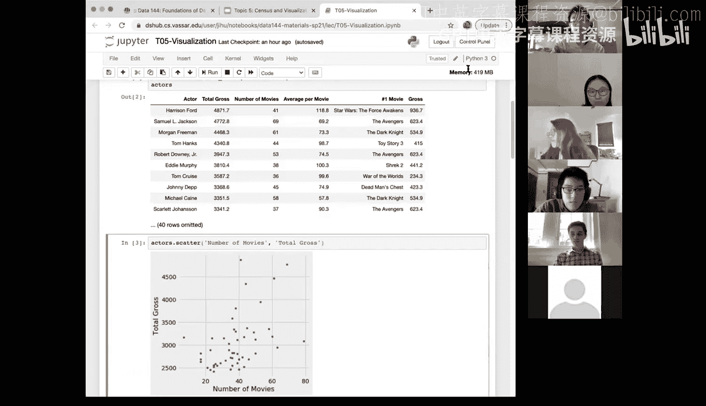
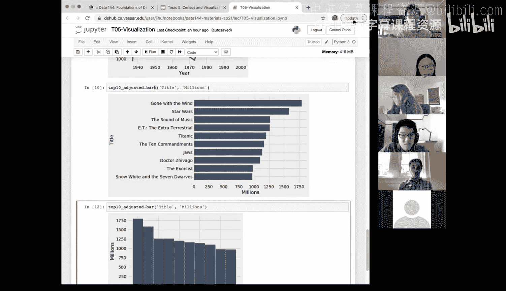

# UCB《数据挖掘和分析｜DATA 144 Data Mining and Analytics 2021》中英字幕 p20 [P20]lecture20-[T5 Census and Visualization] Visualization-g8h8cT1rP8o.zh_en [BV1efBEBuEVg_p20]

Yeah we're gonna get started so Jason told me last week we had gone through almost almost down of topic five censs and visualization。

 but we are having the last I think demo on visualization to be done so I'm going start with that today and so what I'm talking about is topic five here so I think he had done all of this up to I talked about the census data how to analyze the census data so we're left with data visualization okay which does have a demo so let's start with that and for visualization as you will see that we're working on different ways to visualize the data and then the way that we're going to choose to visualize the data highly depends on what kind of data you're working with okay so I think so far I've been talking about numerical data was categorical data and today we're gonna to see more of those examples so just to get us started。

嗯。We're going start with two data sets just to show when depending on the type of the data that you're working with。

 you might want to choose one way of visualization over the other so we're gonna to see a few examples and then you get to work with them later in lab and homework as well so I'm sure you will see more examples and then as you get more familiar with it I think you're going get some kind of like automatic response that while I'm dealing with categorical data so let me go with by charts and if I'm working with numerical data then maybe scatter plot maybe line plots so you really depends on the goal。

All right， so for scatter plot， which we're going to start with this actors data。

 so if you load it right you will see that is showing us I think more than 50 yeah like。

Ranking by total gross income of I think about 50 isch actors and actresses okay so you will see that each row okay of this data table represent an actor or actress okay and then each column is representing some information about them okay so the name okay the total growth and you can see that is ranked this particular data set is ranked based on the total growth from the highest to the lowest。

We also have some information about the number of movies that they had done， okay？

As well as average per movie okay meaning the average income per movie okay and also they top one movie and then the gross income of that top one movie so for us as you can see that there are multiple variables here okay the actor name is string okay also the number one movie I think we can consider a string as well。

 everything else seems to be numerical to some degree okay like the total gross number movies actually count so that's also a pretty interesting variable here average per movie and the gross for the number one movie so for us I would like us to look at how to deal with scatter plot meaning that we're using scatter plot to visualize information containing the data okay so among the few variables let's pick a few just to visualize okay so the first one I'm demonstrating here is I want to see if there's any relationship between the number of movies okay which is the count here。

And the total gross， Okay， so the method。Of the scatter plot is called dot scatter， okay。

 so actors is the name of the table data table， and then we're using dot scatter as the method。

The method for the producing scatteratp has two inputs， okay。

 the first one is the first variable you're picking， the second one is the second。Okay。

 so let's see what we're going to。Find out about here。Yeah， so in particular， those two inputs。

 as you can see here， the first one goes on the x axis in the scatter plot。

The second one goes to the Y axis so I'm plotting the total growth against the number of movies okay so do you see any interesting trend at all here if I'm looking at total growth versus the number of movies。

Sort of scatter around right well that's one reason why people call a scatter plot but sometimes some variables between two variables think the relationship is probably stronger to observe and in that case you might not see something as scatter as here but regardless we call this type of plot a scatter plot so now let's move on to a different scatter plot here we're visualizing average per movie that's the income of average per movie versus the number of movies okay so if we do that we use the dot scatter again okay。

Now maybe the relationship is a little bit more interesting。

 don't you think compared to the other one and overall I guess theres a decreasing trend right as the number of movies increases。

 the average per movie seems to be decreasing， okay seems to be decreasing。

 but there's one very special case here。Okay， that is what we typically call like an outlier， okay。

 it seems very different for the cloud of the data point。

And one way we can find out about it if you remember about our dotware method。Okay。

 so the doware method is applied to a table， but specifically is applied to a table column okay we're applying it to a particular variable so the way to use it okay。

 so we remember the y axis and the average per movie be okay and one thing like there are many ways I guess you're able to。

To get this average per movie for example you can do the max okay finding the maximum and then get the where a quick way here we're demonstrating is looking at any average per movie above 400 the 400 is really just because after we visualize this well we realize there's only one dot there so how about we try to find out about that particular observation so if we do that。

It's going print out that particular role okay so it's Anthony Daniels so if you know about Anthony you would know that well even though the number of movies he was in was not a lot but it was really blocklockbuster it's actually the Star War series so he is out like you're here but anyway the thing is we probably would never think about it if we're just looking at the table of the data right like you have to look at each row and things like that。

 only when we started doing visualization of the data and then in particular picking the variables that we're interested in we start to see certain pattern about the data and then that will be a first step for data scientist to start f out understanding the data so visualization is usually the first step and I think we're probably talked about this idea early on like the first lecture of this course but now we're looking at different ways to visualize the data for us right now we're using scatter plot。

Because we're really looking at relationship between two continuous or two numerical variabless。

So the x axis is a numerical variable， the y axis is also a numerical variable。

 and when you plot one against the other， you start to see certain patterns about them。

And then once you observe something really interesting。

 you might be able to dig into a little bit more like what we're doing over here。Okay。😊，Makes sense。

 make sense， yeah， and I will also just mention that I think earlier。

Last week when Jason was doing the census lecture， I believe he also showed us like line plot okay we're able to visualize about a particular one one or two variables at the same time。

 for example， that you are instead of like putting each dot as a separate dot。

 you can also like put the line next like adjacent like connecting all of the different data points and that is what we call like a line graph or a line clock so that will also be a very useful one for numerical data。

And we're going to see that later as well。And the other type of visualization we want to do demo this time is bar chart okay。

 so bar chart is very useful for categorical data and。

Let's see what we can get Okay so this if you remember this data data set it's the top movies in 2017 Okay we have the gross and a gross adjusted okay so this data set contains I think about 200 yeah it's actually exactly 200 movies okay the top 200 movies in 2017 okay but then it's just like top according to the gross adjusted gross in 2017 okay so you can see that the top one is gone with the wind okay studio is MGM。

For the growth， well it's really hard to read I would mentioned and then we probably want to reformat the data like this variable in a easier way to read。

 we're going to see how to do that soon and then the adjusted for inflation and also the year that the movie was released。

So this is like the top 10 printed out， but there are 200 in total。

So let's just say we instead of working with 200， let's just say we want to work with the top 10 okay so one way you can do this。

Is that we can get the index if you remember an indexing from zero according to Python rule， okay。

 so if we do MP do a range 10， we're getting0 one to up to9 Okay so we're getting the indexes of the first10 and then we're using theduct take method。

Being applied to the table in order to get only the top 10。

And what we did in the end is that we're going to assign it to a new object called what we call top 10 adjusted so let me show you the printout over there so while from the outside it looks like they're exactly the same okay。

 but one thing you'll notice that the origin data I can say has 200 rows because it has 200 different movies top 200 whereas right now we're only working with the top 10。

So this is one way you can get only the top 10 that is using the take method being applied to a table。

 and then you're selecting or like just inputting all of the index of the ones that you want。

So the ones we're doing right now is top 10 okay you can do top 20 if I change that 10 to 20 okay or I can pick any kind of selected like I don't want the top 10 maybe I want all of the even numbers for example then I can also get it from there so this is just a quick way to get the top 10 and for us just just easier to work with and because well if you imagine there are 200 data points on the plot might be really hard to see okay for us we really want to get it started like small now we have only 10 data points let's see how we can。

Visualize it using different visualization methods Okay so one thing like I said。

 the gross adjusted this column or the gross column they're really hard to read okay and so one thing we could do is that instead of putting it in dollars we're going to put it in the million dollars。

And if I say that， hopefully now it rings a bell to you that， well。

 in order to do any kind of adjustment of formatting or like creating creating this variable in terms of not in terms of dollars anymore but in terms of million dollars。

 we can do selecting the column， if you remember okay， and there were。Extracting it as a array。

 and then we're able to do arithmatictic based on that array。So the way to create a new column。

 just think loud before like just try maybe try not to look at the code。

 but in order to create a millions column， what we do is we're going to select this column。Okay。

 and then we going to， well， this is in dollars， so in order to do it in millions。

 we're going to divide it by 10 to the power of six， right？

And then reatt it to this table so we can have a new column。

Okay so the way there are multiple steps and you know that now we actually chain all the steps together。

 but for now let's break it step by step the first one is I'm creating a million what we call like a million array here that we're taking the gross adjusted that particular array okay that particular column we create an array okay using the dot column method。

And then we divide it by 10 to the power six， okay， I might be having so many like decimal points。

 so we are using themp dot round method to round it to three decimal points。

So when I running this line， I'm going to get an array。

That is the rate of the same size as before it's going to be 10 and we know that it's going to be the values in terms of meaning。

Okay， and then the second thing is that we're going to attach it if you remember what we did before。

We're going to attach this new array as a new column into the original table and the way to do that is again。

 with the dotworth column method。So the dot width column method has two inputs。

 the first one is the column name that you want to name it。

 the second one is the array that you're gonna to attach it so right now I'm doing everything like millions but then I guess just to follow the convention here it seems that all of the column names their first letter is the capital letter so I use capital M for the millions here okay and then I follow this convention so I'm able to create a new column which we're showing over here。

So millions okay so if you check well I'm pretty sure the work should be fine like the girl suggested against the millions。

 but now it seems to be much easier to read and also later you're going to see much easier to visualize as well。

O。Alrighty， okay。So。Now， let's just say we want to visualize the relationship， okay。

 between the year。And the medium。Okay， so well if you look at this， you might think that okay。

 I have two numerical variable right and then how about I'm doing like a plot a scatter plot like this。

 so to show you this。If you ever do this？This will be something you can do。

 but this kind of visualization I guess in particular for these two variables probably doesn't tell us much okay the year is really just a year of the release right the millions is the growth suggested in terms of millions。

And then showing the relationship between these two doesn't really tell us much about。

 I guess anything right， the year is sort of I wouldn't say random。

 but the year is just the year it was released and the millions is the amount that is being made。

So instead， maybe another thing we want to do because at the end of the day。

 we really want to look at the like the。The gross adjusted in millions and then looking at how how that is like compared to different columns in a sense that the different titles of the movie。

Okay because really what we want to do and I would say that you a lot of news articles as well as like online I mean either in on paper or online you have seen this kind of like graphs of showing like okay this type of movie has made how much right and then the second ranking the second movie like made is how much so that is a more typical way to visualize this kind of millions data so the way to do it in Python in our course is use the bar graph okay so it's called bar。

Okay， dot BAR， but then there is also an extra letter here， H stands for horizontal。So bar plus。

 as you can imagine， we can do a horizontally or vertical here we're going to demonstrate using a horizontal one。

 meaning that as you can see here， I'm printing the title of each movie okay on the y axis to some degree。

 okay but like the length of each bar is showing me the millions yeah the gross adjusted a million。

So the method is called B AR H okay， so like I said， H stands for horizontal。

 so you might want to do vertical or maybe not let me show you what that looks like oh。

Maybe not a be give me a second maybe nothing okay never mind okay so H stands for horizontal and if you don't do H just do bar by default is going to show you vertically okay now I think you start to see why we are using horizontal in this case because the name the title of each movie is pretty long right we really want to print it out is to show them as a contrast but if we don't do it as horizontally but only just the default version we won't be able to really see what's printed for the title。

So this is an example of using the bar plot， but then in particular using it horizontally。

 so we're able to show the comparison in this case because it's ranking from the highest to the lowest。

 so that will go in this particular order that we're seeing over。

So a lot of times the bar plot especially the bar H going to be really useful okay so one thing we now can understand this a little bit better is that the dark BARH method takes two input right the first one actually is going to be plotted whatever like according to it and the other one is the numerical variable that we're applying against it。

Okay so if I'm doing the horizontal here， okay， so the titles are horizontally showing or like I guess yeah。

 the titles are showing it row by row in this case Okay。

 and then if I do the default is sort of like。Column by column to some degree。

 but that it' not really useful。Okay。😊，Making sense， yeah。

 so hopefully you get the chance to do this demo by yourself so you can。

Consolidated this idea and information， so just to wrap up here we have caught like not only today but also last week talked about multiple ways to do graphics okay so the line graph or line plot they're just simply using the dot plot method。

So I think last time you have seen this US population and then comparing like say two different years。

 you can do that for the census data okay and this is useful when you're trying to say。

 like visualize the relationship between two numerical variables。

And I will also say that you do line graph compared to scatter part if you really want to see a trend of connecting certain things。

And then today we talked about scatter plot okay we can do a line graph here I guess that's totally fine but the thing is if you look at the x X axis here a number of movies like it doesn't really make sense to connect them you know what I mean whereas earlier we're looking at age okay we're looking and there are many more of them over here so it will be more useful I think to show you in terms of a line graph。

Scap useful for visualizing the relationship between two numerical variables and lastly bar charts in particular we're using the BARH。

 the horizontal one okay this is almost like you have a categorical variable because you have the string of the names right of each movie but I'm trying to visualize the numerical information about each of them and in particular because the title is long for each so I am doing this using the BARH instead of just the BAR。

So like I said。It really depends on the goal as well as the data or variable type that you're working with and then that will drive how you're gonna to decide what kind of visualization we want to do so for us keep in mind that we can do plot。

 we can do scatter， we can do bar H or just bar and all of them actually a methods apply to tables so that becomes super useful as you can see in the demo that we load the data right。

 we're trying to understand certain things about relationship about certain columns so the way to do it is while we apply everything just on top of the table itself Okay we're selecting certain columns that we want to do for the visualization and then of course the dot method is the particular visualization that you pick you're gonna to do。

So keep that in mind like here like demos as well homework is probably going to be like asking you directly say like let's visualize this let's visualize that however I will also mention that it's especially once you get to your own final project you will want to do visualization on your own you want to create those questions for yourself to answer those visualization tasks so I think at that time you start to become more creative as well as just thinking carefully about what kind of visualization you want to do okay instead of asking you to do given the question I saw a quick chat over here so let me。

Just check the question。Is there way to change the font size， Okay。

 of the excess labels instead of choosing between horizontal and default。 Okay， so the question here。

 if I understand it correctly， and by the way， just feel free to speak up because I worried about what if I don't see the。

Question so I think the question here is asking whether we can I think is on the bar plot right whether we can change certain things about say like if I really want to do just the bar is of bar H can I do anything about the font size for example making it I guess smaller to see maybe that will be even more challenging to read but I agree there are ways and they are like additional arguments I think inputs that you're able to make to those in order to change the font size or like even the direction of how you want to print it out but regardless I think for us the important lesson is that we want to make sure that that the visualization we're producing is easy to understand okay and don't try to like putting too much information in one。

 I would say like even though this to both of them are using the bar or bar H is the same method in general but then here it's much easier to understand because we can print out a title and then each bar decreasing is showing us the me。

Okay the growth suggested in millions， whereas this one。

 even though I think is trying to share the same information， okay however。

 because the way that is' constructed it's going to be so hard one way or。

 even if we change the font size， I think it's going to be really hard to read over here。

And in that case， I think for us， this is actually a good lesson that we want to make our visualization easy to read accessible and also tells us information that it might be interesting for the readers or even for ourselves。

Okay。😊，All right yeah thanks for the question like I said usually I should be able to catch it。

 but if I don't and then I started moving on to the other section like the other topic。

 feel free to just speak up so we can make sure that we get to answer those questions。

O。