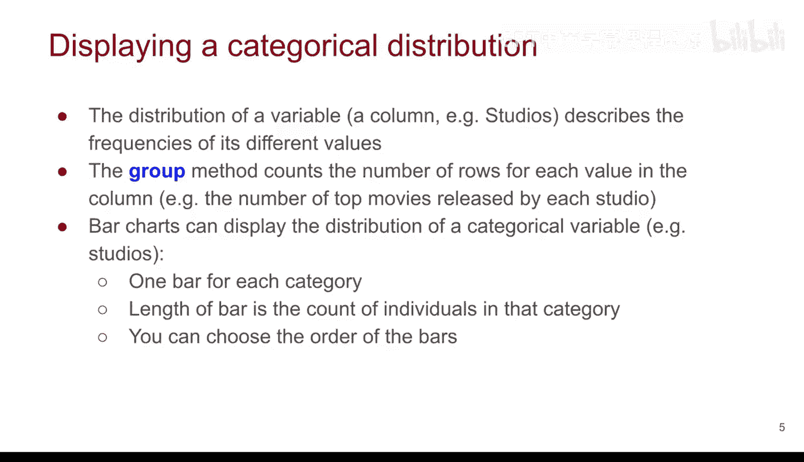
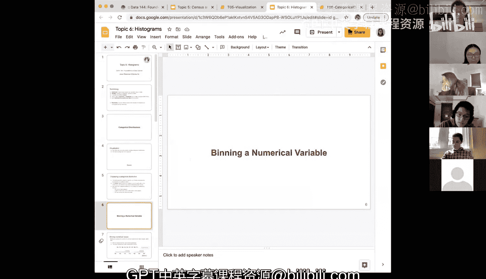

# UCB《数据挖掘和分析｜DATA 144 Data Mining and Analytics 2021》中英字幕 p21 [P21]lecture21-[T6 Histograms] Categorical Distributions-XPz1KbyBkKc.zh_en [BV1efBEBuEVg_p21]

so with topic five down we're able to start topic six so topic6 if you look at our website is gonna it's called histograms okay so that's another way to visualize data in a sense that it's really useful and I'm sure you have seen these kind of examples in other outlets as well but in order to understand how to make histogram it's going it has a few important terminology as well as concept as well as understanding what histogram is about so we're going to start that journey now and like I said histogram is a way to visualize data and in particular you will see that it's a way to visualize。

Nummerical data as well okay its like the ones that we have seen。

 but like I said in order to understand it we need to have certain terminology making sure that we understand everything so we're going to start with that okay。

So I think we have seen this a lot already for us， I just want to make sure that we have a solid understanding of all of the terminology about tables okay and then from there we can start to talk about what we mean by distribution so when we have a data table okay remember we have those columns in the rows okay so each row like we said is's a record or as individual okay so for who in this case for those whose features are recorded and they're gonna to represent rows in the table the variable okay represent each column in the table we call it it's a variable but it can think of as a feature attribute or information like one piece of information about each observation and they are the columns in the table so variable for example earlier in the movie data or like the actor data set right we know the names so name is a variable right it's a column and then it's a variable in our terminology and then we also have the grosss total right？

's another variable and that's another information about each observation so one thing we need to mention and I think we all probably know already but it's important to highlight that a variable can have different values okay that's why like say for the name well each actor has a different or actress has a different name right so that is a different like each row is actually different there and then for total growth well it could be that one or two or two or three or more actor or actresses have the same total growth but more likely or not I think it's going to be different so that's another illustration of a variable has different values depending on which row you're working with okay。

The third thing here as you can see is that the values themselves okay can be numerical or categorical or many of the subtypes within this okay so based on the way they' presenting here。

 you see that we're pretty much having two biggest categories of values or variables okay one is numerical the one is categorical this is the biggest like the top two like top level distinction。

 the categories numerical like say like age year or like the total growths。

 they are on numerical categorical meaning that they are just categories okay like I think like ice cream flavor for example。

 that's a categorical variable okay and what else categor like gender for example。

 depending on how many levels you have that could be another categorical variable okay numerical like I said we have examples of year age and then total growth。

But all of them are slightly different from each other if you start to recognize their are differences like age typically is coded in the nearest integer right so so it's not it's only like like a total like a gross for example。

 that you can have multi decimal points depending on how you're recording the data and that's what we mean by subtypes within this okay so for categorical for example like the gender one or the ice cream flavor ones there are what we typically call unordered categorical data there is no ordering amount of different categories but sometimes you might have a categorical data that has an inherent order for example。

 if a survey asks you how do your last week go and then maybe for that survey question there could be like five different choices like really bad bad neutral good。

 very good okay so that will be an example of a ordered categorical variable okay so just keep those in mind okay for visualization purposes。

 I think we don't make too much distinction per se。Inmer。

 we have ones certain visualization methods to do categorical， we have certain ones to use。

 but for our all understanding as well as like trying to understand the table as well as like the data set itself。

 I think is very important to recognize that there are subtypes within this and then we have a clear understanding of the different subtypes depending on which variable we're working with and what kind of visualization。

 what kind of like analysis we want to do later on。

So lastly each individual has exactly one value of this variable okay so that's why in the table as we can see that we have each row as individual multiple columns right and then for each column let's just say for the ice cream flavor for each observation I cannot have two flavors at the same time well for that example right you can of course have two like if you want to have two scoops of one is one is strawberry the other is vanilla but you know what I mean like the flavor in terms of that definition the example that we saw a few weeks ago that's where we had the example of exactly one value of that variable。

Okay， so with all of this cleared up hopefully now we can start talk about distribution okay so right now let's just understand a distribution of for each different value of the variable like the frequency of an individuals that have that value okay so in the ice cream example if you remember we probably have like three three I think three rows of chocolate and then two rows of strawberry things like that so that frequency that counts okay of the different values of the variable will be the distribution that we're looking for okay and then of course the visualization。

 any visualization that we're doing is trying to give us a sense about that distribution。Okay。

 so keep that in mind， okay， let me show you how we can do visualizations for categorical variables and from there we're going to move to histogram。

 which is typically used for continuous numerical variable okay。

So。Let me start with demo， I think that's probably more illustrative and then we can come back to those summary。

All right， always make sure that we're run the first cell because all of the necessary libraries aret there okay so we come back to this table of the data set of the top movies okay remember we have 200 okay 200 in total the top 200 movies in 2017 in terms of the gross adjusted so among all of the variables here okay last time just now we looked at gross or gross adjusted in particular and years sort of and then the title okay one thing about the title here is that indeed I would say it is a categorical variable but but because it's a title of the movies so we know that it's going to be 20 different 200 different categories here so it might not be as interesting look at however the studio column。

Actually you can see that Star Wars and sound music both were produced by Fox right MGM did a go with the wind and then Dr。

 Shivao and then Disney did other ones， things like that。

 so it might be interesting at least I'm interested I guess for the top 200 movies in 2017 I want to see the breakdown of the studios who make them。

Okay， and if I go for that and just just see how we phrase the question while we're looking at a categorical variable studio okay there we don't know how many categories yet because we know that just going to be like a list of studios producing this 200。

 the top 200 movies okay and then if I start to see if I start to ask the question of I want to break down of how the studios are doing for the top 200 essentially what I'm asking is I want to look at the number of movies out of this 200 is being done by each studio。

Okay， when I say in that way， if you look at well， we're trying to use the definition here。

Sorry over we here yeah you it's not here sorry I probably jump to a different slide。

 but what I'm trying to say is that we're looking at the distribution of it okay and we know that the distribution is a frequency sorry is here I guess yeah for each different value of the variable we're curious about the frequency of the individuals have that value just like the way that I am right now at least interested about that video about that studios column okay so let's see how we can do it okay one thing we can do well maybe just get started is that we know that we're interested in that particular column okay so how about let's just like get that column。

So get that column we're using the select method notice that here I'm not doing column if I do dot column it becomes an array right if I do dot select it will just become another data point it's just another data table that I can keep manipulating with okay so the biggest distinction now I guess just to highlight again we talk about dot column to select a column to make it as an array and then we can do everything thematic about it。

And we do not select to select a column or multiple column， but here we're just selecting one column。

 so the outcome of this once I do the selection is to a data table。

And the reason why in this case we want to do the data table is because we know that a lot of the methods that we have covered so far actually can be applied to data tables and that's why we want to keep it as a data payal format okay earlier when we're trying to turn if you remember。

This growth adjusted variable into millions。There we know that this is a numerical variable right and we know that in order to turn it into into in millions we have to do arithmetic about it like we have to divide it by 10 to the power6 and then do certain roundings things like that。

 so that will give us a hint that for that kind of cases we want to do dot column because we want to make it into array and then do the arithmetic。

Okay， so here we're doing the dot select， so the outcome。

 the final product here will still be a table and then we can keep doing table methods on this particular variable。

Okay。😊，Okay， all right， so now today we're learning something new here okay。

 we're working with the studio table and then the column name is Studio okay so the method that we can apply to a table right now to get the count of each levels of a categorical variable is the dot group method because look at what we're doing here Studios okay is the new data table containing only the column of studio。

Okay， and the method is called darkc group okay and it's being applied to a table。

 which is the studios table Okay， the input right now that we're having here is one input is just the name of the column when I do that I'm pretty much just asking Python to give me the breakdown or the frequency okay more formally like the frequency of the observations that are sharing that particular level。

Okay and notice that I like assign it to something else so later we can also work on that if we want。

 so let me round these two lines for you。And now you can start to see what this doc group method has done for us。

OkaySo。We assign it to a studio distribution okay so we started off with studios which only has one column up here okay just all of the rows of the studio and we know that it's 200 rows of them okay because what we did is really just selecting that column each row is still represent a movie even though now we get rid of all of the other information only about the studio okay。

the dot group method， as you can see here， is turning into this data point of this data table into a new data table。

 okay， we call it studio distribution so we're able to see it okay。

 but interestingly here if you look at it now we don't have 200 rows anymore okay we have I don't know how many we can count it if we want。

 but essentially once we do the dot group method。What this is doing for us is that we're having a new data table where each row represent a level or like a category of that studio variable。

Okay we have the name of the studio as well as the camp out of the 200。Okay。

 so the number of rows here， well will just be the number of distinct studio names appeared in that top 200 movies data set。

Okay and the new column count well that's just like by default that's the name。

 So later if we want to work with anything about the count。

 we're going to do a select that column name Okay it's just by default is called count so we're able to do other。

Well， maybe you want to do visualization or like for example here it might be a good visualization to do right like do a bychar for example I want to look at all of the studios and then look at their accounts I want to compare them maybe decreasing order increasing order so that will be actually a natural thing to do I would say when we get to this point okay but just so way to double check that we have done everything correctly remember there are total 200 movies together right and then now we're doing the doc group method so we create a studio distribution and we have this count column which is recording the number of times the studio like the number of movies each studio has made so if we do a quick sum of that column of count we should get back to 200。

OkayBecause they should simply add up to the total number movies that we started with Okay so this is a quick san check okay just to make sure that we did everything right okay and indeed in turn out that when we do the sum of that column okay we're able to get back to 200 okay so here again notice I'm using the dot column again because I'm returning it array and then I'm taking the sum of them so like I said I think as we work more with tables。

 especially like different uses of the column depending on what your goal is。

 I think we will start to make a better distinction between the dot column and the dot select okay really depends on what your goal is I think you're gonna choose one over the other。

All right， I was already saying that okay if I have this studio distribution。

 maybe one thing I would do is to make a bar chart okay so let me do that and this would just give us in the order actually I think it is alphabetically according to the first letter of the studio name so this is listing okay so again this is a reason of I guess a good example of why we want to use the horizontal BRH instead of this bar because you're gonna have like you name as soon as you have names I guess you really want to plot it the on the y side in this case so this is well one quick visualization if you want to do it if I want to just see overall how how the number of movies per studio are being are able to make to the top 2 in 2017 so this if I don't do anything about it it would just like I said being plotted in the order of the studio distribution and actually by default I guess now。

n that by default， the order， really just the alphabetic order， according to the first letter。诶。

But we know now， I think。That well， maybe instead of like alphabetically I want to say like the the top from the bottom okay。

 so one thing we could do is remember the count。This is a numerical variable。Okay。

 if it's a numerical variable， we are able to sort it like decreasing or increasing order。

 so one thing we could do is the dot sort method。Okay。

 so notice that we are actually chaining multiple methods at the same time。Okay。

 so this is a really powerful thing I think Python has that。We are working on this table， right。

 data table， Okay， I want to first sort it。Sort according to count of a decreasing order or descending order。

 okay， and then once I have this new table， which is sorted according to count。

 I want to do a bar chart。Okay and you can do all kinds of chain methods。

 as you will see either in the demo and later in homework and lab， and I will encourage you。

 if you think it's too complicated to combine everything in one line。

 feel free to break it down one by one totally fine as long as you make sure that you assign it to a new object than then you're using it correctly once you get more familiar and。

Comfortable with all of this， you can change how many number of methods you really want as long as you have a clear idea for what you're doing So here I would say we do have a clear idea because we want to sort based on count first and then we want to create a bar chart based on the sorted version okay so that's why the order right we sort it first and then do a bar chart and now finally it's going give us what we wanted in the first place Okay we want to rank okay the studio from the top to the bottom according to the number of counts or the number of titles that they're able to produce which made to the top 200。

Makes sense。Make sense。 Yeah， and we can also do if you guess。

 maybe some of you are guessing already， you can sort according to the standinging order or you can sort it not according to it like in the。

Ascending order， I think， if we do false。That will give us maybe not as interesting I guess because people usually want to look at the top one first and then looking at it going down。

 but this is just a quick example of showing that you can sort it in the ascending order and then do a bar chart。

Okay and I would just say that because again the names of the studios are quite long over here。

 so regardless I think it might not be a good idea to do bar instead of bar H okay so this one I guess you can still see we can see the trend of course we know that it's going be growing down but it won't be able to plot all of the or like a show all of the studio name over here okay and like I said even if we try to address the I think adjust the font size it still might be really hard to read so I think a lesson for us is that whenever we're working with a categorical variable like with。

So many different categories as well as like the length of each category is quite long。

 if you want to do a bar chart， you really want to do it this way。Okay。😊，Makes sense。

Makes sense for categorical data。诶。So like I said， bar charts very useful to visualize categorical distributions and in particular I would say like is one categorical the other one is numerical okay the categorical here in our case is the studio okay and the numerical is their count after we're able to use the dot group method to get the count。

so just to review for us， the distribution of a variable describes the frequency of the different values okay it's really about the different frequencies here and the group method okay will be able to count the number of rows of each value of the column。

Okay in particular， the group method I would say is really being used for categorical data like studio if it's a numerical data。

 well it might be like it might be too many different levels。

 even though it can be recognized as as the categorical but it might be really hard for us to visualize later or like to get any useful information so bar charts can display the distribution of a categorical in this case。

 one bar for each category okay length of the bar is the count of individuals in that category because we use the do group method to achieve that and then you can choose the order of the bars。

 meaning that you can use the ascing or descending order depending on the goal okay like I said。

 maybe most likely people would do the descending just because that's how people usually talk about like the top like just say top 20。

Not220 I guess like all of the studios I guess descending order showing the number of movies that they have made who are in the top 200 then most likely people would go this way and I think we also talked about like the bar H and bar depending on which direction you are doing it and for most of the examples that we have seen so far I would say that it's the bar H that is preferred just because the category all of the categories in that categorical variable have very long names okay and then in order to visualize that we want to put it in easier to read order and then a format and that we're able to put it on the Y side and then each of the length of the bar is showing as the numerical information。

Makes sense。Make sense， Okay， sounds good and like I said。

Feel free to start looking at later doing the demo yourself and then doing the homework and I think that will help solidify your understanding。

