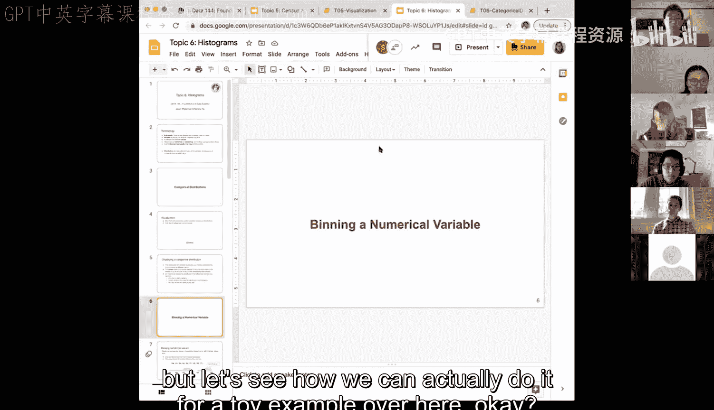
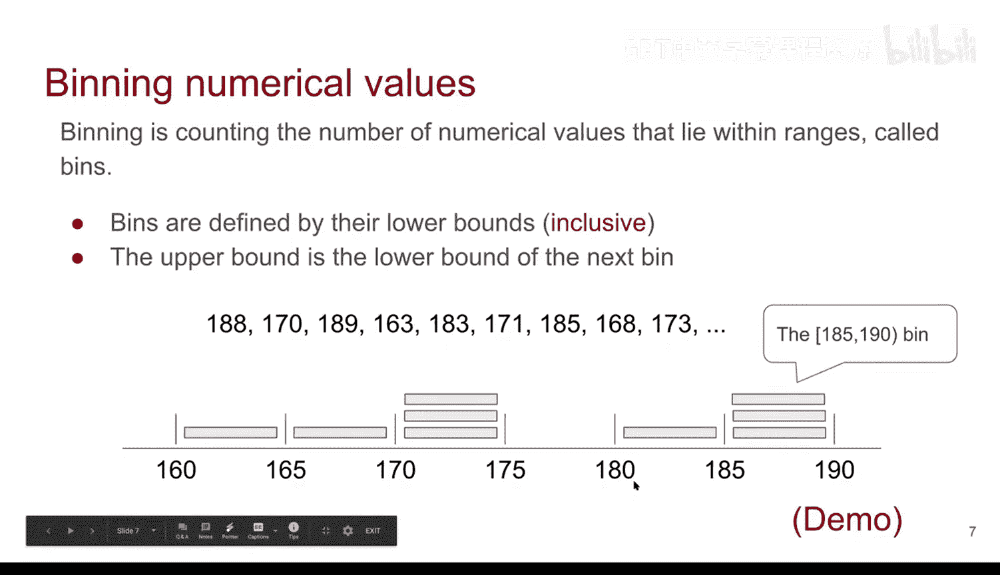
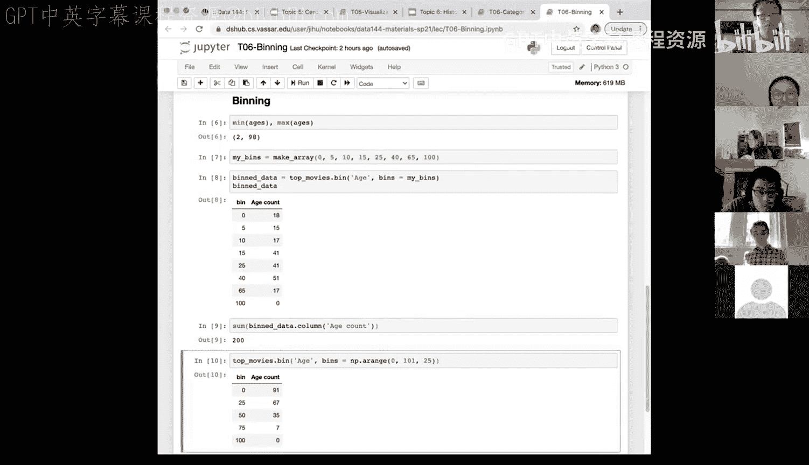
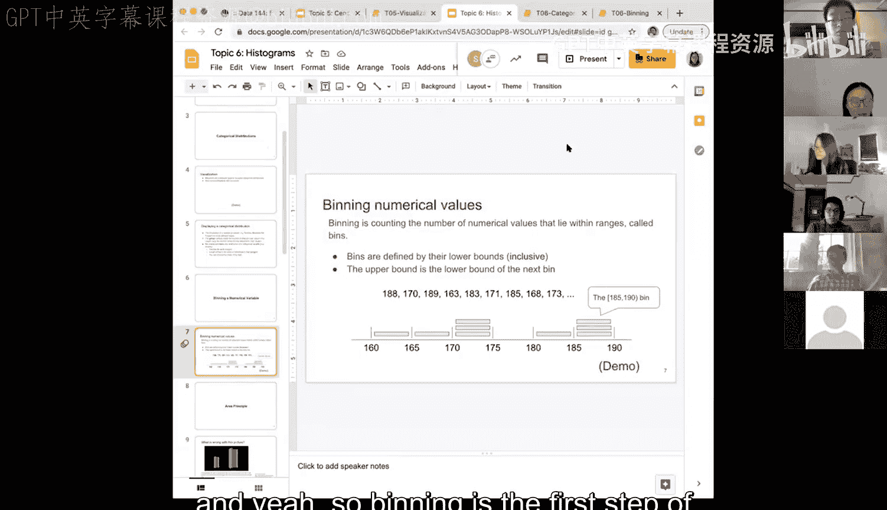

# UCB《数据挖掘和分析｜DATA 144 Data Mining and Analytics 2021》中英字幕 p22 [P22]lecture22-[T6 Histograms] Binning a Numerical Variable-JHWI6fSgCC4.zh_en [BV1efBEBuEVg_p22]

SoThe next topic we're still in the realm of doing histogram we haven't talked about what a histogram yet Okay but let me just say that the bar plot that we seen actually already tells us a little bit about how a histogram will be constructed in the end so let's go about it so the bar plot that we see earlier we were saying that it's useful for doing a categorical variable right and in particular we use the dot group method put it into a distribution about like not only the levels。

 but as well as the number of counts according to each level and then we're able to use a bar plot to to visualize it okay so for numerical data so far if you remember we have seen how to do a line graph we have seen how to do a scatter plot right especially if we have multiple numerical variables to visualize。

Another thing people typically do is that well numerical variables， for example。

 like the total like the total gross total for example。

 like in millions let's just say the growth adjusted in millions okay sometimes maybe I don't want to show them in a scatter plot sometimes I actually maybe I I want to see that well what is like say what if I want to see the distribution of like gross in millions like  zero to 10 okay and then maybe like 10 to 20 okay 20 to 30 etcera。

 et cea， so I'm still trying to understand。Information about this numerical variable okay but in particular in order to make that happen。

 I have to do certain kind of binning because I'm trying to now figure out like say I have all of like 200 in total right 200 movies in total just say but then instead steroids is showing a scatter bar graph to show how yeah like a line graph sorry to show about how their distribution is like about the total growth for example。

 maybe I want to look at for each particular interval I want to see how many there are like percentages and things like that Okay so that's another way to visualize this numerical variable and the way that we're gonna to do it as you will see is a histogram。

It's going to work very similar in a way like the barpl whereas the bar chart or barpl like the category is already given for you right you only need to do the doc root method and then you get the counts and that's easy okay。

 however for numerical variable as you will see now we actually first need to create those bins。

And then we're ready to get those numbers like the counts in each bin。

 and then we're able to visualize it。So that's what I mean by there's like there are multiple steps in between of thinking about like like doing visualization for numerical variable and finally doing being able to do it through a histogram okay because it does have this。

 like I said， multiple steps in between to figure out how we can actually get to a histogram okay so at the end of the day you will see that histogram is also showing us frequency。

Okay， but it's showing us in a particular way for numerical variable okay so in order to get get us there that's start talking about how to bin a numerical variable okay I was already talking about like say maybe why we want to do it in the first place。

 but let's see how we can actually do it for a toy example over here。

All right， so binning numerical variables like I said。

 we want to put it into bins okay because then we can visualize life frequency for each bin as a way to visualize the data so binning this process is counting the number of numerical values that lie within ranges okay we also call the ranges as bins okay。

So the way to create them let's define them first bins are defined by their lower bounds okay so this is again just very Python okay it's looking at the lower bound but not the upper bound so what we mean by this is that later you're going to see that when we create those bins。

We're going to label those bins， okay， so the labeling of those bins going to be the lower bound value of that bin okay。

 including that value okay。And the upper bound is the lower bound of the next bin。

So for example I'm doing 10 to 20 okay， and then 20 to 30。

 then my first pin is going to be called 10 because the lower bond， like I said。

 is inclusive and it's defined by their lower bound， so the first one are going to be label as 10。

And for the second one， it's going to be labeled as 20。And the upper bound of the first one is 20。

 it's going to be the lower bound of the next bit。All right， without。

 I guess like giving you all those like imaginary examples， let's look at the sequence of numbers。

 Okay， they're a numerical， okay。Let's just take those values as height in centimeters， okay。188，170。

189，163，183，171，185，168，173。And do do do， okay， let's say now we're trying to bin， bin them， Okay。

 meaning that we're creating bins。That were're able to put each of the numerical value into one of the bins。

 okay？Let me just say that we're doing this one， two， three， four， five， six， seven bins， okay？

160 you1 65？Sorry， and then 165。165 to 170， okay， and then 75 70 to 75， 75 to 80。

 80 to 85 and then 85 to9 190 okay， that's sort of like the end of all of the values that we have over here。

So if we now put everything into the bin， okay， one AEA should go to the last bin okay because it falls into that range okay and that's the notice what we're writing over here the lower bound is inclusive so we're using the bracket left bracket okay the upper bound like I said is going to be the lower bound of the next bin okay so for this bin one night is not included。

Okay， so if I keep doing all of this 170 okay 170 is exactly the lower bound right of this particular bin so I should put in here okay because like we said。

 the lower bound is included for this bin but the upper bound is going to be the lower bound for the next bin Okay so for 170 issues stay here。

The last the next one， 189， okay， not surprisingly should go here， 163 okay。

 should go into the first one。183 should go to the second last， Okay， so if you keep going。不是。

If you keep going， then we're able to put each of the values in one of the bins okay。

 and the bin counts here like1，1， three，0， one，3 is actually frequency。Okay。

 and this is how we're one step closer to creating histogram for this type of data。

numericalum variable。Okay so keep that in mind let me show you in a demo because I think demo is usually always easier to work with in some sense and then easier to understand to see things in action okay so what we're doing again we're bringing back the top movies data set from 2017 remember we have 200 of them okay。

And let me just print it out， maybe that's just easier to。

For us to remember what we're doing over here。Okay， remember we have 200 rows， Okay。

 each row represents a top 200 movie Okay， and there are many numerical variables where we have over here。

 Okay， gross growth suggested in here okay for this demonstration let's actually work。

Work with a version of like we call like age let's just say like age of the movie like how many years it has been out there Okay for the demo we're using like 2019。

 but we can probably do 2021 let me do 2021 let me do one just not to mess up things but this is just one way to define the ages okay so I'm creating a new column pretty much I want to know the age of each movie okay so I created using well first of all。

 get the age by 2019 minus the year that it was released okay and then I use the doc with column to attach it back to to the table Okay。

 so this I think we have seen it multiple times so hopefully if you're pretty comfortable doing this okay and once we do that while you see the age okay。

And the age is being attached to the original table and then we have one additional column and here we're gonna work on this age variable Okay so age we're gonna take it as a numerical variable okay and now let's see how we can do the bin okay so the binning that we're talking about earlier in the slide as you can see is that well first of all。

 I need to create the bin right and then I need to know like from where to where I'm having my first bin the second bin and etc cea。

 etc ce so that's actually the first step of do in the binning okay and I will also mention that in this example we are having like equal length bins all of them are five okay but in many cases maybe you want to do equal length。

 maybe you don't it just really depends on the application that you want to do so we're gonna see actually both approaches in this demo。

So in order to create bins， well I think the first step is we need to know what is the minimum and the maximum right so from there we're able to think about how we want to create bins。

So the age variables that we have defined here， the minimum is2。

 okay the maximum 98 so maybe just given this data set maybe one way of creating the bins is have a lower bound of zero。

 okay upper bound of 100 and then picking I guess certain points in between that we can create on bins。

So the first set of bins I'm creating here， as you will see is that I'm creating onequal bins okay I want to have like the most reason like the five year like for the five past five years。

 I have one bin for that and then the previous five so it's gonna be five to 10 and then another previous five so I have 10 to 15 and then keep going like like backward I guess maybe I can use larger bin here I'm using another 10 from 15 to 20 another 15 to 25 to 40 another 25 from 40 to 65 and then the last one is as long as 35 so this one again you can do any kind of bin you want okay I'm just giving a demonstration here to show you one ways of doing unequal bins。

And the way we're doing it， as you can see， is that we're making a array。😊。

We're making an array after the lower bound of each bin。Okay。

 so that's how like what we're saying over here。Even though in your mind。

 you will know that it's 185 to 190 in this case， and including 185 and excluding 190。

 the way that we're coding in Python is that we're only going to define the bins by their lower bounds。

Okay so that's why we're able to utilize the array method because as long as I have an array of the lower bound values。

 I can create my bins。All right， without further ado， let me create my bins in this way okay。

 and now we're able to use the dot B method okay， so the dot B method is being applied to a table again。

 but in particular is being applied to a numerical value of the table。Sorry。

 numerical variable of the table， Okay， so the first input。

Of the dot bin method is the name of the color so we're working with H so that's what it is and then the second input is how my bins are structured。

OkaySo if I do that and notice that I have assigned it to a beam data okay， so if I do that。

 it's actually returning us very similar to what we had seen earlier with the dot group method for categorical data if you remember okay back there we're doing the dot group on the studio right and then it's returning us the count of each studio。

Here the binning is doing something very similar like you can see the output is actually a data table again okay is giving us how many rows that there are like depending on how we're defining our bins okay and then the first column is giving us the bin the label okay remember is always the lower bound is being coded for the label。

The second column， in this case by default， I think they give you like the name of the second column and it's the name of the variable they you work on and then with a space count。

And we know that like we can always relabel a label name so if you wanted something else like feel free to change it。

 but for our case for our purpose for demonstration we just going to keep with it so what you can see here okay like I said is very similar to that darkt group method on categorical data it gives us the count of each bin。

Okay， and not surprisingly， if we sum up the column of age count。

Using the doc column method because now i'm doingri arithmetic remember when i'm whenever i'm doing arithmetic I better work with array I think that's always easier so if I do the song it goes back to 200 not surprisingly it is the number of。

Total movies out there and then the bins are really just like when we are creating the bins and then use the dot bin method it's really just doing the counting right each of each bin。

 how many number of movies in each bin， so they should still add up to the total number of movies in the first place。

so that's what we're seeing over here。Makes sense。Makes sense Yeah one thing I want to bring your attention to here is that well therere always like one extra bin as you can see over here okay it is as you know if we make an array like this it's going to give us so remember this is the lower bound of the current bin right but then in our case because the maximum is 98 okay so it's not surprising that there is no count for 100 and up。

so that's why there is a zero over there。Allright， of course there are different ways to bin it okay let me show you like say this one for example。

 remember our old friend dot a range okay， we start with the beginning going up to the end right and then with certain interval。

Okay， so here I'm doing pretty much in this case， my bins are 0， 25， 50， 75100 okay。

 so I'm creating equal size bin equal with bin here and I'm using the do bin method， so if I do that。

You can see that I'm getting something else， well， it's a different distribution。

Right now because I define my beings differently， the counts going to change accordingly as well Okay。

 now I guess you start to see that maybe why in the first place that we wanted to have like a smaller space in the beginning ones。

And then larger space in the later ones just because while there are a lot of movies made more recently that have made to the top 200 Okay。

 so in that cases， you might want to like have a larger。

 I should say like a shorter bin width right more bins。

In that range of the data sore able to see more features。

 more local features in that range okay but if I'm only doing like zero 25 and 50 and 75 then it's all sort of like lump together so it might be harder to see but thiss just another example like I said you can create arrays with unequal with。

Or you can create array like we know using the dotmp dot arrange method that we're able to give you equally sized bin and then you're able to use the dot bin method again Okay I do see a quick I think a comment let me see if I can get to it question maybe。

All right， if you create bins that don't cover the whole range， for example。

 the ages go up to 150 or your bins go up to 100 will it give you an error or will the values above 100 automatically be put in a bin with the lower bound of 100 Okay so that's a great question let's just find out。

So I'm going create a new oh you know， whenever I know that that I think I'm going to create a new one I always like dilud know I made this mistake all the time anyway。

 so the question here， if I understand it correctly。

 let's see so earlier I think the example we had earlier was 011 right and then 25 okay so the question now in the you might not be able to see it because it was type like directed to me but like I said if the bins that we create do not cover the whole range。

But our only go up to like something lower Okay， actually like I guess whatever I left over here is a good example here okay so。

Here the bins right I'm creating the MP dot a range of0 up to 60 Okay so clearly I'm not covering like the upper upper ones okay。

 but I'm doing like with a 25 interval using the dot a range method okay let's see what we find out。

It won't give us the error message per se， but it's not going to give us something useful either so see what's happening here。

One thing immediately we notice is that well it's going to like end up 50 right。

 because the way that we're creating the bins you would never get us further。Okay， however。

 one thing you will notice that if I add up this two numbers clearly is not 200， okay。

 something is missing here。Okay， so this is actually a good example。

 I guess it's a really good learning example of knowing well it's very important to create your beings correctly。

 Okay， and then whatever like professor yeah go ahead you're not sharing your screen anymore Thanks let me do this here Sorry about that Okay。

 let me。😊。

All right， sorry about that。 Okay， let me see this， okay。

Do you know what I mean now I'm doing like a 60 at the endpoint Thanks yeah and then the increment is 25 sorry about that Okay。

 so what I mean here is that okay， it's going to end at 50 because that's how we like ask for it Okay the my bins here or like bins here is MP do A range is only going to go up to 50 because the way that we specify it。

😊，Okay， however， another issue that we're seeing over here is that they do not add up to 200 anymore。

We know that well to create good bins if we have a term like that。

 we really want to cover the entire range okay and we want to create bins that can show us important features of the data okay just like when we do it over here like I said might not be as interesting right because it's too much in those smaller bin like in the earlier bins because there are too many movies made in that case in that data time in that period so it might make more sense in this case to make bins it does not have to be the same as what we did but it might make sense to have like I said。

Shorter period like shorter interval in the earlier in the most recent years okay and then if you are doing something like what the chat message earlier was asking that if we don't create bins go up to the maximum。

 okay， then it's going to cause our trouble。Okay， and in particular， well。

 one thing we know is that well they're like it's it's very surprising right。

 like they don't even report any ca。Above 50 even though we know there is a 50 over here okay but this is really like say we can also do the dot where method right like are there any movies with8s50 there are like we know there is one so at least this should not be zero right like again what I mean is that we really want to create bins in the correct way okay and a lot of times if you do not cover the top then it could could give us trouble like not like not enough information or like showing insufficient information or missing something out there okay one way to understand why this is zero maybe useful is going back to this example if you see。

Whatever is being ended over there， like 100 over here。

 well in this case I guess well there're none above 100 anyway okay so here yeah I honestly don't know exactly why it does not give us like anything above zero but to me I feel like a lot of times it's just the way that the binning is being done and we want to make sure that we do have correct binning being in the right place so we're able to return the information that we really need。

Okay。Makes sense yeah and thank you Gordon I totally forgot that I didn't share my screen anymore so that's good。

 And yeah， so like I said bining is the first step of doing。😊。

Any kind of further visualization of numerical data with okay。

 I see another chat oh you're welcome and yeah， so Vna is the first step of doing histogram for numerical variables okay so now。

