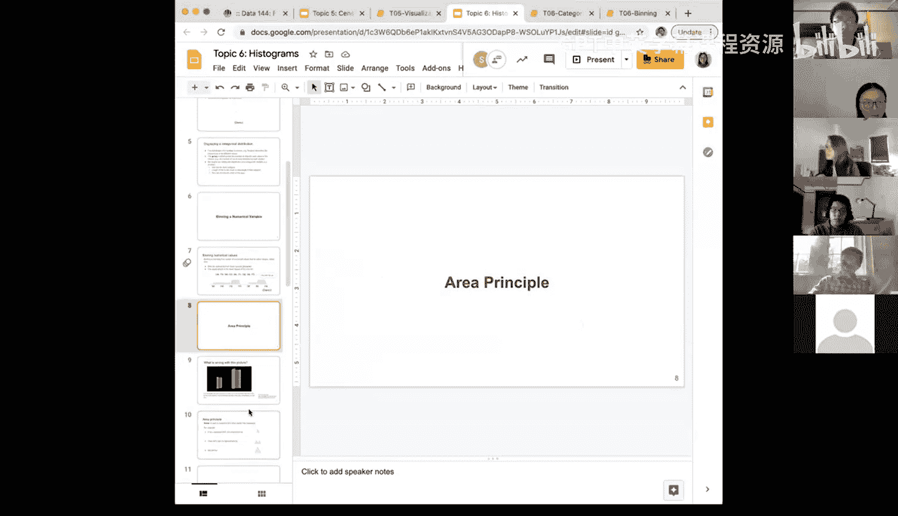
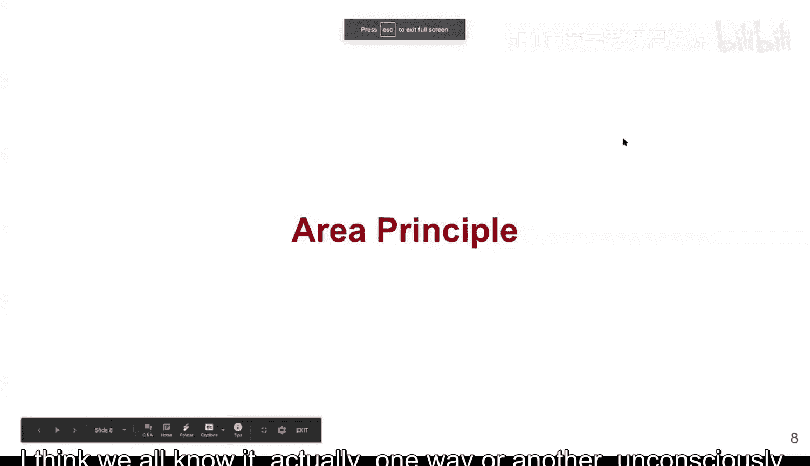
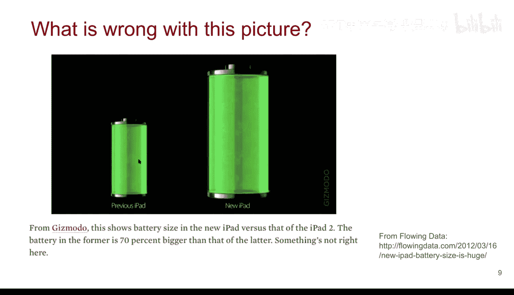
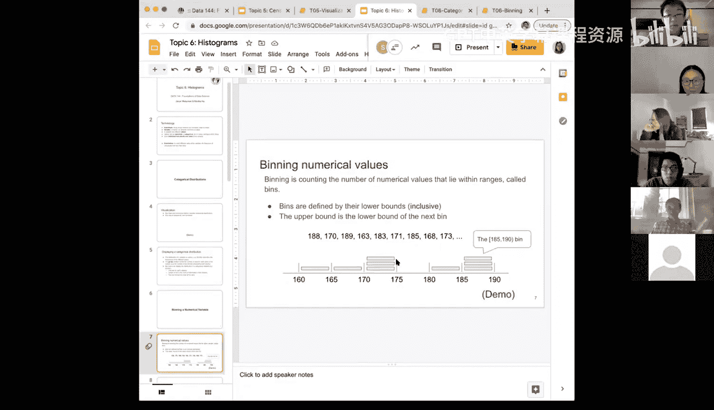

# UCB《数据挖掘和分析｜DATA 144 Data Mining and Analytics 2021》中英字幕 p23 [P23]lecture23-[T6 Histograms] Area Principle-JIKtaUqLKKo.zh_en [BV1efBEBuEVg_p23]

Let's start just a little bit， I know we're only having five minutes left but I think it's still be good that we talk about the area principle in particular that we need to know this pretty well in order to understand how we're doing doing the binning later especially for the histogram that we will create okay so for here let me just show you the error principle I think we all know it actually one way're another unconsciously so I just want to show it upfront to make sure that we are understanding it。

So here there's a news article okay， from flowing data， okay？They were saying that this figure。

ItShows the battery size in the new iPad on the right hand side。

Versus that of the iPad2 and also in the text they say that the better in the former is 70% bigger than that of the letter Okay。

 so what that is saying is that the right hand side okay。

Is 70% bigger than the left hand side okay so one thing I don't know if you are like pretty suspicious here to me。

 I feel like， well， when they're saying like 75% bigger the right hand side compared to the left hand side it's pretty much saying that well。

 this is I guess talking about the battery side okay and then they're showing us in this clindral form right。

 so it's really just talking about， I guess the volume right the volume the right hand side should be 1。

7 times the left hand side so if you agree with me on that kind of understanding of volume and then battery size。

 I think this picture will look a little bit weird because just based on the way that they're showing it。

 it feels like it's much better it's probably like four times not like 1。7%1。7 times larger。

Okay， so the mistake that they're making here， I think。

 is that instead of showing the volume 75% higher， the 70% higher， sorry。

 they're showing I think the radius okay the radius of it。

 but once you you know like the rate like the volume formula for for cylinder here is what like radius to the what is it I probably don't remember it correctly is。

Pi times r squared and then times the height right so the effect of like 1。

7 times radius actually gets squared right when you're showing it in terms of the volume。

Okay so that's the issue here and that gives us the important lesson which we will see soon。

 not today， probably on Thursday now of understanding standing a histogram okay。

 so the histogram as you will see is that well， the histogram each of the histogram that like the bar that we're able to print or like show visualize is talking about the percentage。

Of the data points fall into that bin。Just like what we did on that demo okay so but then later of course。

 remember what we did in that demo we're doing the pinning。

 we do the counting and then what's going to be important on the histogram we will see on Thursday is that what's being plotted well its not only just the area which is showing us the percentage but also the height of each bar。

Okay so that is an important lesson that we will learn on Thursday。

 so to help us get that just using like using the iPad example that we're showing here。

 the area principle is very important to keep in mind， okay。

 so the areas should be proportional to the values that we represent。For example。

 if you have 20% of the population by one triangle， then we know that 40% is just two times of it。

 okay， just like two triangles。But just like this example， like the mistake it made over here。

 sometimes people accidentally think oh， I need to like say twice like double the length right。

 double the length of the side Okay， but then again。

 according to the formula of the area of a triangle， we know that it's not going to be。Two times。

 right， it's going to be four times because there's a square term over there。

Okay so I know this might sound a little bit vague at this point。

 but on Thursday when we come back you will see that drawing histogram。

 we need to make sure that each of the histogram bar is showing us the percentage of each bin。

OkayAnd then the height of the bend。It is showing us the frequency。Okay。

 so if you have that lesson in mind you will know and you will see that on Thursday that because each of the bin area is the percentage that we're able to compute。

 then the height。Will have to be actually the area divided by the width。Okay。

 so that's the important thing to keep in mind because a lot of times like I said， like okay。

 just one minute， so I'm just going to go back to one example。

 I guess the bar plot that we did over here， for example， this one。

Okay so this is not a histogram per se because well we know this is bar chart right because each bar is talking us is telling us about the millions total growth total growth I think growth suggested for each movie okay。

 so here well the height or like the length of each bar is already telling us the numerical information。

Okay and this is so because we're plotling against the name of the movie right and then for us it's really just like the millions girl suggested information showing for each of the numerical each of the title that we're owe we have over here but for a numerical variable now we know。

 especially if you remember the example that we did for example， let me see over here， for example。

 okay yeah so like this one to1，1，3，1，1 they're the percentages if I divided by the total number of bins like total number of bars over here okay so what histogram will see that well if you have equal bins。

 then the height is the same as the area like proportionally but if you don't have equal bins。

 then you need to be really careful about how you're gonna create a histogram。All right。

 I won't bother you anymore and we're running out of time。

 so I think on Thursday things will become clearer and if not definitely make sure to come back to this part of the area principle as well as like just thinking hard about how to compare a histogram to a by a bart and then how they're different how they're similar and then of course you will see that in order to get to a histogram we have so many intermediate steps just like the bein right and later you're gonna see even more in order to create a histogram okay so there are many things going on so just keep in mind and I hope you will find it more useful。

Later as we get the detail a little bit more clearer。

 and then histogram is a very useful visualization method for numerical data。Okay。

