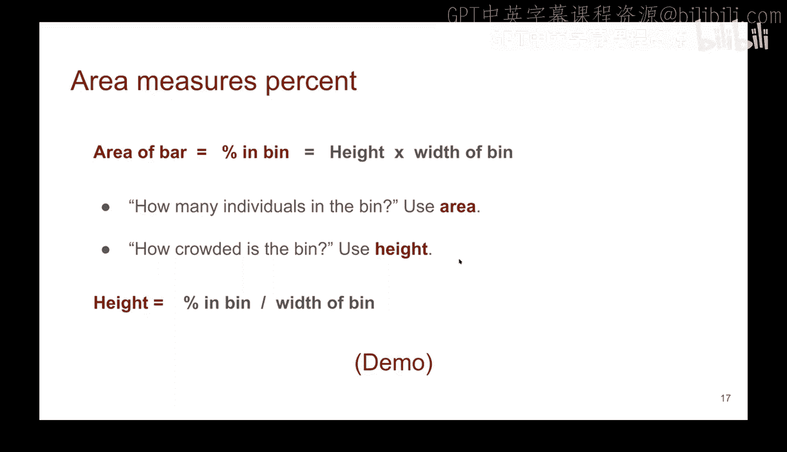
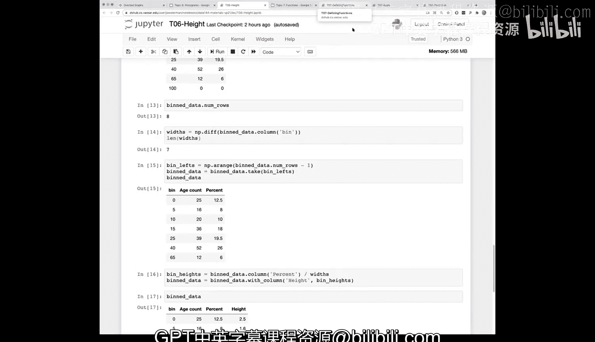

# UCB《数据挖掘和分析｜DATA 144 Data Mining and Analytics 2021》中英字幕 p24 [P24]lecture24-[T6 Histograms] Drawing Histograms-7_0xiW9WdD4.zh_en [BV1efBEBuEVg_p24]

Hereer。

All right， happy happy Thursday everyone， so we're going to pick off we're going to pick up where we left off last time where we started talking about histograms。

😊，🤧In particular， we talked。We talked about kind of what histograms are and histograms are really designed for showing distributions of numerical variables and contrast that to the bar plot。

 which was a good way of showing。Categorical values。

And so the key with histograms and one of the big primary differences from bar charts is is that histograms uses bins and so since we're dealing with numerical data。

 we can bin that data。And there's going to be one bar corresponding to the bin and unlike a bar chart。

 we the size of the bin so how wide these bins are is up to us and and the bins don't have to be uniform we can bin however however we like but when we have in particular it's in particular to pay attention when we have uneven bins that in histograms histograms really use this area principle where the area of each bar so the area and so that's the height times the width。

If you take the height of the bar。Multiply it by the width of the bin that will give you the percent of individuals in that corresponding bin okay。

 and that's。😊，And that's kind of important and we saw kind of from last time that gives us a good visual representation of。

😊，Of the distribution from there。Okay， so now that we have this idea that the area represents the area represents the percent of individuals。

 we should talk about how do we calculate the height and what does that mean in terms of the density of the distribution？

And so by default， so if we use the built in hist method on tables。

 it's going to normalize it's going to have a normalized scale and what that means is。😊。

That the area of the chart sums up to 100 and so again。

 that comes back to this idea that the area under each bin corresponds to the percentage of the entire group。

And if we're talking about percentage， we would like the whole thing to add up to be 100。

The horizontal axis。As we said before doesn't they don't have to be equal to each other。

 they can be and because we're kind of dealing with this in terms of thinking about these things in terms of area。

 the vertical axis so the y axis is going to be percent。

Per whatever the X axis is and so in these graphs that we're looking at down below。

 that's going to be in percent per year， okay？🤧So how do we calculate the height？Well。

 it comes from the fact that so looking at the kind of movie example and I'll show you a demo of that in a second。

 if we have a bin and remember the way we calculate bins right this is the thing that is easy to trick people up and it takes a very Python centric view。

😊，Inof far as that the starting bin right so I've shown in this example here we have this bin denoted from 40 to 65 and we're using the range notation so the square bracket means the start of our bin starts at 40 and is inclusive of the number 40。

😊，And so this particular bin starts at 40 and goes up to but not including 65 shown by the parentheses right so that's not that's not like a typo that means that the bin all of the items in that bin will be greater than or equal to 40 and less than 65 okay。

😊，And so to calculate the a particular height of a bin so we can count the number of items。😊。

In that bin and so for this movie example that I'll show you a demo for in a second this bin has 52 out of。

😊，200 movies okay so。The percentage in that bin is going to be 52 out of 100。

 or if you just do the math， that's 26%。🤧And so we want the whole thing。

 we want the whole area of that bin of the area of that bin to represent 26%。

 so to calculate the height， we're going to take this 26% and we're going to divide it by the width of the bin。

And in this case， the width of the bin is 65 minus 40 that gives us 25 years wide okay so the height of the bar if we are plotting this out and the good news is here。

 I'm kind of walking you through through I'm walking you through the mechanics to show you what the histogram method does but but but it will do all of this automatically for us and so the good news is we don't have to do all of these calculations but it's good to know where these calculations come from。

😊，So we're going to take the 26%， so that is。The area that we want to represent and then we just take the width they take the width of the bin itself and we take the 26 divided by 25 and then that's going to give us the height which represents。

1。04% per year okay， and then if you multiply that the height by the number of years 25 that gives us。

Our 26% our area for that bin。Okay， another way to kind of look at that is that thinking about height in terms of density。

And so kind of from our formula。😊，🤧。From our formula， Heida Bar is our percent over the years。

We can just kind of rearrange for height and so if we look at the height what does the height represents the height represents the percent in the bin over the width of bin right and we kind of went over that on the last slide and so。

The height， the way you kind of want to the one way of thinking about the height is it measures the percent data。

Relative to the amount of space in the bin， okay， and another way of saying that。

The way you can think of the height is is that how crowded is that bin how in other words。

 how dense is that bin so the higher the height， the more items are in that are in that bin in that bin they're going to be more crowded together and so one way to think about it is is that the area the area represents the percentage。

 the height represents density of that bin。And again。

The units of height are percent per unit and whatever the unit is described on the X axis。Okay。

🤧And we talked about this and just just to kind of have it in reference form。

 the area is simply the height times the width and that's going to be the percent。

And so if you're asking yourself， if you're asking yourself the question。

 well how many individuals in the bin， well that's the that's an area question right that is the percent over the total。

 but if you want to ask yourself how crowded is a particular bin you can get that just looking from the height。

😊，All right， let's take a look at that and see an example。

Any questions so far while I'm getting the demo up and going？All right。

 and I remember to make remember to make the Jupiter notebook big this time。

 so hopefully everyone can see that if it's still too small。Say something in the yeah。

 speak up or pop something in the chat and I'll make it a little bigger。

 but I think this was just a bit bigger。You want to make it a little bit bigger？Yes， no problem。

Ha's that？Perfect， awesome， okay， 75， 175%。Is our default going forward fantastic， thank you。Okay。

 so let me。Let me to this Okay great so in part of all of our stuff and so here we're going to read。

😊，The topu from 2017。And so now we have that table， we can look at that real quick。😊，Okay。

So we have titles gross and year and so what we want to do is for this demo we really want to look at the ages of movies and so this year this list came out in 2017 so let's take the ages of the movies from 2017 and so we're going to make our own table and so we can do that by extracting the year column from our table and we're to make a new array we're going make a new array subtracting the year that the film was made from 27 and that will give us the age of the film in 2017 okay and then we're going add it back we're going to add it back to our we're going add it back to our table。

😊，And so if we do that， a new column automatically appears and that's going to be the age of the movie。

 right relative to 2017。Okay， so that's all that's all review and so now' going to look we're going to look at this in a histogram and so whenever whenever if you want custom bins for a histogramre going you're going to need to make them yourself and you can do that with the makeAray method。

😊，And then it's just the list of the bins and again， the way you want to kind of as a review。

 the way you want to think about it， the first bin is going to start at zero and go up to but not including five。

 the second bin starts from five up to but not including 10。😊，m all the way up to the bin。

At the end is going to be 65 up to but not including 100 okay so we'll make those bins as as an array and now we can call the bin method on our movies table and so the first argument there age is what we want to bin on right so that's going to be our newly created and the bins。

The bins that we'll do。🤧Or my bins if you leave this last part off it will auto it will try to guess what what bins you think you might like from there okay so if we do that and we take a look at our bin data and so notice right Monica talked about this on Tuesday but kind of one of the quirks of it is is that you get this last bin here okay right so。

The last bin that has like any width is from 65 but up to and but not including 100。

 but the when we look at the bin data here， it's going to show you that last table。

 it's going to show you that last bin but there's not going to be anything in it from there， okay。

So that's just something to kind of be aware of。When you when you kind of look at the counts for the bins right so we've called the bin so now we've actually got the counts for each of those bins as we specified。

Okay， and so we can now kind of， we can now convert that， we now can convert that to a percentage。😊。

And so since we have the counts to convert that to a percentage。

 we're going to add a new column percent and so we're going to take our。

Bin data and our age count which we have there and we're going to divide it by the total and so how do we know what the total was。

😊，We can see from this from this table here right remember because this is the the accounts from the original table and you can see it shows the first 10 and that there's 190 left so there's200 there's 200 in that column there so we're taking that。

😊，And we're taking our data and dividing it by the total number of count。

 and that's going to give us our percent。And if you want to see that。Yeah。

We can see now we've added a column， we've added our column to our bin data table。

 and so now we have a percent from there， okay。All right， so now that we have our percentage。

 let's actually look at the histogram。😊，Right so the histogram method on tables will actually show the histogram for us。

The first column is what we're going to do the numerical data that we're going to do the histogram on。

 and so that's our age。And we're going to use our bins and this is just this unit is just going to be useful for when we plot out the title is is going to show up on the axes here。

So now if we've run that now that is creating the histogram with our custom bins with our custom bins that we've shown and the unit here right shows up in the percent per year and the age per year right it's really just a string you could put you could you should you should put the unit but if I just put you know high and rerun it it's just going to show you it's in units high it's not doing anything with the unit parameter other than。

Oops。Other than updating the title for us， okay？And comparing that to our B data。😊。

You can see the age counts and the percents and then but notice right the percent per year right so it's taking each of these bins it's taking each of these bin percentages and it's spreading it out across the width。

Of the bin。And that's why the unit， that's why the Y axis is percent per year， okay。

 and so if you actually wanted to get the actual percentage。

 you're going to take the height here and multiply it by the width。

And so let's see a particular example of that。😊，And so。

If we if we look at the data where the bin is 40， okay， so we're going to look at this column here。

And take a look at that percent。You can see that 26% of the movies are in the 40 to 65 bin， okay？

And you can actually see that from this table right here by looking at the 40 line and then the width of that particular bin is going to be the start minus the end minus the start。

 so the width is just going to be 40 65 minus 40。And then the area。

 the height is going to be the percent divided by the width。In that case， it's going to be 1。

04 and if you look at that graph here， you can see it is if you look at kind of the one。

 it's just above the one。And so that looks like the actual that looks like that all kind of checks out。

Um，If you look at just showing the bindate again and the number of rows， you can see that again。

 that last row here is kind of like the end row。😊，If you wanted to get。

The width of each of the bins we can use which showed up in one of in I think the last homework you have the diff method and that's going to show you the difference between all of the different is going to show you the diff between the columns and so if you do that。

You can see that it's gotten rid of that end and the width column themselves。

Actually has all of the widths， okay？🤧And so。If we want to calculate all of the the。

The bin data themselves， what we're doing here is we're creating our number our bin data minus one。

 so we're creating just we're creating an array of all of the left most。😊。

Bins and then we're just going to take。That data there， and then if I show you this。That gets rid of。

This gets rid of the last。The last the last bin， the last bin here and then is just showing the start of each of these bins right so each it's showing the start。

Of all of them and getting rid of that last bin so the the bins in our particular graph started at 05。

😊，10， 15， 25， 40 down here， 25 and 40， okay？And then now that we have all of the starting bins numbers。

 we can just simply divide to get the heights， we're going to take the percent and divide it by those widths。

And then。Went wrong。Oh。な。Okay， good。Yeah。And here's all of our BI data。

With the particular heights associated with it。And then just kind of putting it all together。😊。

That's where we come up so bin or five H count and then 15。Oh something， something， hold on。

Itened what did I？Did I。Oh， give me one eye， I overwrote my data。Restar and run all， let me。Okay。

 that is much better。So is in this over here， I overwrote my binI data so that was throwing off。

These graphs up over here but putting everything all together here are the manual heights that we collected and if you compare them to the actual histogram they they all line up。

😊，And so again， kind of the takeaway is is that we're calculating we're calculating the heights with represent density。

 the height times the width gives us the area， the percentage of individuals in that bin。😊。

And you know， we kind of work through in this example how to calculate those heights。

 but the good news is is that the the histogram。😊，The histogram method will will do that automatically for us。

 but it's helpful to kind of walk through all of the steps in there just to kind of remember what's going on with them so the width。

The the area represents the。The percentage， the height represents the relative。

Denssity in that bin right and so you can see this is a very crowded the first one from zero to five that's a very crowded。

😊，It's a very crowded bin， there's a lot of movies relative to the size of the width of the bin。

And down here at the end， it's relatively sparse。Okay。Any questions about that？

I was wondering why the last spin is showing as a result whereas。

And the table that you showed us in there， the hundred。Have any individuals in it？So the。So up here。

 this one right here。And12 or further down yeah this one shows that the yeah so this is kind of this is kind and thank you for asking it it's kind of worth highlighting。

It's kind of the way I think of it is it's kind of a quirk with the histogram method。And so。

The way the way the library works is that so lets let's kind of think about what that last bin is from here。

 this last bin starts at 65 and and goes up to but not including 100。

But it's showing for the way it works for plotting is is it's actually showing the next bin。

Um the the starting the starting point of the next bin because of the way it's defined when when you want to calculate the width of the bin you're actually looking at a difference and so it's important that we actually know where that bin ends。

😡，And so it's showing the hundred as really the end point。For the previous bin。

 but it's there and it's going to show up as as a bin。But it's a bin， it's a bin with zero width。

Okay， and so you're not going to see any items in it。Um， from from for all practical purposes。Um。

 and so， you know， I kind of just kind of view it as a as a quirk u with that。

I don't if that satisfy I don't know if that answers your question in a satisfyingly manner。

So if we have other tables that we're working with， then they have zero。Would that happen as well？

What do you mean what do you mean for tables？I mean。

 we have all of this data and we have a binI that we're trying to show that has zero individuals in it will that also happen in another exercise？

You you mean at the endpoint？No， not at the endpoint like if it's。In the middle。

 for example oh I see it like something or will it be completely empty got you got you Yeah， yeah。

 so if if for example， the if the bin from like from 10 to 15 didn't have anything in it it would show up empty。

It would show up as a gap。In the histogram。Okay， thank you。Yeah。Okay， let's。Let's go back。

From thereAll right， I think this wraps up this topic。

。