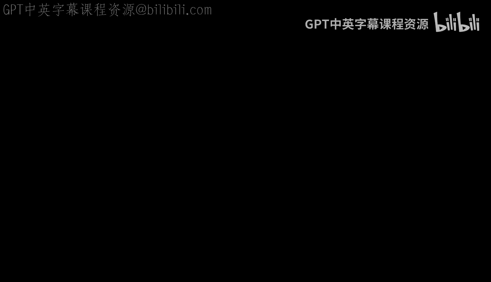
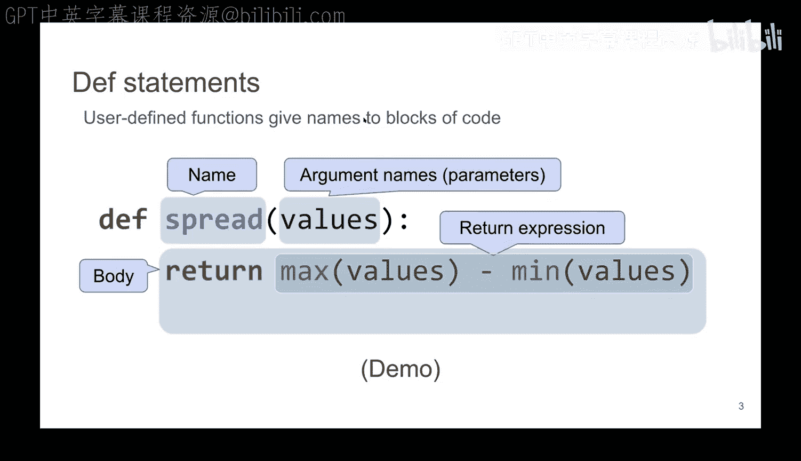
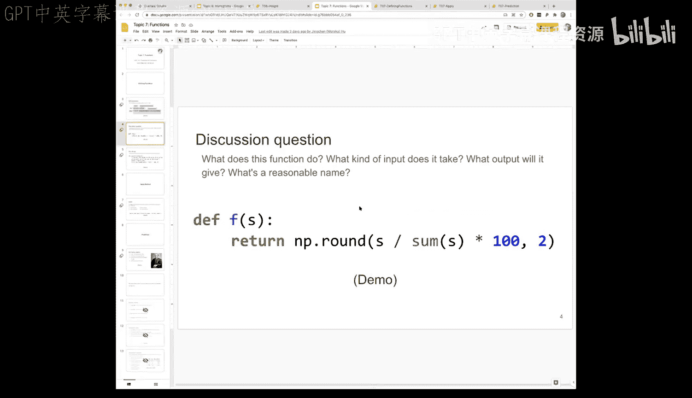
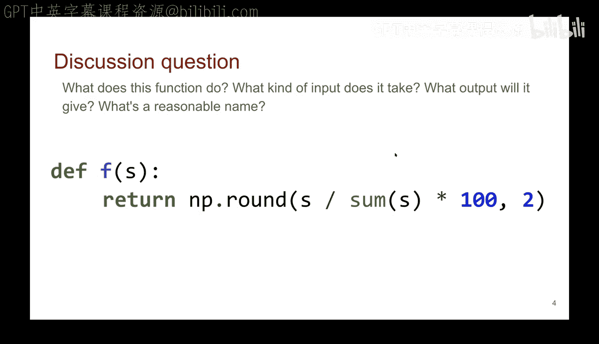
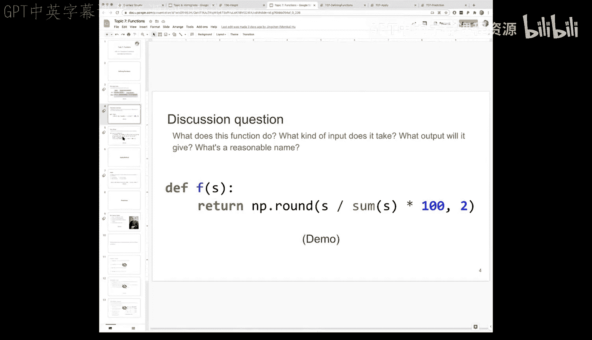
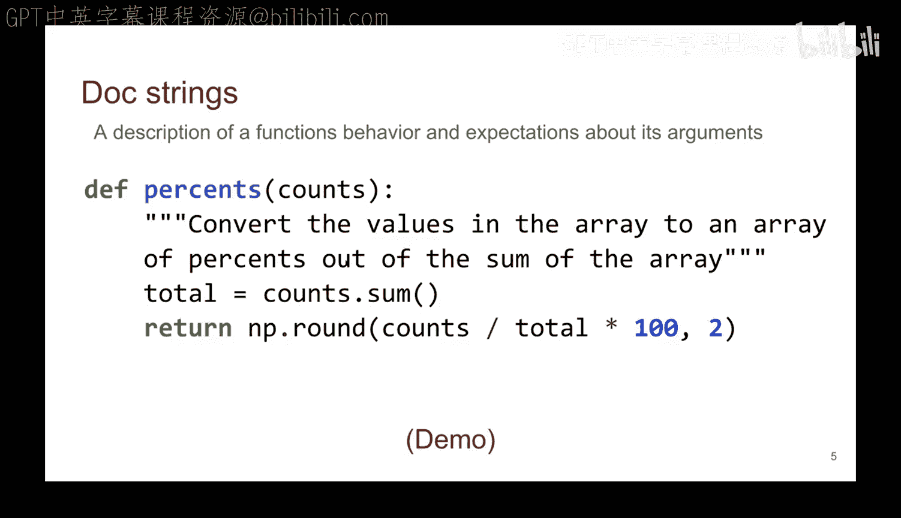
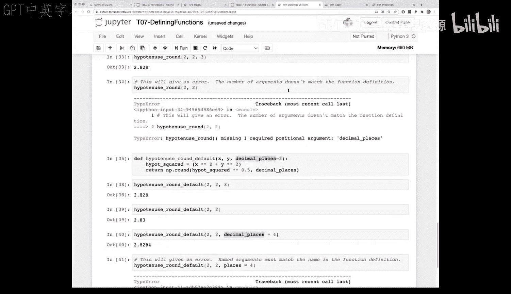

# UCB《数据挖掘和分析｜DATA 144 Data Mining and Analytics 2021》中英字幕 p25 [P25]lecture25-[T7 Functions] Defining Functions-eaB-lFQOS68.zh_en [BV1efBEBuEVg_p25]

Okay， so we've been using functions， we've been using functions almost from kind of day one in this course。

 we've been using kind of built in functions that have been written and provided for us。😊。

And in one of the surveys someone asked their great question what's the difference between a function and a method there's a lot of similarities between the two both of them are things that you call to perform computations and operations and both of them can take arguments as we'll see the primary difference is is that functions are standalone。

😊，And we're going to talk about today how to write functions and so they're standalone。

 they're not attached to any any object。And so when we use a function。

 any data that that function is going to operate on is going to be passed in to the function inside the parentheses as an argument。

Methods， on the other hand methods are called on existing objects and so if you have a table using the dot notation we have a table called like MB you know MB dot show right that is that is a method that is a method performing an action on。

😊，The table object okay， but they both are used to do computations and do useful work and today we're going to learn how to write our own functions。

And so before we going to think about look at how to， let's look at the anatomy of a function， okay？

😊，Functions Python gives us the ability to create our own functions and our own function definition start with the keyword DEF and so that is short for a function definition so this is how we define a particular function。

😊，And the way you want to think of a function is it's a way of giving a name。To a group of code。

 a block of code or a set of computations that you're going to want to do probably multiple times。

Fctions are good in the world of computer science because they allow for code reuse。

 so instead of writing out all the steps that you would have to do to perform some function you just define this function once and then you can call it you can call it you can pass in data。

😊，And so all functions have a name， and that follows the functioning definition。😊。

And functions may or may not take arguments， okay？Arguments argumentgument names are go go inside of the parentheses and if your function doesn't doesn't take any input doesn't take any arguments you'll still have the parentheses there just won't be anything inside of the parentheses but you can have zero one or more arguments and if you have multiple arguments the argument names are going to be separated by by commas okay and all the arguments are going to go inside of the parentheses and then this colon is is。

Let you know that this is going to be the start of the function。😡，And then。

Lines underneath this function and in Python is in particular。

 they need to have this all of the lines in the function have to be indented to the same width， okay。

😊，In this case there's just one one line in our function and so you can see how it's indented。

 but if we had multiple lines the of this function they're going to。They're all going to need to be。

Indented to the same width okay， and then if you want to if you want to get a value back out of the function。

 you you pass that with the return statement here。Those are the body and this in this case right this function is going to create the spread it's going to give us if we pass into values。

 if we pass in an array， it's going to give us the difference between the maximum value and the minimum value。

😊，From there。And this is the return expression and so when we call a function when we call a function most of the time we expect that function to return some value right that's the that's the value of that expression which will either you know save as a。

😊，As another object and what gets the value of the function call is going to be defined by this return expression and that is denoted by the keyword return。

😊，🤧From there and so all functions follow this this format， they have the name。

 they have the definition followed by the name， any arguments， the body。

 and then most functions end with a return statement。😊，From there， okay。

 and so let's actually take a look。😊。

Add some functions。Okay。Go to dump， so here's our boiler paint and here's now our first function definition and it follows。

😊，It follows the the nomenclature that we had in the slides so it starts off with the keyword de and then in name of the function we can give we can give it any name that we want following the same rules that we named our object in the system insofar that you can't have any spaces and it has to start with a letter you can use numbers but no punctuation other than an underscore so your。

Your function name has to start with a letter can't start with a number but but it can have numbers in it and the only punctuation you can use is the underscore so here we're defining a function with the name triple and it has one argument which we will call the name will give the name X。

Um。This X。We can give it whatever name we want， but much like choosing the names for our objects in our systems。

 the more descriptive the name is。The easier it is to understand what your function is doing so for this example here it's such a short function you know x is is a perfectly fine name。

 but as we write more complicated functions。😊，It it's often worth taking a moment or two to think about what is a good name for our argument because we're going to use we're going to use this name inside of the function and so in this case what we're doing is the body is just this one line of code where we're returning three times our input is really how you want to think about what that function is doing it is taking whatever is going to get passed in when we call that function and it's going to return three times that value so first we need to define this function so if I skipped over like if I forgot to do that and I actually call this I'm going to get an error because Python has no idea what the triple function is yet right so that's giving me a name error and it's saying triple is not defined that's because we haven't done a function definition yet so now when I run this cell and nothing is going to happen I mean nothing is nothing is going to show up to the screen but now it will define that function。

And so now when I call when I。When I call triple it's going to pass in that value three。

 it's going to pass in that value three and that value three is going to be contained in the object X so when we call with the input of three。

😊，X is going to have the value of three and it's going to perform the body of that。

 which is going to return three times x and in this case three times three。

 so the value of this call， so what we're going to say is when we when we execute this line。

 we are calling the triple function with the value three。And that whole thing is going to evaluate。

To whatever the return value is and so when we call that this whole thing is going to evaluate to nine okay。

 and if we wanted to keep that if we wanted to keep that。

We would assign it to some object and so we want to say value。Val equals triple。And then。

And then we can use the value， we can use the value from that function。Later in our program， okay？

And so't have to be it doesn't have to be a number that you pass in。

 it can be any other object that has been previously defined。

 so if we define if we save the value four to the name nu。

 we can call triple with the name nu and so what should that return for us？It should take our input。

 whatever the value of our input is and return us three times that value。

 so that should the valuation of this function we call this function， it should have the value of 12。

Okay， and it doesn't even have to be， it can be any expression。

 it can be any expression that could get passed in。And so in this case。

 what we're doing is is we're passing in number times five and so how that works is before the function is going to get called。

 before the triple is going to get called， it's going to evaluate this expression。

It's going to actually do the math for us and it's going to come up with a value for that expression before it calls the triple function so in this case we're going to take numb。

😊，Whi has the value four， we're going to multiply it by five and so we're going to pass in the value 20 to the triple function and when that gets tripled。

 the value of this should be 60 okay？😊，Any questions about that？

So basically the way I like to think of functions is that you you pass in a function with a function。

 you pass in some some value and those are defined by your arguments。

 some computation is going to get done and then it's going to give you back a value which is the。

Which is the value of that function call expression。From there， okay？So。Here's an interesting thing。

What happens if I just evaluate x right so here's this function call。😊。

We're here inside of this function， we've defined this name X。

That will whenever this function gets called， it will have the value of whatever was passed into the call whoever called it。

Now is x is x？Actuallyly defined in our in our program so if we we can just see by trying to evaluate it and we see it gives us a name error and that's a good thing that's a good thing because this X this X in computer science speak。

 this X has the scope of the function。That's just a fancy way of saying this name X。

Is only defined when executing the code inside of this function。😡。

It doesn't live outside of this function。And so。For example， if I say x equals five， okay？

Vi say x equals5， and now I call triple two times x。That should return us well x is five。

 so we're multiplying it by two that's 10 we're a triple it， that should return us 30。

What is the value of x， what is the value of x and if you can see the comment it should still be five and it is because this x is defined outside of a function。

 it has global scope， we can use it in any of our cells。This x here。

 this x is defined only when executing that function。😡。

And it's going to have the value of what we pass in， and then when that function is done executing。

 this x longer no longer exists。It is tucked away inside of the function and this is a good thing。

 this is in computer science land， this is the concept of encapsulation。😊，And what that means is。

We don't need to know。What variables are being used or defined inside of a function。

 all we need to do is we need to just understand the behavior of what a particular function does and there's not going to be any conflict of variables。

😡，From there， so we don't have to worry about the variable names in any of our functions。

Those are limited。The lifetime of those variables of those names live。

Only when it's executing a function。Okay。😊，And in Python and in Python， we can pass in。

Numbers strings anything into a particular function and the function won't give an error as long as the type that we pass in is compatible with the instructions in the body of that function okay so。

😊，If you remember one of the things that you can do to strings is you can actually multiply strings by a number which is kind of a funny thing to think about and if you remember what is it does it does it actually just concatenateates the string however many times you multiply a by so I can call triple on the stringha。

😊，And。It's going to。Return。哈哈哈。😊，A little joy in mirth for Thursday okay that's because that operation made sense you can actually multiply a string by three and so that will also work with arrays and so if we may if we use the a range the array range function this is going to create an an array for us from zero1 two and three and it's going to pass that array into the triple function so it should return。

😊，U an array with all of those values tripled and in fact it does， it returns the array of zero。

 three， six and nine from there， okay？😊，Any questions about arrays。

 sorry about functions and function definitions， we'll get some practice。Defining them。Any questions？

Okay， fantastic。Alright， so。Okay， so。Let's kind of take our take it take our newfo our newfound knowledge of functions and let's think about can we figure out what function this will do so when when we think about functions when we think about functions I always want to I always think about them in in a couple of terms I think about term functions in terms of。

What are their inputs， what inputs does that function take？😡。

What are the valid types of inputs that that function supports and what does that function return what is its output okay and so if we have this function which I've given intentionally a very nondescript name。

😡，What is let's see if we can kind of decode what does this function do。

 what input does it take and what output？😡，Will it give and kind of when we figure that out what's a reasonable name for that function so to take a moment and just kind of work through what's going on here and so if you notice functions can call other functions。

😊，So to get a sense of what what it's doing， think about what are we doing with the input right so our input is S so how is S being used。

 what functions is S being passed into and what are we returning？😡。

Is it taking the percentage of something and then rounding it to two decimal places yes。

 so yeah so the the big clue here is this kind of this round right and so。

If we think about what's going on here， so we're taking S。

 we're taking S and notice here this sum of S Okay， and so what。

What type and so I its always it's always good and useful to think about what types particular function support and so the sum what when we call sum what gets passed in what is what type that pass in I think I heard someone say the right answer an array that's right so so this this sum function supports arrays and so you know to answer the question what kind of input does it take well then S。

We should be passing in array to this function。And that's exactly right so it's going to give us it's going to compute the sum of this and then we can support division on on individual elements of the array and so it's going to take the sum which is some number and it's going to divide every number。

😊，Every element of that array by the sun。And so that's giving us that's giving us the fraction。

 right， the percentage。😊，Of all the individual elements in our array。

 but to make it into as in a percent we're multiplying it by 10 so that's what this inner thing does and notice that whole expression is what gets passed into the round function。

😊，And then the round function takes a second argument。

 which is how many decimal places are we going to round to？😊。

And then it's going to return that value， so let's actually let's actually take a look at that。😊。

🤧嗯。And so what does that look like so here is here's the function now more aptly named you know percent or percent of total。

 I think are good names for that。😊，🤧And then。When we define that function again defining a function。

 it doesn't call the function it just makes it allows you to call the function。

 And so now we can pass in any array。 So here I'm passing in the array1，2，3 and 4。

 and so when we do that。We get back。An array。Where each one of these is the percent rounded to the appropriate decimal。

 but for this number it was a whole， all these things work out right because this gives us 10。

If we take the sum one plus two plus three plus four that gives us 10。

 so one is going to be you know one over 10， so 10%， 20， 30 and 40， but if we call it again。

With a different array， we if we give a different array as input。

 we're going to get a different array as outputs and then here we actually get the。😊，Actually。

 you know， we get to see the rounding in use from there。Okay。

Okay， so when we write functions。It's very helpful because we write functions because we want other pieces of our code or other people to use our functions to call our functions。

And。Python is really cool because it actually is a self documentmenting language。

 you can write the documentation for your functions inside the function themselves and anyone who wants to use your function can get the documentation for that function。

😊，And so how do we do that， we do that in something called Python doc strings。

And these doc strings are just basically a description of。😊。

How you expect that function to work give it you know so some of them can be some of these doc strings can be very detailed that lists examples that detail all of the inputs all of the outputs but we can do that from our we can do that by ourselves and so here is a here is a do string。

For the function that we just wrote。🤧And so doc strings， they start in triple quotes。

 so notice the triple quotes here and those will。And I'll show you how to read doc strings from there。

 but I think it's easier to see in demo form so let me hop back to our demo here and so here's here's our function with with our doc string okay and so。

😊。

Here what i've done is so I've kind of cleaned up our function。

 so I gave it just this percent of total is a good name but percent is a little more concise i've changed the input from being S。

😊，To count。And so and then I've given it a duck string so convert the values in the in in array right so in the array so I'm kind of letting you know that a valid input for this function is going to be an array。

😊，And I'm telling you what i'm going to return and so i'm going to return an array right so I convert the values of an array to an array so i'm letting you know what i'm when that i'm going to return an array so you know that you should be passing in an array you're going to get back an array。

An array and I'm explaining what the the function does， right。

 it's an array percentage is out of the sum of the array。😊，And here， and again。

 all included in the triple quote， I've given an example of how to use it。😊。

And so these three little greater than signs those are the interactive Python prompt and this is just the format that do strings use for showing examples and so this is showing you an example function call if I did the percentage of make array 10 15 and 25 this is what I would get back I would get back 2030 and 50 from there and then and then we end with that right so this is basically one big string。

😊，One big duck string and then that's not part of what actually gets executed when you call is really a comment。

 a documentation comment explaining how the function works and so then the other thing I did to kind of clean up this function is instead of having a just big one long expression here I broke it up I broke it up I made the sum into it into into the total and I think you know from a readability standpoint。

 this is a little easier to understand then than up here right because here you kind of have to work through exactly what's going on to figure out what it's doing but in this case right where you can see that I'm clearly taking the total as the sum and then you know taking the individual count。

Each of the individual elements of the array divided by the total times 100 it's a lot easier to see exactly what's going on okay so now if I define that function here。

😊，One of the things that you can do and this is a Jupiter notebook thing。

 so if you want to see the documentation for any function for any function that has a doc string associated with it。

 you can just type the function name。With a question mark and so it is your way of asking for help and so if we evaluate this。

 this is going to return the duck string。😊，And you can see it actually shows up in a separate window down here。

 it shows up in a separate final and it's it's showing us can everyone see that？Um。It's showing up。

 it's showing the signature， so this is just the inputs and outputs and it's showing it's taking account and it's showing us the dock string。

Here's the duck string and then it's showing us an example of how to use that Okay。

 and so here if I add another cell。😊，You can do that with pretty much most any function so for example if you wanted to see so what what are so I use the sum method right but that's on a table but if I did if I wanted to see the built in I should be able to do some question mark。

And then here is the do string for that right we can make this a little bigger and it's showing you return the sum of the star value plus iterable number so you know some of the do strings kind of talk in python speak。

😊，Um。But I think。Think I could do。 Think I could do table。Table。

 no I can type table dot sum question mark。No。That's when you try to。

 that's what happens when you try to do live demos。あ。

But if there's a function that you're not sure how to use， you can try always putting。

The question mark after it and then another way of doing that is is that there's a help built in function。

😊，And you can just call it， you can just pass in a function name and that will show you instead of showing up in a separate window。

 it will just show you kind of in line from there。Right， so you can do something。

 you can do something silly like。You can do。Help。Oh。😊，And that will show you the help function there。

From there， so that that's pretty useful if you're not exactly sure what something is doing。Um。

Imp Python。Okay， any questions about that？Okay， let me talk let me go back to the demo and kind of wrap up the demo and that might just be as far as we get today。

Um。So you can pass in multiple arguments to a function。

And when you define them when you pass them in to a function。

 you separate them by columns and when you define a function， you do exactly the same thing。

 you separate them by commas and so this function here this will。Calculate the hypotenuseose。

By calculating x squared plus y squared and。From there。And then if we call that。

That returns that and then two plus two should return us， yeah， two squared。

Plus two square root is four is a square root。あ。Of that。Okay， so if you have multiple arguments。

 you just separate them by commas， both when you call a function and when you define a function。

One of the things that you can do and a lot of the data science methods and functions in the data science package make use of this。

 so it's worth kind of pointing out is that you can have default arguments。

You can have default you can have arguments that are optional， okay？m，And so if we took this。

 if we took this hypotenuse function that takes two， we can add a third argument， okay。

 decimal places。嗯。And that's going to tell us how much we want to around by okay and so。

If we do that and here we're just going to make use of so this hypotenuse round is going to make use of our previously yeah。

 so we're going to keep we're going to。We're going to compute the hypotenuse like we just did before。

 right with the hypotenuse squared。And then instead of just returning the answer directly。😊。

By squaring it， we're going to run it through the round function first。

If define that and then cause cause that So that tells us how many decimal places we wanted to round to right if we wanted to do that too that would round to there if we wanted。

We can do that。Okay。😊，However， if we called it right so now that now that we've specified this argument this last one this decimal places。

 once you've defined an argument you have to in the function definition it has to be called with with all of the arguments you've defined so if I go back and I I call and I call it without the third one that's going to give us an error that's going to give us an error but but。

Sometimes you may you most of the you know， so for some functions。

 you may just want to have a default if the user doesn't specify an argument。

To use some reasonable value， okay？And so Python allows you to have default arguments and so here just like we did before。

 those decimal places we define it， but what we do is after the definition we use we have this。

 we have this equal to。😊，And what that's saying is， what that's saying is， is that。

If the user doesn't specify a third argument。😊，Assume。

The default value of two for the decimal places argument。

So if we define that function and we call it and and if they pass in an argument。

 if we pass in an argument， the third argument there overwrite the default value okay。

 so if we call this with three。It's going to do exactly what we we thought it was going to do it's going to round to three decimal places right then if we've gone with five。

It will do that。From there， but now if we don't， if we leave off that third argument。

 if we leave off that third argument， this will not。This will work properly。

 it will not give us an error。And it will go to the default， okay？And so。

A couple of restrictions on default arguments， default arguments。

 you can't have any non default arguments after your first default argument。Okay。

 and so I couldn't do something like this I couldn't do I couldn't define a I couldn't define a non default argument Z after a default one so if you have a default argument。

 all of the other arguments after that must also be must also have a default associated with them。Um。

And if you have multiple， if you have multiple， if you have multiple。Default arguments。

 you have to refer to them by name。😡，If they're if they're coming out of if they're coming out of order。

 and so here we explicitly name the the default argument that we want to set from there and Python allows you to do that。

Okay， but we can't give it any any old name that we want this decimal places has to match。

This name has to match the name in our function definition。

 so if we just did places before the name you're going to get an argument mismatch right in particular you got an unexpected keyword argument right you got an unexpected argument name places it was expecting something that had the name decimal places。

From there。Okay， all right， I don't think we have enough time to start another topic。

 so I will I will stop us here and I will entertain any questions you guys might have for like three minutes。

We'll get some practice we'll get some practice in lab writing functions and using them the key the kind of this the the sneak preview is what comes next is。

We're going to really take we're going to take advantage of the the fact that。You know。

 when we call when we have an array and we can like multiply all the elements in the array。

 we're going to be able to do the exact same thing with columns in our table。

 so the next thing is going to be this apply method and what that's going to do is is if you apply a method on a column it's going to allow you to call a function on every element in the column automatically for you。

And so this is really where where functions are going to get a lot of power because we now can once we've wrote once we've written our functions。

 we can now apply them to arrays， we can apply them to all the elements in our array so we can apply a function。

To a column of data and that's kind of that's kind of the next step in our journey and once we do that we can really start doing some amazing kind of data analysis on our tables right now we're kind of right now so right now we are at the mercy we are at the mercy of the data science library package and and that can get us really far because it's a pretty feature packed。

Library， but there's going to be times where you want to do things that are going to be very custom and and basically applying a function to a column is a very convenient way of of doing that So that's what's that's what we'll we'll pick up with on。

On our next class， all right， so any questions， any questions with that。😊，Okay。

 great well I have office hours starting at three so if you have any questions on the on the homework assignment that's do tonight pop in my office hours here let me stop the recording because no one no one this does not need to。

😊。

