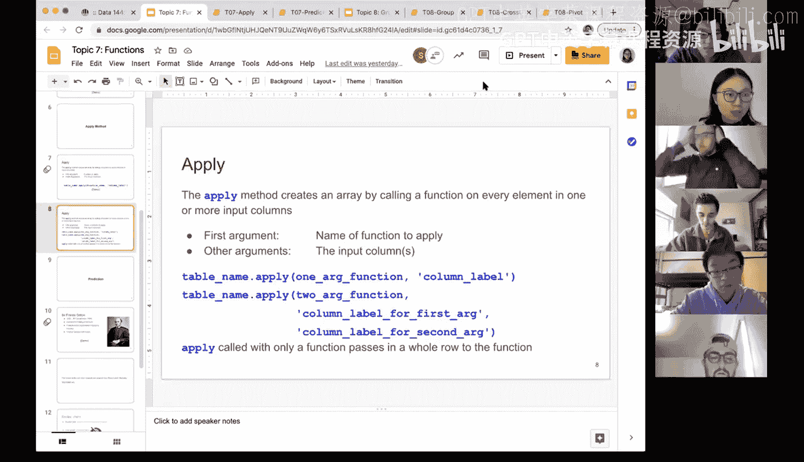

# UCB《数据挖掘和分析｜DATA 144 Data Mining and Analytics 2021》中英字幕 p26 [P26]lecture26-[T7 Functions] Apply-NdPhH60hLaA.zh_en [BV1efBEBuEVg_p26]

Okay。

All right， so welcome to today's lecture I was saying earlier that we're going to resume from the apply method and even though we had seen。

being used in the lab I think last week， but let's try to cover it more thoroughly so that some of you can resume keep doing your lab as well as I think the whole work and also be related to the applied method as well and is a really widely used method you will see that throughout this course anyway so let's star from there so this is the topic seven the functions。

Topic and then the apply method I think Jason applied will talked about it to some degree。 So for me。

 I wanted to take it from doing the entire demo maybe yeah like to make sure that we are on the same page so the method so the apply method as we know now is that it's going to create a array okay by calling a function on every element in a particular input column okay and you notice that we're doing like columns so in fact you could apply the apply method to multiple columns depending on the function they're doing so this again relates to if you remember。

 some function only takes one input right sometimes a function maybe compare two columns at the same time。

 things like that so you could do it for multiple column but for what we're focusing on right now is just to give the demo and then try to make sure that we all understand how we can do the apply method by calling a function。

A input column， so the example I think you have seen is this。

People with their birth here okay so we only have four people here okay four names and then the four birth here and we can do like like what we're talking about since this the applied method we know that it's been a particular function that you want to call to an entire column that you want to do so there could be many things you can be doing right so one thing we're saying that well we know the birth here like there are four different birth years and what if we want to cap the birth year at a particular number like 1980 for example so the one function that we want to use to do that is well in this case we actually write a function so the function name is cap underscore at underscore 1980 okay and the input could be like in this example。

 the input when we looking at it the input could be a array or just could be a scalar whichever regardless were gonna take that input and return the minimum between X and 980。

So that's why if I apply this cap in 980 to 975， then we're gonna return the minimum right between 985 and then 980 and then the minimum well as we know is 985 1985 so we're gonna do 985 here however。

 if we're inputting a value that is greater than 1980 then we know that it's going to be capped at 1980 okay so that's why if we do 991 okay it's going to be 980 being returned okay so that's what we mean by cap at 1980 okay so that's when we applying this function by inputting a particular scalar like x and then trying to return the outcome so again on the apply method that we're covering here is that we can now apply this function okay on this entire birth year column okay so the way to do that okay again apply is a method on tables okay so the table name is ages and then we do apply。

And the inputs here， the first one is the function that we want to apply that's the name of the function。

 so it's cap at 1980。The second is in quote the column name Okay， so we can do that。

 and let's see what's the output。 Okay， so remember the apply gonna return you an array。

 Okay that's why we're seeing this and then cap at 1980 for those four numbers。

 we know that well the first two they are greater than 1980 right so they're going be capped at 1980 whereas the last two they are smaller than 1980 so they're going to just be reported by their original values。

 Okay， so that's why you can see that we can define whatever function that we want to be applied to a column Okay and what's more keep in mind that the apply is returning you a array Okay so maybe let's just say like you wanted to attach this column attach this array into the original column and then just call it like capped at 1980 and now we know in order to do that the apply method gives us an array right。

 so in order to do that if you are。WeRemember we're going to do ages right and then with column because I want to add that in right I want to add that in just cut it CA at 1980 that's the name of the column and then I supply the array and the array will be exactly what we apply that function earlier so if I do this。

I believe I will be adding this extra column Okay， so depending on the goal Okay again。

 you probably see this occurring many times that we're saying that there are many ways that you can achieve a goal and then also one particular way probably needs to be broken down into multiple steps okay so for us we are learning more and more methods that we're able to do and now like say we can write our own functions we can even。

Do apply to apply the function into onto an entire column and then depending on the goal。

 let's just say like if I only really want to know the capped values and' returning the array will be good enough or maybe in some some cases you do want to add that array as a new column into the original table then you can just do what we did before using the width underscore column method and go with all of the syntax that's needed for that okay so again depending on what you want to do and we really need to synthesize I think as you will see more and more that as we learn more stuff we need to figure out what task can be done by what method okay and then in order to do that it does take the synthesis of all of the experience that we have so far so it is part of the learning so don't get stressed out that oh I forgot like oh we learn this before so always go back to check like the demo the lecture slide or even on our website I think you know。

I that we have a help or like a Python helper page with all of the different methods that we've been learning so far so that can be like a good control and F thing if you want to do just to search what you want to do okay actually honestly I do that all the time because I keep forgetting about those arguments like say what I'm trying to do dot where and I'm trying to do like oh is exactly like strictly about so two values it's strictly like between two values there's so many different arguments that we can do so for me I always do like control F dot where and then i'm gonna go to that box to figure out which one is the one that I'm meaning okay so don't feel bad of doing that as's part of learning and then not only learning it's part of doing it as well moving forward okay。

All right， so the last part is we are doing a new function called name and age， Okay， so the age。

Is defined by into21 minus the birth here okay and then the return actually as you notice is actually the name plus like a string is and then the string of age okay so what we're doing here is that we're applying like we are defining a function called name and age there are two inputs。

 the name of the person and then the birth here of that person Okay now you're looking at it this is actually a great example of what we're saying earlier。

 that the apply method can also be done for functions with multiple inputs okay so here this name and age as you can see。

 we need the name we also need the year So as you could imagine once we define this function and then if we want to apply it into a table with multiple columns then we're still going to do the table name right apply and then the first input is always the name of the function okay and then in this case the name of the function is name and age and it does take two inputs so we're just putting the column。

In quote accordingly， so we're able to pass the person column as well as the birth year column in the end。

 we'll be able to returning I guess each statement about who is at what age。

So let me run that for you Okay so don't forget it's always an array being reported Okay so that's why when you run this it's gonna to give you array。

 but it's gonna be array of strings。 Okay Jim is 36 prime is 33 micro is 54 and create a 117 so depending on what you want to do we're using the small example to demonstrate that the applied method how to do it and then you could be function with only one input you could be function with multiple inputs and it can be pretty flexible and for us also please keep in mind that the output is array itself。

 So if you wanted to do anything about it， you might have to do extra stuff like attach it back to the table。

 for example using our familiar with underscore column method。Okay， make sense。 apply now yeah again。

 I think last week we got the chance to do some of it in the lab already。

 so hopefully now seeing this full example and then maybe that can connect to what you had done before and then maybe if you haven't finished lab for feel free to do that as soon as you can Okay so on the slide we now have introducing the apply method in general and it also the two different methods that I was talking about like is theres one argument function or there two argument function Okay so really pretty flexible I could imagine if we want to do like even more more than two arguments。

 I'm pretty sure it should be doable as well Okay so really depends on the goal and then what you want to do about the table and what kind of output that you are looking for。

All right， so I think that ends the discussion about apply and again， revisit the demo。

 revisit the lab to make sure that you get a solid understanding understanding and practice of this。

