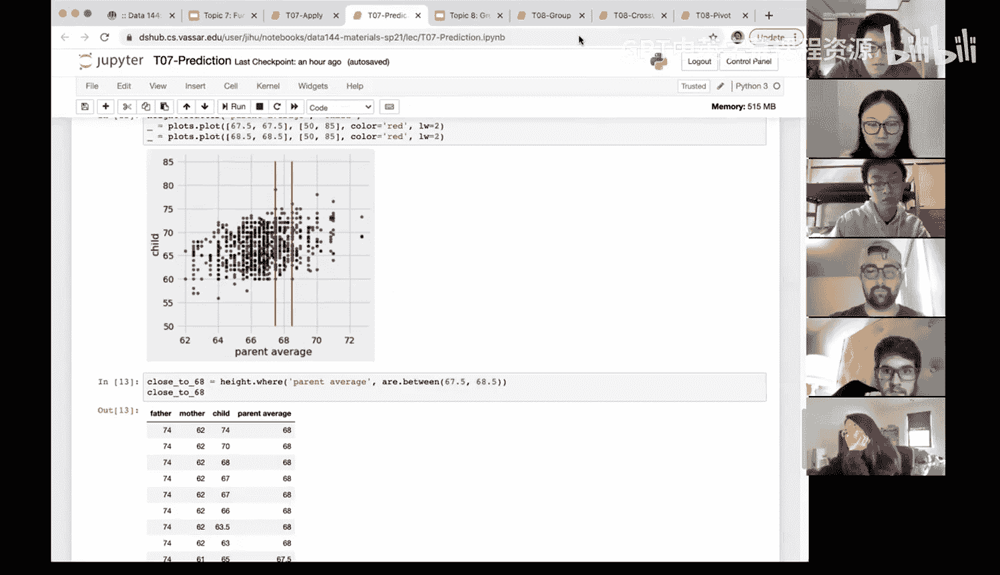

# UCB《数据挖掘和分析｜DATA 144 Data Mining and Analytics 2021》中英字幕 p27 [P27]lecture27-[T7 Functions] Prediction-OhGE2mZusds.zh_en [BV1efBEBuEVg_p27]

Okay， so the last topic of topic a7 functions is prediction。 Okay， so this， again， if you recall。

 at the beginning of the semester， we're talking about the goal of doing data science。 Okay。

 we're talking about like we're trying to visualize data， right。

 we start to do that with multiple visualization methods like scatter plot line graph as well as bar plot。

 right，  different bar graph， different style and depending on what kind of variable you're working with。

 you're gonna to choose and histogram， I forgot histogram is very important as well。

 So it depends on what kind of variable you're working with。

 you're gonna to choose the appropriate method to visualize it。 Okay。

 so that's usually the first step。

And then after that we want to do certain inference okay we want to make useful statements or solid or valid statements out of it okay so that's inference part which we'll get to do a lot more later as well and then usually a very important next step of doing data science is making predictions okay so here we just wanted to give you like overview especially like prediction can be done through functions okay so that's why we put the prediction topic in the first place the first time we're introducing it right now in the functions topic but later on you're gonna see even more methods of doing prediction okay so prediction nothing fancy there are so many different ways you can prediction and of course some maybe a better than the other and then when we say better you could imagine that you want to to have higher prediction accuracy for example things like that so naturally I think there there are certain methods to compare different prediction method so for now for today we really just wanted to show you how one type of prediction。

Can happen as well as how to do that through function Okay it's really trying to empower you to use what we have learned so far to do new stuff that you probably have not thought of yet okay so the example we're gonna go with Sir Francis Galton okay maybe some of you know this name and he was actually Charles Starwins half cousin okay he was knighted in 1909 okay he was a pioneer in making predictions okay there are some controversy but overall he was really like a very important pioneer in making predictions even back then you can imagine like he was born 1922 and then died in 1911 and then there are not many tools out there right to do any kind of data even collection but then let alone to do like afterwards so he was definitely a pioneer and then maybe in some other mathematics statistics or computer science courses we have heard his thing before there are certain stuff that he did in many computing。

Aspect as well so maybe you will see him again in other context Okay so for us we're going to start with this prediction method that he proposed back then I pretty straightforward and then you will see that well it doesn't seem to be something really fancy but for us one thing is how to think about prediction okay and then next is like I said how to make it work in python through making functions okay all right so。

To get us started， I wanted to first show you the data okay it's a really rich dataset so for us we're gonna to select a few things about the Galton data so what he was doing back then is that he was collecting information about father's height mother's height and the child's height so what he was curious about and I think many people are or like theres certain I don't know common sense like thinking about how how you can determine in some sense like the child's height given the information about the parents height so one thing we're doing here is focusing like I said in h here the father's height mother's height and child's height adult child so one thing I wanted to show you is that we can do what we call overlay histogram okay so here it's interesting over here is that well we have the father is a column the mother height as a column child height as a column so we can always like visualize them using histogram one by one okay。

Sometimes it's really interesting， especially if we're curious about the mother's height and the father's height effects on the child's height。

 we might want to put all of the mean grand graph just to see how how things are looking okay so that's what we're doing here with overlay histogram so let me start with regular histogram okay we can do all of the ones for the father all of the ones for the child for example。

 but then if you want to do for all of them especially if you look at the data set we have father。

 mother and child okay and the data sets called height okay so if you want to do overla。

 nothing fancy， you can just do height under dot histogram so hist is still the method okay and we wanted to do bins for like say a particular range over here so if you do not supply a particular column that you want to do histogram for it's going automatically do the overlay histogram for you for all of the three different columns okay so let's see what we get over here。

So they're going to do the automatic color coding for you okay。

 and then in particular they have fathers in the darker blue mothers in the gold color。

 I would say or yellow and then child is the one。In the lighter blue or greenish over here Okay so the method itself is still hist okay we're still doing histogram because there are numerical variables okay and like I said。

 if all of them are numerical in our case， father， mother and child all of the columns numerical if you don't specify which column you are creating the histogram the method itself but automatically do all of the histogram for you and then overlay them one over the other and then do the color coding for you as well so before going forward of doing prediction I guess maybe one thing we could think about is looking at this histogram okay I guess one one thing interesting is that well。

 I guess not surprising is that fathers hide overall is always taller than the mothers okay that's how the two taller histograms are showing us okay the child is sort of like an average of the two okay like of course it depends on the children's gender as well I'm sure but overall right now we're not collecting。

That information we're only just showing the child's height compared to the mothers and the fathers。

 so I think that's pretty much what we can tell from from this guy okay。

Now moving forward to prediction， one thing we could keep in mind or even start to brainstorm is that well。

 if I don't have the child's height or like maybe like the parent or like the couple is thinking about having a new kid without like yeah having a new kid for example and then maybe maybe one thing people want to do is oh okay given the father's height given the mother's height am I able to do a good prediction of the child's height okay so given what we have right now。

 it seems to be something like the average of the two to some degree okay like or some kind of average of the two so that's what I mean by like the prediction that Galton was doing like10 a little bit more than 100 years ago by now is nothing fancy okay could be pretty intuitive to some people as well is like thinking about how we can make prediction of child of a child's height given the fathers and the mothers through some kind of a okay and that's what were gonna to do and then of course to make sure that we can do。

In Python all right， so let's get started， okay， so the height that's the data set just to remind you。

 okay， it's about it's close to1 thousand records back there。

So one thing we could do is first of all， just to get a sense of what it looks like of the child's height okay that's the one that we're。

Trying to visualize okay， so the scatter， if you remember。

 okay scatter is trying to give us a dot plot or scatter plot okay。

 about one numerical variable and what's being done here is we gave python we gave a dot dot scatter method the name child okay so what's being plotted okay is the child's height but one thing you might notice that because the data contains also also the mother's height and the father's height okay so actually more than that what they're plotting if you read it more carefully is that on the x axis right is the child's height that's being labeled over there okay on the y axis apparently they didn't give us the like the label itself but what they do give us is color coding of the father and the mother okay so we can understand that the parents height is being plotted against the child's height but then they're doing a color coding over here。

 the father's overall as we can tower。If you remember from the overla histogram。

 the father's side is overall taller and then the mother height is overall shorter。So。

This is just to get started we're thinking about the child's height okay and then we're thinking about how father's height and the mother's height could help us to maybe make prediction about the child's height so one thing let's just do something simple to get started okay so we do know for each child okay we do know for each child we have the father's height and the mother's height okay maybe like a really crude prediction here is that well how about we just take the average of the mother's height and the father's height and then produce that is maybe a possible height for for a kid Okay so the way to do it okay I'm gonna slow down over here if you look at my box down here。

Is that we are adding a new column okay if you read it okay because we're using the dot with column method okay and remember when we do that we have two inputs right the first one is the name that you want to label this new column the other one is whatever the array that you're doing okay for us like I said。

 I was proposing how about we're taking the simple average of the father's height and the mother's height。

And then add it to back to the data data table and then trying to see if that can be something useful for us to predict as the child's height okay so because of that the way I'm doing it is I'm going to do the width column method okay and I'm going to name this new column called parent average okay just and then the array that I'm doing over here is exactly what the name says I'm doing the average of the mother's height and the father's height。

To do that， just to remind you one more time because we're trying to create array， okay。

 and then we're trying to do arithmetic about arrays， so we're using the dot column method。

We're using the dot column method using the column name in quote。

 so we're able to get the array of all of the mother's height and then the array of all of the father's height。

 I'm adding this two up and then divide it by two。Okay and because they are the they are two arrays with the same length right so we're able to do arithmetic about them Okay。

 so that's what we mean by here we have all of the records mother's height okay in an array okay we add it to all of the records father's height okay in another array so during arithmetic about this so we add them up and divide it by two okay it's going to give us an array of the parent average just how we define it earlier。

Allright， so maybe this all sounds straightforward enough for you and that will be great Okay so if you look at the new table okay that we're returning over here okay。

 the first three columns that don't change okay there is still the same as before the father the mother the child and now we're adding is what we call the parent average okay and you notice that well for the first four for example well the fathers size or the same mother's size are the same and then well the parent average will be the same okay that's actually a quick way just to check that your work is right。

And then similarly for the next four same parent， same father's height and the mother's height。

 so then the parent average is always 71 for that four record。Okay。

 and then of course the child record is from the original data， so it is what it is。Okay。😊。

Makes sense。Since yeah like I said this is this could be like a very crude prediction you might want to use it。

 you might think well might not be accurate and things like that。

 at least one way now we start to see that when you want to do prediction if you want to do it on the table they are ways you can do it okay and then especially using the table method like with column and then of course the doc column method we're able to get array of those numerical columns and then we're able to do arithmetic about that Okay so I think to me I think that's actually maybe more than about how accurate the prediction could be this is a more important lesson about what we can do on Python tables okay。

Alrighty， so let's see how how that prediction or how that is helpful Okay so now I'm doing a scatter plot here Okay。

 we're doing the parent parent average okay on the X axis okay the child is on the Y axis okay so what this is saying if you think about like using the parent average to do a prediction and do you think it's it's it's pretty high accuracy or like maybe not so good based on what i'm showing over here this scatter plot。

Feel free to yeah I can pause over here for us for a little bit and then take a moment yeah。

 I will still keep sharing my screen。And I will pause a recording Yeah so there are two numerical variables so as soon as we plot it together。

 people not surprisingly will start to think about and think about the correlation or how strong the correlation is how related those two right and then I think all of this are on the point because when we're thinking about how good the prediction is if like say parent average is not really correlated or highly correlated with child height then it's probably telling us it might not be a good thing or like it might not be a good predictor to be used okay so that's I think why people are talking about the correlation stuff like that and I would just also mention that like say another way we can think about this will be that well maybe for some of the records。

But just say for like say this one， for example， just say like this particular dot sorry like here in the middle okay like for that dot。

 what that says is that the parent average is 66 right and the child height is indeed 66。Okay。

 so when we're thinking about like accuracy to some degree。

 if that makes sense to you is that we do wanted to see how close right the parent average is to the child height for every data point。

Okay and for that to happen that's 66 that was the one that I guess I was able to I guess eye bought and then sort of pinpoint over there。

 but then of course there are all kinds of records like far away from from that right。

 for example like this one。Okay， this is the case where the parentheit I think is probably like 73 is or something。

 right， whereas the child height is only 69。So these are good things to you think about like I said like think about correlation how one is related to the other one and then that might be telling us okay maybe directly use the parent average might not be the best okay but still some of them are pretty good okay some of the records might be a little bit having a little bit more noise over here so let's think about what we can do over there okay so。

One step further of the parent average for prediction is how about okay。

 how about like instead of like directly use the parent average for every record okay for us to do as a prediction how about we pick a particular like small window but just say like picking a small window of the parent average height okay so instead of using every dot for every dot I'm thinking about like maybe I can use a really small small window and then collect all of the data points in that window and then take their average。

Okay so it might sound a little bit complicated at this point。

 but let me show you what I mean Okay so for example。

 if I only want to focus on a small window of like one inch okay so for example。

 like if I focus on 68 okay as that。Parent average okay and then I go below like 0。

5 okay I go about 05 so it's between the 60 67。5 and the 68。

5 and'm trying to collect all of the records falling into this range okay I'm going to use the average of all of those dots as my actual predicted value。

Okay， so whenever we're taking average， one way to think about it is that we're getting like getting rid of some noise going on。

 okay， we can see that like between the parent average of between 60 69 and 67。5 and 68。

5 like the parent average or like the child height can still be like all of the place。

So what we're saying is that how about， okay， how about we're using。The child's height over here。

 okay， and then we're using the average of all of the child's height。Okay。

 within this range for everybody in that range。 So we're able to get a prediction over here。 Yeah。

 so Samantha， please go ahead。Hi， I was just wondering， so each line represents one of the red lines。

 so you have to code them individually you can't just put a range。And also， what's LW equals 2 mean？

Oh okay， yeah， no， great point。 Okay so Sammanha raised two great questions。

 I I guess I will answer the second one first So that Lw I think is line with okay this is a ploting ploting method like I'm adding this two vertical red lines over here and making sure that like they're thick enough so I'm able to read it So LW stands for line with okay you can well maybe I can do know five over here so we might be harder to read。

 but you will see what I mean okay they're just gonna get thicker okay so that's what that is let me bring it back to two Okay and the second or the first question Sammanha asked。

 which we will see soon is that well， yes， looks like if we have to do this for every one inch interval it seems a lot to do right like to do this like say we get the interval we get the average and then do that so you will see that later I'm gonna streamline this okay using a function Okay that's what I mean that okay we're really trying to use function。

All of the prediction for us so it's going to come up soonish Okay。

 but yes indeed in the end I think it's a good way to to streamline it one way like you said。

 like what Samantha said was saying that maybe we can do a make array yeah so that will be one way to do it or we can actually do it as a。

As a function。 So we're calling for any particular point going on。 Okay， so more on that in a second。

 Okay， so let me show you one more question。 Oh yeah。

 go ahead and you can name this it the same because like you can name something underscore and also you can name it twice。

Because like it's not real。I didn't hear the last part， you're saying like。

 what do you mean by twice？Like for the first one， it's like first of all you're allowed to name something underscore and second of all。

 you have underscore equals the plot for the top line。

 but then you also have it for the second line and it's not redefining it。Are reassigning？Oh。

 I see you're talking about this one。This one， right， Yes， Oh okay， yeah， yeah， okay。 So right。

 So this are really this are sort of， yeah。 So the main plotting mechanism is still the scatter plot。

 Okay， so that's the main structure。 and what we're doing here is that I think we're adding adding lines。

 Okay so that's what we're using underscore scores it's not really， yeah。

 you can think of as assignment。 Yeah， and then it's gonna to show up as two lines over there。

 And for us， what we're doing is that well you can see that what we're adding lines。

 we want to make sure that we first input the x axis right and we're actually fixing it as 67。

5 for the first line。 Okay， and then for the y axis， we're doing it。

 I guess just to cover the range of the data。 So we're doing it from 50 to 85。

 we define it to be color red。 and then we put the line width to to be2 Okay and similarly we do that for the other line that we're doing the second line Okay on the right Okay so this again。

This is adding on top of the scatter plot that that's the basic we're adding extra lines going over here Okay and then of course we're doing two vertical lines。

 that's why we fix the x xs like even though they're interval but it's going from its one to itself Okay that's how we're able to fix the vertical lines if you want to do like horizontal lines you're going fix the y axis in the same way。

Makes sense。😊，Yes。All right， great question Okay， so all right， so if now we were thinking about。

 like I said between those two lines， okay， I'm collecting all of the height。Average， okay。

 I'm only going to try to figure out。Like how to get all of those points So in order to do that now we know is that well I know I'm collecting the height okay andm in particular I'm collecting the height of the parent average okay。

 so the way that we're doing it so height is the name of the data table Okay we do the where document where method we're putting quote of parent average so working with that column and then we're collecting all of the dots between 67。

5 and 68。5 Okay so as soon as we do that let's see what we have。Okay。

 so we caught it close to 68 just as a。Object so we can observe it a little bit more。 Okay。

 so what this happens is that we're doing like a subset， right， we're correcting。

 collecting all of the parent average between 65 and 60 67。5 and 68。

5 and then we're putting everything into this new object close to 68 Okay。

 we still have the father's height mother's height child height and the parent average Okay。

 and then of course， the parent average going to be indeed in that particular range that we have specified。

Okay， all right， so for that prediction to work， okay， let's just take okay， like I said。

 now we have this new data table， okay， only the ones close to 68 for the parent height okay。

 and we're going to use all of the child's height and then take the mean of them。Okay。

 so that's why we are having this column out the do column method， okay。

 because we're trying to get an array， okay， we're using it child's height over here and then take them in。

So that's what I means like say instead of using all of the dots like just one at a time or one for itself。

 how about we're collecting all of them in a particular range okay of the parent average and then trying to utilize them in in one in a particular way that we are able to get rid of a lot of the noise going on so one way to do that is take them in so we're taking them in。

Okay， so let me do that in a function Okay， and what we're doing here is that predict children's height Okay。

 and then the input is going to be what we call PA just like parent height okay。

 and we are pretty much like this function is wrapping up what we talked about the previous steps like combine them The first one is we have this close points object。

 which is a data table Okay， we're doing height dot where the parent average and then R between a particular range。

Okay， and then you can see that this particular range is going below 0。5 going above 0。5。

 so whatever the input is we are doing R between negative point like minus 0。5 to plus 0。

5 of the input value that we're doing。OkayAnd then the second part is that we're returning the me of the Chow's height of all of the records that we just collected。

 what we deem as clothes。Okay so you can see that we always have the definition of the function。

 okay， and then we always need to have a return over here okay for us。

 the return is actually just a scalar。Okay， and that scar will be the predictive value that we're going to use。

Okay so let me try to demonstrate that for you Okay， so we did that already like if it's 68。

 we know that the mean is 67。62 Okay， and then now we're running through the new function that we wrote and we indeed get the same value Okay so that's just verification of our function is written at least in the way that we're hoping it it's going to function Okay and then for 62。

 then the predictive value is only 63。So let me around this for all of the data points that we have is going to take a little bit。

Time to run it okay， and then after that we're able to see the prediction。哎。😊。

So this does look slightly better right like we have the parent average still being plotted on the X axis okay。

 the actual child height is all the place okay， but because we're using the mean of each particular parent average range as the prediction we're able to get rid of a lot more of the noise over here。

Okay， and then the predicted value is being shown in yellow or gold。

 whereas the actual child value is being plotted here for you over the place。Okay， makes sense。

 So this is a crude prediction。 Okay， like I said， back then。

Like nothing fancy really going on and but still like I'm sure now there are more methods for a better prediction for us。

 at least for this kind of crew prediction we're able to use Python to realize it okay we break it down into different steps as you can see okay and then in the end we try to synthesize everything through a function。

Okay so I will also recommend if you have other ways of thinking about making predictions you can come up with maybe instead of like say。

 just for example， maybe instead of a one inch interval， I want it to be even more precise。

 but to say I want to do like a 0。5 interval okay so then one thing you could do is that to shrink this a little bit more by doing minus 0。

25 and plus 0。25 and then use even the finer range of doing the prediction。Okay。

 maybe you want to even cruder whichever or even maybe not even using the average in the way that we're doing it。

 you might want to do something else， for example， so all of those if you have a prediction mechanism you can think of then try to break it down step by step。

And then maybe finally also put in geo functions so we're able to do that prediction for all kinds of records。

 not just for a particular one。ok。😊，Makes sense。Make sense。

Allright， okay that's good and that's pretty much what we have for topic7 functions Okay and then that's involving。

 of course， a lot of things about the table okay depends on the methods that you're able to apply to a table and then of course depending on the goal that you're working with so we want you to think a little bit more creatively okay and then for us we show you one way to do the prediction okay and then once we know how we want to do the prediction。

 I guess the remaining task becomes how we can make Python code in a way that is doing the thing that we want okay but then like I said。

 you can always come up with other ways that you want to do the prediction itself and then that will involve different ways of writing the code and then sometimes you do have to break into multiple steps and totally feel free to do that and Jupyter notebook is we know now you can create new cells and then test it out you can do it afterwards things like that so those are good things to use okay but in the end things we want to do。

This at a maow in a sense that we're doing prediction for every record or in that case。

 so it's probably always good idea in the enterr as a function okay because you're able to apply it at a wider range okay so that's I think some important lessons from this topic。

