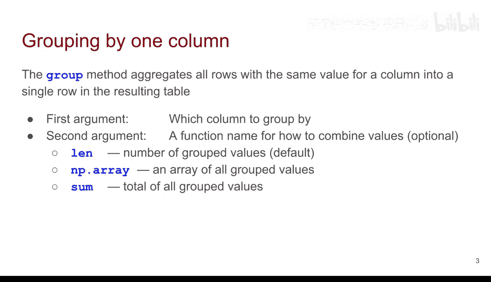
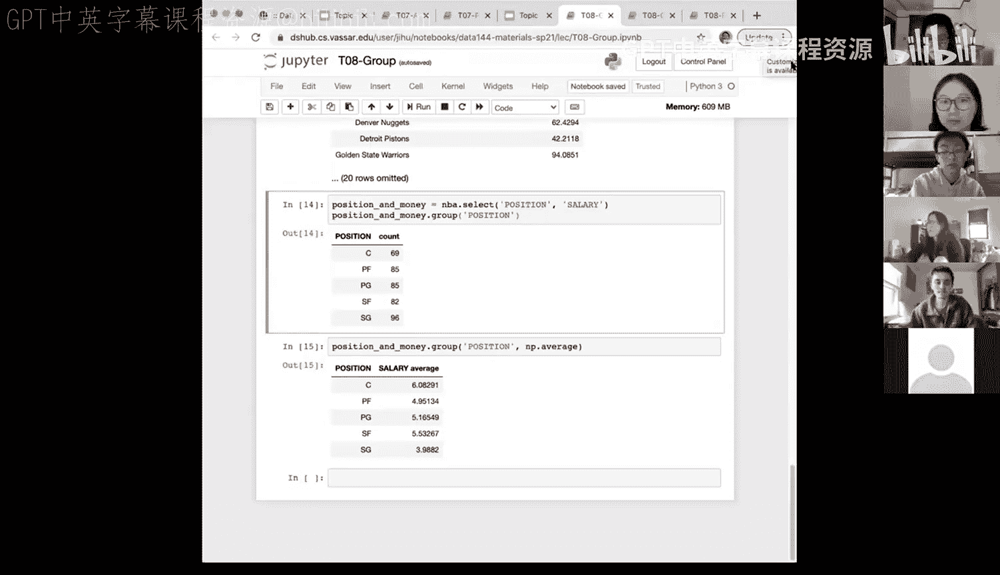

# UCB《数据挖掘和分析｜DATA 144 Data Mining and Analytics 2021》中英字幕 p28 [P28]lecture28-[T8 Groups and Pivot] Classifying by One Attribute-Zu0pjCbMa1U.zh [BV1efBEBuEVg_p28]

And now we're ready to move to a new topic， which I think is very interesting。 Okay。

 we're still going to work with different。

Varariable types okay and then trying to do all kinds of summaries that we can for for different variable So the topic name is group and pivot Okay we already talk about the group method a little bit earlier if you remember we trying to summarize like the counts okay a categorical variable okay I think it was what is it like the top 200 movies in 2017 right and then we're looking at the different studios and then we were doing a tally count of those top 200 records top 200 movies how many are are made by certain studio and that's how we actually also introduce the bar graph if you remember like doing it as a decreasing order to show how different studios are doing Okay so we're going to revisit that to some degree but then I will also wanted to show you that the group method actually goes beyond the ones that that we have seen okay so。

We call this classifying by one attribute okay and the method we're introducing again is called group。

 which we have seen before。 Okay so the group method again， just review。

 but then adding some new flavor to this the group method aggregates all rows with the same value for a column into a single row in the resulting table Okay so imagine what we had done before about the movies and then the group method being applied to studio okay so remember studio is a categorical variable right and and so what we're doing is that we're counting among all of the 200 top movies how many are made by studio1。

 how many are made by studio 2 and things like that Okay so that's what we mean by is aggregating all rows with the same value like Studio1 for a column which is the studio column into a single row in the resulting table Okay so that's just a final count okay so the first argument okay is which group which column to group by。

Okay and that's actually what we have seen before right we use group just in the really the simplest way we only have one argument we're just like using the first argument what we call over here is the name of the name of the column you group by which like in that example is the studio okay but now we're adding some new flavor like I said okay we can actually provide additional argument okay it's optional that's why in the past we only provide one argument and it works fine but we can also provide a second argument it actually could be a function okay it's a function name for how to combine those values。

Okay， it sounds maybe not as obvious as now like what do you really want to do about the studio right like you're really just doing the count okay so that's a common reaction okay so。

But I will show you now and then in the demo like what are the possible arguments of the second arguments which is the function that we can do Okay so the default is the number of grouped values that's the count Okay so that's length L is default So if you don't do anything about it's going to return you that okay however they can also give you array okay an array of all grouped values you can also do sum okay total of all grouped values okay so let me show you in a demo now I think that helps much more than telling you what this are doing okay。

So。Let me do the demo here Okay and for us we're focusing on like doing group on one column at this point Okay so the data set okay is super small if you remember the cones data set we have the flavor column and the price column Okay flavor is a categorical variable Okay we have strawberry chocolate strawberry well just two flavors I guess strawberry and chocolate okay and then we have price for each。

Each flavor over here for a particular type， I guess okay， so what we did before。

 if you'll remember is we're doing the group method on the categorical variable。

 which kind of returns us a new data table with the counts。Okay。

 so we know that we only have five rows in the original data set so not surprisingly okay and it's we are able to actually check if if it is doing the thing that we thought it's doing so we only have strawberry twice and then chocolate three times right so while it is indeed what the five row table of the original is telling us okay now i'm trying to show you like the added flavor that I was talking about that you can do with the group method Okay so the first one。

诶。Is MP dot array。So。What is doing exactly here？Is it doing anything about the flavor or is it doing something about the other variable going on over here。

 that's something new。Okay， so let's look at the output。

 the output here is giving us actually the price array。Okay。

 so even though they put in a bracket but it's not really like interval it's just an array。

 so notice what it's doing here we're saying that you're able to provide a new like a second argument for this group method okay and we're saying that it' like the function being applied to that group okay so what's interesting here。

Is that if you don't do anything about the second column。

 then it's just really going to do the tally count for you about the categorical error。However。

 in our particular example， you see that we also have this additional price variable。

 which is numerical。Okay， so if I am interested okay in well what's the what are the prices for strawberry flavor right。

 what are the prices for chocolate flavor if I want to report all of them then I can use the second argument domp array well it's a function now we know it's really just listing okay listing the price of all of the chocolate flavors and then listing the price of all of the strawberry flavor。

Okay so this second argument， like I said， is a function， okay。

 but it's not only a function about the column that you're working with。

 but also about the additional column that you did an actually explicit call。

Okay so for us the column that we're trying to group is by flavor so that's all fine okay however。

 we do have the price column that if we do a MP array is going to list all of the prices according to each of the type of the flavors going on。

Okay so sometimes this could be handy， okay， and like I said， the default is length， okay。

 so if I do that， well it will just be like the length of the price， which is the count。Okay。

 so that's why if you don't we anything， the default is giving you account of each of the flavor okay。

 all right， what if I put min， what do you think the min going to do。

I'm going to pause here for a sec。嗯。Okay， yeah， so indeed， like everybody was saying。

 it's gonna give us the minimum。 Okay of each group。 Okay so let's return that。 Okay。

 so among old chocolate， we know it's three over here， right，1，2。

3 and the smallest is is indeed 475 Okay same goes for the strawberry so now you see that the group method right。

 not only works for just like giving you the tally of counts。 Okay。

 if you have additional numerical variable going on together with your categorical variable for this case。

 ice creams。 then you're able to do many kind of summaries。 Okay。

 about those numerical about the additional numerical variable out there that could be really useful。

 Okay， so。Let's look at one more thing， what about this one？If I do。

Flavor chocolate okay and then column and then I do the min Okay this is actually sort of like spelled it out for you what this group min is doing Okay。

 so essentially what this new function like not new function like the new line going on here is that we're collecting right all of the flavor which is chocolate and'm collecting all of the prices and I'm taking the min。

Okay so this not surprisingly going to give us475 because that's exactly what we have returned earlier Okay so you can think of this as a breakdown of what is doing behind the scene of that group method but you can see that well the group is so much more efficient right you only need one line to do all of this and you can do it for strawberry and chocolate and whereas if you want to do it group by group。

 you will have to do all of the writing for yourself。Okay。😊，All right， lastly here。

 if I do an MP average， okay， I guess everybody probably will guess it right now we're just taking the average of the price for each flavor and then report that。

Okay so。Again， this is a toy example。 So maybe well。

 I don't know if you care about the average price of a chocolate flavor。

 ice cream and stuff like that。 But what I'm saying is that I will see as soon soonish we're gonna use the MB example again about the salary and then there will be all kinds of group method that we're able to do over there Okay depending on what kind of answer you wanted to look for Okay so let me do one more demo on the ice cream。

 So what if I want to know the range。 what we mean by the range is that if I input an array。

 I want to know the difference between the maximum and the minimum Okay。

 this is one way to measure how variable right， how much variable of that variable is Okay so if I define that function。

 I can use this new function that I define into the group method。 Okay。

 just like the applied method that we do before you can always create a new function and then doing it on your。

Data table okay， so the price range that we have for the chocolate is only 50 cents and then for strawberries like three times more。

Okay， so of course there could be other other functions you are interested in so feel free to experiment now let me show you like on a bigger data set and how all kinds of like grouping can be done Okay so this is our MBA data set if you remember we have the player name the position the player is playing the team the player belongs to and the salary in million dollars okay so what we're doing okay a couple of things first the first demo that I want to do is that okay what if okay what if I'm interested about the total salary of each team。

Okay of course， maybe you are thinking about okay if I want to do for like team at Atlanta Hawks。

 I have to collect all of Atlanta Hawks right like I have to do the wear right and then taking all of them to take the average that's what's working behind the thing if we're going use the group method so the way to do that so first of all we're only going work with the team column and the salary column just because now you could probably have guessed right if you have more columns if they're actually also continuous like numerical variables you probably are doing way more summaries that you want to do So we're really only focus on salary column at this point So we're only going to select the team column and the salary column and we call it teams and money and then we're going to do the group method okay on the teams and money table and remember the first input is the column of the categorical variables that we want to do summary about okay for us is team because I was saying that I wanted to know the sum about the salary of each team so then。

Second input is the function， which is the sum， and we know that the sum is going to be applied to the salary okay because that's the numerical variable that is being summarized about and then lastly we're doing a disen order so we're able to do a rank。

Right。😊，So Cavaliers is the top okay and then Oklahoma City of Thunder state Warriors keep going Okay。

 so that's one way you can use the group Okay， so like I said。

 I posed the question early on I was saying that hey how about we wanted to yeah what if we want to know the sum of the salary by 1 team then we can use the group in this way Okay the team is the categorical variable that we're doing the summary on and then the salary is the column the numerical variable that we're doing the summary off。

So that's one example， okay， and then of course。If you don't do that what I was saying that let's just select the team and the salary and then you will see that well。

 there are other columns in the original data like player and position because there are non numerical variables so like no sound'm going to be reported for it。

Okay so you can do this of course it doesn't hurt， I guess have same results after all， okay。

 however， if you really just wanted to work on the team and the salary。

 then it's always a good practice only selecting those two columns and do the group open there。Okay。

 all right， another thing let's just say okay how about I want to do now remember there's also the position variable okay in the original data set so maybe some people are more interested in instead of about the team I want to know like comparing to all of the different positions on the basketball team I want to know the average salary or the maybe average salary probably makes more sense okay so you want to do that I'm gonna select the position column and the salary column I call it position and money and then if I do only group on position that's only gonna give me counts okay so we can do a count first just to get a sense of whether like say the number of positions are sort of like similar to each other I guess maybe not so much okay it looks like Sg is the largest and then center C is the smallest so because of that for any kind of summary probably average works better than the sum because you actually have different number of people in each group when you do the sum it does really。

Tell us much okay， so if we domp。 average as the function and then apply to the position categorical variable by doing thatt group method。

 then what we're getting is the average salary okay and then again it's not ranking in particular。

 but we always add the ranking over there so you can now see the comparison across the average salary of different positions。

Okay so like I said， I think this is probably a little bit more realistic example if that's what you're interested in compared to the ice cream example。

 but like I said the group method you can always do it if you really want by hard coding it doing where and stuff like that but it's not going be as efficient as the group method okay however in order to do use the group method most efficiently we might want to do some kind of selection of the columns first okay and then we have to think it through carefully about what exactly is the categorical variable that we do suming about and then what is the numerical variable that we're doing the summarizing off I think that's the keys in working out the group method so the more example and more exercise you do I'm sure you will stick with you okay。

Questions。Comments。

Alrighty， if not， let me make sure。

