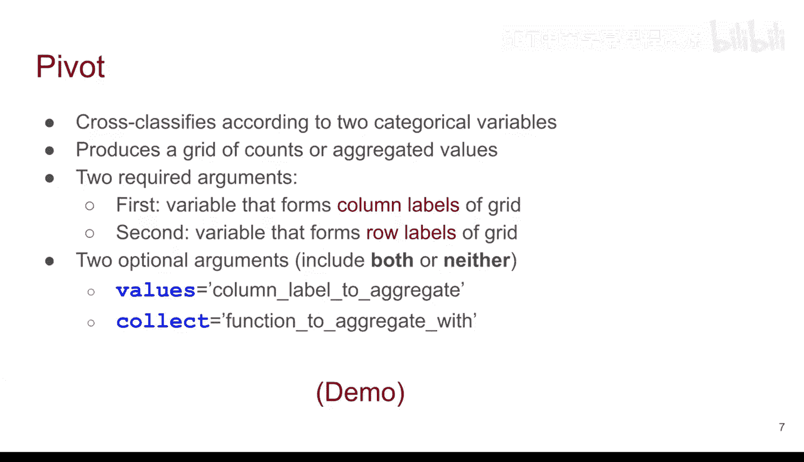
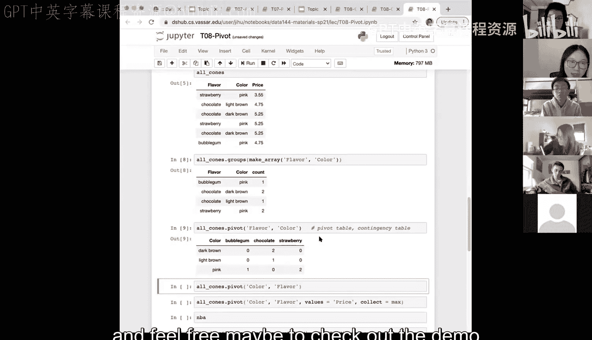

# UCB《数据挖掘和分析｜DATA 144 Data Mining and Analytics 2021》中英字幕 p30 [P30]lecture30-[T8 Groups and Pivot] Pivot Tables part 1-6n6ED5qkpFo.zh_en [BV1efBEBuEVg_p30]

Get started on the last topic and so then we can。

Get more done Okay， so let me share my screen one more time over here We have the last topic in this topic a called Pet tables Okay。

 so it's going to be you will see that similar to some degree with the groups that we have to be doing but then again depends on the goal I think pivot table gives us some option about specific things that you want to do Okay so let me do the present mode okay。

All right so if we look at the definition okay PiVt is trying to crossclassifies according two categorical variables okay so notice here earlier we are also talking about okay crossclassification like according to more than one categorical variable we're using the groups method okay but one thing you probably notice and soon when we do the demo you will see that when we do the groups method is giving us the count right of all of the combinations of likes say two categorical variables and it's returning us the count which is non zero but of course sometimes you might have like a certain cross classificationification like say a particular ice cream I don't know let's just say like strawberry and color is like I don't know dark or yeah you know like that kind of combination might not be possible which actually going result in a zero in the count but like the group method does not show you that okay however the PiV method going show you that。

If you want to return that as well， so this is a actually a option over here depending on what you want to do so the pivot going to produce a grid accounts or aggregated values just like what we are seeing over here。

 but notice is producing us a grid okay and we also call it contingency table okay we're going to have one。

Variable on the on the rows and then the other variables on the columns Okay and then each of the cell of that table in the end is gonna to give us the counts。

 Okay so you will need to arguments both are required。 Okay。

 the first one is the variable that forms the column labels of the grid。

 The second one is forms the row labels of the grid。

 we're gonna do a demo so you will see what I mean and then you also have optional arguments。

 Okay likes say if you want to do certain values about certain things like additional column label that you want to do any kind of aggregation or you want to do collect。

 Okay so sounds a little bit vague， but I'm sure once we get to the demo。

 things will become a little bit clearer so let me show you here。

We're going to work with the MBA data set again okay and before we get there let me just do one last demo about the group method sort of what we have seen to summer degree okay。

 so for example like the group' method you're able to do multiple columns like I said okay and then depending on what kind of function you're applying to you might be able to do different things okay so for pivot table okay we're coming back to this。

Exre data set， Okay， so remember if I'm doing。Actually， I think yeah， let me yeah。

 let me double check yeah， actually， I guess in in in Python， if you do groups or group。

 I guess if you are supplying more than one categorical variable。

 I think automatically they're going to do groups anyway， so I guess in terms of like the syntax。

 no big difference， but it's a good practice to keep in mind that we do have like two different names for it Okay allright。

 so here's what I mean。The flavor when we do the groups okay do flavor and color we're giving us like it's giving us a tall count of the combinations okay but of course it could be like like just like what I was saying strawberry and light brown well there is no ice cream like that at least in the data set okay so so the group's method does not give us the like count zero for that okay however if we do pivot。

Of flavor and color， it's going to give us a grid of the counts where zeros are also there。Okay。

 so let me show you why me okay， when I do a pivot， okay， flavor。

 remember is how the columns going to be。OkayAnd then the color。

 the second input is how the row is going to be like which like what the row is going to be Okay。

 so dark brown， light brown and pink。And then bubble gum， chocolate and strawberry。

If you look at this one， this grid， which is also like I said called contingency table。

 is giving us the exact breakdown of the count of each each I should say each combination of the color and the flavor。

and we do get some zeros here like zero like there's no duck brown and bubble gum。

 no light brown bubble gum， no brown or light brown for strawberry right and there is no pink for chocolate。

So for this example， again， it's2 example， so maybe not as as useful。

 but sometimes you do want to get this kind of contingency table over the groups because you might want to do that kind of summary more。

Okay， so I think I will stop here just because I think we'll be running all the time if I keep going。

 but for us today， I think it's good to keep in mind that we did talk about group and groups。

 even though maybe the syntax probably wouldn't。Matter too much when you're doing in Python and for us we lastly introduced this pe function。

 which is going to return us the entire grid instead of just the tally okay and then of course just now in the slide we're talking about their additional right her additional argument that you're able to put in so you can even do further summary about this kind of grid that we're doing about the other numerical variable if you ever want to do any kind of summary over there。

Okay so just keep that in mind and feel free maybe to check out the demo even before we meet again on Thursday。

 but regardless I think those will be useful tools to I mean not only for upcoming homework or lab but also just thinking aloud in terms of the stuff that we're learning and then what kind of manipulation you can do with data and then this are definitely useful tools and then some of them really related to each other some of them may be a little bit confusing at the beginning or like maybe like hard to differentiate but like I said the more practice and exercise we do I think things will become clearer and then it does take time to get familiarized with everything so just keep up the good work and reach out whenever you have questions。

Thank you。