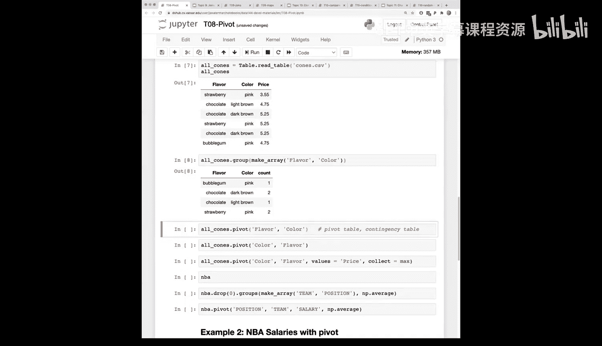
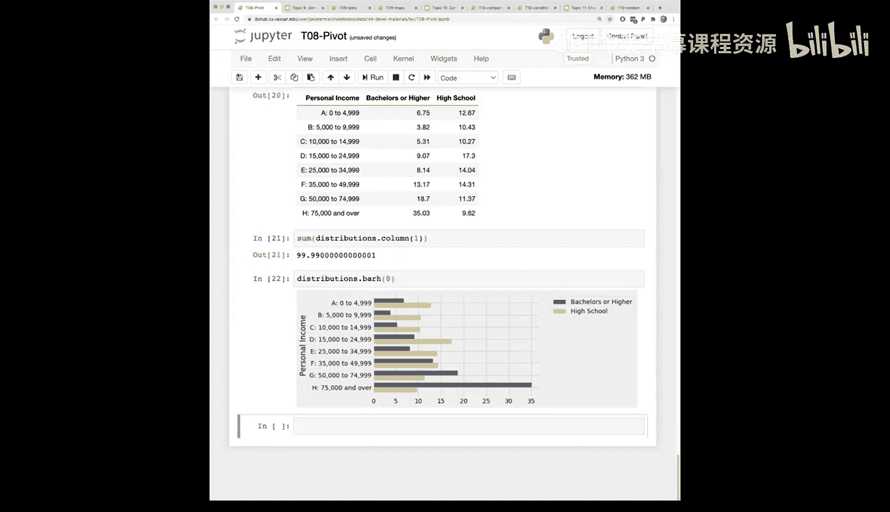

# UCB《数据挖掘和分析｜DATA 144 Data Mining and Analytics 2021》中英字幕 p31 [P31]lecture31-[T8 Groups and Pivot] Pivot Tables part 2-TZVAPLIrSaY.zh_en [BV1efBEBuEVg_p31]

So what we're into today we got we got a lot of tabs kind of open if you can see like my whole screen I don't know we probably won't get through all of them today but we got like kind of like a lot of little topics we're now we're now getting to we're now getting things are getting interesting things are getting good we're getting to the point where we've got some really good data analysis tools in our toolbox and we'll talk about a couple more of them today and then you know I think really kind of maybe this lecture next lecture that kind of wraps up。

😊，All of the technology kind of like all of the libraries and all of the kind of python that we're going to need for the rest of the course and so so we'll do kind of a little kind of the last kind of thing today and on Tuesday of the Python bits and then it really gets to the point where we can really start doing kind of some serious data analysis right kind of what we've been doing so far is we've been we've been looking at data we've been processing data we've been doing computation all the things that we've done so far our computation and visualization。

And so we're going to kind of wrap up some more tools to help us out with that just different ways of organizing data right and so organizing and visualizing data and so once we've done that then we can really start thinking about in the next kind of major concept and we'll probably have time to get to it today start talking about conditionals so right now what we've done is computation right we've done we've organized data and we've done computation on data we've we've you know the things like we can group data together and we can form computations on it we can take the sum and the average and we looked at apply weve looked at the ability of applying some function some computation to a column of data right so really what we've done is we've done computation we've using a computer the compute you know putting compute in computers we've done computation and and really now then the next step is is that we're。

Learn about conditionals and now we're going to have the ability to make decisions we're going to be able to decide we're going to decide to either do this or something else based on input and so that's kind of you know one of the last missing pieces this ability to make decisions and and we've been doing that actually but it's been kind of buried inside of the library right so the where clause so the where method。

On tables with the our clause we've been making decisions right we we've made a decision whether to include or exclude a row in our table and now we're going to generalize that we're going to generalize that with with conditionals and then kind of the next thing after that is we're going to introduce randomness and then that's going to unlock that's kind of our toolbox that's going to allow us to actually do the data science。

 the actual you know making inference making predictions and having understanding the confidence how strong our predictions are how much confidence we have so that's kind of the roadmap for the next a couple of lectures and so that's kind of exciting a couple of announcements before we kind of dive right in so homework four has been released homework three is due tonight at 1159 homework four has been released we'll release lab5 this afternoon as well and down your first individual。

😊，Right so that is going to be released this evening。And that project is in essence。

 kind of your think of it as a take home quiz， take home kind of you know take home quiz that you'll have you'll have I think a week and a half to do it and it's kind of it's very similar you'll see it's very similar to the homework。

 but it's a little more involved， this one because it's in you know the project is in lieu of a quiz。

 this one we ask that you do， you know on your own， no talking with friends no talking with coaches。

 but of course you can definitely ask us questions like for clarifications if something doesn't make sense。

 from there。And so we'll release that tonight and you'll have a reasonable amount of time to do it it's not meant to be that you should be working every moment on you know every moment of the day between now and when it's due and it'll be due just before break so we'll give you kind of the maximum amount of time to do that。

for there and it's it's it its it's like a homework but it's a little more involved and so what we'll do because you'll be working on the because you'll be working on the on your individual project we won't release a homework next week okay so we'll have a homework this week。

But after that we won't have another homework for the following week so you can focus on the project and I can definitely say some more on the project in lab tomorrow after we've released that。

Okay， so I think those are kind of announcements， so let's let's kind of pick up where we left off last time。

 so last time we started talking about we talked about groups as a review and then we introduced this this concept of a pivot。

😊，And so let's just start off kind of with the demo。

And so here we're just reading our MBA salaries table again then。

RightThis is kind of old news like how to use the group and so this is kind of a good review right and so what we're doing is we're taking our data we're dropping we're dropping the player。

😊，We're dropping the player column and then we're going to do a group we're going to do groups okay and so the new thing is is we learned about group which will group on a particular all you know if we give the。

The column name team and that team is a categorical。😊，Column。

 what group is going to do is it's going to gather all of the rows。That match。

That match that are alike。For a particular column right so for example。

 if we if were doing a group on this on this table。😊，With the team， it will collect all of the rows。

 it will plug all of the rows with that have Elnahawk and then you know。

Agreggate all of the data we want for a particular column and then we can perform operations on them or by default return account right so groups with the S notice the S here instead of just specifying one column we're going to specify one or more columns inside of the array and what it's going to do is it's just going to look for it's going to look instead of just looking at the team it's going to look for all matching teams and positions。

Right so team and position， if those two rows match both team and position。

 it's going to group them together， it's going to treat that as an entity and it works just like the regular group insofar as that then you can perform some operation in this case looking at the max。

Um。For all of the remaining columns from there right and if we've dropped the player columns and we're grouping on team and position the only thing left is the salary so that will give us the max salary for all groups of teams and positions so if we run that cell。

😊，We can see that we have now grouped right if multiple if we have multiple players right and so we do for the Atlanta Hawks。

 they have two Cs center center center， I don't basketball so center and they've now been combined。

Right and then what we did was if you look at just these two centers。

 we've grouped them together because they're both the same team Atlanta Hawks and the same position so those two will get grouped together and then the function that we're applying on that group on the salary column is the max of these two data elements here so 12 and 9。

7。And so it took the max of that and gave us 12 right if you actually wanted to see the values。😊。

You can do instead of Max， you can do NP array。And it will actually show you。

All of the particular values that got grouped together and for our Atlanta Hawk C we see it has the two values in there it has the the 12 and the the nine points and there must have been。

Yeah， the 12 the 12 the 12 and the 9。7 from there and there must have been someone else in there buried in the list somewhere that had a $1 million salary from there。

 okay。T go back to Max。🤧You see that okay， so that's group and then of course once we have that we can we can sort right this is the column that we're going to sort on。

😊，And then if we said descending true instead of the default is ascending and that。

We'll show the max going down Okay and so so here we're just grouping on the team and this is going to give us the max is this is going to give us the。

The sum of the salary for each team from there， okay， any questions about that？

So it really is doing the heavy lifting of matching matching matching like minded rows。

 rows of the same category as specified in your column label。

And then we can apply functions onto that aggregate data。😊，From there。Okay。

 and so it it's worth remembering it's worth pointing out the difference between group and apply。

 okay， so group group will collect all of all of the rows that match the one or more columns。

And then the function that we apply in this case sum that is getting called on the array of data。

 it is getting called on the entire array so physically what's happening is is that that array that was collected that we saw up there when we changed it from from max to Ny array that array is what's getting passed into the function in this case max or sum and so the operation that is the function that is operating it is operating on the aggregate data and it is performing some type of aggregate operation。

The apply is very different， the apply gets applied， you specify a column。

 the apply function gets called once for every row with the input from that particular column。

Do you see the difference there？It's getting called many times it is getting applied individually to the data in each row separately。

😡，The group is a collection， think of it as as an aggregate and the type of functions apply that you would specify with a group are going to take like an array。

😊，They're going to take a single array in his input while the apply just can take any any single value and it will get applied to each and every individual row。

Um for that particular column， okay， so that's the difference between apply think individual elements in group thinking operations on an array。

😊，🤧Okay， so now any questions before I move on to pivot tables？Okay， great。

 so pivot tables are really kind of fun and it it's a very easy way of helping us kind of look at our data and so kind of let's run through this example kind of quick。

😊，And hopefully I can kind of give some insight to where we get this name pivot table from okay so we have this table it has flavors colors and price。

😊，Here we're just doing a group just like we did before。

And so grouping will collect right so here we're collecting unique combinations of flavor and color and so for every combination so for example here's one that has one right so in our original table we have two rows that match that both our chocolate and dark brown and we can just look up we can see the two rows the one right here and the one down there and so that's why we get accounted too and the same thing for strawberry and pink here's our first strawberry pink and then here's our second strawberry pink。

😊，Okay， so now pivot， now what pivot does。And hopefully I'll give you some insights and so that first。

😊，That first column flavor， again， it's a categorical。

🤧Column and so what we're going to do is we're going to look。

 we're going to look at all of the values， all the categories in the flavor column。

And for this example， we're going to have strawberry chocolates and bubble gum it looks like okay。

 and then let me let me stop sharing because I I want to do make sure you all see the visual here。😊。

And so the way I want to think about it， right the column， the category。

 the categorical column has all of the categories in a particular column， okay？

And what the pivot table is going to do Watch my hand the pivot table is going to actually take those categories。

 take those categories in the row and it's going to pivot them。

 This is where it gets its name it's actually going to rotate so it's a vertical column it's a vertical column of categories the pivot operation is going to pivot on that column and turn all of those categories in a particular column into their own columns and so if you think about that if you think about that vertical column where're now pivoting it。

To be their own columns and that's where this name comes from we are literally kind of taking that column and turning that column on its side。

 we are pivoting that column okay and that's and that's and the first column is the thing that we pivot on。

😡，Let me go back to screen sharing。

。Okay， and so we're going to pivot and so now all the unique combinations all the new categories in the flavor column will become their own columns we will now have a bubble gum column we will now have a chocolate column and a strawberry column okay and then。

😊，The second one， the second item， so the first one show the first column。

 the first column flavor is going to give us our new columns。

 our new columns across the top of the table and the color will fill in the categories for our rows Okay。

 and then it's going to fill in that。😊，Two by two grid， the flavor is going to be。

All of our new columns and then the colors， all unique colors will be their own rows。

 okay and by default again it's going to give account。

So let's just run that and then we'll see what happens。Okay。All right， so now as we as I said。

 you know our unique our flavors， our flavors were bubble gum chocolate and strawberry and they became each of those categories became their own column now now we have the bubble gum column the chocolate column in the strawberry column and each。

😊，Color each unique color and in this case we have pink light brown， dark brown。

 and we have those three colors each of those colors now became their own row in the table so the first one controls the column。

😊，The second one controls the rows。And then it is actually going to do。

By default account of all of those combinations it's going to look at all of the bubble gum bubble gum dark browns。

 all the bubble gum light browns， all the bubble gum pinks and by default is's going to give you that is going to give you the count okay and we can go back and kind of verify this and and it will if a particular category doesn't exist in our data so dark brown bubble gum that does not sound like a very appealing flavoring color so it is not surprising that we don't have that beauty combination it will show all of those with there okay and。

😊，We can pivot on we can pivot on any column we want right so if we actually wanted to if we wanted a new table with all of the columns being now colors。

 we would just pivot on the color and then fill in the flavors from there。

And then that will work as well and so notice again we're pivoting on the color so all of our colors now become columns dark brown like brown and pink and then our colors now become。

😊，Our flavors， yeah， hello， hi， do you have a question？

Yeah I was wondering if we will always need to use group before we use pivot no no absolutely not this you can you can forget that this is even exists。

Because across from the original table right that's right that's right that's right so really the reason why this we put this demo in here。

 we really wanted to contrast kind of the group。Vus the pivot and so and so thank you for asking that question they are completely unrelated right we are working on the original all tones table from there。

 but it does it does give me a chance to kind of highlight the point that the group what we're doing with the group is think of it as is really just being in a particular instance。

😊，You know， we're picking a particular flavor to group on in this case， flavor and color the pivot。😊。

We'll do that mapping for us。so in essence， it is like a group。

 but it is doing kind of all possible groups and showing it as a table。So they're related。

 but they are definitely doing different things and the similarities are in the sense that it's gathering right it is collecting it is collecting categories。

Um， but in the case of the pivot， it is really kind of， it is。

 it is it is doing almost like a cross product it is actually getting all possible combinations。

All possible combinations of in this case flavors and colors right and so it's basically doing kind of a full on group of bubble gums and you know of flavors and colors and showing us them so in that sense that's that's actually that's how that group is similar into that case but in this case right this is really kind of all combinations and so in some sense it's actually if you're not if you're kind of in the exploratory phase of your data a pivot table is really great to visualize it's really great to see all kind of the combinations。

😊，And just like with the group。We don't have to it's not just the count we can apply any function we can apply any function and it works it works similarly to how the group does so for all of for all the unique combinations right for dark brown well here let's pick one that has one for all dark brown and chocolates right all of those。

Combinations。We can now look at kind of a column and it's going to group all of those it's going to collect all of them together and it's going to give us an array of all of the particular columns and we can call a function on that okay and so here is kind of the full blown version of a pivot table of a pivot。

With all of the arguments specified out。The column， the column that you pivot on。

The column that you pivot on is always first and then so this is always。'm going to be your columns。

 those are going to be the categories for your columns。

 this will always be the category for the rows。And then here this is also another column。

 This is the column to collect the data for everything that matches a particular color and flavor Okay。

 so this is the column， this is the column that we're going to collect on and if you remember back in that this is simply the price of those particular items okay。

 and then the last one is the function to call on。😊，The collected values。Okay。

 for each unique combination。From there and it turns out that you can actually here I've shown the actual parameters you can actually just put price and function from there you don't need the values equals in the collect。

From there。Okay， so let's see that example here。And so here we're showing the max price for all of those combinations right and if you look kind of in the case of dark brown and chocolate in our original table dark brown and chocolate we see one is 525 and the other one is 525 thank you so Max would you know but here let's。

😊，Let's look at let's look at the other one pink， here we go， strawberry pink right。

 we have strawberry pink。😊，Sorry for scrolling very fast Our strawberry pink。

 we have one for 355 and the other strawberry pink is 525。 So the Mac should return for us 525。

 which it does Okay， so that's kind of an example。 Let's look at kind of how we can use。😊。

The pivot on a bigger data set to kind of do some type of analysis for us。If remember our MBA table。

Here's a salary here again we're just grouping by team in position but seeing the average。

 but what happens if we wanted to see all the positions。

 all of the teams and the average salary for all positions in all teams， okay？😊。

We can do that with one command with the pivot table here and so when we pivot it's going to give us right so the position is going to be our new columns and so we have our center。

All of those things， I think there are four words and guards。Sorry if you're in the basketball。

And I'm not getting your team positions correct。And then the rows are going to be all of the。😊。

All of the team names okay， and so what's really nice with that one command。

 we now have a summary of all of。😊，The average salaries for all of the players on the Atlanta Hawks who are with the centers。

 forwards cards， yeah， someone had a question。So it's me again so we don't have to worry about the categorical variables because it's not going to average that out right we can just write it like that for another instance。

 for example。I think the answer is yes， but could you say that question again。

 I feel like I followed 80% of that。Just when i'm doing an exercise and I want to do something similar I can write the exact same way considering that it is similar enough and the NP average won't average out the categorical variable Oh I got you I got you yeah so so the average this average is going to be applied to this gathered column okay。

If that makes sense。Yeah， and so the first two the first two position in team。

 they're going to be categorical columns。The salary is often a numeric column right because what's going to happen is is that we're going to collect all of the unique teams and positions right and you know if you think about a team a team might have you know one or more centers and so that array and so we're going to look at so we're going to look at all the unique combinations of positions and teams and collect all of their salaries together as an array and then we're going to pass that into the average function right so this whatever function you name here has to be capable of handling arrays。

Um from there， okay， and so so it's not going to do it on all of the other columns。Um。

 it's only going to do it， it's only going to calculate this function。

 this average on the the values collected from this column， the salary column。

 which should be a numerical one if you're calling a numeric function on it。😊。

If that makes sense perfect yeah， it does think and it turns out， didnt mean to talk over you。

 please go ahead。No i'm just clarifying that position and team are being pivoted and then NP average is operating over salary exactly exactly and it's operating over the collection of salaries of all of the matching teams and positions sounds good thank you from there。

😊，And then and so now that we can do that we can really do any type of analysis that we want and so for example here we're collecting the maximum salary for each position。

😊，And then at that point once we have that table， so that's the table now that we have。

 so we have all of the particular each row is going to be a team and this is going to be a collection of their highest played paid salary and so presumably you can make you can make the assumption that that these are going to be the salary of the starters right the highest I mean it's not a perfect correlation。

 but you got to think the highest player， the highest paid salary is probably going to be your starter。

From there and so so that table gives us that the salary of all of our starters for each position for each team and then what we're doing down here is we're going to drop column zero so we don't care about the team names anymore and now we're going to take the sum of that okay and so。

😊，What that's going to do is is now here we're doing the apply。

 we're doing the apply and the apply is going to work on each particular row one at a time。

mFrom there。And so if we do that。What we're going to do is it's going to the apply is going to work on every column。

Um from there and it's going to sum up。The salaries for that。

and so now we can get the total salaries for the sum of the salaries for all of the particular。

Columns right， so what we're doing here is we're adding back the total for that。

So we're applying we're applying the。The sum and so that is giving us。The total salary for each。

Team from there， okay， and then finally， once we have that once we've added in the column。

Once we've added the column there。嗯。We can then now sort and see that the Cleveland Calier Leers is the team with the highest salary and then there's the positions from there。

 okay。All right， and so where。Where the pivot tables really come into play is this allows us to compare different distributions and so。

Here， let's take a look at a。A different table here。

And this table is a study of education and income okay and so we have a bunch of different types of so we have a couple of category columns here so we have age as a category right even you know so we talked about this that even though ages can be represented as a number we here it's being represented as a category right we have these age groups 18 to 64 and then we have 65 to you know we have all of these different categories in the same for gender and education and income okay and you can see the incomes are coded or ABCD based on different categories as well and then we have the population how many how many people are in that particular category okay and so。

😊，The pivot will really allow us to kind of get a better sense。Of the data for comparison。

And so in this case。Again we're going pivot and and so just to kind of fit everything on a PowerPoint instead of writing out all of the column labels we're just using numbers here and then that is perfectly fine and can save you some typing at a little bit of cost of readability but the important thing is is if you go down that row remember please please please remember that Python counts from zero okay and so this is the age column is column zero gender is the first column and so educational attainment that is going to be what we're going to pivot on so all of the all of the education are now going to become columns in our new table and then our rows are going to be personal income okay？

😊，And then what we're doing is is we're going to gather all of that data together we're going to gather everyone。

 for example， you know who had no high school diploma and salaries of 75000 over and then we're going to calculate the sum of the。

😊，Population count， okay， so that's going to give us the totals for all of that。Yeah。Yes。

And you can see。How much easier now this is to read right so really what we're doing is we're taking because we're ignoring the age and gender。

 we're really grouping everyone together based solely on the educational and personal income so in essence what we're doing is we're grouping all of the males and females together。

 all of the ages together for that。😊，And since we're taking the sum。

 that is now the total count for all of those groups from there， okay？And so again， you know。

 we haven't done， we haven't created any， I mean， we've all the data is there。

 it's just how we're collecting it and displaying it。

From there and so it's a very powerful construct from there okay so now that we have the data in this form we can really kind of start doing some interesting things on it so one let's write a little helper function here。

 which is just going to give an array of counts in two percent okay and so。😊。

If you have it if you have， you pass in an array， it's going to turn each of those。

Individual items in the array into a percent of the total of。

All the elements in that array right it's going to basically take the sum of that array and then divide each individual element by what it's what is it it what is its contribution to the overall。

totaltal for that array Okay， so that's a little helper from and so now we're going to use that。

And so we're going to create a distribution table， so let's just run that first and then we can see what's going on with that。

Okay， so we're taking our income。We're taking our education， our pivoted table， our EU income。And。

We're selecting we're selecting column zero， okay？And then we're adding the columns。Bachelor's。

Or higher？So we're taking the first column of our table。And then we're going to take。

We're going to create a new table， bachelor or higher。

 which is going to be the percent of the education column。From the bachelor or higher category。Okay。

 so were going to basically take of we're going to take all of those。

And calculate the percent for that column and we're going to take the high school column。

And we're going to get the percentage off of that， okay？

So we see that as specified in the column one and the column two from there， okay。

 so we grab the particular column and then just call percent on that from there。

And you can see the kind of takeaway message from that。

Is if you look at the higher category right and this is telling us the percent of the population that 35% of the population had a bachelor's or higher degree and who were making $75。

000 or over or compared to only little less than 10%。Who had a high school diploma so that kind of。

Confirms you should stay in school。From there， okay， and so we can take the sum of that。😊。

And that's just a sanity check right so we take our distribution table and sometimes this is really good when you're kind of doing data analysis to take a step back and this is kind of known as cross-cheing and so do the results give us what we think we're doing right and so we have all of these particular categories here ABC DH you know all the way through H and then we have these percentages right and so as a sanity check as we show all of these percentages and these are all of the columns right these are all of the unique categories and we know for a fact those are all the unique categories because we did a pivot a pivot a pivot is going to make。

😊，It's going to show us all the rows and columns specified in the pivot so we should have gotten all of the categories and so if we show all of these percentages if we sum all of our percentages in column1。

 if we sum them that should equal 100 it should equal 100 and we get pretty darn close right 99。

99 so that is well kind of within the margin of acceptable accuracy for our calculations okay and then if you wanted to look at that。

 if you wanted to look at this now that we have this table here with these really nice percentages。

 now we can actually look at a bar chart right you can kind of get a sense of。

 yeah you know it looks definitely the more income you make the greater the percentages but there's nothing you know the classic the classic saying a picture is worth  a thousand00 words。

And if you show the bark chart here， you can see the you can see the differences right so as income goes up the。

You know， to higher salaries， you see definitely the percentage of。

People with a high school degree obtaining those salaries goes down you can see through here and the percentage of people with a bachelor's or higher goes up from there okay so thats kind of that's kind of a tour of pivot tables it's a really nice way of grouping all possible combinations for categories in your data right if you're kind of in the exploratory phase and you want to see how all of the categories for a particular for particular columns match up use a pivot table from there。

Okay， all right， I'm going to stop。

I'm going to stop this topic。

