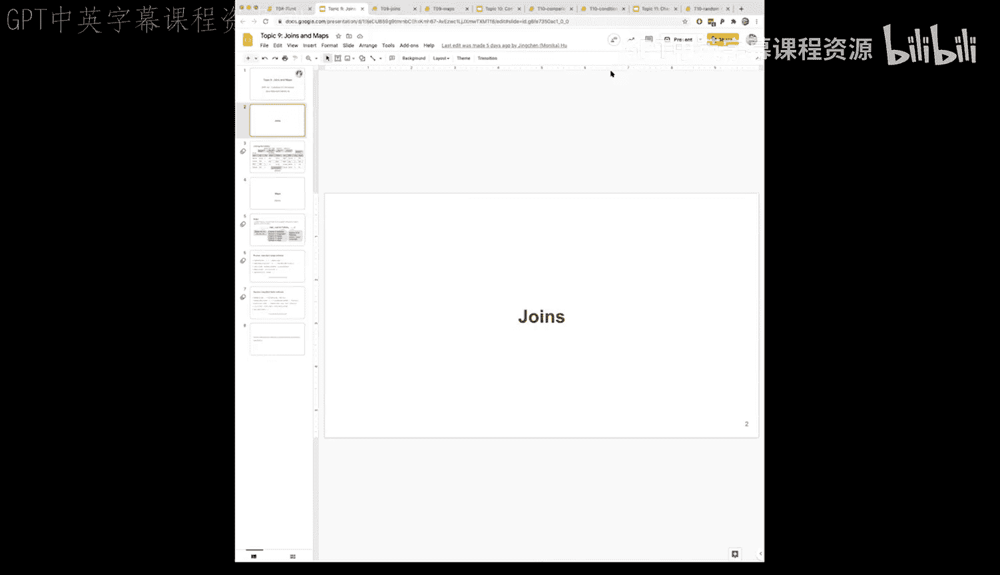
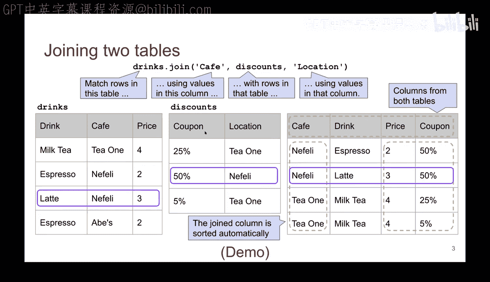
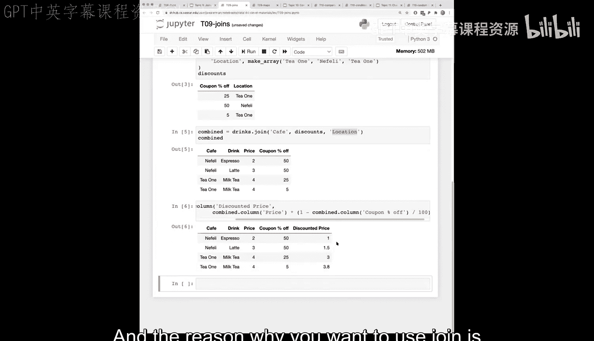

# UCB《数据挖掘和分析｜DATA 144 Data Mining and Analytics 2021》中英字幕 p32 [P32]lecture32-[T9 Joins and Map] Joins-jEqO0i8VxzA.zh_en [BV1efBEBuEVg_p32]

All right， so the next thing I want to talk about so any questions about that any question add should have should have should have not started a new topic we're going to have。

😊，But please don't let that be a disincentive to ask a question。U from there。All right。

Great， all right， so the next thing that I want to talk about are joins and again these are kind of tools in the toolbox for us right so we've learned about groups we've learned about pivots。

 you know to do all possible groupings of two categorical columns。😊，And so the join is operation。

 so the problem that the join is trying to solve， and this is a problem that pops up time and time again is that the data you want is very often not conveniently in a single table。

More times more often than not the data that you want is actually going to be scattered in in one or more tables okay and so the join kind of you get a sense of it from the name the join is is is an operation that allows us to combine。

Data from two。Different tables and join。Them together in a single table and and so I think the best way to kind of die to kind of explain this is actually to see an example here and so。

😊。

Let's start let's start with a fairly simple table to kind of so we can kind of see all the combinations of everything and so we have we have a table here we have a table of drinks and so we have particular drinks and the cafe that serves them and then the price okay so that is our drinks table。

😊，From there and then we have a different table and this table is a table of the discounts we have and so these are coupons that you have and and the coupon is for how much off at a particular location okay so different companies different。

😊，Different cafes are running different promotions and sometimes you know there could be multiple promotions going on even from the same company right think of them as like clipping coupons in your flyer right so so right now you know t1 is offering two coupons like 25% off or 5% off and then other this other place has 50% off coupon and so。

😊，We very often would like to， you know， think about。

Looking at the data kind of altogether and the key here。

 the key with the join and if so if you have two if you have two completely independent tables。

I don't know that there's much value in joining them。But here notice that。

In this one table here in this one table here we have a cafe。

 we have the cafe and in this other discount we also have what even though it's called the location。

 it is。😊，The actual cafe and notice these， you know， you can think of these as categorical columns。😊。

They they line up right the cafe and the location have the same categories from there and that's going to be the key to the join that you're going want to join you're going whenever you do a join there there has to be a column that is similar between the two tables there has to be a categorical column they don't have to have the same column name but they have to have the same categories otherwise the join doesn't the operation doesn't doesn't kind of math doesn't make sense so let's look at the join here okay and we're going to break down exactly what's going on and so a join is a method on a table and so we're joining we're going to do a join on the drinks table okay。

And so then what we're going to do here is and we'll break this down。

 but we're going to join so the first argument is going to be a column it's going to be the cafe column from the join from the drinks table right so this is going to be the the first argument is going to be the label column label from the first table Okay and then。

The second the second argument is going to be the table you want to join with okay。

 so the first table drinks is implicit because we're calling the join method on the drinks table so that's where the first table comes from it comes from the method call itself。

The second table， the thing we want to join the first table with。

Is specified here So this is the discounts is going to be a table it's going to be a table and then the last argument to the join is going to be the column that we're going to join on the second table Okay so from a practical point the cafe is a label a column label from the first table the location is a label from the second and so what it's going to do is it's going to kind of go back and kind of do some matchmaking okay it's going to do matchmaking and it's going to find all combinations it's going to find all combinations where you have matching locations and cafes okay and it's going to combine the coupon column with the drink cafe and price column。

With the other table。And so let's just actually see so this is the result of the join down here。

 okay？And so let's see how this works， so we're going to match the rows in this table。

 we're going to look for all of the rows。😊，From using values in this column Okay。

 so we're going to look we're going to look at all the rows we're going to look at all the rows from the cafe column So T1 the Fe and aves all of these all of these cafes and then we're going to。

😊，Match them to any。Any locations， any locations in the second column， okay？

So that that's how that works so let's let's look at kind of let's do one and so the resulting table and so it creates a brand new table the results of the join。

😊，The join is going to have columns from both tables Okay it is going to have columns from both tables notice the location it's going to have all of the columns except for the one that you used。

The column label that you used in this in the second table because that is going to be matched with the cafe with the cafe so notice you have the cafe。

But you don't have the you don't have the location in the second column because it's going to be matched as being the same as the cafe column okay so you won't have the location but you'll have the coupon and if the second table had multiple columns in it you would get all of them except for the one specified up here from there okay so you're going get the columns from both tables。

And then so how does it do the matching well here what it does is is it basically goes through every row in the drinks table it's going to go through every row。

And here are all the values from this particular row and then it's going to go look is there any rows is there any rows that match and in this case we have a match here so we're matching we're matching cafe Nefeli to location Nefeli here we have a match and we're going to combine we're going to join those two rows together in this row down here。

😊，Notice we have Nefeli and latte and the price， the cafe。

 the drink and the price from the first table。Matched。

Joined with the coupon from the second table from there， okay？🤧And。

Thats and then that's how that works right and so let's look at an example I don't have this highlighted from here。

 but let's also let's look at an example from the milk tea。😊。

From the milk tea here okay so here we're going match and we're going to look at t1 we're going to t1 and we're going to see in this case we have two matches we have two matches we have this one right here the first row and so that's going to be our first match and we're going to see this down here we're going to see the this match right here the T1 the milk T in the four come from there and we're going to combine it with this coupon here the 25% right so that is the first match we've matched。

But then what it's doing is for every row for every row in the first table it is going to scan every row in the second table。

 so we had our first match with the T1 here， but then it's going to continue scanning it's going to continue trying to match t1 from the first table from this first row and then it's going to get another match down here at the last row of the second table。

😊，And again， the result is going to be we're going to take all of the values from that first row， T1。

 milk T and4， and then we're going to combine it with the coupon from from the row from the second table。

 okay？Um。And what will it's kind of a nice little perk this will the join will actually sort the table on your on your joining label as well right so it's going to show you all of the nefes together followed by all the T1s in that all of the other locations right and so notice notice what didn't appear what didn't appear abes didn't appear in our second table why is that well because there wasn't a match with the second table so you know when it went through it was looking for abes in the it was when it was comparing this last row this espresso row it was going through searching each each row in the second table looking for a match it didn't get one so it doesn't make it over from there。

Okay。😊，And so。That's kind of the mechanics of that from there and in essence what we've done what we've done is is we've pulled in the data。

 the coupon data from this other completely separate table matching on a common column the location。

From there。

Okay。Let's see a demo of that。Let's take a look at that。From here。😊。

Okay and so here is the here is the table， the drinks table that we had before。

 and so here I'm just hard coding i'm just creating the table straight from scratch it's small enough to do that and so there's our drink table just like in the example that we had before。

And now we're just going to create the discount table。😊。

Where we're just making an array of our discounts 2555 and then here's our location right so this is just a straight application of creating a new table with the with columns method。

😊，And so there's a discount there。😊，And then there's our join。From there again。

 the thing to remember is is that we're calling join on a particular table this cafe needs to match one of the columns in our original table right there's our cafe and then this is the second table this is this is the actual name of an actual table and this is a column in the second table from there。

Okay and so there's our combined there's our combined table from there Okay so why is why is that powerful so now now that we have this combined table we can start doing computations we can start doing computations on this table and so for example we have the coupon off here which is good but really the thing that we probably care about is which place has the cheapest you know espresso or which place has the cheapest milk tea when we take the coupons into consideration right so a place might have more extensive drinks but if it has a bigger coupon then we'll want to go there and so that's what we're doing down here so we're going to basically we're going to create a new column we're going to take our combined table and we're going add a column with it and we're going add a discounted price we're going add the discounted price and we're going do this computation。

😊，We're going to take。We're going to take the price column。

 we're going to take the price column and then。Basically， take our coupon off。😡。

Subtract one from that and divide by 100 and that is right so what we're doing down here right so if you look at the 25% off coupon well that's the equivalent of taking the current price and multiplying it by 0。

75 right 25% off means you're going to get it for 75% of its current price so that's what we're doing here we're taking the one and subtracting it from the coupon off that gives us the the percentage。

That gives us the percent of the cost。And then dividing it by 100 to get the the like for example。

 for this one， the 75 to 0。75 and then multiplying it by the price and then that gives us。Um。The new。

 the new table。For us。We we run that。From now， okay， so that's the discounted price， right？

From there， so that's an example of join and the the reason why you want to use join。

Is is where you have？We have data in a different table that is related to your first table in some manner。

😡，Um， right， if if the if the tables weren't related。

 the join doesn't work because there needs to be a categorical。

Column in both tables that match that have the same categories because thats it's physically doing that matching for us。

Um。But you' you'll see this time and time again， especially when you start kind of looking at your own data in the wild。

 you know we in this class certainly in the first part of the class we have constructed carefully constructed tables for you that have kind of the data you need but when you go out into the real world you're going to find that oh okay you know here's here's like three of the things I need but then this other table has this other population data and and how do you combine them in there instead of manually editing a CSV file and that is no fun especially if you have hundreds of thousands of lines or even just even if it's just thousands of line let's have the computer do that for us and so the join。

Allows us to bring that data together。Okay， all right。

 I'm going to ask questions first now before I pause， the professor can learn。😊。

Any questions on the join you will definitely we will get lots of practice doing joins。

 so we will see examples of how to apply that。All right， fantastic， all right， let me stop this。

