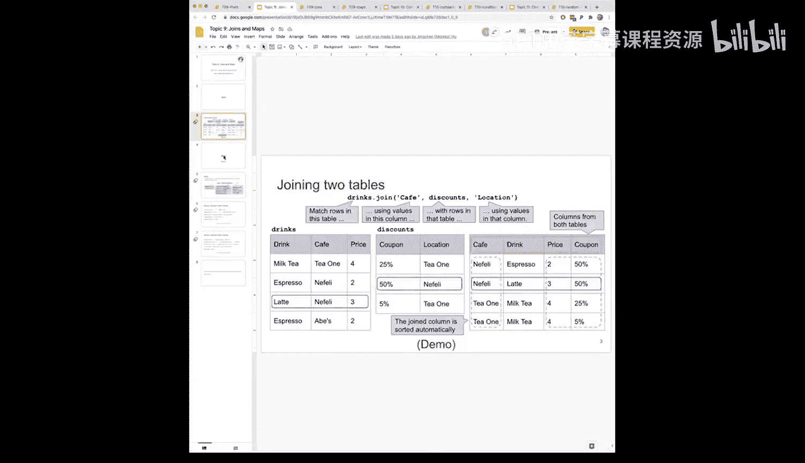
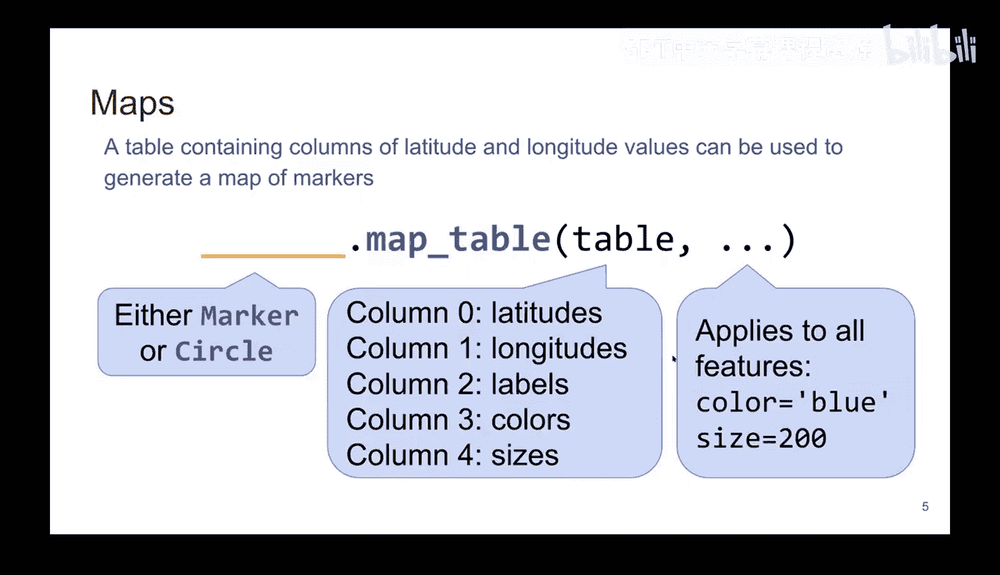
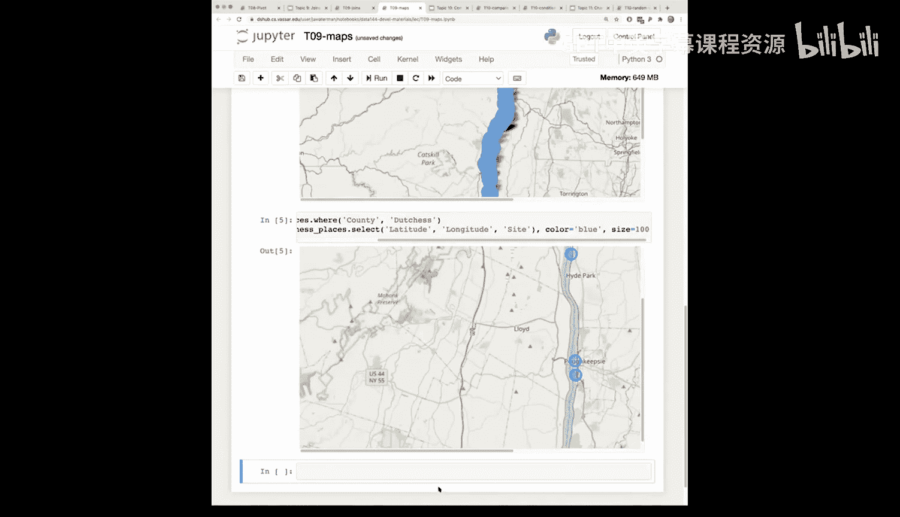

# UCB《数据挖掘和分析｜DATA 144 Data Mining and Analytics 2021》中英字幕 p33 [P33]lecture33-[T9 Joins and Map] Map-bYHDr8jk6J0.zh_en [BV1efBEBuEVg_p33]

next topic is a short one， but can be very useful especially for our final projects。😊。

So the last thing I want to talk about。Um。The last thing or the last or the last kind of the next thing I want to talk about to be chair。

😊。

。next thing I want to talk about is the mapping function。😊。

And this is just short and sweet there's a couple of methods if you give it a table with longitudes if you feed it a table with longitudes and latitudes。

 it will plot very nice maps for you with literally like one line of code due to the power of encapsulation and libraries right there's a bunch of libraries is doing all the heavy lifting for us but we can create a special type of at least in the data science package world。

 a special type of table a map table and and all that means is is that it's just the table that has rows of latitude and longitudes okay and we can generate a map of markers and so on this particular table the table constructed of latitude and longitudes we can call two methods。

😊，We can call we can call the mat table method on two different objects and that object is either going to be a marker or a circle really it just。

😊，The marker basically looks like a little kind of a Google teardrop thing。

 kind of like the little marker and the circle is just a circle from there， okay？😊。

And so the you're going to give a table。And then the other argument so you're going to give latitudes。

 longitudes and then labels and then colors and sizes Okay and then these parameters and I'll show you an example in a second will apply to all of the features so you can you can basically sit like the color to blue and the size of either the marker or the circle so this is a this is。

😊。

Something that's easier shown。From there， all right， so here's our data science and so。😊。

I just pulled and I just pulled a random I wanted something local for us to see so I just found this Hudson River Valley Greenway water trail designated site so it's a list of sites of various things along the Hudson River from there and so if we read this table。

😊，Oh， oh， oh， hold on， I just got to reconnect。Okay。😊，And if we read this table。

 it just has like different parks， the community it is the county and then what the important thing is it has latitude and longitude right that's the important thing you the data that you want has to have a latitude and longitude associated with it。

😊，And these are a bunch of things， a bunch of parks。

 boat launches all along the Hudson the Hudson River okay and so。😊，Again。

 so what we're going to do here is。We are， we're going to basically take our places table and we're going to select。

We're going to select the latitude column。And the longitude column and then the site column from there。

 okay？And then it's just going to make a map of us again because the first column。

 the first column is going to be interpreted as latitude。

 the second column specified and is going to be specified as longitude and the site is just a name for the marker。

 but for some reason it's not being it's not being displayed properly the site。

I need to figure out why that is I couldn't figure it out last night but basically what you get with literally one line of code is this kind of really funky map and so and these are the markers right they look like the little Google markers and you can scroll around with this map and then here is there's Kingston so here's poughkeepsie and then heres kind of the various things from there and if you click on it you're supposed to get the site name from there and I will hopefully figure out where the bug is I actually reinstallled the data science package then I broke it for everyone like at midnight last night and none of you were working at midnight or if you did you didn't complain that the data science package was broken for about a half hour but anyway hopefully we'll get to the bottom of that but then there's just the little markers there from there and so if you ever have kind of geographic data this is really pretty amazing that we can kind of do that with one line。

😊，ode for that and you can scroll out and zoom in and you can see， wow。

 there's like a ton of stuff all along the Hudson the Hudson River from there。Okay。

 so that's the marker and we can do the exact same thing。

 it works exactly the same way as the marker， but we can have little circles instead of instead of little I don't know。

 little arrow type things from there。😊，And then so what I've done here is I've just selected all of the things in Duchess County right Poughkeepsie is in Duchess County so we live in Duchess County so here are all the things so instead of having all the different items there I just I just did where county equals duchess so if you look back at our original table I just selecting for Duchess and fun fun little thing I was getting this demo ready last night and when I selected Duchess nothing appeared nothing appeared I got an empty table and then I was like what what's going on and then I was like oh you know am I doing this wrong now because then I tried like Saratoga and Saratoga worked。

But when I did a select when I did a select on Duchess and again I just grabbed a random data set off of I literally did a Google search Duchess County CSV file and I think this was like the first thing that popped up and so。

😊，And so it wasn't working for Duchess it was working for the other counties and so I'm like。

 all right what so I looked at the rawss CSV file and it turns out that that the CSV file had duchess had duchess with a space after the Duchess。

 a space after the S。😊，And so it wasn't matching dus it was looking for dus with a space after that and so if I did the search with the space after it you know everything worked fine but I ended up just editing the CSV file so you know to fix it to take out that so when you deal with data in the real world data is most often not clean for that and so whenever you have the opportunity to do some crossvalidation testing out of the data you know these things just pop up all the time and as you kind of get more into your career as budding data scientists you you will find a disappointingly large amount of time is actually spent cleaning and validating the data。

😊，From there so that's just something to kind of be aware of when we do things in the wild and there's really not too much more to say about about that and then again so the other thing is is that aside from that you can set the color I've set it to blue and you can set the size of the of the point of the marker as well right you can make it a little you can make it a little smaller。

😊，And then those were slightly smaller from there and you can make them different colors as well。

 so for your final projects just remember this tool in the toolbox。😊，For kind of visualizing。

Geographic data from there。All right。Any questions about that and there's no magic there just is just knowing that that exists and feeding feeding the table you know feeding the right columns from a table right and as you saw we didn't have to make a specific table you can use any you can use any table as long as it has a latitude and a longitude column associated with it and then you just give the proper labels from that table to the first parts of the argument there to the to the either the。

😊。

To the either to the marker or the circle。Object。From there and again it's the table method from there Okay。

 I think that's all I I want to say that's all I want to say about that。😊。

So。