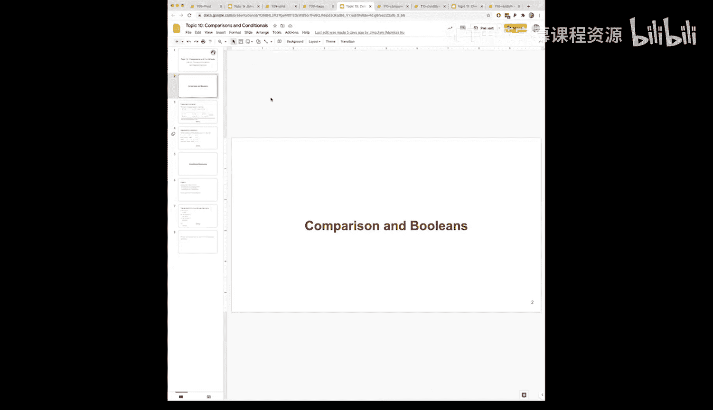
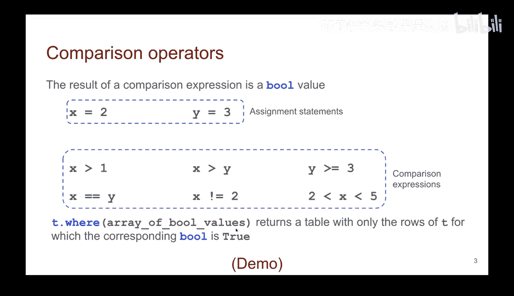
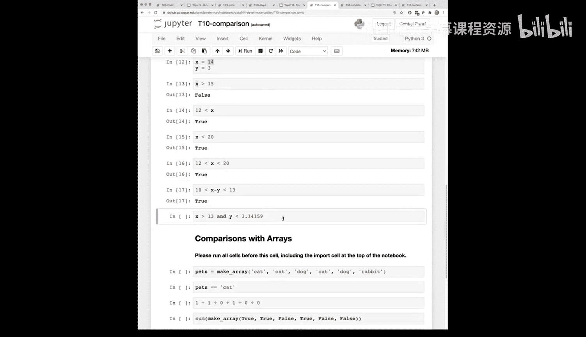

# UCB《数据挖掘和分析｜DATA 144 Data Mining and Analytics 2021》中英字幕 p34 [P34]lecture34-[T10-Comparisons and Conditionals] Comparisons-Qy9wnoc50DU.zh_en [BV1efBEBuEVg_p34]

Great， all right， now we're recording。Okay， so now going we're going to talk about how。

How the computer can actually make decisions and we're going to do this through a new data type and I've hinted about the Boolean data type before。

 it's a type that just has the values true and false and we're going to see how these Boolean objects these boolean types are being used in comparisons。

嗯。🤧Okay， so the bottom half of the screen has comparison operators these。😊。

These in the top out of the screen they are not comparison operators。

 even though they look like comparison operators right these are assignment statements and we've we've we've we've learned about assignments you know almost from kind of day one because that is how we。

That's how we store values right we store values and it's unfortunateve that they've chosen kind of the equal sign as an assignment。

 but remember when you see one equal sign if this is not this is not a test this is not a test does y equal three。

😊，This is an assignment where you have a left hand side which is a name。

 the left hand side will always always always be a name and the right hand side will be some expression。

 some value， this will always be an expression that evaluates to some value and and we're going to assign we're going to associate the value three with the name y okay。

😊，This is not this is not a comparison。The result of this whole expression is the value of that expression from there。

 okay， down below down below， these are comparison expressions okay， and in particular， the thing。

 the distinction that we're going to we need to make the the distinction between our single equal which is assignment and the double equal down here。

 the double equals equals equals。😊，I is actually doing a comparison and so all of these are comparison operators right they're going to result the result of this expression is either going to be true or false it's going to be true or false right so if x is an integer x has some value so to evaluate this expression to evaluate this expression it's going to evaluate whatever X is X has some value。

😊，And then it's going to do a test， it's going to test to see if that value。

 whatever that value is and remember x is x is a name for something we previously stored so it has a value so you can evaluate this name x it's going to have a value and if that is bigger than one。

 this whole expression will evaluate to will evaluate to true if it's not if x actually has the value of zero。

 this whole thing will evaluate to false。😊，And this whole expression is known as a Boolean expression and it actually has a type bo and so now we've learned about a new type right what are the this is a review what are some of the types that we've encountered before well we certainly know about the table type right that's a really big object that we've used in this class we know about strings we know about the string type we know about integers whole numbers and we know about floating point numbers numbers with the decimal so now we can add a new type。

😊，We can add a new type to our list， the Boolean type。And it supports all of the usual suspects。

 you know， so this is greater than and you know very names of things that we've stored before can be on either side again it's going to for this x greater than y it's going to take whatever the value is stored by the name X get that value。

 look at the value stored by the object named y and then it's going to do that comparison and we can do less than greater than less than so this you read this one the third one here you read this is we're asking a question is y greater than or equal to three。

😊，Okay， and that's either going to result in true or false。Again。

 here is the xs equals y that is doing the comparison this will be true if x and y have the same value。

Down here， this is you read the exc point as not this is known and by on this is known as a logical not and the way you want to read this expression in English is x not equal to two right so this is if this one here equals equals is the test for equality this is the test for inequality。

😊，This will be true for all values of x that are not two okay this last one is kind of funky this one is the last one is kind of funky。

😊，And this is actually perfectly valid syntax in Python what it's saying is is this whole expression will be true right will' evaluate x and if x is less than five and greater than two then that expression will be true okay so those are kind of the comparisons and so now I just kind of before I go into the demo I kind of want to revisit this idea of where so now right so we've been doing we've been making decisions we've been making decisions but we've been doing it with the where method and the R。

😊，The R function right and what was that doing it was it was selecting rows it was selecting rows based on kind of our r predicate and so we're kind of familiar with these concepts of right greater than less than less than or equal to but underneath the hood underneath the hood the wear clauses and this is how the wear claws actually works。

😊，What gets passed in to where is a it gets passed in an array， it gets passed in an array。

 one element for each row in our table。And that array is an array of Booleions。

 it's an array of values true or false， true or false， true or false。😊。

And what the wear clause does is it looks at that array and it returns the rows， the rows of T。

Where the corresponding array has the value of true。

And so what that our predicate was doing was it was just generating an array of truths and falses which then got passed into where and that is where the selection of the rows was done and we'll see this in the demo from here so while i'm setting up the demo do you have any questions。

Okay， all right， we've got four minutes let's so okay， so now let's let's look at the comparisons。

Okay， so what do you think about this one what do you even think is it so we're asking the question is three greater than one so。

No tricks up my sleep here here' that's true right three is greater than one So what will get returned。

 The value of that expression right is going the interpreter is going evaluate that expression and it's going to it's gonna the value of that that is going to be true okay notice capital T true that is that is a valid boolean type in Python and so here I'm just asking Python to tell me the type of that expression right that's the same expression that we had before and this will tell me that I evaluate that that will tell me that the type of this is a boolean type right that's no surprise there that is just like the integer。

 the string and the floating point types that we had from there and we can actually use that it is actually you can think of it is you can think of it is true and false as being literals like the number five the number five is an integer42。

7 is a floating point Well the key word true。😊，Just true by itself is a boolean， is the literal true。

 and that type is Boolean。Okay。It is case sensitive。So the true。

 the literal value of a boolean true has to be capital T and the Jupiter notebook cell kind of knows that true is is the boolean literal for true and so it highlighted it in green for us and notice when I did the true in lowercase what's happening we get an error because we did a lowercase T Python is case sensitive it's treating that as a variable it is saying oh this is a name。

 this is a name of something that hopefully you previously defined and we didn't assign any value to true so that's why we get this name error。

From there， okay ah。What about this？Do you think this will run correctly or not？I don't think so。

 I don't think so right because this is an assignment and the right hand the assignment is some value that looks good。

😊，But the left hand always always always the left hand side of an assignment has to be a name and so we're assigning a literal we're assigning some value three to the literal number three and that just conceptually doesn't make any sense okay so just remember if we're doing if we really wanted to do that comparison we need equals equals and here's an example where we're using the equals equals and it turns out by Python is smart enough to know that the integer3 is actually equal to the floating point value three but if you're comparing two floating point values together。

😊，You know it's going to go out to a lot of precision and so that's just something to be aware of so you may want to either round first。

If you're doing a comparison between two floating point numbers from there okay10 not equal to again that will return true right because 10 is not true and here we have a couple of。

Values here and so we can we can do these with stored things right and so what's going on here is we're saying is x greater than 15 well we're going evaluate x what is the value of x well we see we save the value 14 to x so this is doing the same comparison as is is 14 greater than 15 and the answer is no so we will return false and then by the same token we're asking the question is 12 less than 14 and that answer is true is is 14 less than 20 the answer is true now here's the thing that's the kind of the in between operation right is 14 greater than 12 but less than 20 yes from there right and we can do any expression in here as well。

😊，And another thing that we can do is we can combine them。

 we can combine expressions with and or or so here we're asking two questions that will get evaluated to a single Boolean is x greater than 13 and is y less than pi and we will do each of those individually and both of them because of and both of them have to be true for the whole expression to be true okay that is a perfect stopping point from there so any questions。

😊。

About that。No great so we'll pick up we'll pick up from here next class and I will see you all in lab on Friday if you haven't finished your homework work on that and have a great Thursday afternoon everyone and be on the lookout for your first individual project coming to you later this evening all right by now take care。

😊。

