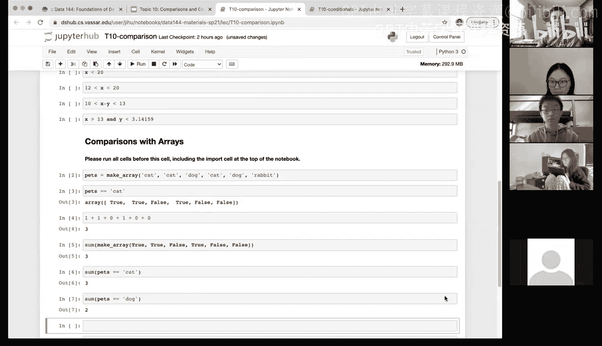
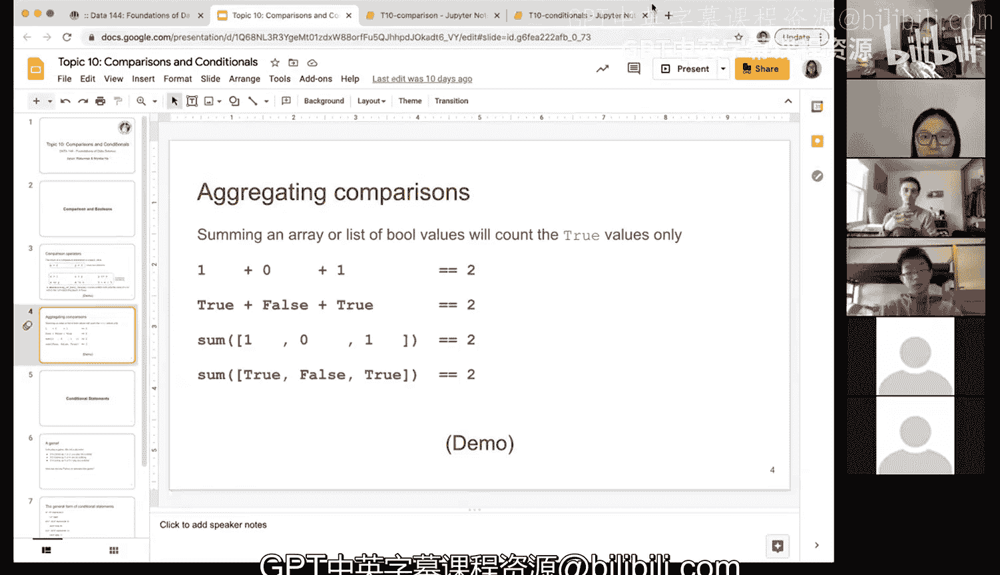

# UCB《数据挖掘和分析｜DATA 144 Data Mining and Analytics 2021》中英字幕 p35 [P35]lecture35-[T10 Comparisons and Conditionals] Comparisons with Arrays-DGT_OL [BV1efBEBuEVg_p35]

O。

All right， so I think last week on Thursday we ended about talking I guess comparison and rulings right and then doing certain comparison in python just to use it as a checking method in some sense。

 so today we're going to resume in particular starting from。

Have it in the face。Yeah， we're gonna resume from here where we're talking about like the comparison operators for certain arguments and then in particular I want to show you that for today to get started we want to show you that array can also be compared okay so just so you know like what we're showing on the screen right now is all of them could return two right and then actually checking whether it equals to two or not so you will see soon in our demo coming up that yes of course when you're adding like one and zero and one and then you can check if it's true with two right this is all bullying over here and then true actually in Python is also coded as one whereas false is coded as zero so if you do true plus false plus true when you check it against two I also going return true okay so that's pretty important for us to remember that true is coded as one and then false is coded as zero。

Moreover okay so remember here they're all the sc adding up and we can also do on top of array Okay so the last two examples we're showing here。

 as you can see is that well if we have an array of integers here 101 then if we do the song and then we check it against two it's also going give us true similarly if we have an array of true falses like just true and false and true in this sequence we check that against two also gonna return us true okay so those are useful things to keep in mind when we get started of the new demo for today okay so let me do all of so I think those ones are down from last week okay and then here we're gonna resume from comparisons with arrays okay so again we're creating array first of all and then trying to do different types of comparisons about them So the first one that we're gonna do okay as you can see。

Is what we call it pets okay， and we make a ray it's an array of string Okay， we have cat， cat， dog。

 cat， dog rabbit， okay so。Let's do a couple of comparisons that we're talking about。 The first one。

 as you can see the one that we're going to run is whether pets equal equal to cat Okay so this。

 as you can see， it's array of string okay and then in particular what we're doing here is that we're checking each of the strings in the array to see if it is equivalent to cat okay and that cat。

 as you can see is also in a string format is in okay so when we do that okay you will see that it's gonna return us an array of true or falses Okay because we're checking the bullying operator over here。

 true， true， false， true， false false Okay so if we just manually check it that's fine right like cat the first two are cats So the first two are true and then we get a false because it's a dog another true with the cat and then dog and rabbit the last one they' are false so。

Again， this an example of yes， the array just like what we worked on array before can be a array of different data types right now we're looking at a string and then you can do comparison with string as well all right so what we're gonna to demo now is what I was showing on the slide earlier as well is that well if we know that well true is coded as one and false is code as zero it is the same as well if I want to know how many cats are there right if I code cat as one and then dog or noncats I should say as zero if we add up those six integers we will be able to get the number of cats in this particular array okay so this is well mathematically we know that it will be true and then of course if we do the sum of make array right like if it's true。

 true false true false false then just like what we show on the slide earlier because true is coded as zero or true is coded as one false is zero so when we do this。

It's to return us to sum of three as well。Okay lastly。

 maybe we want to do it much more efficiently that will actually directly be doing the sum of pats equal equal cat Okay so what that does now we know because this inner part over here this argument is going to be array of true and falses right and then we're taking the sum of that array of true and falses so this is actually going to directly tell us how many cats are in this array okay so not surprisingly if we do it it going to return us three okay so this is a quicker way I guess overall to do this kind of comparison。

Or in this case just checking like how many cats are here so really quick here some of pets you call quote dog there's only one dog in it right in this pets array so。

Oh sorry two dots so so then we're going to have two because the third and the fifth yes。

 please Samha。😊，Hi， so my question is about like the make array。And the like the sum of maker。

 is it just， does it take the sum of how many instances are true？And that's it。Yeah， that's right。

 that's right。 Yeah， so that's a great point。 So here this demo is that if we do the sum of an array of true and falses。

 then well we know that true is one false is 0 here， this is yes within it。

 as you can see it's going to be an array of true of falses Okay so what this does is actually I guess two two rounds right the first round is checking the inner argument that's going to return us an array of true and falses and the sum just like what we showed it out here is showing us the sum of the true and falses where true is one and false is0。

Is it possible to get count of the falses？Yeah I guess let's see yeah that's a great question What do you all think if I want to get the count of falses what should I do I guess there are many ways so maybe feel free to speak up any way that you can think of and I can do the demo right now here。

And the question is for everyone Samantha， feel free to jump in， of course。

 but everybody else like say Samantha's question is。

 is there a way that we can get the count of falses？And if so， how？All right。

 maybe instead of waiting here let me actually this is a great breakout room question I guess so let me do like pretty quickly one minute okay and then we're going to come back and then hopefully we're going to get I can already think about at least two ways to do it but I'm hoping to see more okay。

Okay， so we'll come back， the question is how can we get the number of falses and anyone？

You just directly speak up， unmute yourself and then or type in the chat and I can do the demo on the screen。

I wasn't sure about getting the falses， but I think I would just switch the assignment from cat to dog let's see so if we do anything else really。

Okay， all right， so I guess let's see let me actually move this up because I think we're directly trying to figure out。

How to replicate I guess the sum I guess the sum of falses in this particular path's equal quo cat okay so the first one I guess L was saying is doing dog and I guess we did that just now so I guess you probably wouldn't directly give us three exactly because it's actually counting the number of dogs so what's the opposite I guess what's the opposite of is cat。

I don't have the answer to that， but I have the answer I have a different way to find the okay。

 let me do the other one， Yeah， go ahead Eli like。Um。

 if you did like the sum of the or the length of the array minus the sum of cats。

 yeah I think that would give you the。The number of non cats in the array。Yeah， okay。

 So if we do this and then minus the sum of paths。Would to cat， okay。Yeah。

 okay so that's I think it's one way maybe not the most direct。

 but still definitely correct is that we can count the number of because again。

 the array is only show false right so if we know the total number of elements and then minus the number of cats or like count of cats then we're going to get the number of non cats Okay so yeah so that's like I said trying to think about the opposite right of cats Okay so if we come back to lens。

Solution up here because we know what there is also rabbit right in this particular pets array that we know that well。

 if we only do equal equalal dog， I guess this is probably only a subset of how or like a subset of how many or the subset of all of the cats that are not cat Okay because we can have dog or rabbit So one way to。

 I think resolve this， I think is that I think we talked about it like Jason talked about it on Thursday that we can do the。

It exclamation mark and then with equal， that is not equal to。

Okay so that's what I was trying to get that when we think about equal equal we're talking about checking it is cat okay。

 but then the opposite of that， the negation of that is not cat okay so when we do that the bullying operator is gonna be exclamation mark equal that is not equal to and I think if we change this back to cat okay we will be able to get three as well okay so the logic here is that the inner part is again an array okay but instead of array of checking it is a cat we're checking that it is not a cat okay so pretty much we're gonna get the reverse。

 I'm sure we're gonna get like false false true， false true true okay and then when we do the sum over there。

 that's another way of getting the number of falses， I guess of the original array。

So I think both definitely work and again I acknowledge that when we do the not equal to cat we're reversing the array itself okay but then if we try to answer Samantha's original question。

 if we have the original array， I want to know the number of falses。

 you can either do the sum or the length of this array minus the sum of the array which is going to be minus the number of truths。

 you're gonna get the number of false or if you change you reverse the array to the reverse version of it and then if you do the sum that's going to count the new true which is the old false。

Okay so all of those were valuable like I said and I think。😊。

This is a toy example that we're trying to show you how to do different kind of comparisons but in practice I can see why I say Samantha was interested in finding out the false because sometimes when you're checking certain things you actually want to know what if not the true counts but the false counts okay so keep that in mind I think creatively I think later on we might see similar examples as well。

Okay， all right a couple of more down here so we just did the number of docs right by changing that equal equal after that to be doc and then there is another function or method I should say in the N library okay it's called count underscore no zero okay so that is equivalent okay so let me run that first and then show you what we mean。

Yeah so if you think about or like just guessing out loud what the term means or what the method is trying to do is literally I think just counting the non zero or the true occurrences of the array Okay so remember my pets equals dog dog this is gonna be array of checking whether it's a dog or not true and falses Okay and then again zero is or like false is code is zero and then true is code is one So if I'm trying to do count underscore non zero I'm doing the same as trying to find out the number of elements the count of elements that is non zero Okay in our case is non zero in this case is true so that gonna give us again just like what we do with the sum Okay so this is another function a method that is out there that you might find useful and。

So keep that in mind okay the last one I want to do is well let's look at a numerical array Okay we're doing x MP8 do a range 20 to 31 Okay so we know that it's going to be 2021 22 up to 30 okay it does not include 31 so if I do this okay and then if I do a comparison okay I'm interested in knowing。

How about for each of the elements whether they're greater or 28 or not。

 So if I do this comparison not surprisingly we' get an array okay again array of true and falses okay so only the last two or two everything else before that is false okay but just so you know again we never touch X itself okay so X is always X itself okay so this is another lesson of unless I want to do anything about this true or false array and if that is the case you want to assign it to object and the access later otherwise you never gonna touch or affect the origin array itself。

So Samantha， yeah， please go ahead。Back to the count non zero is there such thing as count zero or no yeah great question I don't know let's try to find now so。

I always also needs to check the what is it the up let me do correctly the library to make sure the documentation is right Okay so it doesn't work yeah so I don't think it's there so if you look at the so this one is saying that this library N does not have this function itself or the method itself Okay that's why it doesn't work So I think only non zeros in this case and。

Again， this is binary in a sense that like if it's non zero it's going to be zero right so we can always get the other one。

 I guess in this case by doing I guess two ways to do it again。

 whether you do the explanation mark equal as the negation or doing the sum or like the length minus the zero cases so minus the non zero cases so you're going to get the no zeros in that sense okay。

I also have another question ahead so X is an array and is it filling it with the numbers from 20 to 31？

So like when you say x is greater than 28 and it returns the array。

I'm just confused about like is it returning everything between like from 20 to 30 or like why are we returning x is greater than 28 like then wouldn't it only have like two numbers or yeah no that's a great point so so let me type it out here so we know that if we assign x to be an array of 20 to 30 in this case because it doesn't include the last one right so if we print it out we know that it's gonna to be array of those integers 2021 up to 30 okay and then this okay this is an example of comparison okay this is example comparison that we know that when we check when we round this and we saw the output already but even before doing that we should recognize that this statement okay this comparison statement is trying to check each of the elements of X and compare that to 28 okay we're curious about how each of the elements compare to 28 so。

All of this bullying operation as we know is going to return true or falses Okay so that's why yes。

 indeed， I guess mathematically yes， if we're not thinking about ecoding wise。

 if we're gonna do like x greater than 28 if we want to find which ones are the ones if we know that the array is 2230 then we know that's going only gonna be the last two okay but then in the python world or in the programming world we know that this particular comparison。

 the bullying operator greater， this is going to return us true or falses okay so for anything is smaller or smaller or equal to 28 is's going return as false and that's why we see all of them okay all of this are 20 to 28 okay so when we compare them it's going be false however for the last two 29 and 30 when we compare against 28 is going to be true So that's why in the end when we do in python do this kind of bullying operation then checking comparison here it's going give。

's an array about each of the elements， okay， only not only the ones that we know mathematically going to satisfy this。

Okay， so。For example， if I want to know how many right， how many there are that is greater than 28。

 so based on what we learned earlier， we can do some。And then that will give us two。So yeah。

 so I will say that what we're doing here， all of the bullying so if I come back give me a second if I come back to this slide over here。

 okay， so all of this。From last week， Okay， those are different comparison expressions， Okay。

 greater， greater and greater equal to equal equal not equal to and then in the particular range。

 Okay， and then I'm sure there are a few others that you can think of So all of this as we know if it's scalar or scalar like scar against scalar。

 then it's gonna only gonna return as true or false。 okay， it's a bullying。

 okay but then if we're doing array operation like the one that we're doing today here。

 then just like the example of that 28。 Okay， compare x with 28。

 then what's gonna return is an array of true or falses。

 okay and then we can do all kinds of arithmetic Okay， remember if it's an array of numerical values。

 we can always do arithmetic about them and then true and falses in particular here。

 both true and false they are also considered as numerical in certain degree because true is code is 1 and false is code is  zero And that's how we can do the sum like what we did earlier。

Makes sense。Okay，Yes， thank you No worries， thank you for the questions。All right。

 yeah so I would recommend go back to the demo and then try to figure out things and then solve any remaining questions you have and that's for the first topic。

