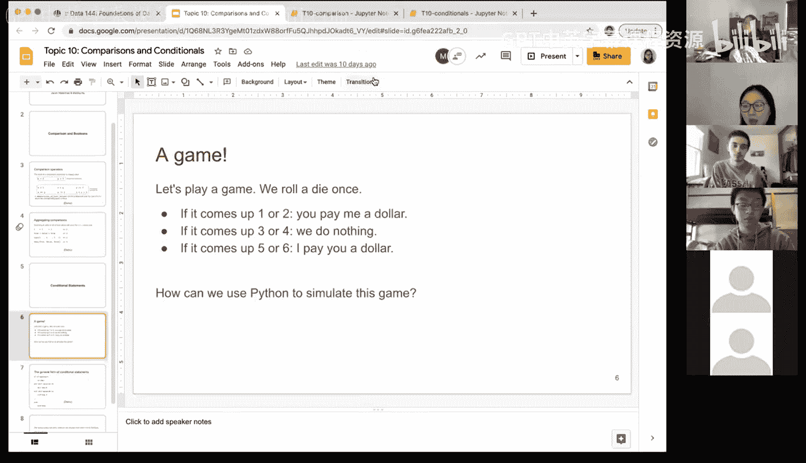
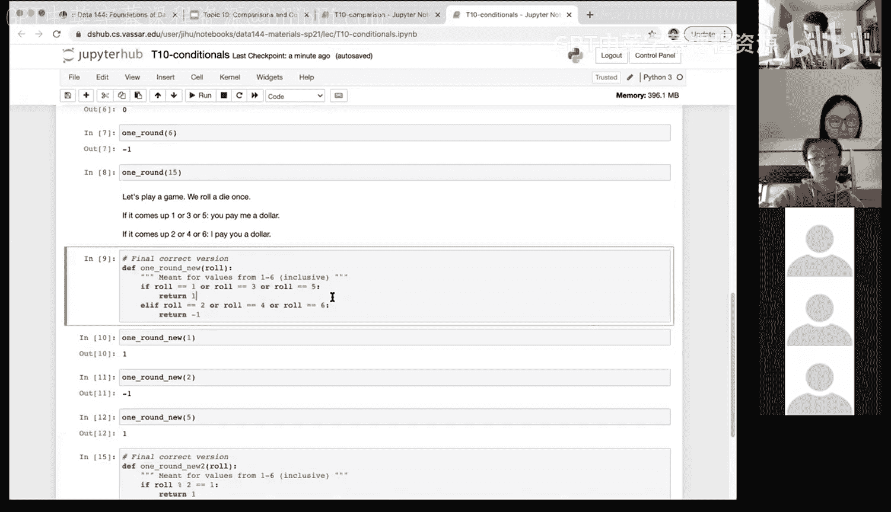

# UCB《数据挖掘和分析｜DATA 144 Data Mining and Analytics 2021》中英字幕 p36 [P36]lecture36-[T10 Comparisons and Conditionals] Conditional Statements-Pz4Ns-u [BV1efBEBuEVg_p36]

And now we are ready to talk about conditional statements。 Okay。

 the term might sound a little bit vague， okay， but you will see that well we already did some kind of conditional statements and now we're just formally introducing it and trying to cover different types of conditional statements that can work okay so we're gonna work around this what we call like a game Okay and then let's try to figure out how to use Python to simulate this game。

 So the game is we're gonna row a die once Okay die of six side of die， let me be more clear。

 So if it comes up one or two， you're gonna pay me a dollar。 if it comes up three or four。

 we do nothing and then if it comes up five or six。

 I will pay you a dollar Okay so this is what the game is about okay maybe you can already start thinking about how you want to do and whether and how you can do it in Python。

So the idea that we're going to cover today is what we call conditional statements Okay。

 the first conditional statement we're covering here is the if statement Okay。

 so I'm going to here we're showing a workflow okay， so if。A particular expression。

 we're gonna execute a certain thing。 Okay E L if， so the E L IF that stands for else if okay。

 if we have another expression， okay， we're gonna do something else okay and keep doing that and then until the last option over here okay so before I go doing the demo actually want you to brainstorm it will put you back into the breakout room。

 brainstorm a little bit of how this set of if and else if statements might be helpful for you to actually simulate this game。

 okay， so notice here we have three if going on Okay， whether it is one or two。

 you do something right， three or4， you do something and five or six。

 you do something Okay so keep that in mind， you probably because once I put you in the breakout room。

 you have to access the slides yourself So it's on our website Okay if you want to take a look the question for you all is based on the if statements。

 the if else the conditional statements that we're showing over here。Um。

 if you were to write it in Python to simulate this game， how are you going to go about it？

So let's have about two minutes and then I'll bring it back。

Okay， so welcome back and yeah the task here is that if we want to simulate this game okay of three different if statements okay conditionals that's what we call a conditional statements conditioning on certain things comes up or certain things happens we're gonna do in an action okay and we show you earlier that the general form of conditional statements goes if else if else okay so depending on how many you're having over here so the particular demo is T10 conditionals okay and let me run the necessary box first okay so the simulation like I said is rolling a die okay and then if it comes up one or two you pay you a dollar three04 we do nothing and then five or six I pay you a dollar okay so just to show you a couple of things。

You will see that well we are working on again in terms of making it as a function okay and we call it one round Okay of course we don't need to put in a function。

 but in the end we wanted to make it as a function that we can actually determine like say if I supply the row number you want I wanted to know the outcome of it okay that's why I'm wrapping it up as a function but within the function you will see it's gonna be a bunch of conditional statements that the one talking about Okay so work in progress let's just do the first one for now okay so you see that the depth so the function format as we know we have the name of the function okay we call it one round Okay and row is whatever the row that we're gonna get out of this die okay。

The first part we know is that well， if the row is smaller or equal to two。

 that's the first statement up here， okay， you're going to pay me a dollar so in terms of me I'm going to return or I'm going to gain $1。

Okay so this is part okay only I understand like it's only working progress so it's only the first one so let's round this and see what we get okay so if we define our function this way only the first if statement so far if I supply the row to be one we know that the output should be one right because I will be receiving a all from you。

If we're around that， okay， great， that's one okay however。

 we know since our function is not finished yet okay。

 we only have supplied the options or like if statements for row small equal to two so if I'm supplying anything greater than two。

 well， nothing going to happen because we haven't told the function what to do about it。Okay。

 so that's why if we around it right now like say the row is four then there is no output or anything Okay so let me show you the final correct version of the entire entire function Okay。

 so the function again we call it one round okay the input is row and notice here we have three okay different if statements or else if statements okay this is each of them is corresponding to the three possible outcomes that we show up in the game itself Okay so if we really carefully okay。

If row is small equal to two， okay， we're going to return one。OkayThat's all good。 Notice here。

 else if row is smaller or equal to4， we're gonna return0。 Okay。

 so notice here because we have an else if Okay， so meaning that whatever we're checking in the second else if statement over here。

 we're excluding the cases of the first if because the actual question。

 I don't know if you're wondering if if I'm looking at this function。

 I will be I will be curious about well， if I have a row equal to2。

 it also falls into this particular if statement right like I said， however。

 because we have the first if that is looking at row between L is small equal to2。

 and then the else if okay， it's else if so it does not include the first item over here and that's the reason why also for the third one if we're checking row smaller or equal to6。

 it does not include the first term。So this is one way to do it， okay， so let me run it。Okay。

 and then now I'm going to show you well if I okay， so if I row a four。

 we know that the return should be zero right because it's in the middle if statements okay。

 it's going be zero if I row a6 I think I will get negative one right because according to the game rule I'm going give you $ a Okay so that's what is negative one and then if I do 15 which is out of the scope okay of what we're doing over here just like before it's not going to return us anything。

Okay， and yeah， so any quick questions or comments about this？

What if like so like the winning numbers， what if you couldn't chunk them up in terms of like you know。

1，2，3，4 and then five，6。 what if it was like for me it's one in five， you know。

 and for you it's like two and four or something Yeah， yeah。

 no that's a great question So that's what I was saying maybe there already I mean even yeah so Michael's question is what if we have some other not easily cholkpped off version of those statements and then yeah。

 so for example， let's just say if we change the game Okay。

 let's just say let me write it down like down here so I don't forget and then make mistakes So this one。

 let's see we're doing according to Michael's idea let's see let's just do this like if if it's three or one or three okay or let me just do this if it's one or three or five Okay you pay me a dollar okay if it's a odd number okay and then if its。

2 or four or6。 Okay， let's do， I pay you a dollar。 Okay， so were only going have two in this case。

 okay。Alrighty， so if we want to rearrange this okay or like change this accordingly So first of all。

 I guess we probably want to delete the middle one because we only have two outcomes over here Okay so that would be the first one to do okay and then of course the first one is returning one the other one is returning negative one so that's good and then here is it comes up three one or three or four okay you're gonna pay me a dollar so I guess instead of doing this as we know。

We probably will have to do equal equal one right I think this is right like or row equal equal three and then or row row equal equal five。

Okay， yeah， and let me finish this one and let's check if this is correct。 Okay， so in fact。

 as we are showing right now， there will be multiple ways you can write those。

If conditional statements okay and all of those as you can imagine is going back to what we just covered about the comparison okay all of them are going to be different versions or different combinations of the comparison Okay so let me name it differently so I don't overwrite whatever I have okay so let me define this okay and let's try to see if it's correct。

Let's see so if I do one Okay I should get one right okay。

 that's good I'm actually not entirely sure if I did it right so so that's comforting and then if it's two hopefully it's going to give a zero okay。

Oh no， no， negative1， I think we're a good because it's I pay you a dollar so91 is fine。

 and let's try one more， maybe like five just to make sure。😊。

Yeah so I think this is i'm sure there are other ways to do it。

 but just to show you like say if it's not easily broken out like what Michael was asking earlier。

 you can always make this connotation in a sense right like row equal equal equal equal to one or two three or five and then you can go that way Yeah Samantha go ahead。

I was just thinking could we also use like modulus and like if rolled module or like divided by modules two equals zero then one Yeah I agree we should be able to do it I don't know the code per se for for the module okay so what Sammanha was suggesting is like this particular rule that we're falling right now is that it's a odd number you pay me a dollar right if it's an even number I pay you a dollar so instead of like writing all out like this one way to do is like to do the module so like say if it's an even number if we module that with two then it's gonna the gonna be zero Okay if it's a odd number if you with a mod base two then it's going be is gonna be a one I think so i'm going just like I guess making myself like a fool here but let me just try it out I think it's fine let me just do new two but i'm not entirely sure about the。

Yeah， so I honestly don't know， like say it doesn't show up like as a maybe ready function， but。

The general idea I don't know the syntax I guess let me put it this way I don't know the syntax so I cannot say for sure。

 but the general idea if I let's say if mod MD is the module function Okay if it is indeed the module function that we're talking about then this kind of code should work Okay but like I said I'm not sure if that's the right syntax okay so I will do zero here I guess and and then okay。

 so let's try that out okay like I said I'm not too sure if the。Function itself。

 the MOD the function is correct， so maybe I will get something weird。Okay， yeah。

 so it's not available， but I'm sure it's available somewhere in Python world。 I just don't know it。

 but I think the general approach that Samantha was suggesting is definitely a good one。 Okay。

 Spencer ty in the chat row percentageile percentage percentage sign to Okay thank you let me try that out。

 So do I do。Oops， oops， percentage is to。And do I also do， I guess， do one here？

Or yeah because because nevertheless， I think we need a comparison statement Okay。

 so let me try out what。Okay。Yay okay so thank you Samantha and Spencer。

 So I think the trick here is that the percentage side that's the module operation in Python and maybe Spencer if you feel comfortable you can share how did you find it but if I were to do I would to search online googling it and then try to figure out the cares synt okay but either one is fine and we have seen how to do it like in a less straightforward way or like more tedious way I guess maybe more straightforward but tedious because we are just listing out all of them by using or to connect each of the conditions or we can use this module and then go about it。

And okay yeah so Samantha also said percentage sign is also modules in Java okay and that's great I didn't know Java so I guess I didn't have that knowledge to go ahead about it。

 but nevertheless I think you can see that there are multiple ways you can go about this kind of task and some of them are maybe more straightforward but maybe a little tedious but then some of them might seem less straightforward like the module that we're doing over here。

 but it can be pretty pretty easy to implement and then maybe less less prone to error honestly I think this one if you type something wrong than something is not working correct from the way that you want it okay。

All right， so keep that in mind that the general form of conditional statements okay the if conditional statements that we're talking about is having this okay so this one is general in a sense that you can have I don't know how many you want in terms of the number of statements you have the particular demo that we did is only having three okay the original one I should say only have three and then the later one that we did has two but regardless the general format follows the same style and then that can be generalized to many other context as you going start doing it for your lab for homework and the project。

All right， thank you for all of the comments and questions。

