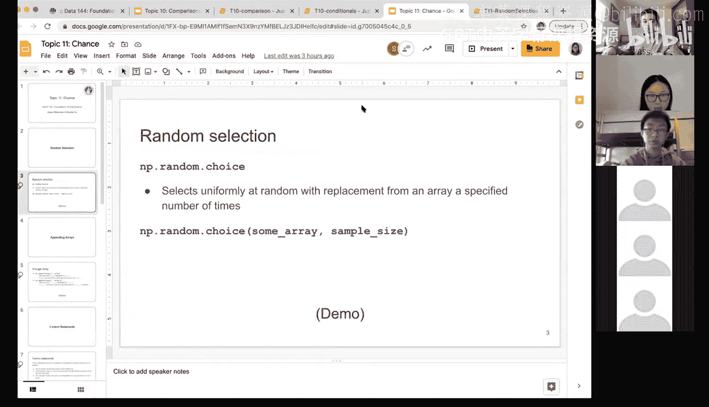

# UCB《数据挖掘和分析｜DATA 144 Data Mining and Analytics 2021》中英字幕 p37 [P37]lecture37-[T11 Chance] Random Selection-rx09Vm9vy5c.zh_en [BV1efBEBuEVg_p37]

Now move to our topic 11 chance okay so now you will start to see that let me share my screen now you will start to see that why we are interested in talking about those different conditionals comparison for now okay because you will see that later for all of the inference that we were talking about in this course we're trying to do what we call like a simulation based inference okay we're actually gonna try to simulate just like the game that we're talking about we want to simulate games and then maybe you'll be wondering okay whether this is a fair like maybe you'd be wondering like say whether this is a fair six side die okay and then one way you can do is you can simulate like a large number of experiments okay and then check against maybe some of you know about like say now hypothesis or turn of hypothesis things like that and we're gonna cover that in detail as well but just so you know all of the conditional statements the comparison that we're covering just now is going be very。

VeryImportant in understanding how we can create simulation based inferences Okay because all of them are building blocks of how to simulate games and then of course。

 simulate the game for a large number of times and see whether it makes sense Okay。

 so to get us started Okay， we're going first talk about the render selection Okay and what we mean by random selection is well。

Let's just say the example like the demo that we did earlier about the simulation of the game。

 if you remember， we only did part of it。 Okay， so let me bring us back really quick。 Yeah。

 so if you remember the game， we're saying that if it comes up one or two。

 three or4 and 5 or6 the function that we're writing earlier with the conditional statement is only after I already know what the die is going to come up with Okay like remember that's what the row that we're passing into the function that we're writing Okay but now for us。

 the next question is if I really want to simulate the game。

 I also need the piece to actually roll the die Okay and I know it's a six side die。

 okay so the missing piece， which is the one that we're gonna talk about is how to how to actually create or randomly select in this case out of the six possible values Okay so that's what we mean by random selection Okay and then in Python。

 pretty straightforward Okay you have this MP。 So it's in the nu。

Function nu library heremp do random do choiceice Okay it's gonna select read it carefully select uniformly at random with replacement from array of a specified number of times okay so put that I guess into easier to understand notion we are providing okay an array of choices okay and then once we do thismp do random dot choice we're selecting is selecting uniformly at random with replacement so what that means is that if I'm supplying the array of one。

2，3，4，56 okay what thismp do random dot choiceice being play being used on top of that array like is the input what we are doing is that we're randomly selecting okay one of the six values。

Okay， and then once I'm done with this， if I do another one。

 it's gonna randomly select from one to six again Okay。

 so that's what we mean by with replacement Okay， when you select one， okay。

 you are saying that well I'm only selecting one of them but if you start to do two then what we mean by that is that you can get one1 Okay because when you select the first one you still put it back and then again it's gonna to be a uniform random selection over there。

Okay， so as you can see there are multiple arguments you can go with multiple arguments the first one has to be the array that we're selecting from okay again it's uniformly at random so it's equally likely all of the outcomes。

And then the sample size is actually the number of selections that you want to do over here okay so you can have this additional argument input argument over there so you're able to do that okay so let me go to the demo so we'll see how that can be done in practice okay。

Okay， all right， so most commonly later in the semester。

 you will see that a lot of times the random selection we're doing is especially trying to work out if you remember about our causality statement。

 how you can make causality statement we're putting people in the treatment group and the control group right and then we're trying to do a randomized experiment over there So a lot of times maybe the choices that you're making right now is between treatment and control Okay。

 so this is the first example that we're having over here Okay so experiment groups okay it's an array of treatment or control Okay you can imagine that later on。

 when we know how to do for a large number of times we're doing this kind of assignment right the group assignment for each of the observation。

All right， but to get us started to get there， we first of all， okay。

Decide the experiment underscore groups that's the array of treatment and control Okay。

 so remember themp do random dot choice method you will have to supply the array of the outcomes that you're interested in Okay。

 so we create that and we name it as experiment underscore groups Okay。

 so now i'm going to do one random draw okay。It turns out to be treatment okay and then I can do another one well it turns out to be control I can do another one it's control and I can just keep doing that every time it's a random chance okay it's a random draw as should say and it's equally likely it could be treatment it could be control。

Okay so just all of the default like you can see here that we don't have the second input argument array because the default is one。

 we're only making one random draws， but we can do 10 let's say we do 10 and then you're gonna see an array okay of the outcome each of them is one of the outcomes over here treatment control treatment etc cea。

 etca， okay and then it's an array。So now hopefully you're so familiar with this now that whenever we're doing an array we might want to do some kind of arithmatic about it okay so first of all。

 what if I want to do some of the like I do 10 choices I do 10 random selections and then I want to know how many of them are control okay so when you do that well you can use the song method and then equal equal control okay so this goes back to what we just did the demo for the comparison。

Comparison of array， I guess of the previous topic just now and then we can do that Okay so in this case we have six okay and then in this case we have six again okay so you might find it well if I'm only do 10 how come I'm gonna have six controls and six treatment okay great question if you have that in mind just notice every time we round themp do random dot choice it's a new set of selection Okay that's why this particular one。

 the one that we did over here is different from this one that's what we can have both six Okay but if you only want to do it one one time then general approach over there is that you're gonna do this selection right and you caught it something So later on you can work on。

Work on the particular one over here， so for example， if I name is selection。

 then if I do some of selection political control。And then I do another， oh sorry， I do another one。

Call song。Selection。equal treatment Okay if I do that then I'm pretty sure they're gonna sum up to well。

 happens to be 5，5， but they're going sum up to 10 because we're doing the arithmetic or the bullying operation and then checking the sum on the same set of 10 outcomes Okay so every time you round the MP do random do choice it's going be a new set Okay。

 that's why you might see something seemingly contradictive。

 but if you want to make sure that everything works out well。

 you might want to assign it to object So later you can operate on that object which is fixed。

All right， so well I think that's exactly what I did down here anyway so so that's what we mean by you can actually simulate right you can simulate random draws over here by using themp do random dot choice method okay make sure that you always supply the array of the outcomes okay but then of course the second optional input will be the number of selections that you want to make。

Allright so with all that in mind， let's see how we can make that game working in the way that we hope is gonna work okay so like I said。

 just to come back here really quickly the one row function that we row earlier is only doing this part okay is only doing the part that is checking the three different conditions and return you the outcome okay and what we are saying here is that if we want to actually completely simulate this game we also need to row the die and that's what we just covered okay you can use themp do random do choice method to do a random draw and let's see how that can be placed together to make this game complete okay so the one that we're doing over here is like the die faces okay I am doingmp do a range one to7 okay because we have one2 three4 five6 different six different options So if I do that we know that it's going to be array of one through6 okay and then if I do okay。

And MP do random choice on top of this while we know that we're just equally likely selecting one of the six options okay so if I do another one okay I might get one as you can see I do another one is six ex serviceer okay so that you can see that it's going to be a random process and let me quickly。

Okay yeah， never mind chat， I got it Dory。Thank you Alrighty so now let's see how to make the entire game complete。

 Okay， this is copied from before if you remember we have this one round function， okay。

 the input is the role Okay so we know that that's good and now I'm writing a new function wrapping up this one round function Okay I call it simulate underscore one underscore row Okay actually I don't even need any input Okay because the reason is the way that I'm doing it is that in this new simulate one row function I'm gonna first of all。

 you can see take a random draw right from one through six。And then second。

 I'm using the one round function that I wrote earlier to determine what is the output going to be。

Okay so this is a function as you can see that doesn't need to take any input because we're really just simulating we don't like there is no I guess in this case you can think of as I don't need any input to make it happen or make it wrong so I don't I can put it as a blank right now。

And then for us。Notice that this is a nested version over here， right we are using the want round。

Function， which as we wrote before of determining once I know the row， right， determining the output。

However， just like what we talk about we also need to have the rolling process going on and we learn that themp do random do choice method can make that happen so this function once we run it we can actually start simulating the game like what we're talking about Okay so the simulation has two parts right the first one is that we have to determine。

Wwhichhich one or like what is the row and the row the rolling is from the render draw like what we did。

 and then the second part is evaluating it based on the three if statements right and then determine the output。

Alrighty， so let me try to run this okay， so this case is I guess it's the row is probably three0 four right so we have a zero output over here。

I do another one it negative one so I guess for that particular row is going to be five or six and you can keep doing that just like what we showed before every time it's a new draw mostly because as you can see because the function。

 the similar one row function involves the MP dot random dot choice and we know that every time you rerun it is going to be most likely a different outcome。

Okay。😊，Makes sense。Makes sense all right， so if I come back here yeah just to wrap up really quick over here the method function the method name ismp do random dot choiceice okay you need to have the first input as the array that you're selecting from and the second is optional default is one but you can always make it larger if you want multiple outcomes or multiple rounds being done。

Let me没事。

