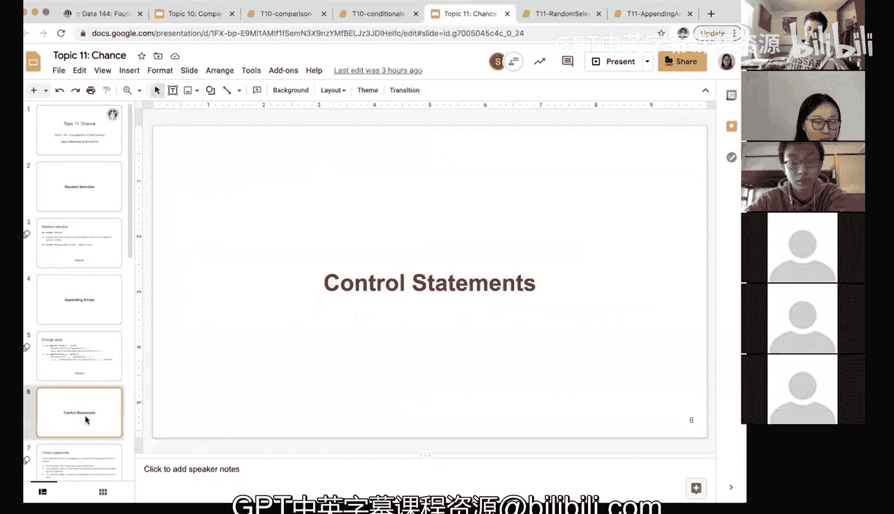

# UCB《数据挖掘和分析｜DATA 144 Data Mining and Analytics 2021》中英字幕 p38 [P38]lecture38-[T11 Chance] Appending Arrays-OmnUrCRZmsU.zh_en [BV1efBEBuEVg_p38]

Okay， all right， so with that coveredboard， we are ready to talk about， well。

 what if I want to perform my gain for a large number of times okay I want to see like how how once I do a larger number of times whether I can have any kind of general statement or like if I have any kind of checking about whether the row is a fair row stuff like that。

 then what we need it is that well， I run it for once okay and then I proceed around the next time and I want to make sure that I can cancate or like connect or like link all of the outcomes that we're getting into what we call like a new array that later on we can do summarize any kind of summary about okay so what we mean by this we call it a pending array but pretty much if you look at what we're trying to do is that we're using theend method what we're doing the first one to a first version of using it is that if I have an existing array one I want to add a value。

New value to it Okay so we can do themp dot append and then array one and then value those sort of two inputs so we are just adding a new value appended to array one Okay caveat and I think we probably know this by heart by now。

Is that the array all of the elements should have the same data type okay so if you are doing array of integers earlier。

 the appended value， the newly appended value should be another integer otherwise you're gonna get an error message okay so what this is doing and later on you're gonna see is that well if I want to do this experiment one at a time okay but I want to do a large number of times and I do let's just say I do 10 already and I want to do another one okay what we can do is that well I have the array of the array one of the 10 outcomes from the first 10 experiment and now I do a new experiment and then the value of the new experiment I want to append it to the original。

Okay， so the append is trying to help us do what we mean by longer array because I want to record all of the outcomes one by one Okay so that's the first one。

 first way to use it。 you can also do aend of two arrays。 Okay。

 so like say array one array2 and then it's just the array2。

 the second one gonna be appended to the first one array one and then again。

 all of the elements need to be in the same data type。

 Otherwise youre gonna get a error message Okay， so keep that in mind the purpose of doing this。

 we're trying to。See that if we're able to do a large number of experiments and I want to do like say one at a time or a few at a time。

 but in the end， I want to collect all of the results together into array。

 and that's the way that you can go about it。 Okay， so let me show you some quick demos。

 and then we go back again to the rolling game okay。Alright。

 so the first array I'm doing over here is amp do a range4 Okay， so that's gonna be10，1。

23 right and the second one is gonna be 10 through 16 Okay allright。

 so the first demonstration okay is that if I do MP do append first and then6 So remember whatever first is what I did over here。

 right0，2，3 Okay and I'm adding a new value into it Okay and you will see that well right we have one through three first and then we add that six over to it。

Okay， so that's what this append is doing， but of course if we just go back to your first again。

 it doesn't change okay， if you want to save this just like what we know by now you want to save this to assign it to an object so later on we can access it。

Similarly， if I do the MP appendo first and second， okay。

 we're going to have a longer array of the two appended together。

 but the original two were never touched。Okay， so those are good things to keep in mind and I think we have seen so many different examples。

I know as long as you do any kind of operation， anything or any object， if you want to use it later。

 you always wanted to assign it to object later so you're able to use it otherwise like what we have seen again and again you're never going touch the original object if you don't assign it to anything new okay。

Allright， so let's come back to the repeated betting that we're talking about it here Okay。

 what if I want to do the game for a large number of times okay and every time I want to record my results okay and then here we can say that well if we are redefining all of the like the dive phases through one to six and then the two definition like the two functions one round and simulate simulate one row okay those are from before okay so the way that you're able to actually save all of the results if you're gonna run it one by one is that I can first of all starts with the results array which is empty okay because I don't have anything yet okay so I do an empty array okay and now I will run my simulation once。

Okay， and remember once I run this， I will have the outcome of the zero or negative one or positive one。

 depending on the role that I'm doing。And then I can append it back to results。 Okay。

 so if you focus on the righthand side， Okay， we're doing the empty do append results is whatever the results that we have so far。

 which is empty array at this point。 And then we can simulate one row we're doing the game Okay we append it to the new results。

 And then we assign it to results again。 So this is the case that well in the end。

 I only really need to know the array of all the results。

 So I can reuse the object name every time Okay because in the end， I only care about that。

 But of course， if you care about any intermediate ones。

 you can always name it differently before our demonstration。

 we're doing append back to results and then we assign it as results again。 Okay， so okay。

 so remember， let me run this one more time right now。

 results should be empty So let me actually just。From that。Yeah， so it's empty， okay。

 and now I'm going to run my first game okay， and I'm going to pen the results。

To it and then now you will see that because I only simulate the game once right I'm going to get one result which is 1。

0 Okay， and I can do another one。Not surprisingly because i'm appending it back to the results itself。

 I'm just adding one more result over here Okay， of course， if I do another one。

 it's going to be the outcome going to be array of three elements， right oops？

I have to put on so it turns out that the third one is also a positive one。

so a pending arrays maybe at first do you think that why would we ever do it。

 why do we want to add or like say append any new observations or new results to the original one as you will see soon like we just saw it but then also like I said later in this course we're gonna see a lot of simulation based inference where we try to repeat the experience so many different times and then the append method going be super handy here because every time I run a new result I can append it back to the original that I had so I can just keep growing my final results array that I can collect all of the results that I need。

All right， if that sounds good， I think we can come to the control statements。

