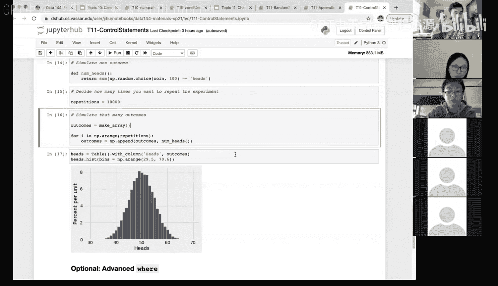

# UCB《数据挖掘和分析｜DATA 144 Data Mining and Analytics 2021》中英字幕 p39 [P39]lecture39-[T11 Chance] Control Statements part 1-cYlrw3Iwiis.zh_en [BV1efBEBuEVg_p39]

All right， okay， so we talked a little bit earlier right about the conditional statements okay conditional statements like what we're talking about here back there is all of the E statements that we're doing okay and it's conditioning on the expression then we do certain action okay so。

But conditional statements also falls into the bigger umbrella。

 what we call about control statements。 Okay， so control， if you think about the term， Okay。

 we're really trying to show you in a sense that those control statements are useful in a sense that we can check the condition。

 And then once we know the condition， we're gonna control for it and then do all the tests that we need to do。

 So what we mean by that。 Okay， this statement gonna control the sequence of computations that are performed in a program。

 Okay， conditional statement is one type like the if statement。 Okay。

 it's going control exactly what gonna happen。And then the four， okay。

 so this is the new one that we're covering here Okay， it's another keyword Okay。

 we're going to begin a control statement and the four statement as you will see is that it's going to perform a computation for every。

 every element in the list or array。Okay we'll see an example soon。

 but just so you know when we cover the if statement earlier。

 okay we know that now we know that it's also a control statement okay it is is used to define functions that choose different behavior based on their arguments just like if else if that we did like one or two three or four or five or six okay so both of them is what we call a control statements okay and we have seen how if can be done now we're gonna to do a demo about four and then four as you can see is another very commonly used way that we're going do a simulationbased inference okay and I noticed because earlier doing our discussion some of you have experience with Java or other programming languages then the for loop I'm pretty sure you have seen that over there and that's what like the Python world that we're delving into two is trying to do as well okay so four and if both of them are control statements and then they're gonna control the sequence of computations going be performed in the program and。

For is doing it for every element okay and then if is given the conditions being satisfied you're going to execute certain tasks okay so let me show you the demo and then I think hopefully we can get through this before we going to end today okay。

All right， so the four statements， okay。We're going to start with a few toy examples and then again go back to the rolling game that we started earlier Okay so here the four statement okay so let's take a moment to understand this。

Line of code a little bit more。 So what we're doing here。

 as you can see is for pet okay in the array of cat dog and rabbit。We're going to print。

 I love my pet okay， whatever the pet is being asked to return over here okay so。

Any guesses of what the output going to be looking like after I run this？OkaySo recall。

 let me come back here really quick， the purpose for four。

Is to perform a computation for every element in the list or the array so here。For pet， okay。

 in this array。I'm going to print， I love my b pad。So before running it。

 let's try to understand this line a little bit more。It's saying that for any pet。Okay。

 in this array。 So I'm going to do cat， right， I'm going to do dark。 right， I'm going to do rabbit。

 Okay， and then for each of them， I'm going to print。 I love my。Bh Pat， Okay。

 so what this is doing is that， well， if my pet is cat， if it's the first one， then I'm gonna do。

 I love my cat。 Okay， now I'm going to move to the second one is the dog right， and I will print。

 I love my dog And the last one is rabbit。 so I'm going to print， I love my rabbit。 Okay。

 so when we round this。You will see that three different lines are printed based based on the particular patent name that is being being done Okay down here。

 we broke it down for you just to show that what the four statement is really doing what we're doing here is like were gonna access the array one by one right remember the four statement is trying to perform the computation for each of the elements okay so what we have is that we have an array of three elements all of them are strings okay all of them are like each of them is the name or like the type of the Pat that we have okay so pretty much this more complicated version of the code over here is replicating what the four statement is doing up there Okay so pretty much I'm doing like if it's cat like I'm accessing my item0 like the first item it's cats I'm going to printed the second and the third okay so if I run all of this is going give me the same output is before so as you can see that the four statement。

It's super useful if you want to perform the computation for each of the elements okay and for us。

 while the example is probably not so complicated yet because we only have three elements in the array and you do it one by one so but what if you had 30 or 300 right like say you want to do certain of things about it so like writing it down。

In this way will be so， so much more tedious， whereas over here you can use a four statement to do everything for you。

Okay。Allright， so keep that in mind how the fourth statement is being used and how like what is used for and now if we come back to our old example。

 okay of rolling the die game， okay so we have the die faces， we have the one round function。

 we have the similar one round function okay allright。

 now let's suppose I want to run run it five times okay I want to on to run the game five times and just like what we did before。

 if we remember this one okay， this was the previous demo okay if I want to run it five times。

 of course I can just do this five times right like I do like the MP do append results of a new round of new round。

 I'd repeat this five times right and then I will get array of five okay or five elements but now we know the fourth statement okay now we know the fourth statement what this is gonna do okay can help us is that instead of repeating that for five different times okay I can write it in a four loop okay what we mean by four loop or four。

four statement over here， okay， so we start with the game outcomes again， it's MT array， okay？

And then we're saying that well we're gonna repeat this game for five times what we do is like I stands for iteration Okay it's a very commonly used notation here okay I'm going repeat this for five times so I'm doing four okay I in zero。

 one， two three，4 okay five times okay so every time I'm going do a new row right I'm going toend it to my game outcomes okay I'm going assign my game outcomes to the new one and then once I round this few lines together I should be able to get a game outcomes of five outcomes。

Okay， so let's see if we do get that okay， so instead of running it one by one and then you have different new cells for each。

 okay， you can do it as a for group。Okay so the gains outcomes， we have negative  one， negative  one。

 zero， negative one， one， okay。All right。More commonly I guess you wanted to repeat this game for a large number of times and this is where the four statement can be super handy here I'm demonstrating doing the game for 5000 times Okay it's going take a while to run so let me run it for now it's quick anyway it is pretty quick so 5000 times pretty quick okay and let's just double check that we do get the number right like say the game outcomes because we have run the game for 5000 times the length of it should be 5000 Okay so this is a sanity check to make sure that we have done it right。

Okay， and let's see if now because remember there are only three possible outcomes right negative one0 and positive one。

 so right now I could be like visualizing the outcome。

 I want to see like whether they're all equally likely meaning that whether like say the die is fair。

 we know it's fair because we're doing themp do random dot choice。

 remember it uniformly equally likely but still you might be wondering so like if we do create a table of the net gain okay we know it's either your own negative one or positive one okay and then finally we can do a bar graph okay remember our bar graph friend okay over here there are very similar now exactly the same okay but very similar okay theyre like similar the number of occurrences like the count over here because we know that it's gonna be roughly5000 divided by three for the three different outcome。

Okay， makes sense， yeah， so the for loop。Or for statement。

 the control statement that we're doing is super handy if we want to repeat the experiment for a large number of times okay but then of course to make that happen。

 we need to know how to do the append right and then of course we also need to have a random available function to do the experiment itself so in order to make that happen as you can see that we build it up gradually right we talked about how to write if statements right checking those conditions and then do certain execution and then we talk about how to do like a random draw okay all of those two together come up to give us the experiment like simulating one experiment okay and then beyond that we talked about well if I wanted to repeat the experiment large number times then the four statement can be really useful。

All right， so I think given three remaining minutes I should be able to do one more demo for you all let's do another experiments Okay。

 let's simulate the number of heads in10 hostes in 100 hostes okay what we mean by that is that now instead of working with a row rolling a die we gonna flip a coin okay and the coin of course the outcome is either heads or tellss okay so were gonna make the array first that's the outcome array remember we always need that to do themp do random dot choice we always need that array okay so once I do that okay let's do themp do random dot choice okay what I'm showing over here is that what if I run it for 100 times okay and I want to check how many heads are out there。

So well， it's a fair coin because we know it's equally likely of getting the heads and tails using the MP dot randomer choice method。

 so this outcome should be close to 150 not exactly but close to 50 if it's a rare fair coin okay。

Alrighty， so。Of course， what we mean by like say this particular outcome is 55 and it's relatively close to 50。

 and that's just one experiment。 Okay， what we mean by like the multiple experiments right now is that what if I can repeat this hundred housesses a large number of times I want to see how many heads each time is turning out okay and then the way to do it okay as you could imagine is that well we put this numb heads okay into a function okay that's repeating what we're doing the sum over here Okay and then I decided to do it for 10000 times okay so I need to run this now because I think this one does take a little longer time to do don always done anyway and so what this is doing So just to sort it out clearly where each experiment is doing 100 tosses and counting the heads。

Okay， and then each experiment like this we're repeating it for a large number of times like a thousand0 times 10000 times okay and I want to see the number of heads coming out of this a 10000 different simulations Okay so I save everything into outcomes Okay remember that's the outcome the outcomes is storing the number of heads out of each experiment Okay so just like before Okay we can put it into a data table and then do some kind of visualization so let me do that for you okay。

And you can see here， okay， we're doing a histogram， Okay because here what we're doing。

 we are the heads right， like heads the number of heads。 it's a numerical variable。

 So that's why we're doing a histogram。 Okay and then what's interesting And I think we'll see occurring similar shape of distribution a lot of times later on the semester as well is that well。

 we can see that for a fair coin right and the number of heads out of 10 hosts if I do this or a large number of times。

 I can roughly see that the number of heads that's turning up centered around the 50 value that we thought it's gonna be right。

 but sometimes you can get something as low as 35 right。

 sometimes you can get something as large as 65 Okay and you can sort of get all kinds of values in between but then the general shape as well。

 it's most likely right you get 50 because that's where's centered and sort of like the highest right if you remember the height height of the histogram。

Because there are equal beanss over here so this is telling us like say the heightest self is telling us the frequency to some degree right so it's most likely at the middle 50 but then gradually die down okay and then for so extreme values like 30 and 70 out of 10。

000 simulations we never saw any。Okay， so。Hopefully this gives you an overview and you can see that if some of you have taken any kind of like a statistics course in the past。

 you will know that this is related to what we call like a normal distribution and we're gonna to cover that later in the semester as well okay but I want to use this example to show you all that this is what we mean by simulationbased inference okay we're trying to repeat experiment for a large number of times and then see how we can make inference based on it in the past maybe your experience with statistics is that you have to memorize the memorize the formula and then doing the hypothesis testing following those formula but now this course we're trying to empower you to use computationbased inference okay is what we call a simulationbased inference that you're able to repeat experiment large number of times and then go about your inference from there。

Okay， yeah， all right， so sorry for the delay， I think already two minutes late like over time so feel free to log up and。

