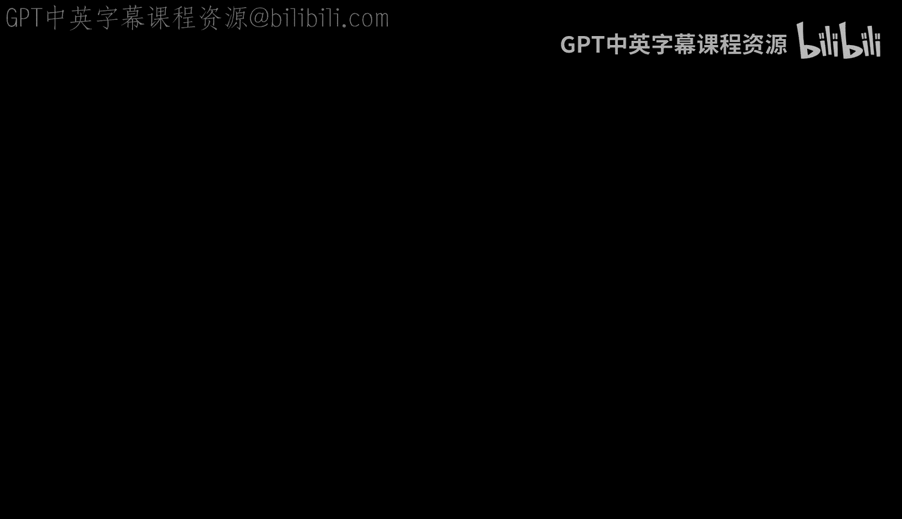
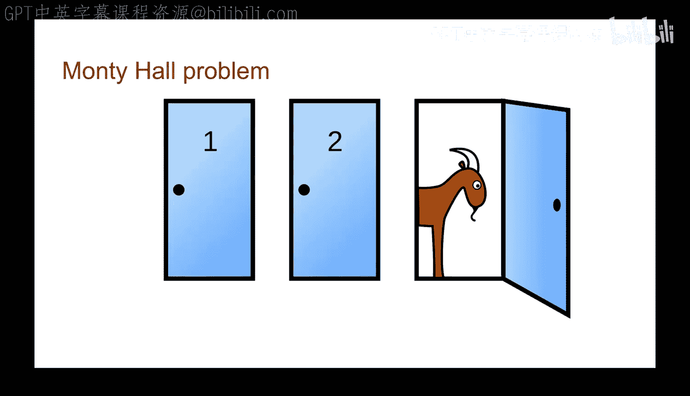
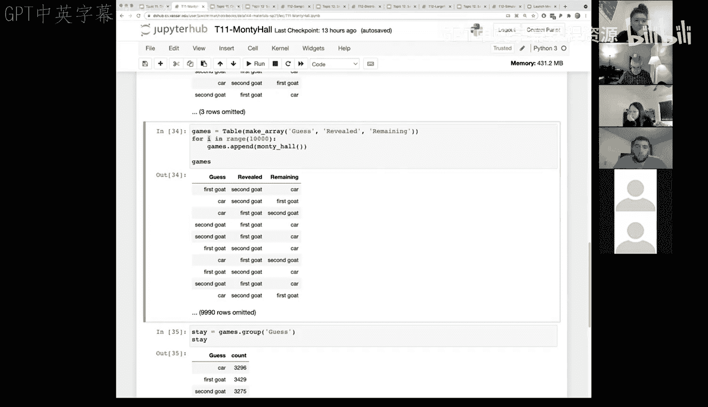

# UCB《数据挖掘和分析｜DATA 144 Data Mining and Analytics 2021》中英字幕 p40 [P40]lecture40-[T11 Chance] Monty Hall-KZVj2IeQpJU.zh_en [BV1efBEBuEVg_p40]

Okay， so。Where we left off last time。Where we left off last time where we started talking about conditionals and a good way to kind of kind of see all of that together is we're going to talk about the Mon Hall problem and so the Mon Hall problem comes from a game show back in the 60s and 70s and the host let's make a deal was the game show and the host was Monty Hall and actually you know as everything old becomes new again it's actually they brought back you know let's make a deal I think Wayne Brady is like the host of it now but used to be this guy Monty Hall and one of the kind of the more famous and so this was where all of the contest people audience would dress up in kind of crazy costumes and then the host Mo Hall will just pick members of the audience for just kind of random games and one of the more famous games was this game where they brought the contestants up and they were shown three doors。

All the doors were closed and one of them would have a good prize like a car like something you know substantial and the other two would have not a good prize often they actually would have like a live goat all right and so kind of the problem as it formulated。

Your' presented three doors， one of them has a car。

 two of the doors have goats and so the host will ask you to pick。

You'll you'll pick a door one of the three doors and then that' that's your pick and then what the host would do is the host would open up。

One of the doors that you didn't pick okay， so if you picked door one， for example。

 the host would then open up one of the doors that you didn't pick in this case three and and they would always show you。

A goat they would always open， they would never open like they would always show you one of the losing doors。

 okay， and then you were faced with a dilemma， you were given a choice。

Do you either stick with your original pick？😡，In this example。

 do you stick with pick one or do you switch， do you switch your pick？And。

In this case pick door two okay and so we'll work through kind of like empirically what what is going on and we can kind of figure that out with probabilities but this was very controversial at the time and people wrote columns about it and people you know it turned into like flame wars and all of that so we'll work through kind of the probabilities which would be a good segue and kind of our next topic but then we'll actually run a simulation we'll actually just run know play thousands of versions of the game and see what happens from there but the upshot is it is always better to switch it is always better to switch when you're given the choice to switch it's always better。

Okay， and so lets let's see a demo of this in running and that will give us some insight。

 why is it always better to switch？😊。

Okay， so here's our program， let me make it bigger for everyone。So everyone can see。There we go。

Okay so standard plate stuff and so what we're going to do is so we're going to make this game so this is kind of we're going to we're going to kind of write this simulation it's it's going to be kind of one of the more substantial programs that we're going to write and see in this course。

🤧And so first thing that we're going to do is is we're going to we're going to kind of create our our data that we're going to use for the door for the game and so I want to create the doors and so this will be。

😊，All of the possible combinations that could be for the prizes that are behind the door and so we're showing the car the good prize and there's going to be two goats and we want to differentiate between the goats and so we'll call the first goat first goat and then the second one second goat okay so these are all the possibilities of things that can be behind doors。

And we're going make a goat array。 Okay， that just has the the goat and the other goat in there。

 And so we're going to write also， So those are our structures， right， So we have a door。

 We have a door array that shows our three prizes。😊，And then we have a go to ray， which has our。

Our two goats and what we're to do is we're going to write a helper function okay and so this little function here is just a little bit of code that will give us if we pass in a goat。

 if we pass in either first goat or second goat， it is going to return us the other goat okay and we'll see in the code why that's going to be helpful for us。

😊，But basically all it's doing is it's using an if statement that we learned about last time and so if the goat that we passed in right so the a goat is our parameter that's being passed into the function and we can use that as a name inside of our function and that's going to have the value of whatever we call that function with。

😊，And so if the goat if a goat is equal to first goat。

 then we're going to return the second goat and vice versa if we pass in the second goat we're going to return the first goat okay and so when we write these functions it's always good to kind of test in isolation so let's test it to kind of make sure it does what we want。

😊，And sure enough， if we pass in the first goat， it returns the second goat and if we pass in the second goat。

 it's going to return the first go okay， what happens if we pass in something else that's not a goat。

We get nothing back and in particular in Python speak， we actually get。

A literal called none so if I actually take this and just actually print out the value here。

 you can see that it actually prints out something called none from there but。

We only care about getting back the first goat or the second goat。For this， okay。

 so now we're going to write this Mon Hall function。😊，And here we're going to。

We're going to use random， okay， and so if you remember how random works。

 if we pass in an array and we're passing in the array of doors and if you remember our doors as our three prizes。

U and so we're going to simulate playing a kind of one round of this game， okay。

 and so the contestant let's assume that they choose randomly。And here we're using the random choice。

 so it's going to return one of those three elements in the array and we're going to assign that。

That value to the contestant choice， okay？And so once that's locked in。Once that locked in。

If the contestant。Chose the choseose the first goat， okay， so the door。

 what we're saying here is they picked a door that had the first goat behind it。

Well then what Monty the Monty choice that is going to be the door that the host reveals well he's always going to reveal a goat he's always going he's never going to reveal a prize so if the contestant picked the first goat then he's going to he's going to reveal the second goat and then the remaining door the door that that is hasn't been opened and that isn't the contestdesant choice is going to be the car okay right because we have three doors and three prizes so。

It has to be that way and conversely。Conversely， if the contestant chose the second goat。

 will then Monnie will open the first goat and the remainder go over the car and then finally。

If the contestants actually picked the winning door。

And was a car well then actually in this case moni has a choice which door to open both doors have goats and so what we're going to do here is is we will just randomly pick one of the one of the goat doors okay and then the。

😊，The remaining the remaining door will be the other goat that's where our helper function other goat comes in okay and so then the thing that we return is we're going to return an array of these three things that is going to be the data that we return in that order the contestant choice the choice that the door that the contestant made the door that Monty revealed and then the remaining door okay。

All right， so if we do that and now if we run this once。

You can see this is we get back the array and that happens meant to be。😊。

One instance of the game and right and if we run it every time we'll get you know slightly different results running it each time okay and so now what we can do is we can collect that results we can collect that results and and we'll make that into we'll make that into a game we'll make that into a table and so what we're going to do here is first let's create a blank table。

And so we just use the table function， and then we pass in an array of our three column names。

And so now we have a blank table。And now what we're going to do is is that we're going to run the game we're going to run the game and so we're calling the Monty Hall function right which will return us an array of one one round one you know playing one instance of that game and then we're going to append it to our games list okay and so if we see that if we run that table。

We run this cell， we can see our table now has。😊，One instance， right。

 and we can run this again and again and again。And again， and each time we do that。

 we're going to kind of build our table， right？So we could sit here and if we wanted if we wanted to run this like 10。

000 times， we could sit here and press the button 10，000 times。

 but that doesn't seem like a very good use of our time when we can have the computer do it and that is where looping and the for loop comes in。

RightSo if you remember from last time。How the for loop works is。

For I and so this is going to be some some name that we give and it's going to execute the body of this loop it's going to execute this this statement right here and this is known as the body of the loop it is going to execute it。

One time for every item in this list。And so we're creating this range。

 we're creating this list that has 10，000 elements in it and you notice in this case right we're looping just to run this 10。

000 times and so we're not actually we don't actually care that we don't actually care that we're running it the fifth or sixth or seventh or you know thousandth time and so we don't we don't need to use this variable this loop name here in our body but it's still important that we define it that's otherwise that's just Python syntax and so this will run this will run 10000 times and it'll create us a table for us so if we run that。

😊，Takes a few moments to run， but then there's our table from there Okay。

 so now we've kind of simulated playing 10000 version10000。Insit is of that game okay。

 so now we can actually collect some statistics okay。

 and so what we're going to do is we're going to group。😊。

We're going to use the group function so right we're going the guess column if you remember is is that is what the contestant guess okay and so if we group by the guess it's going to show us it's going to show us our three categories of guesses right whether we guessed the door that had the first goat。

 the car or the second goat。And so if we group that。

 then we can get remember the default to group is going to give us count okay。

 and you can see that and this is not terribly surprising right we ran this thing 10。

000 times and you can see roughly about a third of the time we picked the car。

About a third of the time we picked the goat the first goat and about a third of the time we picked the second goat and this all kind of makes sense from probability right if the guess was random in the doors the prizes were distributed randomly around the door behind the doors if you pick one door you're going you're going to win the car one third of the time you're going get the first goat one third of the time and you're gonna to get the second goat one third of the time okay and so that is the probability if you played the game you picked the door and you didn't change your choice you just stayed with it。

Does that do do you believe me and I'm not doing anything like does that make sense and the reason why the reason why I'm asking that is is that this is this is this has been quite controversial and so I want to make sure we got kind of buy in that that makes sense。

Um right if we picked if we picked our our door and then Montety really revealed another door and we stayed with our choice。

 we're going to win the car one third of the time that's that's not controversial right to any of us。

Awesome， okay， so now。う。Now we can calculate the probability of right we see the counts but we can actually you know we can just with just a little bit more math we can actually count calculate the probabilities and so here all we're doing is we're taking the the counts we're taking the counts from from this。

😊，From the stay table and we're just taking the count for each particular item。

For item zero and then which is the car and then dividing it over the。

The sum of the caps right so if we just run that we can see that the probability of winning the car is about 3。

33 about 33% from this you know simulation。From there Okay， and that's not con。

 But so now then the question is so what if you made the choice。

 if you made the choice to switch when Monnie gave you the choice。

 do you want to switch doors right so you you're going to go you're going to go from if you look at the table right this is the guess So this is what you had this is what we were revealed and we made the switch when we make the switch our choice is now coming from this remaining column it is now coming from the third column if we made the switch okay and so we can do the same same statistics So if we made the switch how many times was how many times was the car you know we can get count of how many times a car was there and how many times a goat was there。

And if we do that， now we can look on the remaining door in the remaining door， the car was there。

About two third of the time。And the first goat and second goats are about one six of the time from there。

 right。If we do the counts again， if you switched， you're going to win about 67% of the time。

If you switched right and so you know， where does this come from， yeah， Julianne。

I had a you can finish I had a question Oh the big reveal is is that you know。

 the way the way you think about it is is that once once you've made that choice。

 once you've made that choice， the initial choice right the way the game is played is is that if you guessed。

Right。One third of the time， you're going to win the car。Um， and then， you know。

 if you think about all the， if you think about the choice of either winning or losing。You know。

 as being the two distinct choice。If you switched， you're going to get one minus one third right if you didn't switch。

 you're going to win the car one third of the time。😡，If you switched。

Because those were the only two possible outcomes you either won the car or you didn't win the car if you kind of frame it that way if you switched your probability of winning is going to be  one minus one third or 66 you know0。

666% from there right so that's kind of like the probability but you know notice you know what we did was we didn't actually have to kind of figure out any of the probabilities we just ran an experiment we ran a simulation and as we'll find out kind of from today's lecture as the number of times you run the simulation as the data grows。

The more likely the results will converge to the actual probability distribution。Okay，Yes， Juliana。

I had a question about the eye I wanted you。Yeah。😊。

So why is it there again it's just standard syn so the way the four loop works so so the answer is for this。

 for this example， it has to be there because of the syntax of Python。

So this is how the four statement works， it is the keyword for。

And this is known as in computer science speak， this is known as the loop variable but but variables in this course has a very specific meaning a variable is actually the attribute of a column so we don't use the word variable in this course so it is the loop and so whenever and so I slip up because I'm a computer scientist so you know you probably hear me say variable and I correct myself and I say name we we call these things names you know in this course so I as a loop name and the way and thank you for asking this question because think it's worth spending a little bit of time kind of kind of reviewing how how the for loop works and so the for loop is a way it is a way of iterating over a list okay and so let me say that again so the for loop is a way of performing some computation over every item in a list and we've done this before right we've done this before。

😊，For with arrays， but this has all happened kind of behind the scene right with like the apply method behind the scenes it is kind of doing the code that we are are kind of talking about now and so specifically what happens is。

😊，So the syntax of for loop is the keyword for so that is the keyword and then it is some loop name and that is any any name that we want to give and then it's the keyword in。

😊，And then this is something that evaluates to an array， okay。

 and Python speak it's a list where we're kind of using arrays and lists interchangeably in this course。

 so this part here is anything that evaluates to an array。😊。

And and then and then we have the key and then we have the colon which is part of the syntax and then this is known as the loop body these are all of the statements that are going to get executed once for every iteration of the loop and so how it works is it's going to take this array it's going to take this array and whatever the first element of that array is and in this case because we're using the range this list this list this list is going to have the value zero through 9999 because the default for range as it starts zero goes up to but not including the endpoint so there's going to be 10000 items in this list and and it's going to start at zero so what's going to happen is is that Python is going to assigned the name I to have the value zero。

And it is going to execute the body of this loop。Because we're just using this as as literally as a counter as just to say。

 hey， execute this statement 10，000 times， we don't need the name of this。

 we don't need the name of all of the items in this list。

 but you can imagine a scenario imagine where that list was an array of names okay and you wanted to do something with those names then you would actually use the loop name from there。

Does that does that kind of answer your question， awesome， okay， great。

Thank you。