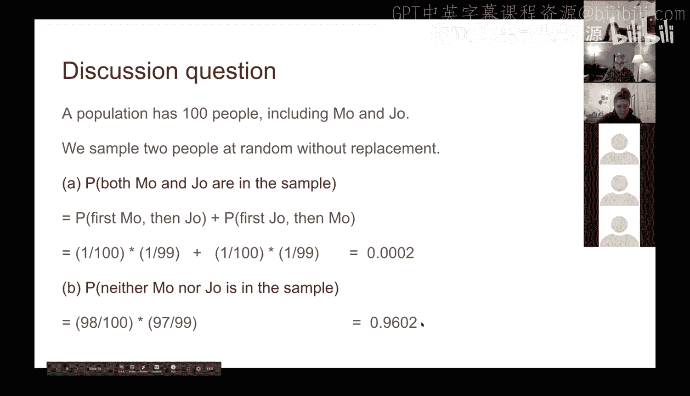

# UCB《数据挖掘和分析｜DATA 144 Data Mining and Analytics 2021》中英字幕 p41 [P41]lecture41-[T11 Chance] Probability-deQHnKwvrWs.zh_en [BV1efBEBuEVg_p41]

Okay。So we can spend we could spend an entire course on probability and as a matter of fact the math department has entire courses on probability we are going to get the super crash course in probability this will be just enough probability for us to kind of run our simulations okay so I don't want to pretend that we are now going to become probability experts you know from the next few slides but this is just kind of enough that we can be kind of dangerous and run our experiments and so very very briefly。

😊。

Um。We can think of probabilities as having the the numeric values from zero to one and we can express those as percent so the lowest and when we think about the probability we talk about the chance of some event happening or not and so the lowest value would be zero or zero percent and and zero would represent that that that that is impossible the chance of that is event happening is nonexistent we could we can you know。

Play that thing a million billion times for the for the end of times and that outcome would never happen firstly the highest value we can say is one or 100%。

😊，And that means the chance of that event is certain。Okay， so。Basically what that means in terms of。

Kind of events right is that if an event you know in our definition is either going to happen or not and so if an event has a 70% chance of happening。

 then the chance of it not happening because it has to add up to one the chance of the the item is not happening is going to be 100% minus 70 or 30% okay so the sum kind of of your of your probabilities need to sum up to one or 100%。

Okay， so there's a couple of scenarios that are worth kind of talking about and one which happens kind of fairly frequently is this this idea of events having equally likely outcomes okay and so if we're if we have an event that is that has equally likely outcomes and you know the canonical example is thinking about flipping a coin。

 flipping a fair coin rolling rolling a dice right assuming that the dice is not a loaded dice and the coin is fair all。

😊，Outcomes are equally likely right and so to calculate the probability is is that you can take the number of outcomes that make the event a happen and so for a dice example it could be what's the what's the odds or what's the probability of rolling an even number okay and so we would just count out the total number of outcomes if we just think of a standards excited die the total number of outcomes is going to be six and then the number of outcomes that make it happen you know two。

 four and six right so we just basically take。😊，The number of outcomes that make it happen。

 three divided by the total number of outcomes， and then you can see the chance of rolling and even number is going to be 0。

5 or 50%， okay？So that that's kind of what we do when they're。All of the events are equally likely。

We also want to talk about the multiplication rule and this happens when you have two events。

Let's call them A and B and we want to kind of get the probability that both A and B both happen right the key word here is A and B。

And so when we have that scenario where we have two things that are going to happen。

 the multiplication rule takes comes into effect and so what that means is to calculate the probability that both A and B happen。

 one way to calculate the probability is that you calculate the probability that A happens， okay？😊。

So we calculate the probability that a happens。And that's going to be some probability between zero and one。

 and then we're going to multiply that by the probability that B happens。😊，But。And this is important。

 we're going to do this probability of that B happens given that A has already happened。

Okay and the reason why we're doing that is because we're basically calculating the probability that both A and B happened so for a and B to both happen A will have had to have happened okay so if we calculate the probability that A happened and then the probability of B given a that and we multiply the two of them together。

That will give us the probability that both A and B happen together and so kind of one insight you can kind of glean from that is because probabilities all go between zero and one and we're multiplying together。

 we're multiplying these two probabilities together well the answer is going to always be less than or equal to the chances of the chances of each of the individual probabilities of being have happened。

Okay， you know， individually， and so the idea here is is you have more and more events。

That that all have to happen， the probability that all of the events will happen is going to it will become less likely to satisfy them all。

 okay？Um。And you could do this for， you know for more than just A and B as well， you know。

 if A happens and then calculated to B， given that A happens then C。

 given that A and B happened and so on and so forth。From there okay。

 so when when we have this this condition where two events both have to happen the and we're going to use the multiplication rule conversely we can look at。

😊，We can look at events where。We want to say it event can happen if in exactly one of two ways。

If we have， basically what we're saying is is that event could be satisfied by P the first way。

Or P the second way， okay， so if we have two ways to kind of satisfy an event。

 this is really where now we're getting to an or situation。😊，m， you know。

 and so like kind of an example。Let's see。So you could say I pull a card from a deck of cards and the event could be whether I get a heart or a club okay so there's two ways to kind of satisfy that event but probability that you get a heart or the probability that you get a club and so we have this or and so this is where the addition rule comes in and this is where you're going to add the probability of the event happening in the first way to the way that it can happen in the second way。

😊，And conversely， because now we're adding together。

 the probability that you're going to get is going to be equal to greater than or equal to the chance of each individual away and this makes sense right because of this or。

You're giving yourself more opportunities to kind of satisfy the event from there and so the way kind of the way I kind of remember it is is that when you think and it's multiplying when you think or it's going to be addition and so it becomes harder when you string to get events together a and B and C the probability of all of them being satisfied is either you know tends to go down and then or。

You're doing addition to the probabilities are going to become more likely。From that。Okay。

 so let's look at a couple of examples， one， lets let's think of a coin flip and so the let's calculate the probability of at least getting one head for a certain number of coin flips so we toss a coin three times。

At least one head is any outcome except for the three flips that give us tail tail tail and so when calculating these probabilities。

You know， we actually kind of have a choice right we can calculate the probability of at least one ahead。

But sometimes it's actually easier to kind of calculate the probability of the not outcome right and this case is what is the probability that we get all tails。

And when if we compute that， then we know the probability of at least one head is just simply going to be one minus the that probability from there。

 so in this case it's actually easier to just calculate the outcome of tails tails tails and then the probability is going to be one minus that so what does that look like。

Well， you think about it。In terms of each of these trials kind of are independent and so each coin flip and so the outcome of tails Tas Tas right getting a tail for the first flip is 50% and so that's our outcome and then the second trial again we have a 5050 50% chance of getting a tail so that's where the second half comes in and the third trial we have a 50% chance of getting a tail right and so。

😊，You know， calculating the probability of getting a T and a T and a T right here the and so we're going to use the multiplication rule and so we're going to get a half times a half times a half which is going to give us one eighth and then the outcome that we want at least one head is one minus that from there or about 87。

5%。😊，Of there okay and we can do that for any number of tosses10 number of tosses its the same thing except for instead of doing this one half times one half three times we're going to do that 10 times and I've just shown that here in Python notation this is the equivalent of taking one half and raising it to the power of 10 so that's the same thing of saying 0。

5 times 05。 times 05 you know 10 times and if we do that math we would put that through we found out 99。

9% of the time right it is extremely likely that you would get at least one head。😊，From there。

Any questions about that？Okay， great， awesome， all right so。😊。

Let's have a discussion question and so kind of to put our newfo probability。

To the test and so we have a population has 100 people， okay， including Mo and Joe。😊。

And so one question is， so what we're going to do is is we're going to sample two people。

At random without replacement okay and so again sampling sampling without replacement。

 you know I always think of picking names out of a hat right so we have 100 names in the hat we're going pick one name out and then we're gonna pick the next name without putting the first name back in so thats sampling without replacement if we sampled with replacement we would pick a name out of the hat look at it record that value and then put it back in put it back in the hat shuffle do that again but we're here we're picking without replacement so once weve picked out a name it stays out of the hat。

😊，So now the question is， what is the probability of both Mo and Joe are in the sample？Okay。

 let's go into breakout rooms。嗯。Let me。So if we take a look and there's actually a couple ways。

 there's a couple of ways that we can calculate that one way to calculate that。😊。

One way to calculate this is that first。The probability that。The first sample picks Mo and then Joe。

Or right there's two ways to kind of satisfy this event right that first we pick Mo then we pick Joe or first we pick Joe then we pick Mo from there right and so what is that what is that probability the probability。

The probability that we first pick Mo。Is well there's 100 people in there Mo is one of those 100 so the probability that we pick。

We pick Mo is going to be one over 100。And we're sampling without replacement。

So then then the question is。😊，What is the probability that we picked Joe well Joe is still in that population because we picked Mo first right and the probability we're calculating is you know that we picked Mo given that we first you know we pick Joe given that we first pick Mo so there's there's now instead of 100 people in the room there's 99 and so the probability of picking Joe is one over 99 so that is the probability of first we pick Mo then we pick Joe。

And then， but that is only half of。The possible conditions。

The other possible way of thinking about that is is that first we pick Joe， then we pick Mo， okay？

And then that's the same kind of logic from there，100 one over 100 times one over 99。

 and that gives us00002%。Um。Another way， another way that we can think about it is is that。

Actually I like I like kind of explaining it that way did anyone did anyone come up with a different way of kind of reasoning through it？

No。Okay。😊，Awesome。All right， so so that is kind of a that is that is an example of kind of using kind of the or rule and then let's take a look at another another variation of that。

😊，What about calculating that neither Mo nor Joe is in the sample？

And so I'll send you back over to the breakout rooms。Okay， so to calculate that。😊。

We want to look at we want to again look at this as kind of two samples and so the first sample。

 the first person we pick out of the room， sometimes they are on that like a wheel。Is he again？Clasy。

And the。Interalner。Cant expect that from everybody。Were you asking someone asking a question？お。

So to calculate if neither is in the sample， we have to look at first the first pick and so what are the percentage of that neither Mo or Joe is in the first sample well there are two of the two members of the population so 98。

98 out of 100 would be for the first selection right so those are all the possible ways of picking someone from the room that's neither mo nor Joe you're picking。

98 out of the 100 people from there okay and since we're sampling without replacement then the question is for the for the second sample。

 right we've already drawn one out so the total population is now 99 and we want all the possible combinations that are not that are not Mo or Joe and we have 97 of those and so since we have an anN situation we're going to use the multiply rule so we're going to take 98 over a divided by 100 multipied by 97 over 99 and then we get 0。

9602。Does anyone have any questions on how I got that number？And did it match yours？Awesome。

 good good good all right， so we'll come back to kind of this idea of probability throughout throughout the course。

 but that's kind of the the basic groundwork that we'll need to kind of start running our running and doing our simulations。

😊。

