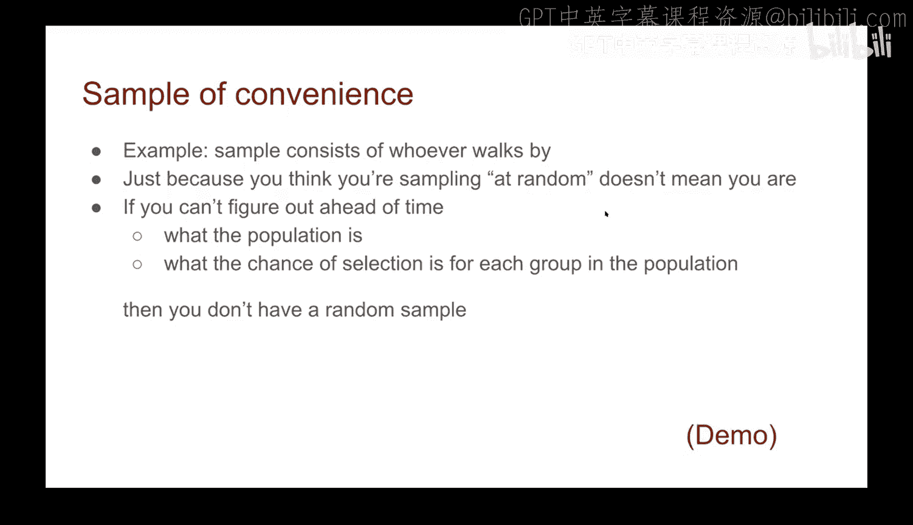
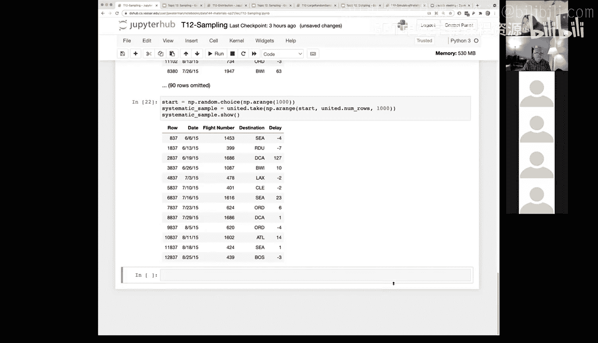

# UCB《数据挖掘和分析｜DATA 144 Data Mining and Analytics 2021》中英字幕 p42 [P42]lecture42-[T12 Sampling] Sampling Intro-AaJRSZq1Q_k.zh_en [BV1efBEBuEVg_p42]

All right， so the next topic that I want to talk about。

 this is topic 12 if you're playing along on the website。

 the next thing I want to talk about is sampling。😊，And this is going to be a very。

 very kind of powerful technique that we're going to use pretty much for the rest of the course and so it's worth kind of figuring out exactly what we're talking about when we mean sampling because we can have deterministic samples。

 random samples。😊，嗯。And so first， I want to start off with this idea of a deterministic sample and a deterministic sample just simply means picking a sample that is not random。

 that there is some kind of algorithm or some way of picking that sample。😊。

And so why do we want to do this， we want to do this because。😊。

The big part of data science is is that。We want to make conclusions based on data and random samples and so kind of the overarching theme for kind of the the next few lectures and kind of the course in general is is that。

We don't generally know the entire population right it's either we don't know the values of an entire population it's too costly。

To get。To get the to get some piece of data on on an entire population and so what we're going to do is is that we're going to instead of you know asking everyone in the entire country who you're going to vote for。

We're going to do this， we're going to draw conclusions。

Based on random samples where instead we're not going to ask the entire country who they vote for but we're going to ask a random sample。

 a random selection of that and if we do it right we can make inferences about a broader population with some kind of confidence interval and so that's kind of the roadmap for the next part of the course。

So as far as the terminology。😊，Terminology goes if we think about our table。

 if we think about our data in terms of tables。😊，and we should because that's kind of the how we're representing data in this course。

 each row of the table represents an individual okay。

 so every row represents an individual of the population。😊。

Each column is going to be what statisticians call and what we're going to call a variable in this course and so I want you to think of the variable is as some feature of the data and and literally mapping it to kind of our tables it's a column it's a column in the table and so it's a feature you know other people yeah I like to think of it as attributes it is attributes for that individual so each individual is going to have values in those columns each each of those values represents a particular feature of one or more variables in our table okay so rows are individuals columns or variables and we're trying to model an entire population。

😊，And the population is basically the set where we're going to draw our samples right think a country think Vasar college think there's some population that is defined and we're going to draw samples from that population and each of those samples will be an individual with。

With variables， having the values for that individual will be those features。Okay， so。

That's kind of the general terminology and so how do we pick， how do we pick？

Which individuals from a population are we going to that we're going to sample well one way you can do that we can do that deterministically and what that means is is that it doesn't involve chance that there is kind of it is predictable about who we are going to sample the。

And we've done this right this is not new to us whenever we take a particular row of a table via the take method。

 we are doing a deterministic sample， we're saying give us row5， give us row 27， give us rows two，3。

4，6 you know seven and we also do that with where right this is deterministic we're putting some we're putting some condition on which individuals we take from the population right and we're looking at some variable some feature that we're selecting on but we're doing that very determinism right if we had the same table of data and and we do the same where clause we're going to get the same data back whether we run it you once the first time is going to equal the second time equal to 10000 time we' run we've run that where selection right assuming the population hasn't changed so that's deterministic。

🤧We can also sample using probability okay and so what that is is。Before we take we drive sample。

We're going to drop。Our sample we can divide into groups and we've seen that with the the group method on tables right but if we have we have a population and we have some way of grouping them we may draw from this table not。

Not where every every row has an equal chance of being selected we can divide our population up into groups say males and females or different age brackets you know 10 to 20。

 20 to 30 so on and so forth right any you want to slice up your data and if we do a probability sample what all that means is that within a specific group。

We're going to pick from that group with a certain probability， okay。

 and those probabilities don't have to be equal across the groups。

Sometimes you want to overre a certain population because in surveys right this happens a lot where sometimes you have groups that are just you know reluctant to do surveys and they tend to be underrepresented and so if you want you know from from the broader population people who respond to surveys so you may want to actually when you're kind of drawing from your population you may want to weight those groups more heavily to get a fair representation of what the actual population is okay so that's a probability sample but you do that beforehand you say okay from you know from this group we're going to get pick 60%。

Um。And from the other group， we're going to pick， 40%。From there。And so that's probability sample。

 we can draw samples with replacement。😊，And。What we're going to do then in that case is with replacement you're always choosing from all items in the array right this is the equivalent of picking out a name from that and then putting it back in from there and it turns out we tend to do this simply because it is a little computationally faster from doing that and kind of the sneak preview is the preview is is that if our population as large enough sampling with replacement it can kind of converges without replacement。

😊，And so we typically kind of do samples with replacement from there。

 but we can also draw without replacement and then again that's once you pulled out an individual。

 you're not putting them back in when you draw another sample。

And then you can do systematic sampling and so what that means is is that one way to think about that is is you pick a row at random of our table and then just give us the next 10 rows。

😊，From that。Okay。And then。Once you've kind of made that random selection then picked every 10th throw after that right the key here is is that it's systematic in sense that you've kind of predefined what you're doing。

 but it is random because you're picking the first row at random from that sample。

Okay another type of sample and this is is this is we listed it but this is one that you probably should not endeavor to do too much and we call this the sample of convenience so imagine you're doing a survey and're you basically just grab you hang out on a street quarter and you get whoever walks by。

Um and and you think right so I mean and I don't want to be too hours on that right that that can be a useful technique。

 but you have to be careful becauseum you have to be careful if you think of it as random。😊。

Because if you think you're sampling at random while it doesn't because it also depends on where you are in the street what time of day。

 you know for that a great example of this of kind of random sampling unfortunately I don't remember exactly where I heard the story but it's too good a story kind of not to tell you but you know Vassar's moto go to the source I can't I can't actually tell you the source of this。

 but even if it's not true it's kind of a cool it's a fun kind of example story so there's this research lab and they're doing there's two groups that are doing these experiment they're doing the same experiment on a group of laboratory mice。

😊，And so the two different groups they're doing the exact same experiment on the exact same mice。

 one group is getting slightly different results from the other group and again this is very puzzling same experiment。

 same kind of procedure， same mice。😊，And this is kind of puzzled and stumped the researchers for quite some time。

 and then they kind of looked and looked at kind of the protocols。😊，And so one group。

 they're selecting the mice at random， so all the mice have an ID and so they you know they have a computer。

 they pick the mouse。😊，Um you know from the from the you know they pick the they pick a random ID of the mice and then they go get that mice the other group was randomly picking the mice by sticking their hand in the in the cage and then grabbing the first mice the first mouse that they were that they grabbed。

😊，Now you may think that's random right I'm just picking， you know。

 I'm just sticking my hand in and grabbing grabbing the first mouse I get。

 but it turns out that some mice are faster than others。

They were were consistently when they actually looked at the IDs that that they were grabbing it was not a truly random sample。

 they were getting the slower slightly larger mice the ones that were not as quick so you just have to be careful when kind of the point of the story is just because you think you're sampling at random right you know grabbing grabbing just you know any old mouse you may not be right and so in this case right obviously the right thing to do is is every mouse has an ID and you're randomly you know using a computer we' picking names out of that you know will work will work just fine。

Okay， and so if you can't figure out ahead of time what the population is。

And what the chance of the selection for each group of that population。

 then you don't have a truly random sample。From there is kind of the takeaway message from that。Okay。

 let's take a look at sampling and so this is just kind of the nuts and bolts on how we will do sampling in our library。

😊。

Yeah。So here here we have a data set and this is flight time so average delays of flight times from there okay。

 so we just load our table and then the only thing we're doing to the table is that we're creating this row we're creating this row column。

😊，From there and so we're just adding this row column and then and then we're sort we' adding that to the table and so this is just basically this is the index for the row and then this fancy little thing move to start that just moves that column to the beginning from there okay so we have the data the flight the flight number the destination and then the delay in seconds okay and you can see that you can have a delay of negative seconds that means a minute sorry this is a delay in minutes。

😊，That this flight left three minutes early and this one left an hour 64 minutes。

 an hour and four minutes late。 Okay， so kind of showing you an example of a deterministic sample。

 So here we're selecting all of the rows that。😊，That we're landing in Newark Air eWR is the airport code for Newark International airportport so that's deterministic that is certainly not random we get that we get that table and if we run this you know if we run this again we're going to get the exact same table。

😊，Every time we run that， right， it's deterministic。

Another deterministic example is here we're just taking a select number of rows from the table。😊。

And so we're taking the rows。Right we're taking going from zero we're going from zero up to the number of rows in the table and then we're taking every thousandth every we're skipping we're starting at zero and then we can see row 10002003000 so on and so forth so right that's deterministic we're picking exactly those and then but that is a sample right that is ni we're not taking the whole population we're taking every every thousand00 rows from there and just taking you know some some selection of there that's also deterministic right every time we run that we're going to get the same we're going to get the same table back probability samples and we can use we can use random choice for this。

😊，That going that's going to be different and so in this case we're taking we're going to sample with replacement here。

😊，Iops sorry。We are going to sample with replacement here and so what we're going to do here is here we're members so how does choice work choice we pass in an array and it's going to pick one element out of that array and so what we're passing in here is。

The number zero up to but not including the number of rows right that is going to give us the row index for the entire table so here we're randomly picking we're randomly picking a row in our table and then this parameter is going to be how many times we're going to do that okay so that's going to give us a table with with 100 rows in it。

And you can see there's our column and if we run this again， every time we run this。

 here every time we run this， we're going to get different output。If you look at the rows。

 it's going to be different every time okay and so that's the default for choice is it's going to do sample with with replacement right it's going to put that back。

😊，And we can also do sampling without replacement and it's the same it's the same call to NP choice we just add this optional argument replace equals false okay and so you know if we looked at if we if we took enough samples if we took enough samples and looked at them we would see that in this and for the first table it's possible for。

Its possible for a row to be represented twice， okay。

 without replacement you're guaranteed that every every row is going to be unique。From there。

 but it will be random right so if we run this again。We're going to get a different row。Out of it。

From there okay and the last thing here is here's an example of a systematic sample where we are see what are we doing we're we're randomizing the start okay so we're randomizing the start。

😊，But then once we've had the start， then we're going to pick every thousand throw from some starting point from the first thousand okay so it's kind of similar to the previous thing that we said where we're taking every thousand throw。

 but here we're varying in in that first thousand elements。

 we're picking a random point within that first thousand to start from。From there。

So that's systematic， but it is random。Because if we run this again， we will get that differently。

 okay？All right， any questions， any any questions kind of how we take these samples。

 we'll get lots of practice with that。😊，行。We're good。😊，Awesome。😊。

