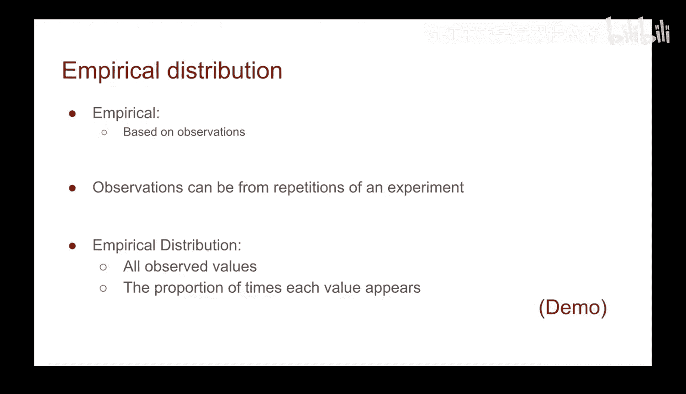
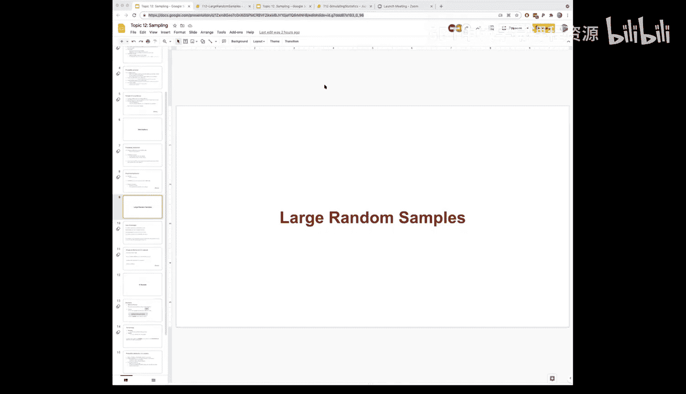

# UCB《数据挖掘和分析｜DATA 144 Data Mining and Analytics 2021》中英字幕 p43 [P43]lecture43-[T12 Sampling] Distributions-WYUNfwK4c18.zh_en [BV1efBEBuEVg_p43]

Okay， so now now that we we know how to sample now we can start thinking about distributions and so what's a distribution we're going to talk about probability distributions。

And。That is going to be some random quality quantity rather that's going to take on some range of various values associated with it okay and so kind of give a concrete example if we roll a sixd die right so kind of each one of those is an event and if we look at a probability distribution。

 we can think about the probability of all possible values for the event for the quality for the quantity for example rolling right and in this case it's actually pretty straightforward to calculate the probability distribution right rolling a six sided die it's a fair die all。

😊，The probability of each each number coming up is going to be16 right so a probability distribution would be all the possible outcomes in this case the number is one two。

 three four， five and six and the probability of each of those values okay and so we can calculate that right we can calculate that if we can do the math for this for this example it's straightforward and simple but many of the many of the problems that we're going to look at it's actually going to be pretty hard to work out the probability distribution。

😊，And so then we're going to fall to this idea ofimulating of simulating this quantity and that's going to be the approach that we're going to take。

 but you know it's good to remember where kind of these distributions come from and in the case of the die right we can calculate that from first principles we can calculate the probability distribution the other thing we can do is as we can estimate the goal here is to estimate that probability distribution through random sampling。

Okay， and so if we can't empirical if we can't if we can't directly calculate the probability distribution。

 well what we can do is we can do， we can look at empirical distributions and so empirical basically means observed values experimental okay。

 and so we can look at a distribution based on running an experiment like rolling a die flipping a coin you know。

 simulating the Monty Hall game。And we can observe we can observe what we saw right and so this is this is you know the Monho example is really good because we kind of did both we kind of calculated we calculated the probability to distribution from doing directly by doing the math but then we also simulated the game and got an empirical distribution is what we did from there right those are based on our observations we ran it you know10000 times and we actually looked at the results from there right and we could do this from repeating an experiment。

😊，So if we run an experiment and we look at the distribution of all of our observed values。

 we call that an empirical distribution。And plotting it out as a histogram。

 that will give us the proportion。😊，Of each value that appears， okay？And let's see that in demo form。

And while I'm setting it up。Does that any questions， feel free。Okay， in this case。

 so let's let's at let's look at the let's look at the calculated distribution and empirical distribution of rolling a dice rolling a die and so how can we do that well because we like operating in tables so let's make a table let's make a die a die table that has one row for every。

😊，Possible outcome Okay， so how would we do that we'll create a table we'll add a face column the face of the die and then we'll just set up our array。

Going from one to up to， but not including seven so we're going to have one through six here Okay。

 and if we look at that there's our there's our dice and so we can roll the dice by by calling sample and this will give us。

That will roll the dice 10 times and it will give us it will give us a new table of the outcome of each individual experiment from there okay and so if we wanted to plot that we're just setting up the bins for our histogram here and so because each each value is a whole number and so just setting up the bins correctly were kind of having it range from the first bin from 0。

5 to 1。5 and so on and so forth from there and you can see so those are particular bins that's that's just setting up our bins to make our histogram look nice right and so。

😊，If we count if we calculate from first principle。

 so if we plot the histogram of the dice right the die table remember the die table just had one outcome for all of。

Our dive phases and so that is kind of the direct。Probabilities。😊。

Right we've made our we've made our histograms such that the width of each bin is going to be one and so if you look at the percent per unit since the unit is one you can see that all outcomes are equally likely and that you have all one six chance of getting each particular face okay and so now so that's kind of right that's looking at that from calculating it so we can。

We can simulate this， we can simulate and we can get our own empirical distribution。

 we can get our own empirical distribution by。😊，Sampling by sampling by and so if we sample 10 times and plot that histogram。

 we will get one particular distribution okay， and you notice it。

You know well first of all it changes every time so if we run it each time you can see that it changes around and it doesn't necessarily look like the distribution the theoretical distribution that we'd expect but we but we only did 10 samples so let's。

Lets I'm going to hide that output and then let's run this， let's run this。

A little more let's sample 10000 1000 times okay， if we run that now we're starting to kind of look very similar now remember each time we run it we're going to get a slightly different distribution。

But you know it's starting to kind of look like it's starting to look like our theoretical distribution。

 our probability distribution， our empirical our empirical distribution is starting to look like the probability distribution and now if we kind of turn it up to 11 we turn it up to 11 and we run it how many times that's 100。

000 times that might take a little bit to pull through math computers are fast right that's exciting notice how if I this if I had this output notice how it is starting to look。

😊，A lot more similar a lot more similar and so kind of the takeaway from this is is that as as we keep doing more and more samples。

😊，The empirical distribution will match will converge to the probability distribution。Any questions？

All right， I think we've got two minutes left i'm not going to rush through large random distributions from there so you know in the remaining minutes。

Any questions？