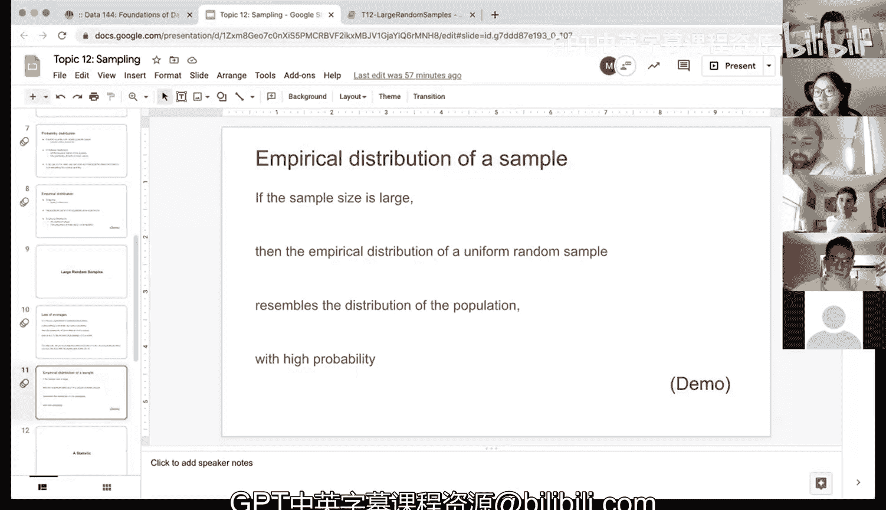

# UCB《数据挖掘和分析｜DATA 144 Data Mining and Analytics 2021》中英字幕 p44 [P44]lecture44-[T12 Sampling] Large Random Samples-HDFL7cf1KXk.zh_en [BV1efBEBuEVg_p44]

All right， so last time before the break， I think Jason。

Talked about topic 12 sampling Okay and in particular we looked at or you guys looked at with Jason together looking at how sampling is done as well as how to think about distribution Okay。

 and we talked about probability theory in the pan like in topic 11 and then in topic 12 that's where we can start using all of the。

Python skills that we have learned so far that we can actually realize those sampling and realize those distributions in Python and see how things work Okay so like I said now I think with all of the skills and knowledge that we have accumulated by by far I guess I think we're ready to talk about how we can make inference okay so those are thinking about while we get data we have some visualizations we might have some interesting research questions that we want to answer okay and now with all of that in mind we can try to see how we can actually assessing any kind of research questions that we have in mind and then the first step to do that is what we call large random samples okay so we're gonna walk through some of the results and then。

We'll be talking about using the using demos okay so yeah okay so now we have knowledge about distribution and then we know how to do random samples from Python okay and one important result that if you have taken some statistics course we probably have heard about this law of averages or what people call central limit theorem is that if you can repeat experiment okay we call it a chance experiment okay if you can repeat it many times like super large number of times and as you can see or have guessed we're going use for loops that we're able to do in Python to make this happen for simulation okay so we're gonna repeat experiment independently and under the same condition for a large number of times then the proportion of times that a particular event occurs going to get closer to the theoretical probability of the event okay so maybe this sounds a little bit vague but to example we have over here is that。

If you are able to especially in Python if you imagine what we can do right you increase the number of rows of a die like six sided die and if it's a fair die then we know that if we do this for a large number of times。

 the proportion of times that you're gonna to see the phase with five spots gets closer to one over six okay and that's true for any of the numbers one through six as well and we wanted to show you that this is the law of averages and we are going to use this general rule and general result to think about how we can make inference about certain quantities of interest okay so。

Another thing to keep in mind is that well， suppose you have a sample okay like a sample of observations okay if you have a large enough sample space or if the sample size。

 if the sample size is large， then the empirical distribution of a uniform random sample resembles the distribution of the population okay so this maybe with high probability okay so this might again sound a little bit vague but what I want you to keep in mind here is that if you have a large sample with large sample size okay and then if I now take a uniform random sample remember we can do the random sample in about Python if I take a random sample in that way uniformly like each record is having the same chance of being selected if I look at the empirical distribution okay of that sample then what we're gonna see is that if you have a large enough sample size。

 the empirical distribution of your sample actually gonna resemble。

The distribution of the population with high probability okay so what this is telling us is that we wanted to make sure that we have large enough sample size okay and then if we do a a uniform random sample out of it we can get a distribution that will look very much like the population with high probability and that can help us to determine or if you don't have access to the population itself this can help us approaching that and then we can have high confidence that we're having a good distribution resembling the population okay so again the population if you remember it's unknown okay we don't have access to it okay but in a lot of cases we have a sample and then here we're advocating that if you have large enough sample size then pinker distribution of that might look very much like that of the population okay so with all of this in mind okay let me bring。

The first demo up， okay， and hopefully。You will get to see how that is done in action。Allright， okay。

 so large random samples here。 Okay， we are loading everything that we need。 Okay。

 so the data set they we're working with here is United airlinelines from summer 2015。 Okay。

 we're looking at the date of the flight the flight number。

 the destination of that flight and also the number of minutes of delay Okay so we're curious about this delay variable in this case Okay。

 so this is the last column over here Okay and you will see that if's zero， then it's right on time。

 Okay if it's a positive number， meaning that theres some delay。

 there was an negative number meaning that theyre well they arrive earlier than they scheduled。 Okay。

 so this is a numerical variable。 Okay， and then here let's focus on how we can understand that delay variable a little bit through thinking about large random samples Okay so here you can see we have a really large。

Data set and in this case， we will take this data set as the population okay because we have collected assuming okay every flight okay in summer 2015。

 okay， we collected every data point so this is the population Okay we know we know that exists okay in this case we do have access to it okay so now let's look at if we start to take random samples of that delay column okay and let's see how likely or how easy it is for us to see whether the sample going resemble the population okay so that's the goal here Okay so this is a very special case that we do have the population and now we're using this as a demonstration to show how the sample resembles the population given certain conditions okay all right so if we still keep working on the population for now okay let'm just going do certain visualization here okay so we have a delay by minutes okay and notice that I only get the bends of negative 22201。

Just as the general like the big bulk of the data will be in this range。

 but of course some of the data points might fall outside of this like the first one is delayed for 257 minutes okay so there are of course more extreme data points but here we're just showing a general trend and you will see that it ends at 200 okay。

All right so that's one way to get a sense of how the population looks like and of course we can also return several summary statistics like the minimum of this delay is negative 16 okay the maximum you can also do the mean which ismp do average if you remember that so it's on average 16。

5。6 minutes okay it delay for all of the flights in 2015 summer and then we can also look at the medium okay so all of this so average and medium both of them are coming from the MP so it's the nu high package and then the min and maximum therere just regular functions here。

Yeah no worries yeah feel free like we're recording the lecture so hopefully you are able to join much of it。

 but if na still have Zoom issues， you can catch up with the video sorry I'm just respond thank you yeah thank you。

Alright， okay， so this is the population。 Okay， keep in mind。 Okay。

 and we have several summary statistics of the population。

 Okay so keep those in mind that we are having access to the population so we can return all of this。

 Okay， so now let's begin looking at how we can take samples of things and then whether the sample size matter。

 Okay， so if you recall for this specific topic， we're saying that if the sample size is large enough。

 then the empirical distribution of the random sample that we can get going resemble the distribution of the population with high probability。

 Okay， so we have， I think a little bit more than 13 close to 14000 observations in the population Okay。

 so I'm demonstrating here of taking three different samples。 Okay， the first one is size 10。

 the second one is size 100 okay， the third one is a size 1000。Okay so before running all of this。

 which one based on the empirical distribution that we're talking about earlier。

 which of the three you think going to have the highest probability resembling the population size 10 size 100 or size 1000 feel free to type in the chat or just speak up by un'muting yourself which one just a thousand0 thousand0 yeah so like we know from that result on the highest yeah and thank you Zach in the chat as well so。

Not surprisingly we'll see that soon okay so notice what we're doing over here okay so United is the data set data table name okay we're doing a sample okay so this is what we learn。

 I think from before the break okay so then whatever goes into the sample parenthesis method over here you type in the number of observations or the sample size that you're taking okay so when we do this part we're taking a random sample of 10 records out of that total population okay and then we do histogram okay this is just visual visualization we're using histogram called hist method okay on that sample that we set generated and then we select the delay column because that's the variable we're looking at and then we're using the same business before okay so this is trying to visualize everything in the same scale okay so let's look at this one okay so by the way don't forget this is what the population should look like okay。

SoWhen we say like resemble the population distribution， we're talking about a sample。

 hopefully with higher chance when you have a larger sample size。

 it's going to look much more like this population distribution okay， so this is the first one okay。

 apparently we only took 10 observations right and looks like many of them are around10 around zero ish and then around 50 ish okay we only have 10 records。

So。That's why we don't we are not able to explore the population distribution as much。

 Okay now if we move to 100。 Okay， starts to look a little bit more like right。

 the population distribution， Okay now surprisingly。

 and if we get to 1000 okay you will see that overall looks much more similar to the one of the population Okay so this result。

 well hopefully intuitive makes sense to you and then we verify using the demo that indeed if we're looking at an empirical distribution of a sample if you are taking a random sample out of population and if the sample size is large enough or as large as you can get。

 then the sample distribution gonna resemble the distribution of the population with high probability so this。

 I guess a biggest takeaway out of this is that we want to make sure that we are taking a random sample with large sample size in order to have a。

Resemblance of what the population looks like。Okay， makes sense。S everybody， okay， cool so。Let me。😔。

