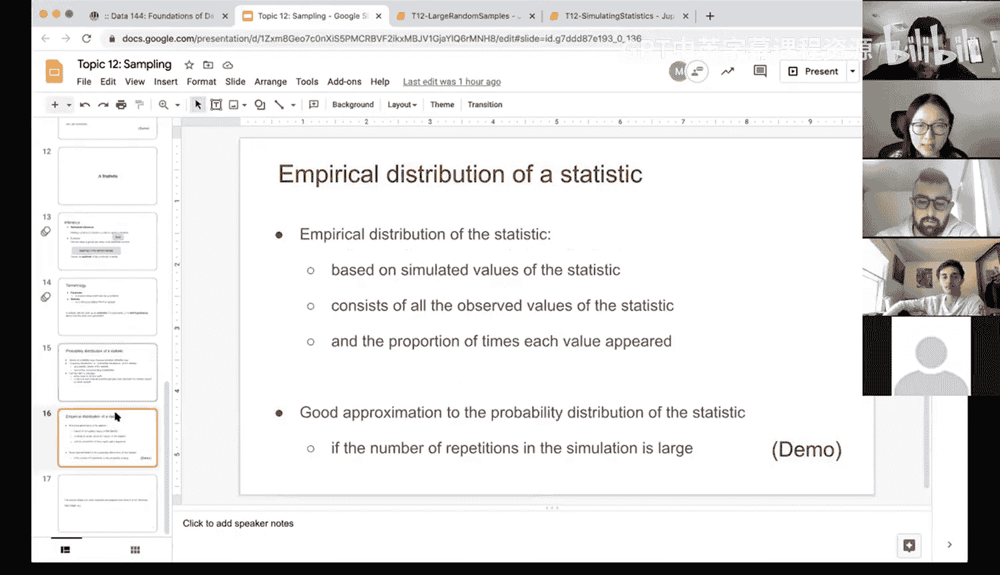

# UCB《数据挖掘和分析｜DATA 144 Data Mining and Analytics 2021》中英字幕 p45 [P45]lecture45-[T12 Sampling] A Statistic-koQEoItuog0.zh_en [BV1efBEBuEVg_p45]

new topic Okay all right so the next one Okay finally we get to talk about statistics Okay and this is a key as you will see how we are making inference about certain unknown quantity Okay so we're going to start with a few terminologies okay and then we're going to bring back to demo again to see what kind of statistics are out there people like to make summary about as well as how to get one step closer to making inference about the stat okay。

All right， so。Let me okay， all right， so a statistic or several。

 So we're gonna talk about them in generic terms and then look at certain examples。

 Okay so for inferences。 Okay， so again， inferences is are what we are trying to make based on a data data so we have access to a data maybe a population we were a sample but in particular。

 if you have the population， there is nothing to be inference about because you know the entire choose okay more likely when we're talking about inference is that we don't have access to the population we only have a sample。

 but we want to use the sample to learn something about the population okay so in that kind of scenario okay。

 you will see that well， we talk about inference of statistical inference about making conclusions based on a data in random samples okay and because in this case。

 the population is unknown okay so what we're doing here is we can see here is that we use the data to get the value of unknown number from the population。

Okay， it's fixed consider is fixed， but it's unknown Okay。

 we're trying to get an understanding of it and what we have from a sample is that we can create an estimate of the unknown quantity Okay。

 and then the estimate。Going to depend on the random sample that we take and then of course。

 because each random sample that you take might be different from one another。

 so the estimate that you're getting is random。Okay so I'm going to stay here for a little bit okay let's just get those concepts clear we have a population that we don't know certain thing about let's just say I'm curious about the meaning okay and I know the population exists out there I don't have access to the entire population but I want to know the population mean so I'm trying to figure out the unknown mean it's fixed out there I just don't know it。

However。I can always take a sample or maybe a sample is already available to me and I can create an estimate if it's for the mean。

 the best one you can do is take the sample mean okay so the sample mean is what we call an estimate of the unknown population mean。

It depends on the sample and then just like what we're seeing in a Python just now in the Jupynter notebook。

 the demo just now we are looking at well， just now we're looking at the sample size how larger it is can help us to know the larger it is the more likely it's going to resemble the population right so just imagine the example that we did like for1 size 10 size 10 and size100 if I take the mean of each of the sample because the sample with the larger sample size is going to resemble the population better right so if I take the mean of the sample size of10 that mean it's probably going be a better estimate of the population mean than the sample size of 10 and taking the mean okay so that's why earlier we wanted to know first about the empirical distribution of the sample comparing to the underlying true population distribution okay because if the distribution。

res it really well if I take any kind of statistic the mean the median。

 I don't know the standard deviation， things like that。

 you will have a higher chance to resemble what's in the population that I'm curious about okay so。

For us， keep in mind， when we're talking about inferences。

 we're talking about making conclusions based on data in random samples， okay。

 and what we're doing is that we're creating an estimate of the unknown quantity using the sample。

 and that is what we can do to have an educated guess of the unknown fixed number in the population。

All right， a few more terminologies over here okay we also call the number associated with the population as the parameter okay so parameter is something unknown but it's fixed like mean parameter。

 medium parameter so that's another way we refer to those terms okay and statistic in particular like the one that we're using over here we refer it to a number of a number that we calculate from the sample okay so mean statistic if we saw if we're talking about mean statistic we're specifically talking about the sample mean okay if we're talking about mean parameter we're specifically talking about the population mean okay so we differentiate those two and as early as we can so that later on we know exactly what is known what is unknown okay and what is that we're using to estimate what。

So the bottom line again is that we want to know certain things about the population。

 but we don't know what it is， it's unknown， but it's fixed。

 what we're getting is sample and then we're able to use sample statistic to estimate the parameter in the population。

Okay， so。Here we also talk about another terminology test hypothesis okay so we're going to get to the detail that later as well okay but overall you can see that a statistic can be used as an estimate of a parameter like the mean example that we get just now or it can be used to test hypothesis about how the data were generated okay so hypothesis again we will get to it in detail but in in some we can also come up with statistic based on the hypothesis that we have in mind from the sample and then we're able to use that to test them against the population as well so those are the general terminology and framework that we're working with okay。

And of course， now we know， okay， based on what we know about the terminology so far。

 we know we are using statistic to make estimate about the population parameter okay and if we can have a statistic from a sample and we know now in Python we can also take multiple samples right I can take a large number of samples from each of it I can make I can take a mean so if I do that。

 I gradually get a probability distribution of the statistic okay so pay attention to what we're talking about now like the distribution like moving from before about the distribution of the data points okay now we're talking about the distribution of the statistic that we calculate。

So earlier the delay variable in the United data， United data that we saw earlier。

 when we were taking the histogram， if you remember right like from the population。

 that's the probability distribution of the observations okay each of them representing a data point okay and then when we take a sample when we do a histogram of different sample sizes 101000。

 those are again still distributions of observations okay now we moved from that to what we are talking about of probability distribution of a statistic。

OkaySo imagine if I take the mean of a particular sample。

I only get one right if I take another sample I start to get another one。

 so what we're talking about here is that well， if you're able to take a large number of samples and then from each sample you're able to calculate the statistic。

 you start to get a distribution of the statistic itself。

so if you're only getting a population sorry， if you're only getting a distribution of the observations。

 well if you just take one sample and then you can graph it and then that's good enough， however。

 if I want to know about how the statistic like the mean going to behave， okay。

 what is the distribution of that， in theory you have to take a large number of samples。

Okay and then from each of them， you can get a mean statistic calculated and if you visualize that that gives you。

 so okay some terminology here， we call it as the sampling distribution or probability distribution of the statistic。

Okay， so and this is again， coming from the fact that even though I'm only interested in the mean。

 every time I take a random sample， I take the mean， they could be different from each other Okay。

 so depending on。The samples that you take the statistic going to vary okay and because of that we are able to come up with what we call probability distribution of a statistic if we're able to sample a large number of samples and then from each of it we are calculating the statistic。

So just keep things in mind， it is also distribution。

But we're specifically talking about what we call sampling distribution or probability distribution of the statistic。

And in essence， we're trying to get all possible values of the statistic and all of the corresponding probability。

Okay。This could be hard to calculate okay either you have to do the math okay and that's what if you have taken a stats course you probably have heard about like I said central limit theorem so that's going to guarantee under certain circumstances you're able to know what exactly say the mean statistic going to follow what kind of distribution it's going follow okay however in this course like I said maybe a few lectures of go because we have the power of doing large number of samples that we're able to do okay especially through Python in our course then what we are trying to do is that instead of doing the math and know exactly what the distribution or the probability distribution sampling distribution of a statistics should follow we're going to actually generate a possible fifth samples okay and calculate the statistic based on each sample so what we are doing essentially as you have seen the demo in a second is that we are going to generate large number of samples from each we calculate the statistic and then we're able to get a probability distribution of the。

StatisticBecause we are able to take a large number of samples。Allright。

 so before we get to the demo， let me show you empirical distribution of the statistic okay so notice that we started off okay talking about the sampling distribution or the probability distribution of the statistic okay that's like in theory what could exist okay if you're able to notice here we're talking about all possible values of the statistic okay however in practice well I don' know you can take 1000100000 samples as many as you want if if the calculation is feasible computation is feasible but since you're still like approximating what the true or underlying probability distribution is going be so we're still going to call what we're going do through simulation is the empirical distribution so again if you remember what we defined earlier empirical distribution is based on what you can sample okay and so for us we're going generate the empirical distribution which is based on the similar values of the statistic okay it will。

Of all of the observed value of the statistic and then we're also going know the proportion of times each value appear Okay so notice earlier on the previous slide we're talking about in theory right we have a probability distribution of a statistic or sampling distribution that's what we call all possible values okay but if you're doing through simulation you will only exhaust maybe part of the all possible values so that's what we mean by all the observed values of the statistic okay and then we're going to get the proportion of times each value appeared which going to give us a sense of the probability distribution。

Okay。Lastly， we want to make sure that we're going to have a good approximation。

 okay all of the empirical distribution to the probability distribution of the statistic in order to make that happen。

 we want to make sure that the number of repetitions in the simulation is large enough。可以。Alright。

 so a couple of things going on， especially trying to link what we talked about earlier Okay so here we're talking about the good approximation of the empirical distribution to the probability distribution of the statistic。

 the rule of thumb that you need to meet like the criteria you need to meet over here is that the number of repetitions in the simulationimil is to be large okay meaning that have to repeat my experiment for a large number of times okay earlier what we're talking about is that well you need to have a large enough sample size okay in order to have your distribution your sample distribution to look very similar right to the population distribution so this are two different things okay one is the sample size itself how large the sample sizes okay and that needs to be large enough to have a good resemblance of the of the population distribution。

And the other thing we're talking about here is that if you want to have good approximation for the statistic distribution。

 okay， you will need to have the number of repeated samplings or the number of experiments to be large enough。

So pretty much if you want to have a good approximation。

 you will have large number of simulations as well as well。

 I think so as well that you need to make sure your sample size is not too small。

Okay because let's just say this if I do like a sample size of 10 okay。

 we saw that before right like the mean probably going be way off from the population me okay so if I only have sample size 10 even if I repeat my sampling for 10000 times each of them might be far away from whatever the truth should be right so even if I can have a large number of repetitions because my sample size is too small I might still not be able to have a good understanding of the population me okay。

So keep those in mind together and we will now go to the demo。

 which hopefully gives you a good sense of what we're trying to do。All right， okay。

We're gonna go back to the United Airlines data set Okay so again we have a population okay and then let's just look at the medium okay so the medium let me just show you okay the median of the entire population is two for the delay variable okay but if I take a random sample as I'm showing you over here right I use the sample method and then I take the median of that random sample well the sample size is only 10 over here so every time I do a new one。

 you could be far away from what the population mediumn is okay so like the population mediumn is two as we saw earlier okay and now if I'm only taking a sample size of 10 if I'm doing that for many different times you can see that like some most likely is far away from it and we knew that because the sample size might be too small in this case but keep that in mind we're gonna use this general type and like the general format of the code to do the probability and。

Empirical distribution of the statistic that we're talking about。

We domp dot medium right that's how you can get the median and then within it we are taking a random sample first right and then select the array like the particular column of delay using the dot column method So we're getting is the array and then we take the medium Okay。

 so how about we wrap that up into a function Okay， we call a sample medium Okay。

 the return is exactly what we just showed up here except now size is the input of the function。

Okay so this sample underscore media method wrapped up what we just showed up here。

 so now you're able to well typing size equals to 10 so that can directly do that sample medium for you two step right the first one is take the random sample of the certain size that you input and the second step is to get the mediumn a it。

Okay， so we wrap it up because later on you would imagine。

 I guess already that we want to experiment with different sample sizes and see which one is giving us more information。

 okay？Allright， so keep that in mind okay so to get us started。

 we have this sample on the square media method function。 Okay and what we're gonna do。

 So this is our old trend。 Okay， we're using a for loop again。

 okay for loop here in particular we started off with empty array to save all of the sample mediums that we're able to draw right and then second is that in the four loop statement we're repeating this for a thousand times okay so what we're doing is that for I in ada a range 1000 so we know that this is going do it for a thousand times okay each time I compute a new medium based on the given size okay in this case the size is 10 okay and then I append it right append the new medium to the sample medium array that I created So after running all of this I will have1 thousand different sample mediumns based on size 10。

Okay， so keep that in mind like just have to get a straight sample size is 10 the number of your petition is1000 okay so if I do this like I said。

 you're going to get a thousand different sample medians of sample size 10。All right。

 so let's run that should be really quick， okay， and then let's do a table with all of the visualization over here。

 okay？So let's see what we have okay， so this is the sample mediums okay。

 and this is a histogram we know okay we're using the bin of negative 10 to 31 okay and just to bring back your memory really quick。

The population median is two。Okay， so what we have done over here is that we have created an empirical distribution of the sample median Okay。

 the reason is because we have taken a sample median every time we took around a sample okay and then we come up with a what we call the empirical distribution of the sample median because we have repeated this for a thousand times okay each time we're repeating the experiment independently under the same condition right。

 So this is exactly what we call the empirical distribution of the sample medians given sample size 10 okay so toos somewhere here not too bad right。

 I mean it's still like sort of in the middle of the sample medians right like the population and you will see later that we're gonna try with different sample sizes that what's very useful about this kind of approach is that as long as we have a large enough。

Repetitions。We're usually gonna have the unbiased or like say whatever the two the underlying population parameter are going be like in the middle is okay of the sampling of the empirical distribution that we're able to come up with however don't forget we still have the sample size is something unknown or something is changing right and we talked about earlier that well if you have a larger sample size the empirical distribution of the sample going to resemble the distribution of the population with higher probability right so one thing we're going to see soon is that yes。

 you can have different sizes as long as you have enough number of repetitions you will get a good overall approximation to the sampling up to the probability distribution of the statistic however the sample size still going to play a role we're gonna to see how that comes into play okay。

All right， so what we have done here so far is that we are doing the sample median empirical distribution。

 okay of doing  a thousand0 iterations or repitions and given a sample size 10， okay。

 so now let me do this。Thiss going to run a little bit longer well it's done already but what this is doing as you can see is that I'm still repeating this experiment for a thousand times okay but right now I'm bumping up my sample size to 1 thousand0 okay earlier only have 10。

Okay， now I have1 thousand0 okay。The histogram of this new graph， is much more concentrated。Okay。

 so hopefully you can see both。You know here this is when the sample size is 10。

That's the empirical distribution right of the sample like the sample empirical distribution of the statistic where the statistics the me down here。

 this is also the empirical distribution of the statistic， the median statistic。

 but here the sample size is 1 thousand0 okay so what this is telling us。Is that yes。

 for each of those two experiments I'm doing a thousand repetitions okay so that condition is met right we know that we're going to have a good approximation so that's good。

So both of this are approaching what we call the sampling distribution of the media okay but they do look very different right it's the same range as we're showing over here okay so both of them approaching their own okay sampling distribution but their own sampling distribution is different because the sample size is different。

Okay， so imagine we talked about earlier that when we have a larger sample size。

 the distribution of the sample resembles more right of the population distribution。

 so if I take the mean or take the media in this case。Of a size1 thousand00 versus a size 10。

 I think for the size thousand we're going to have a media that is closer to the truth Okay because it's more likely right so what these two are showing us really is that well first of all we need to make sure that we have enough number of repetitions okay1 thousand0 is definitely good enough okay and then the second is that depending on the sample size were going to have。

If the sample size is small， were gonna be center at2， that's good。

 but we have a wide spread of possible values Okay because the sample size is small。

 it's possible that sometimes I get negative5， sometimes I get 30 okay just because the sample size is small。

 however， if I bump up the sample size to be 1000 and I still repeat this experiment 400 times then most likely I'm always gonna be around two if you look at this right because there's only four bits over here so I guess it's  one。

2，3，4 when the sample size is large so as we know when the sample size is large。

 we're gonna have a sample distribution resembles more of the population distribution。

 So if I take any kind of summary statistics right if I take a staistic out of it。

 I will have a higher chance to resemble more of the true or of the unknown。

In this case it's known because we know the population， but if we don't know the population。

 then this also gives us guarantee right that if we're able to have large enough sample size as well。

 then everything going to work better。Okay， so lastly。

 for this part this's going to take some time to long so I should be sending this to your mouth and what we're doing here is that I'm trying with sampleize 10。

 sample size 100 okay and sampleize 100。For all of them I'm doing 2000 iterations okay or repetitions and i'm trying to come up like I save all of them into into their own sample media and then I want to graph them together just to show what we were talking about earlier okay like regardless of what you're going to get as long as you have large enough repetitions the。

The sample medium will also be centered at the population medium okay， however。

 depending on the sample size， you will have different results in the spread of the distribution。

Okay， so let me do the plotting over here。Okay。And I will pause here for a second just to give you some time to digest this。

And since if I put it into breakout room you won't be able to see it。

 so I probably will refrain from doing that， but maybe I will pause here yeah。

 let me just pause here for for a little bit okay and I wanted to I want you to think about what is the difference and the similarity between the three different histograms okay？

And。Okay， comments， thoughts。About the differences and the similarities between。

The three different histograms here and why。Maybe similarity first。

Seems that they're all pretty much concentrated around two。Okay。

 and especially I guess when size 1000 and size 100 over here， okay when the size is only 10。

 the mean is probably or centered maybe around one is or something maybe a little bit left okay but overall it's around what the population median was okay so that's what we're saying that if we're able to repeat。

This experiment for a large number of times regardless of the sample size。

 you will be getting on average what the population median is okay or what the population parameter is okay and the difference is I guess here will be that the sample size1000 is much more peaked right you have many more incidence of more concentrated between I guess one to four is one to five over here whereas when you have size 1 thousand0。

 you have a wider range of possible values。Okay， and then when you get to size 10。

 you have an even wider range of possible values。So remember for the three histograms over here。

 all of them we have repeated for a thousand times okay so the number of observations in each of the histogram is the same it's 100 okay but now we can see that the height is much more taller for size 100 and much more concentrated around the true population a medium okay and that's what we mean by if you have a large enough sample size。

 okay you will have less variability of your sampling distribution。Okay。

 if you have a small sample size， like magnified to positive like 20 isch。 Okay。

 that's where you're having a。Much wider range of password values。

Okay so to bring this back to what we were talking about earlier about parameter as well as the statistic。

 okay， so in this particular example， the parameter of interest is the medium。Okay。

 we're looking at the mediumn of the delay variable， okay。

 and in particular we do have the true medium because we know the entire population。Okay。

 so parameter again is what we use to describe the unknown thing that is in the population okay for our example here。

 we happen to know it because we happen to know the population okay but in many cases。

 if you don't have access to the population， the parameter is the unknown but fixed quantity that we're trying to make inference about。

However， whenever we have a sample， okay in this case we have the population so we can generate a large number of samples。

 but sometimes you might not be able to do it， but regardless whatever you can calculate for the parameter of interest on the sample。

 we call them statistic。So we're always trying to use the known。

 but random statistic that we can calculate on the random samples。

 we use them to make inference about the unknown but fixed quantity parameter in the population。Okay。

 so those concepts could be foreign at the beginning， Okay， so if we come back to。

This slides one more time。 Okay， yeah， so this again， I will recommend。

Going back to this like one more time later on after class as well。

 just to make sure that for those concepts that we're talking about inference。

 we do differentiate what we mean by parameter and statistic okay and generically we say that parameter is a number associated with the population statistics is the number that you calculate from the sample okay but for specific examples in the demo just now we're talking about the media okay we talk about the parameter median parameter in the population and the median statistic in the sample。

Okay， so we use this terminologies because later on。

 you will see that we will be interested in many other parameters。 Okay。

 so mean is another parameter of population that people will be interested in。 and of course。

 if we read you everything we did over here with the mean I'm pretty sure everything will work just fine as well Okay just for a variety of demonstrations we did this medium but it could also be that the parameter of your interest is maybe like the standard deviation。

 for example， of the of the like say of the delay variable Okay or maybe even the minimum or maybe the maximum So all kinds of stuff that you're curious about。

For the population we call it as a parameter okay it's unknown but fixed okay statistic is once you take the sample you're able to know it for sure right because you can take the sample you take the mean take the median take the standard deviation et cea。

 et cea， but we have to account for the fact that every time you take a sample whatever statistic that you calculate can be different。

OkayAnd that's why we care about population sorry， probability distribution of a statistic and then moving on through simulation to talk about the empirical distribution of the statistic。

Okay， all right， I think that's all I have for this topic。

 but I'm happy to answer anyification clarification questions before we move on anything else。

 feel free to type in the chat or just speak up anything。

Okay， all right， okay， sounds good， so let me start。

