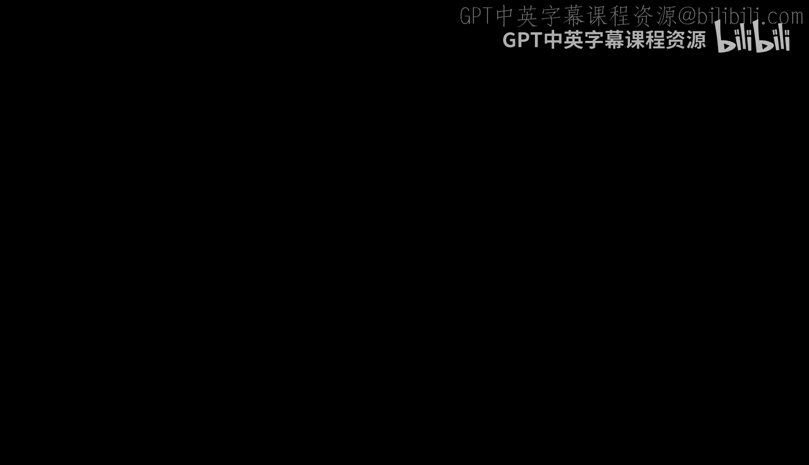
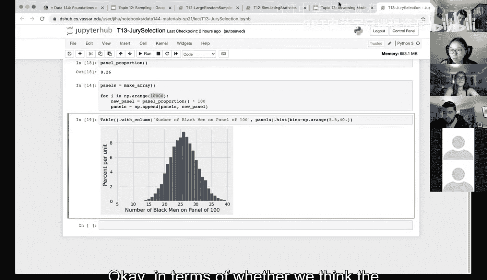
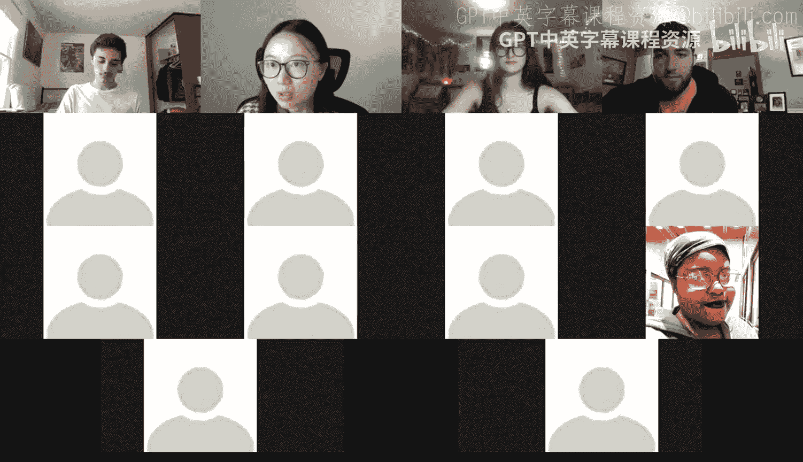
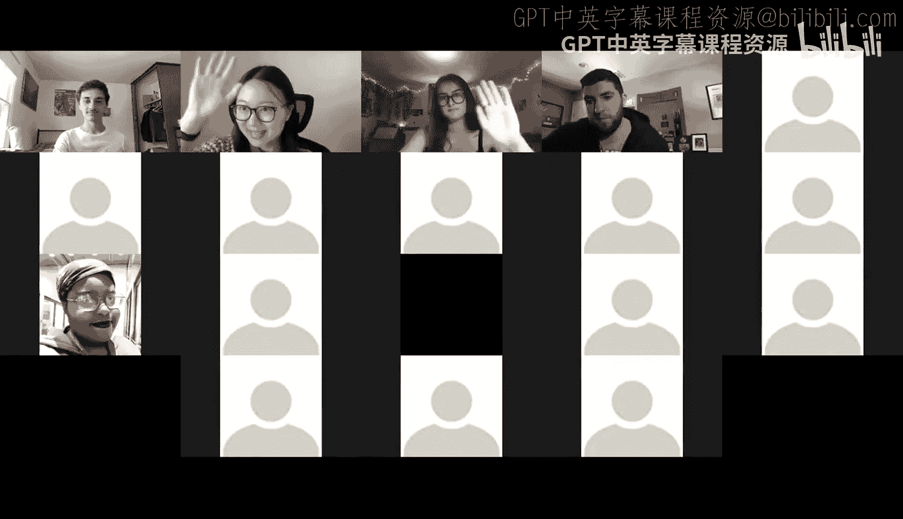
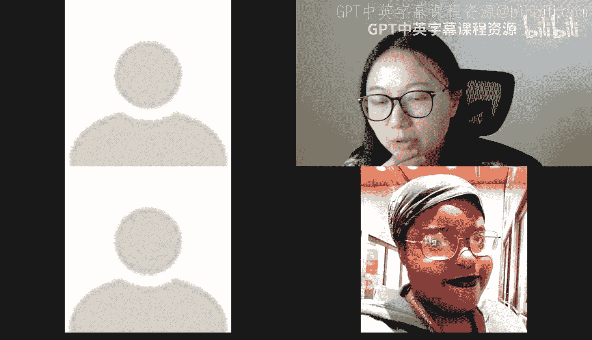
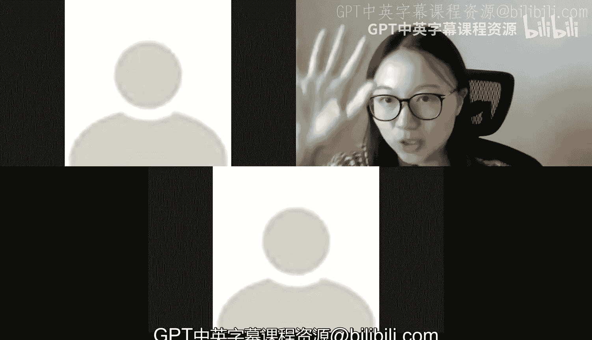

# UCB《数据挖掘和分析｜DATA 144 Data Mining and Analytics 2021》中英字幕 p46 [P46]lecture46-[T13 Assessing Models] Jury Selection-CfAxXQ33wMM.zh_en [BV1efBEBuEVg_p46]

Recor okay， all right， so after talking about sampling what we can do about different things。

 we are getting one step closer， I think， to to test hypothesis or making inference Okay。

 so inference that we talked about earlier。

Is that we're trying to use sample statistic right to make inference about the unknown but fixed parameter of the population okay and now we're moving to topic 13 we call it assessing models Okay so this might sound nothing like what we have seen before。

 but you will see that everything that。We mean by model okay it's really just a set of assumptions about the data okay and what were trying to cover in this topic is that how we can use different ways to assess whether a model which is assumptions about the data whether it's good or not okay in data science many models involves assumptions of a process that also involve randomness that's why we call them as chance models okay so just like the chance that we talked about earlier as well okay so。

We will see in this case that there could be many different models about how the data are like assumptions are made about the data。

 how they are generated， stuff like that or any kind of things that you might want to test about okay so for us we want to talk about some general approach through Python as you will see again of how to access sorry how to assess this kind of models in general okay so were also going to bring back what we have covered so far about the repeated sampling and all of the sampling distributions and different stuff that we have talked about so far okay so approach to assessment here okay so again。

The model， okay maybe some kind of assumptions we're going talk about a few examples soon， okay。

 the general approach that we're taking over here is that well。

 if we have a model like let's say somebody gives us a model， which is a set of assumptions， okay。

 if we are able to simulate data using Python in particular according to the assumptions that the model has made。

Then we can learn about what the model is going to predict。Okay。

 so this is saying that well you might have different models， maybe model a model B。

 if I'm able to generate data from different from this two different models and maybe I can check which one is better by checking the how similar or how resembling the simulated data from the two different models to the actual data that I'm seeing Okay so that's intuitively hopefully for you all that that's the intuitive way to think about what we can。

Assess a model， whether a model is good or not，So。The next step like we just talked about as well is that we're going to compare the predictions to the data that we observed okay if the data and the model's predictions are not consistent。

 then that could be some evidence against the model so again I'm using the model in a very vague way at this point okay so please bear with me we're going go over two examples in this topic that we're going to have a specific model set up okay and then we're going to see how we can generate or simulate data according to the model assumptions and then we actually also have the observed data so we can compare against the observed data to see which one or I should say to see if there is any evidence against the model because maybe the data the observed data and the model predictions are not consistent。

Okay， so。The first example is what we call jury selection okay this is actually a historical event okay。

 sing versus Alabama in 1965 okay so this is a particular county in Alabama where Robert Swayang an Africanam American man was convicted of crying okay he reappeaed okay because notice that later on they notice that in the jury。

 12 people， all of them are white okay， so they're saying that well there might be some bias going on。

So one way we can check， okay， is that here in that county， 26% of the population were black。Okay。

 and here of a 12 person jury。Oh sorry here okay it's 100 sorry sorry about that it's 100 back then in this case the jury panel actually considered of 100 men okay all of them are over 21 years old okay and the question now becomes okay so。

If if they say there is no bias going on， okay that's actually a model right。

 they say there is no bias going on， then what we will see is whether for a 26 percentage of the population were black for that kind of population breakdown。

How possible it is that you're going to actually have  a00 men on the jury， all of them are white。

Okay， so。This is even though it's just like if you look at those terms。

 it might not be easy to decipher which one was the model really going on okay， but just like I said。

Ashley， let me actually just。Oh， sorry， sorry about that。 Okay。

 eight men on the panel were black out of 100 sorry about that Okay， so okay。

 let me recap this really quick。 Okay， so for this particular。

Case okay eight men out of 100 men okay were black whereas in the population 26 of the population 26% of the population were black okay。

 so our question is that well the data the observed data is eight men out of 100 men or black okay but the model that we know if there is no real bias going on about the ju selection at all。

Then on average， 26%。Of the jury， right， should be black。Okay。

 because it should be representing what the population racial breakdown was okay。

 so this is like I said， the data that we observe is eight men on the panel were black out of 100 men。

The model， what the model is saying that if there is no bias， then 26% of the population in black。

 then you'll be on average， observed 26 out of 100 men to be black， right on this jury。

Okay so back then the Supreme Court ruling was actually against this appeal okay it denied denied the appeal okay。

 but now we are probably able to use what we have learned so far about the model and then about how we can generate large number of data sets to see if this is making sense okay so sampling from a distribution that we know okay so we have seen how to do sampling from a numerical distribution that has like uniform random sample before okay now we have to introduce something new what we call sample a random from a categorical distribution because if you look at the model here okay its 26% of the population were black okay so it is 26% versus one minus26% because that's the breakdown of the of the black and white racial breakdown and then we're going to use that to sample a jury selection every time。

Okay so it is a categorical distribution because you have two categories right it's not a numerical variable it's whether it's black or not black or white versus white black versus white over there。

 so we're going to use this particular command so I'm going to highlight this before we go to the break before we go to the demo。

We're going to use what we call sample underscore proportions。Okay。

 so this is a function that we are able to sample。From a particular population distribution。

 sorry from a particular sample size that we want。And then replicating the population distribution over here。

Okay， so you have two inputs， Okay， the sample size。Okay， that's how many you want to do， okay。

 and the pop underscore distribution is the breakdown that you know in the model。Okay。

 so just brainstorm really quick over here if I have a jury of 100 men that I'm gonna sample right so my sample size is gonna be 100 okay because I'm trying to replicate a jury selection and the population distribution over here I think will be 26% versus in this case  74% right because I have the model which is what we call a population distribution over here because in the population of that county 26% of the men。

26% are black， so the breakdown of 26 and one minus 26% which is 0。26 and 0。74。

 that will be the categorical like or like the list of probabilities I'm actually generating from the sample proportions。

So when I do that， okay， what that does is that I have a sample size of 100， okay。

 I'm sampling according to that 0 26 and 0。74 breakdown okay。

 and then it's still random so every time I might get， I don't know。

 like 25 versus 75 not exactly 26 versus 74 because that's what's in the population but every time I take a new sample I might have some variation going on。

Okay so this is how we're going to use the sample proportions in a second okay so just just to give you a heads up okay and the sample we're going to sample at random from the population okay so the population in our case once we do that we're going to return our array containing the distribution okay of the categories in the sample so like I said we're going to put in the sample size okay we are also going to do the population distribution according to the jury selection example is 26% versus1 minus 26% okay and then this is still a random sample draw so it's going give us the sampled proportions okay of the different categories。

诶。All right， so with all of this in mind。Let's jump into this demo。Okay。All right， okay。

 so the population proportions okay so we're using what we call the model right the model is saying that there's no bias in the selection so if that is the case and we're going back to the population proportions which is 26% which is 0。

26 and then 0。74 okay so they add up to one okay and these are the proportions that we're sampling on the sample from okay。

All right， now we are using the sample proportions method， okay sample underscore proportions。

 okay 100 like I said is the sample size so because the jury selection the jury size is 100 so we put 100 in here。

The population proportions， okay， this is what we defined earlier， 26% and then  one minus 26% okay。

 so let me show you if I run this line。I will get an array okay。

 I will get an array of the breakdown of the proportions Okay in this particular case I get 0 29 and 0。

71 Okay， so this is saying that I am sampling according to the population proportions of 0。26 and 0。

74 okay I am having a sample size of 100 okay， and then this is giving me the breakdown in my sample。

Of 29% and then 71% to show you that this is a random process if I do it one more time。Oh。

 I guess I get the same thing。🤧把钱。Sorry， for them。I do another time I get 26%，  76% 24%， 2 76%。

 okay so I could keep doing this for many other times。

 but this is just to show you that we are sampling at random from this categorical distribution。

 okay， where we have the breakdown of 26% and 74% which is the population model， okay？Make sense。

Makes sense。Yeah， so maybe let me just take a step back the reason why we're doing this is that remember we're saying that。

When were trying to approach assessment okay approach to assessment what we're doing is that we can simulate data right according to the assumptions of the model and then we can see how the predictions look okay so just what we did in the demo really quick over here right the model tells us it's 26% versus 74% right of the racial breakdown okay and then I can take simulate data out of it okay if I simulate once I can see like 20% versus 80% okay I simulate another time I get 28% versus 72% so like the first value you know is the percentage we know that it' percentage of the sampled being black。

Okay， so if we are able to collect all of this in each of the simulation and multiply that by 100。

 we know the number of blacks should be on the jury if the selection is purely a random according to the population breakdown of the race okay。

 so this is why we're doing here okay， we are using the sample underscore proportions method a function over here okay。

 and we're sampling it according to the breakdown in the population。And then as you will see soon。

 we're doing this for a large number of times， and then we're able to see how is the distribution of the number of black men should be on the jury if there's no racial bias going on。

Okay so maybe we can now go to that point and then we can revisit what we're trying to do Okay。

 all right， so the sample proportions method okay down here。

 this is we're wrapping it up right now into what we call panel underscore proportion okay and what we do is we define this as a function right and then we run this sample underscores proportions okay we run it but we're only taking the first item because we are mostly interested about the percentage of the black。

Okay， so that's why we do this sample and then dot item parenth is zero， okay。

 because we're getting the first item。Okay。All right， so this is how the function is rhythm。

 so if I round the function now every time you see that I'm returning the first percentage right and that's the percentage oops。

 that's the percentage of plaque that we're able to get。All right， so this is only taking one Okay。

 but like we're saying earlier， we want to simulate the data for a large number of times because every time we take a random sample。

 theres some random chance， right， we want to see over a one to capture that random chance across a large number of simulations So we're able to know how our observed data lies in that particular framework Okay so to do that。

 okay， what we're doing， So I'm gonna slow down here。

 we are doing a for loop for 10000 times okay each time what we're doing。

 we are running this panel underscore proportion， So that gives us the first percentage right out of the sample draw that we have So that's the percentage of black Okay we multiply that by 100。

Just to show how many black men right out of 100 number person jury and that's the every new draw that we get and then of course we do the MP append so we're able to have what we call a panels Okay so this after we run this let me set it to all we should have 10000 numbers of black men on on 100 person jury。

Out of 10，000 times。Okay， and the jury selection like we're saying here because we're sampling each like each time we're sampling the the proportion according to the population proportions right so every time we are stimulating the data according to the model that there's no racial bias。

Okay because we're sampling it according to the population breakdown， okay， now okay。

 we can do a histogram， but maybe even before I do that。

Do you think aid is something very likely to happen out of those 10，000 draws that I take？

So if I go back to the problem before okay right so eight men out of 100 were observed Okay that's the observed data okay the simulateulator we haven't seen in yet。

 but you probably have seen all of the different checks that I did over here right so far like 26% or 28% and then I get another 28 I get another 26 so if I multiply that by by 100 is like 26。

28 right like sometimes 30 sometimes so even just by doing this few number of simulations。

 we can see that eight is very， very unlikely right like it's we don't know like out of the 10000 we're gonna to see in a second but regardless and I guess all of us even by reading the question in the first place was're already a little bit suspicious right like 26% of the population were black how come you only have eight men right on 100 men jury okay so。

Like your intuition is probably good enough， but here what we're trying to show is that well to assess that model that if the model is saying that there's no racial bias going on in the jury selection。

 then we can always simulate data right according to the model。

 meaning that we're using the model to simulate data and then make predictions and what we can do so if we come back to the steps here。

 we can compare the predictions to the data that we are observed okay and we can compare them and then we can tell whether the data and the model's predictions are consistent or not if they're not consistent then there's probably evidence against the model right if they're consistent then we probably have evidence for the model so our intuition probably here is that well without even looking at that 10000 simulations that we have done。

This is already pretty extreme that like a 26% breakdown， 26% 74% breakdown。

 but you only have eight men on 100 man jury that might be very unlikely to happen okay。

 so let's see if that is the case。All right， so this is。10，000 repetitions， okay。

 we're using the bin from 5ish to 40， okay？And I will pause here for a sec so you can take a look at this histogram a little bit。

 okay I guess there are two main questions to be to be answered here and for you to think about one is that well the distribution does seem to be a little bit symmetric。

 right？So where is centered on that's my first question okay， the second M。

 what do you think why that is the case， the other one will be is eight something very likely to happen。

Okay so that's my questions for you all and let me pause recording Okay all right I guess yeah my two part question if you remember where does this distribution center at and that's part one and why the second part is is eight a likely value out of the simulated data that we're seeing over here so any thoughts。

Feel free to centered around like 25 or 26 and it is not an expected value。

 Yeah yeah very much on the side Yeah exactly okay and thank you I think that's and then thank you Lance and Sammanha in the chat as well Yeah so the center I think is around 26 and also probably not very surprising right because we know that 26% of the populations is black and then that's the population distribution that we're using right population I guess proportions over there that we're used to simulate so it's not surprising that it's going to center at that but then of course we have some variability going on right can in the 10000 simulations that we have done you can go as low as It know。

14 maybe and as high as 40 okay however8 as far away I guess from the lowest number which is 13 okay and that tells us something right like say we have done a large number of simulations。

Using the model and the model again is saying that there's no racial bias okay so we are simulating the data according to the ratio breakdown in the population and that's what the model is saying okay and we do that for a larger number of times we notice that a center around the 26% or 26 out of the if if the unit is the number of people and then eight is very unlikely to have in this case actually zero chance of happening because every possible values that we have seen so far is greater than eight okay so that can tell us。

Well， something is probably like that's actually so if I come back to the slide really quick over here。

 okay。Remember we're saying that if the data and the model's predictions are not consistent just like what we're seeing over here。

8 is the observed okay the model predictions is that histogram okay then there is evidence against the model okay and for our case this is pretty extreme because a doesn't appear any time any yeah no time that we have seen it out of 10000 simulations that we have seen this so that's probably telling us it's very unlikely and soonish were going to see that how we can actually compute and you probably have heard about the term before P value okay that's the probability of observing something as extreme as your data given that the model is correct。

Okay so remember what we're doing here is that we're simulating the data according to the model where there is no racial bias right and then we have simulated the data this is the histogram showing it and later you will see that we're able to compute what we call P value and in this case the P value is zero like there's no chance arere going observe something as extreme as eight okay if you think there's no racial bias and then that is what we call P value and that can be a decision making tool okay in terms of whether we think the model assessment is passing or not okay。

All right， I think we're running out of time， so feel free to log off。

 but I would just say that whenever you have questions definitely feel free to type in the chat privately or just to everybody and I can always slow down so。

I think that's probably the best way for everybody to keep on the same page whenever you have questions so we don't let it slip and then hopefully no more new questions accumulating along the way。

 okay。All right， thank you， Thank you take care。😊。

Are we going have some homework this week Yeah I think we we are trying to release the homework for what is due next week later on yeah like I think like by Thursday each yeah so we are not having nothing do this week just to do I guess everybody should catch up a little bit and then yeah so good question I don't think we have anything do this week Okay all right take care thank you gna。

